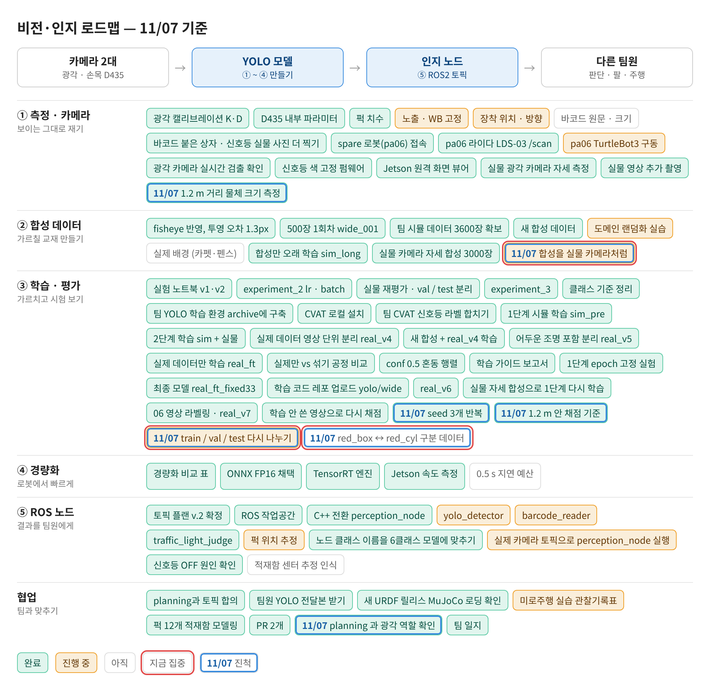
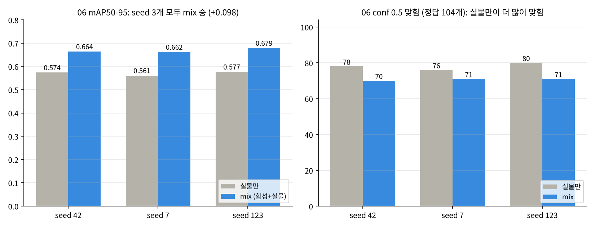
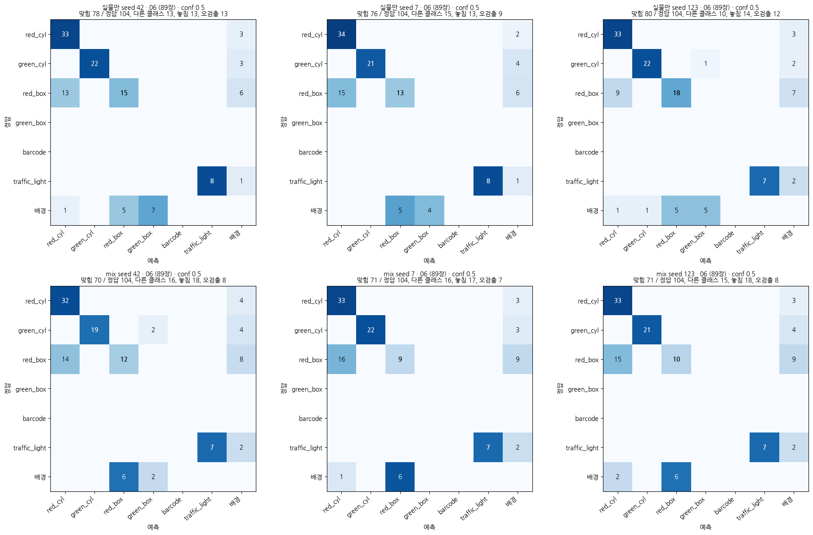
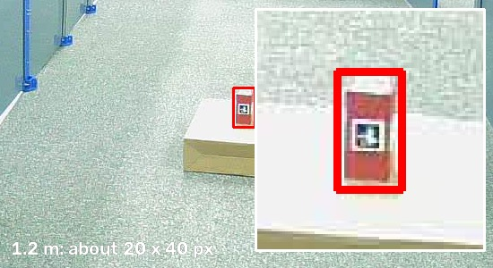
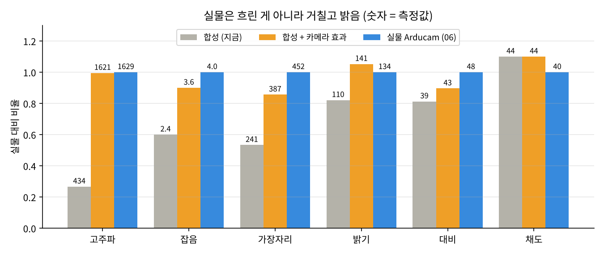
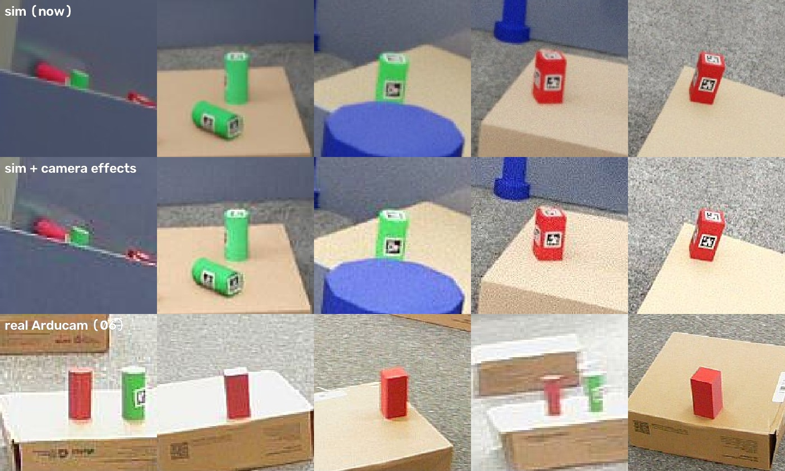
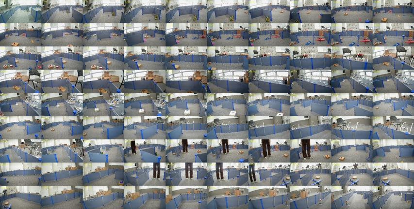

date: 2026.11.07

# Turtle Ninja 비전 작업 일지 (11/07)

> 작성: 김혜민 (비전 담당) · 2026-11-07 (토)

오늘은 **seed 반복 결과를 보고 배포 모델을 바꾸지 않기로 하고, 광각 카메라가 해야 할 일(1.2 m 안)과 train · val · test 를 다시 정한 날**이에요.

- seed 3개 모두 mix 가 06 mAP50-95 에서 이김 (**0.669 ± 0.009 vs 0.571 ± 0.008**). 하지만 로봇이 쓰는 conf 0.5 에서는 실물만이 더 많이 맞힘 (76~80 vs 70~71) → **배포 모델 유지**
- 차이는 거의 **red_box**: 34개 중 9~18개만 맞히고, 두 모델 모두 red_cyl 로 자주 헷갈림
- planning 확인: 광각은 참고만, RealSense 로 다시 보고 확정 → **광각은 1.2 m 안만 잘 맞히면 됨** (1.2 m 에서 퍽 짧은 변 약 20 px)
- 합성 사진이 실물보다 매끈하고 어두운 걸 숫자로 확인 → **합성에 카메라 효과**를 넣는 학습 준비
- val = 06, test = 11/06 새 영상 90장 (CVAT task #4 라벨링 중)

## 로드맵 진행

① 측정 · 카메라, ② 합성 데이터, ③ 학습 · 평가, 협업 칸이 움직였어요. 파란 테두리 = 오늘 진척, 빨간 테두리 = 다음 집중.

- ✅ seed 3개 반복 (06 mAP50-95 실물만 0.571 · mix 0.669, conf 0.5 맞힘은 실물만이 많음)
- ✅ 1.2 m 안 채점 기준 · planning 과 광각 역할 확인
- ✅ 1.2 m 거리 물체 크기 측정 (약 20 px → 기준 18 px)
- 🟡★ 합성을 실물 카메라처럼 (train_camfx · camfx_1107)
- 🟡★ train / val / test 다시 나누기 (test = 새 영상 90장)
- ⬜★ red_box ↔ red_cyl 구분 데이터

## seed 반복 결과: 점수는 mix, 로봇 기준은 실물만

어제 로그아웃으로 멈춘 mix seed 123 은 폴더 이름을 바꿔 두고 처음부터 다시 학습했어요 (이어서 학습하면 사진 효과가 빠질 수 있어서). 6개 모델을 06 영상 89장으로 채점했어요 (`experiments/seed_1106.ipynb`).

| 06 (89장) | seed 42 | seed 7 | seed 123 | 평균 ± 표준편차 |
|---|---|---|---|---|
| 실물만 mAP50-95 | 0.574 | 0.561 | 0.577 | 0.571 ± 0.008 |
| **mix mAP50-95** | 0.664 | 0.662 | 0.679 | **0.669 ± 0.009** |
| 실물만 conf 0.5 맞힘 / 놓침 / 오검출 | **78** / 13 / 13 | **76** / 13 / 9 | **80** / 14 / 12 | |
| mix conf 0.5 맞힘 / 놓침 / 오검출 | 70 / 18 / **8** | 71 / 17 / **7** | 71 / 18 / **8** | |

- mAP50-95: seed 3개 모두 mix 승 (+0.091 · +0.101 · +0.102), 차이(+0.098)가 흔들림(0.017)의 약 6배 → 미리 정한 기준 통과
- 그런데 06 **mAP50 은 비슷함** (실물만 0.864 · 0.863 · 0.910, mix 0.864 · 0.884 · 0.859) → mix 는 더 많이 찾는 게 아니라 **상자를 더 딱 맞게** 그림
- conf 0.5 에서는 mix 가 약 7개 덜 맞힘 → 로봇에서 쓰는 기준으로는 아직 바꿀 근거 부족

- **red_box** 가 문제: 34개 중 맞힘 실물만 15 · 13 · 18, mix 12 · 9 · 10. red_box → red_cyl 9~16개는 두 모델 다 비슷 → 학습 방법보다 **데이터** 문제
- 실물만은 06 에 없는 green_box 를 배경에서 4~7개 오검출, mix 는 0~2개
- val 곡선은 6개 모두 epoch 1 부터 0.80 근처, best epoch 13~27 → val 로는 구분이 안 됨

## 광각은 1.2 m 안만: planning 확인

플래너에게 물어보니 광각 카메라는 **참고**로만 쓰고, 퍽 종류는 손목 RealSense 로 다시 보고 확정한대요. 실제로 사람이 봐도 멀리 있는 퍽은 상자인지 원기둥인지 구분이 어려워서, 광각은 가까운 것만 확실히 맞히면 돼요.

- 1.2 m 에 퍽을 두고 광각으로 한 장 찍어 잼 → 퍽이 약 **20 × 40 px** (짧은 변 20 px)
- 렌즈 가장자리에서는 조금 작아지므로 **기준 18 px** (짧은 변 18 px 이상 = 1.2 m 안). 1.0 m 는 계산으로 약 22~24 px
- 06 에서 1.2 m 안 물체는 104개 중 69개 (나머지 약 1/3 은 더 멀리)
- 채점: 먼 정답은 빼고, 그 위에 나온 예측도 셈에서 뺌. 학습에서 먼 라벨만 지우면 "빨간 물체 = 배경"으로 배우므로, 지금은 라벨은 그대로 두고 채점만 바꿈
- 이 실물 퍽 앞면에도 AprilTag 가 붙어 있음 (06 의 일부 퍽은 다른 면이 카메라를 봐서 안 보였던 것)

## 합성 사진을 실물 Arducam 처럼

"합성의 깨끗한 가장자리를 실물처럼 흐리게 하면 어떨까?"에서 시작해 실물 06 프레임 25장과 합성 사진을 숫자로 비교했어요. 결과는 반대였어요: 실물은 **흐린 게 아니라 거칠고 밝음** (센서 잡음 · 카메라 선명화 · 강한 JPEG 압축).

| | 합성 (지금) | 합성 + 카메라 효과 | 실물 Arducam |
|---|---|---|---|
| 고주파 (Laplacian 분산) | 434 | 1621 | 1629 |
| 잡음 | 2.4 | 3.6 | 4.0 |
| 밝기 | 110 | 141 | 134 |
| 대비 | 39 | 약 43 | 48 |
| 채도 | 44 | 약 44 | 40 |

- `scripts/train_camfx.py` (새로 만듦): train.py 는 그대로 두고 사진 효과 5개만 더함 — 밝기 · 대비 올림, 채도 약간 내림, 선명화, 센서 잡음, JPEG 압축(맨 마지막). 흐림은 0.3 → 0.15 로 줄임
- `experiments/camfx_1107.ipynb`: 1단계(합성만 33 epoch)에만 효과를 넣고 나머지는 기존과 같게 → 2단계 mix → 06 채점 (전체 mAP + 1.2 m 안 conf 0.5)
- 실물 red_box 를 앞에서 보면 그냥 빨간 직사각형이라 옆에서 본 red_cyl 과 비슷 → red_box ↔ red_cyl 헷갈림과 맞아떨어짐

## train · val · test 다시 나누기

06 은 seed 비교에서 이미 한 번 고르는 데 썼으니, 06 을 val 로 돌리고 아직 아무 데도 안 쓴 새 영상을 마지막 test 로 정했어요.

| | 데이터 | 역할 |
|---|---|---|
| train | real_v6 train 685장 + 합성 | 학습 |
| **val** | **06 영상 89장** (라벨 끝) | 모든 결정 (카메라 효과 · mix · 문턱값) |
| **test** | **11/06 새 영상 90장** (라벨링 중) | 모델을 정한 뒤 딱 한 번 |

- 새 영상 242장 → 비슷한 장면 빼고 **90장** → CVAT task #4 `wide_puck_new_20261106_sel (final test)`
- 초벌 라벨: GPU 는 학습 중이라 CPU 로 실행 (`CUDA_VISIBLE_DEVICES=`) → 상자 117개 (red_cyl 38 · green_box 36 · red_box 27 · green_cyl 6 · barcode 6 · traffic_light 4). 06 에 없던 green_box · barcode 가 있어서 마지막 시험으로 좋음

## 다른 작업

- 로그아웃하면 학습도 멈춤 → 긴 학습 중에는 화면 잠금(Super+L), 전원 연결 중 자동 절전 끄기, 다음부터는 tmux 로 학습
- Wake-on-LAN: 노트북 Wi-Fi 에서는 거의 안 되고 유선 · 같은 네트워크가 필요 → 나중에 다시 보기
- 질문 정리: Precision-Confidence 곡선 오른쪽이 들쭉날쭉한 건 높은 문턱값에서 남은 예측이 몇 개 안 돼서 (발산 아님), 1단계 = 합성으로 6클래스를 먼저 배우는 단계, 합성을 오래 학습하면 실물 점수가 떨어짐(10/29 sim_long)

## 다음 할 일

- [ ] camfx_1107 실행 → 1단계 · 2단계 기존 vs 효과 비교 (06, 1.2 m 안)
- [ ] 새 영상 90장 라벨 고치기 → `wide_puck_new_test.zip` (test 는 마지막에 한 번)
- [ ] red_box 놓친 06 사진 직접 보기, red_box 를 멀리 · 옆 · 가림으로 더 찍기
- [ ] 1.0 m · 화면 가장자리 크기 확인
- [ ] 적재함 센터 추정 인식 · 광각 영상 문제 (11/03 에서 이어짐)
