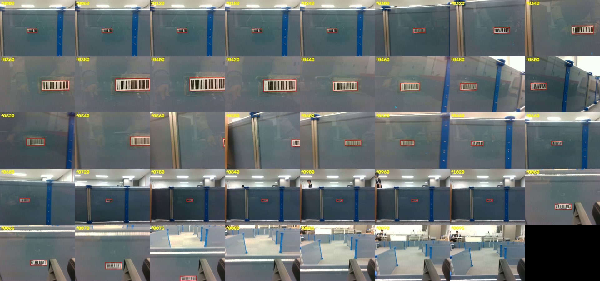
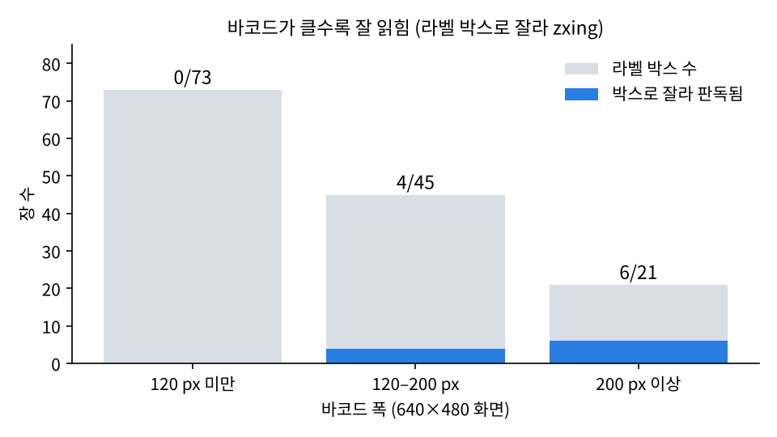

date: 2026.11.14

# Turtle Ninja 비전 작업 일지 (11/14)

> 작성: 김혜민 · 2026-11-14 (토)

오늘은 **손목 바코드 라벨링을 끝내고, 손목 전용 바코드 모델을 따로 만들기로 정한 날**이에요.

- CVAT 손목 바코드 라벨링 2개 task 완료 · 내보내기 (143장, 박스 139개)
- 라벨 박스로 잘라 판독해 보니 **바코드가 클수록 잘 읽힘** (200 px 이상 6/21, 120 px 미만 0/73)
- Jetson 손목 모델은 jje 계정이 만든 **시뮬 전용 퍽 분할 모델 (바코드 클래스 없음)** 으로 확인
- 손목 전용 1클래스 바코드 모델 학습 노트북 `wrist_barcode_1114.ipynb` 준비 (광각 배포 모델에서 출발)

## 라벨링 결과

| 파일 | task | 사진 | 박스 | 바코드 폭 |
|---|---|---|---|---|
| `20261113-2.zip` | #5 pa06 RealSense | 123 | 123 | 14–301 px |
| `20261113-1.zip` | #6 로봇 손목 (`rec_1113_1219`) | 20 | 16 (4장은 바코드 없음) | 139–148 px |

- 박스가 흰 스티커 테두리에 딱 맞고, 화면 가장자리에 반쯤 잘린 바코드도 잡음
- 4cam task (#7) 는 쓰지 않기로 함

## 라벨 박스로 잘라 판독

- 화면 전체로는 143장 중 1장만 읽힘 → 박스로 자르면 10장
- 120 px 미만은 하나도 안 읽힘 → **가까이 찍기 + 박스로 자르기** 둘 다 필요
- pa06 사진은 mp4 에서 뽑아 화질이 낮고 흔들린 장면도 있어서 판독률은 낮게 나온 편 (원본 녹화로 다시 재야 정확)

## 손목 모델을 따로 만드는 이유

광각 배포 모델(`real_ft_fixed33_1030`, 6클래스)에 그대로 이어 학습하면

| 문제 | 내용 |
|---|---|
| 카메라가 다름 | 광각 (Arducam, 멀리 넓게) ↔ 손목 RealSense (가까이, 640×480). 손목에 맞추면 광각 성능이 떨어질 수 있음 |
| 퍽을 잊어버림 | 이번 사진엔 바코드 라벨만 있음 → 퍽 클래스가 약해짐 |

→ **바코드 1클래스 손목 모델을 따로** 만들고, 시작 가중치만 배포 모델에서 가져옴 (바코드 모양은 이미 앎). READ_BARCODE 단계에서만 손목 화면에 돌리고, 퍽 집기는 지금 손목 모델이 그대로 함

## Jetson 손목 모델 확인 (팀 레포 GitHub 커밋 기록)

- 만든 사람: `jje` 계정 (10/30 "add wrist YOLO seg pipeline", 11/06 수정)
- 모델: YOLO26n-seg (분할) 8클래스 = 색 (빨 · 초) × 모양 (원기둥 · 직육면체) × 선 / 누움
- 데이터: **시뮬레이션만** (Isaac Lab 손목 시점 170장면 × 2시점), 실물 사진 없음. 시뮬 평가 퍽 확정 99%
- **바코드 클래스 없음** → 손목 바코드는 지금까지 화면 전체 zxing 에만 의존
- Jetson `~/models/best_fp16.engine` 이 이 모델인지는 Jetson 에서 확인 필요 (레포 손목 파이프라인은 분할 모델을 받게 되어 있음)

## 학습 노트북 `experiments/wrist_barcode_1114.ipynb`

| 셀 | 하는 일 |
|---|---|
| 0–1 | zip 2개 → `datasets/wrist_barcode_v1` (train = pa06 123장, val = 로봇 손목 20장, 영상 단위) + `configs/data_wrist_barcode_v1.yaml` |
| 2 | 학습: 배포 모델에서 시작, 1클래스, imgsz 640, mix 단계 설정 (lr0 0.0005 · 최대 60 epoch) → `runs/wide/wrist_barcode_1114` |
| 3 | val 점수 + conf 0.5 맞힘 · 놓침 · 오검출, 광각 배포 모델과 비교 |
| 4 | 예측 박스로 잘라 판독 vs 화면 전체 판독 |
| 5 | val 사진에 정답 · 예측 박스 |
| 6 | (선택) Jetson 용 ONNX |

- 노트북이 끝까지 도는지 CPU 로 3 epoch 만 돌려 봄 (참고용): val 바코드 16개 모두 찾음 (배포 모델은 11개), 오검출 4개, 박스로 잘라 판독 2장 (화면 전체 0장)
- GPU 로 실제 학습은 아직

## 다음 할 일

- [ ] `wrist_barcode_1114.ipynb` GPU 학습 · 결과 확인 (오검출 줄이기)
- [ ] 원본 손목 녹화(mcap)로 "박스 → 잘라서 판독" 판독률 다시 재기
- [ ] BarcodeStage 를 "손목 바코드 모델 박스 → 잘라서 판독" 으로, Jetson 은 ONNX → TensorRT
- [ ] Jetson 손목 엔진(`best_fp16.engine`) 이 jje seg8 모델인지 확인
- [ ] LOOK_BARCODE 자세 더 가까이 (바코드 폭 200 px 이상)
