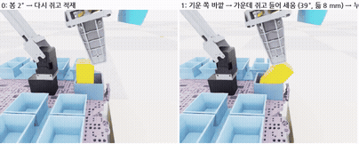

Date: 2026 Nov 15, Sunday

## 오늘 배운 것
- 기운 퍽은 눌러서 · 쳐서 세우면 넘어진다. 긴 변과 나란히 가운데 쥐고, 살짝 들어서 공중에서 세우고, 곧게 내리는 게 젠틀하고 잘 된다
- 쥔 채 바로 돌리면 바닥을 긁어 토크에 무리가 간다 → 먼저 든다
- 시뮬 바퀴의 "속도 0" 은 자리를 붙잡는 게 아니다. 팔이 미는 힘에 조금씩 구른다
- 몸체가 밀리는 시뮬에서는 결과 판정을 바닥이 아니라 몸체 기준으로 해야 한다
- 칸 안 폭이 좁으면 걸린 퍽을 칸 안에서 고치기 어렵다 → 덜 걸리게 천천히 넣고, 걸리면 빼서 다시 한다
- 지나가며 비용맵에 찍힌 점이 벽에 가려 안 지워지면 경로가 영영 안 나온다 → 지우고 다시 계획

 

## 오늘 한 것 

- [매니퓰레이터 작업 일지 (11/15)](manipulator_log.md)
- [Jetson · 미션 점검 일지 (11/15)](jetson_log.md)
- 받침에 기운 퍽 세우기 방법 6가지 시험 → 들어서 공중에서 세우기
- 시뮬 RAM 폭발 · 적재 판정 · 마찰 · 바퀴 고정 · 홈 돌아오기 가속 고침
- 칸에 걸린 퍽 시험 (17°, 벽 끝 걸침 22°) → 빼서 다시 넣기
- S1–S12 넣기 시험
- Jetson: 팀 내비게이션 수정 확인, 저녁 실행 6번에서 바코드 먼저 순서 확인
- n1b 버리기로 해서 `feat/rl-nudge` 지움, 밝기 브랜치는 `main` 기준으로 다시 올리기로

 

## 문제점
- 팀 누르기 · 툭 치기 · 쓸어 올리기로는 기운 퍽이 안 서거나 넘어짐
- 시뮬이 RAM 을 다 먹음
- 몸체가 5–9 mm 밀려 잘 들어간 퍽도 실패로 판정
- 칸 안에서 걸린 퍽 고치기: 팔이 크게 휘두르고, 벽 끝에 걸친 퍽은 2대 모두 실패
- 받침 세우기에서 43–45° 퍽이 넘어짐 (22번 중 4번)
- 실물: 바코드를 60 s 동안 못 찾은 판 1번, RETRIEVE S1 계속 거절

 

## 해결 방법

- 긴 변과 나란히 가운데 쥐고 축 따라 8 mm 들고 공중에서 세우기 (J4 +20°)
- `pathgen.dense_all` 0 으로 나누기 고침, 판정을 몸체 기준으로, 마찰 팀 값 0.9 / 0.8, 바퀴 stiffness 50
- 각도 변환 버그 (손목 62° → −298°) 고쳐 휘두름 없앰
- 넣기 마지막 8 mm 초당 15°, 걸리면 빼서 받침 → 세우기 → 다시 넣기

 

## 결과

- 들어서 세우기 6/6 (35–43° → 0–2°)
- 바퀴 구름 1.8 → 0.1 mm, 몸체 밀림은 약 5 mm 남음
- 걸림 빼서 다시 넣기 4/4, 진짜 걸림 S3 20° 도 성공
- 12칸 모두 한 번 이상 들어감
- 실물 18:54 판: 바코드 11.2 s → 신호 12점멸 (`GGRRRYYYGYGR`), 퍽 3 / 12

 

## 느낀 점

- 드디어 내일이 경기다.. 과연 우린 이길까.. 아무리 봐도 우리가 1등 각이라지만, 매일 새롭게 놀래키는 저 닌자로봇놈은 우릴 불안하게 한다. 언제는 시작부터 고장이고, 언제는 중간에 미션을 하다가도 집으로 복귀한다. 제발.. 완주가 아직까지 한번도 안나왔다는게 좌절스러울 정도다. 제발.. 완주 한번이라도 가자..

 

## 할 일

- 받침 세우기 43° 넘는 퍽 강화학습
- 걸린 퍽 빼기를 퍽 축 따라
- 실물 J4 +20° 확인
- 팀장님 확인 뒤 `main` 에 밝기 수정 다시 커밋
- 바코드 못 찾는 경우 · RETRIEVE 거절 원인 확인
