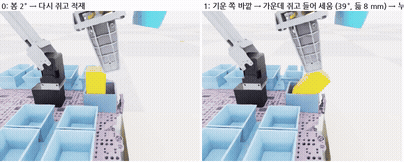
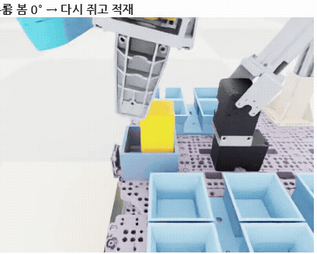
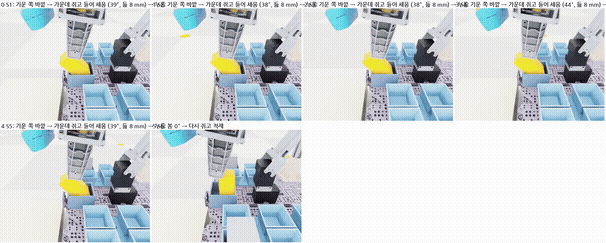

date: 2026.11.15

# Turtle Ninja 매니퓰레이터 작업 일지 (11/15)

> 작성: 김혜민 · 2026-11-15 (일)

오늘은 **받침에 기운 퍽을 "들어서 공중에서 세우는" 방법을 찾고, 12칸 넣기까지 시뮬에서 이어 본 날**이에요.

- 기운 퍽 세우기: 팀 누르기 · 툭 치기 · 쓸어 올리기 다 실패 → **긴 변과 나란히 가운데 쥐고 들어서 공중에서 세우기 6/6**
- 시뮬이 RAM 을 다 먹던 원인 = 경로 만들 때 0 으로 나눠 경유점이 수백만 개 → 고침
- 적재 판정을 바닥 기준 → **몸체 기준**으로, 바닥 · 바퀴 마찰을 팀 값 (0.9 / 0.8) 으로
- 칸에 걸린 퍽은 칸 안에서 고치지 않고 **빼서 받침에 놓고 다시** → 4/4, 진짜 걸림(S3 20°)도 성공
- **12칸 모두 한 번 이상 제대로 들어감**. 남은 문제는 받침 세우기에서 43–45° 퍽이 넘어지는 것 (22번 중 4번)

코드: `archive/manipulator/training2/` (`pathgen.py`, `env.py`, `cfg.py`, `store2.py`) · 기록: `training2/logs/20261115_*`

 

## 1. 기운 퍽 세우기 방법 찾기

받침에 넣으면 35–43° 기우는 먼 가운데 퍽을 세우는 방법을 차례로 시험했어요.

| 방법 | 결과 |
|---|---|
| 팀 누르기 (−28 mm) | 빗나감. 시뮬에서는 퍽이 실물보다 더 안쪽에 앉음 |
| 튀어나온 위쪽 툭 치기 | 퍽이 넘어짐 |
| 사선 손으로 쓸어 올리기 | IK 가 기울기 15° 까지만 나옴 |
| 수직 손으로 옆면 쥐기 | 2/2 섰지만, 긴 변과 나란히 쥐기로 바꾸기로 함 |
| 쥐고 그대로 돌리기 | 바닥을 긁으며 돌아 토크 무리 |
| **긴 변과 나란히 가운데 쥐고, 축 따라 8 mm 들고, 공중에서 세워 곧게 내림** | **6/6, 35–43° → 0–2°** |

- 손은 퍽이 기운 방향이 아니라 J1 에서 본 팔 평면 안에서 기울어요 (5축이라 1–3° 차이).
- J4 위 한계를 +20° 넓혀야 해요 (`J4_HI=1.2`). 실물 J4 가 그만큼 꺾이는지는 아직 확인 못 했어요.

 

## 2. 시뮬 고친 것

- **RAM 폭발**: `pathgen.dense_all` 에서 양 끝 속도가 0 인 아주 짧은 이동이 1e-9 로 나눠져 경유점이 수백만 개 생겼어요.
- **적재 판정**: 몸체가 5–9 mm 밀려서 바닥 기준으로는 잘 들어간 퍽도 놓쳤어요 → 몸체 기준으로 비교 (`env.py`).
- **마찰**: 바닥 · 바퀴가 기본값 0.5 였음 → 팀 값 0.9 / 0.8 (`cfg.py`).
- **바퀴 고정**: 시뮬 바퀴는 "속도 0" 만 유지해서 팔이 미는 힘에 1.8 mm 굴렀어요 → 자리 붙잡기 (stiffness 50) 로 0.1 mm.
- **홈으로 돌아오기**: 가속 3.7 → 1.5, 최고 100°/s. 1.0 까지 낮춰도 밀림은 그대로라 1.5 로.
- 그래도 몸체가 약 5 mm 밀려요. 바퀴가 통째로 미끄러지는데 마찰을 올려도 그대로라 원인은 못 찾았어요. 실물은 안 밀려요.

 

## 3. 칸에 걸린 퍽

- 처음엔 17° 로 일부러 걸어 두고 칸 안에서 쥐어 다시 넣기 → 시험이 너무 쉬웠고, 팔이 크게 휘두름.
  - 휘두름 원인: 시험용으로 J4 범위를 넓히면서 손목 62° 가 −298° 로 바뀌는 각도 변환 버그.
- 실제처럼 퍽 바닥 모서리를 칸 벽 끝에 걸치니 22° 가 34–40° 로 더 기울고, 칸 안에서 고치기는 2대 모두 실패.
- 칸 안쪽 폭이 32 mm 라 손이 들어갈 틈이 거의 없음 → **칸 안에서 고치지 않기로**.
  1. 넣기 마지막 8 mm 는 초당 15° 로 천천히
  2. 넣고 한 번 보기 (기울기 5°, 3 mm 넘으면 걸림)
  3. 걸리면 위를 수직 손으로 좁게 쥐고 곧게 빼서 받침에 놓고 → 세우기 → 다시 쥐기 → 넣기
- 첫 확인을 일부러 걸림으로 친 시험: **4/4 다시 들어감** (0–3.7°).

 

## 4. 12칸 넣기

앞 칸이 다 찬 상태 (실제 적재 순서) 로 S1–S12 를 돌렸어요.

| 칸 | 결과 |
|---|---|
| S1 S2 S5 S6 S7 S8 S9 S10 S12 | 한 번에 들어감 (0–3.7°) |
| S3 | 진짜로 20° 걸림 → 빼서 다시 → 들어감 |
| S4, S11 | 1회차는 받침 세우기에서 넘어짐, 다른 시드로 들어감 |

- 넣기 자체는 지금 방식으로 충분해서 넣기에는 강화학습이 필요 없어 보여요.
- 남은 문제
  - 받침 세우기에서 넘어짐 22번 중 4번 (18%). 모두 43–45° 로 크게 기운 퍽
  - 걸린 퍽 빼기 2번 중 1번 성공. 28° 는 기운 채 쥐어서 받침에 몸 쪽으로 55° 기움

 

## 다음 할 일

- [ ] 받침 세우기 43° 넘는 퍽 → 강화학습
- [ ] 걸린 퍽 빼기를 퍽 축 따라 하도록
- [ ] 실물 J4 가 +20° 까지 꺾이는지 확인
- [ ] 시뮬 몸체 5 mm 밀림 원인
