# slam과 nav2 자율주행 1

- 추가 일시: 2026년 10월 13일
- 강의: LV2

자율주행

픽앤 플레이스

자율주행을 위한 기능 - slam

기존 slam tool box, 카토그래퍼 gpu 개념이 없음. cpu에서만 사용 가능

isaac qv slam - gpu 에서 사용 가능, 속도 빠름

- lidar를 사용하지 않고 카메라를 사용

## 실습

- 미로

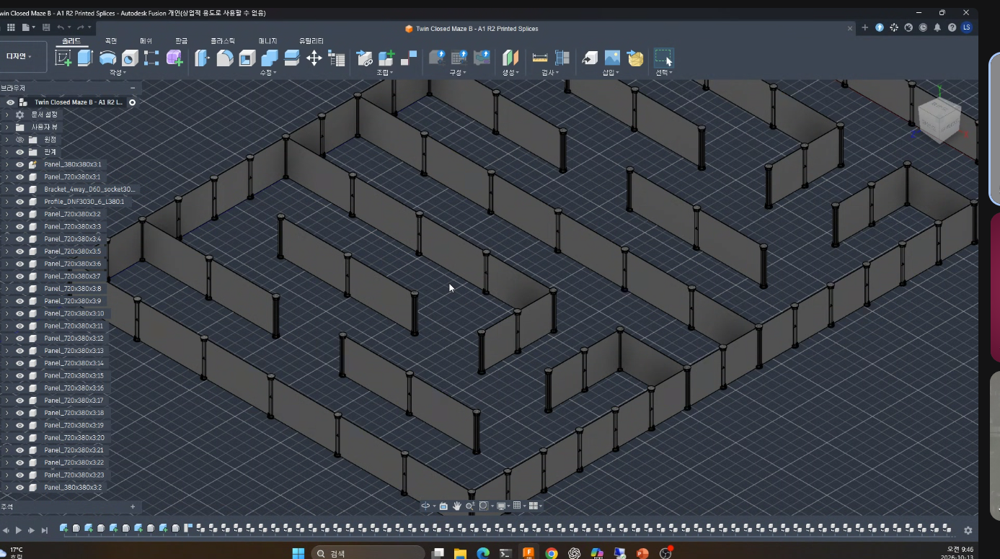

- 시뮬레이션 파일 만들기
  - 학습시킬 파일
  - URDF
  - 제한적인, 극한의 환경: SDF
    - 물리적인 환경
      - 바람
      - 조명
      - 중력
      - 바퀴 마찰
      - 수질 환경
  - 아이작심
    - 재난 환경
      - 물리모델 사용 가능
      - 현업에서는 잘 안다룸
  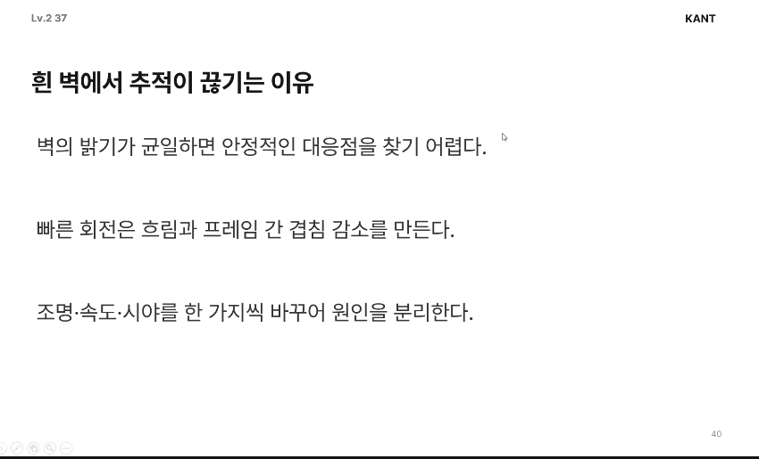

## 시뮬레이션

- 설계
- stl파일을 불러와서 urdf 파일 생성

## 카토그래퍼

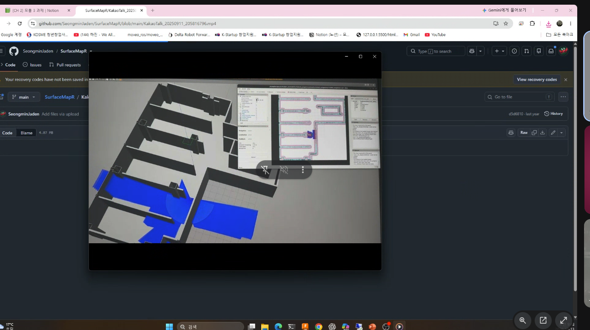

- cad에서 설계 후 불러온 것

## 설정

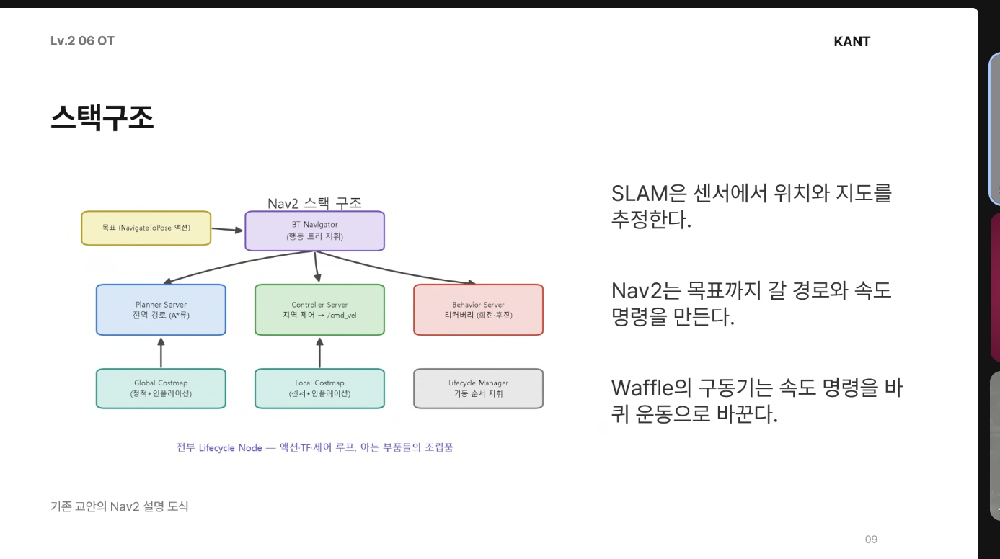

## cuVSLAM

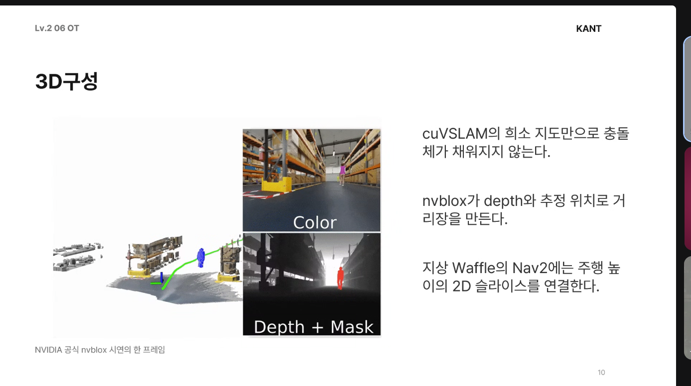

## 맵 구성

- 컬러, 뎁스
- 장점: 사람을 인지
- 단점: SLAM을 할 때에는 앞에 있으면 안됨.
  - 사람을 장애물로 인지
- 3D → 2D to reduce computer process

## 카토그래퍼

- 아직 lyrical 버전이 없음
- 방법 고려중: 도터로 할지

## 사전 검사

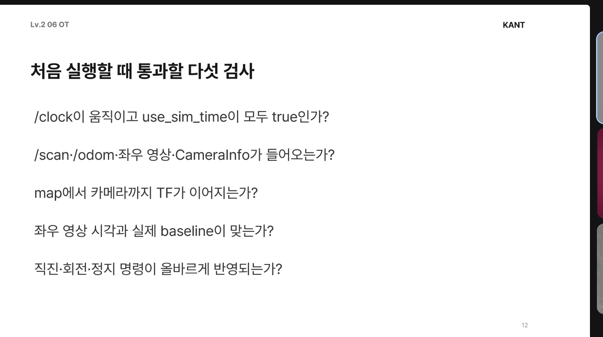

- ros time
  - 시뮬레이션 시간
  - 현재 시간
  - 노드와 센서값이 일치해야 한다.
    - 시뮬레이션 vs 현재 시간 둘중에 하나를 선택해서 둘다 일치해야 한다
- 토픽들이 잘 발행이 되는가
  - q가 안쌓이고 잘 들어 오는가
  - 정해놓은 주기에 잘 들어오는가
- 위의 문제들 외에는 코드가 잘못됐거나 한다

## TF 구조

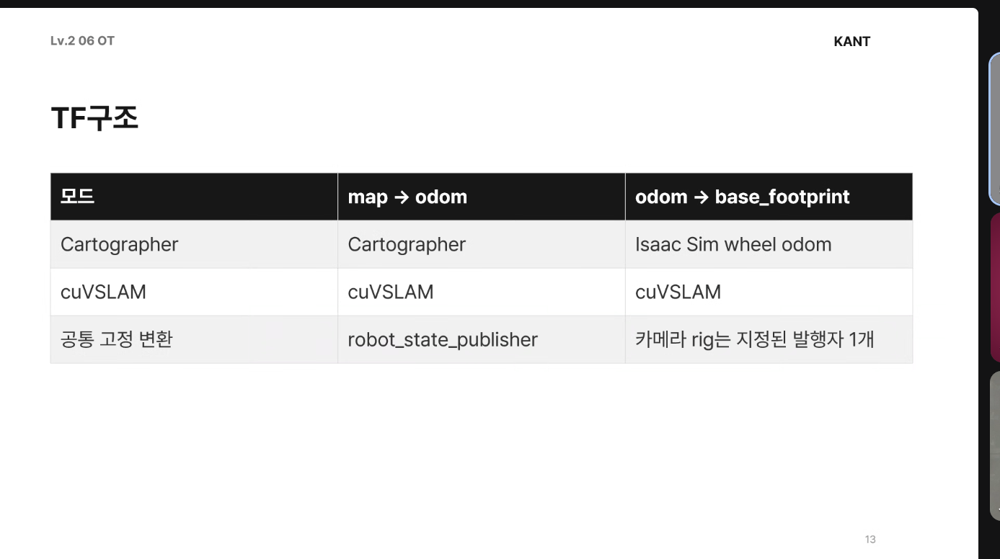

## 로봇 디스크립션

- 앤코더 센서, 로봇팔 관절 모름
- 3d 파일로 불러온 것 밖에
- 센서 작동 방식을을 적용: state publisher
  - 로봇의 명령을 사용하는데 쓰임

## Trouble shooting

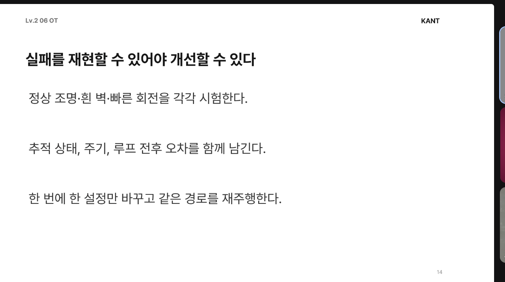

## 자율주행을 위해 필요한 것

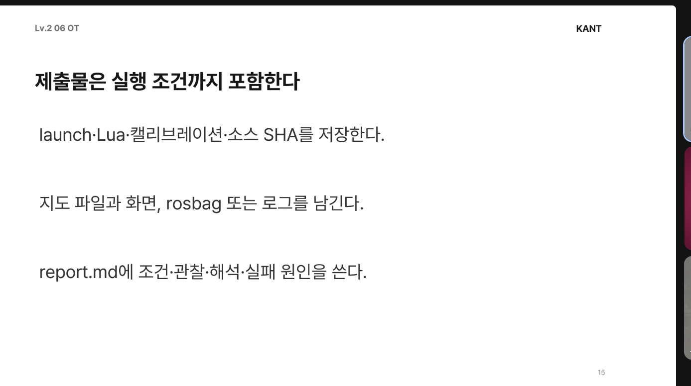

## 앞으로의 과제

## slam

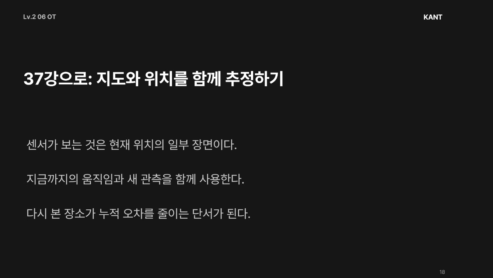

isaac sim의 pyTorch와 …

27분?

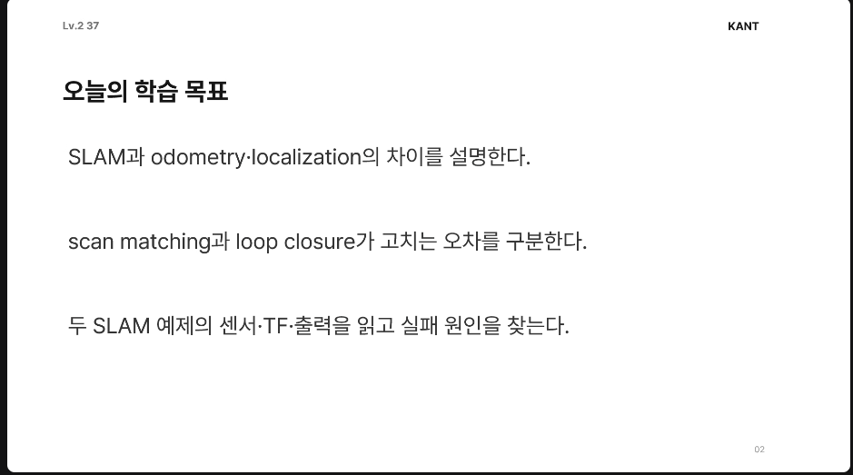

## slam

- localization and mapping을 동시에
- 맵상에서 어디로 갈거고 어디있고 명령을 하려면 맵이 있어야 함
- 정해져 이쓴 길이 아님
- 로봇이 보는 맵, 실제 맵 다름
  - 센서의 오차
  - 드리프트
  - 움직이지 않는 현상으로 인한
- 그래서 localization으로 오차를 파악
  - 위치 추정을 하는 것
- 매핑
  - 라이다
    - 단점: 데이터 무거움
      - 360도에서 거리 정보를 전달
  - imu
    - 단점 : 지자게
    - 자기장이 발생하는 물건 주변에 있으면 오차
  - 엔코더 센서
    - 단점
      - 바퀴의 마찰력 미끄러짐을 측정 불가
      - 회전수만 암
  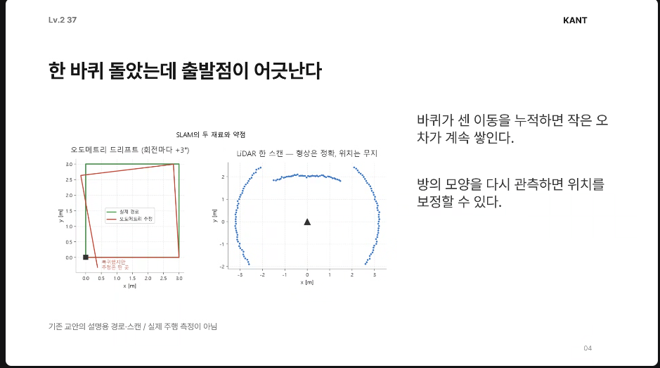

왼쪽 그래프: 초록색 vs 빨간색 차이

- 초록색은 이상적
  - 단순한 cmd-vel
- 빨간색은 현실
  - 물리적
  - 새로 만들어져야
  - 새로 추정한 위치: 오도메트리
- 이래서 오도메트리 odom 이 필요하다
- 앞으로가고 뒤로 가고는 거의 일치
  - 각진 곳에서 오차가 발생
  - 각속도 측정
    - imu
      - 각도만 측정
    - 엔코더
      - 회전량, 속도
    - 소수점 8자리여도 오차가 발생
      - 이것도 큰 오차
      - 회전 즉시의 근처에서는 큰 차이는 안나지만 같은 선상에서 멀리 갈수록 오차로 인한 오차 거리가 드러난다
      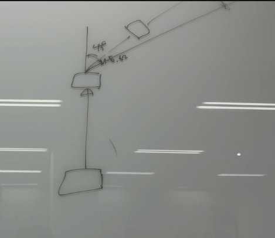

  - 라이더 센서
    - 장애물이 어디 있는지 알려줌
    - 오도메트리: 장애물이 비슷한 위치에 있음을 추정 가능
    - scan matching’
    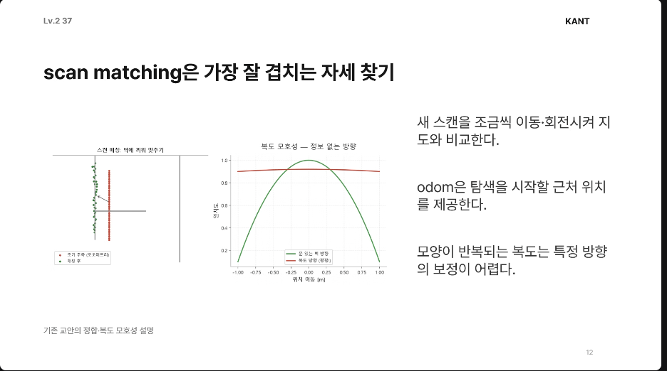

    - imu로 각도는 읽히는데 바퀴가 헛돌때 라이다 센서로 그 오차를 메꾼다
    - 실제와 오도메트리가 달랐을때
    - 라이다 센서의 위치가 겹치는 부분을 계속 보정을 함
    - 주기가 빨라야 좋음
    - ekf 필터링
      - 센서의 노이즈를 필터링
      - 그다음에 융합
      - 응징하고자 하는 물건이 물리적으로 어떻게 움직이는지 값이 있음
      - 장비별 다름: 비행기 자동차 등
      - 최소 3가지 variable이 있어야 한다
        - 속도, 각도, 시간, 거리 이중에서..
        - 예)
          - 1 step
            - 10 m/s
          - 2 step
            - 10000 m/s 불가
            - 필터링 - 삭제
          - 10 step이라면 말이 돼도..
      - 로봇이 라이다 주기보다 빠르면 안됨.
        - 값을 신뢰할 수가 없음
        - 지연 주기를 잘 맞춰야 함
        - 30~60hz 정도면 좋음.
        - 이거보다 빠른건 비추
        - 60hz동안 6m를 가면 안되고
        - 1분안에 6m를 가면 안된다는 것
        - 1초에 600mm를 가면 안됨

scan matching을 여러번 하는 것

라이다 센서가 잘 안먹히는 예외:

- 패턴이 동일한 환경에서는 라이다가 위치 추정이 어렵다.
- 같은 선상을 스캔을 유지하면 어느 길이가 어느 위치인지 알기 어렵다.

순서

- cmd_vel 명령: (10초 동안 3바퀴를 돌아라) 시켜도 실제로 그렇게 움직일거라는 생각을 하지 말 것
  - 여러번 얻어낸 데이타여야 신회 가능
  - 100개로는 부족 적어도 1만개 이상은 되어야 신뢰 가능

## slam

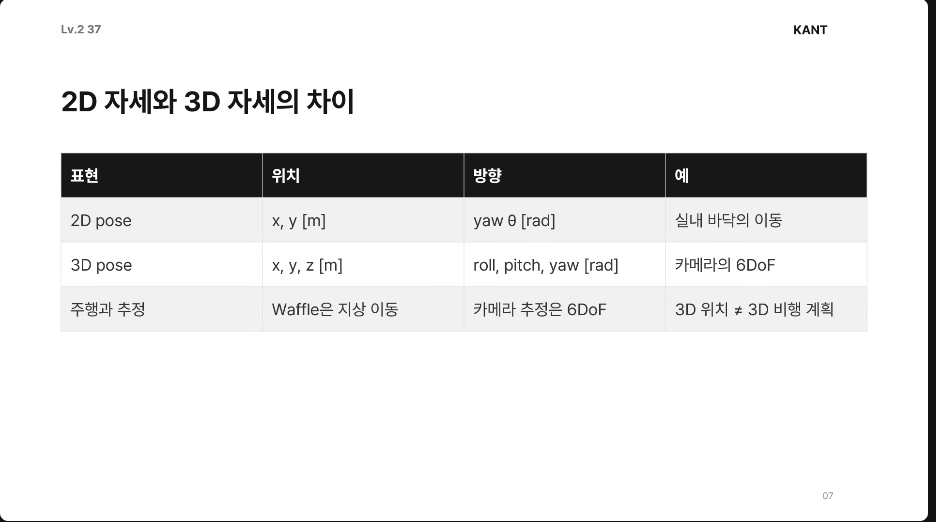

1pix = 1m = 1000mm 용량이 커짐

baselink 와 오도메트리의 TF가 가까울수록 좋음

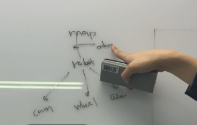

맵과 로봇 사이에 오도메트리가 있어야 한다

baselink - 초기 실제 추정값의 위치를 사용하면 안됨

추정한 값을 사용

오도메트리를 신뢰해야 한다.

## TF

라이다 위치는 로봇 중앙일때

바닥 로봇 가운데 기준으로 수정한 것이 baselink

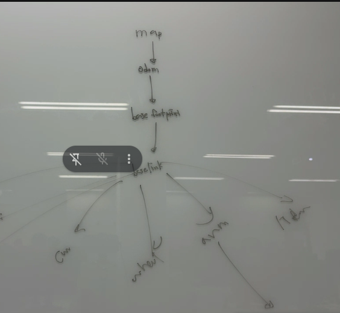

## TF tree

- URDF가 자동으로 함
- 터틀봇의 TF tree

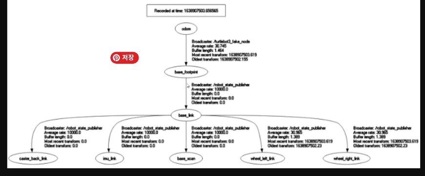

- 읽을땐 가지에서 뿌리로

## 매핑

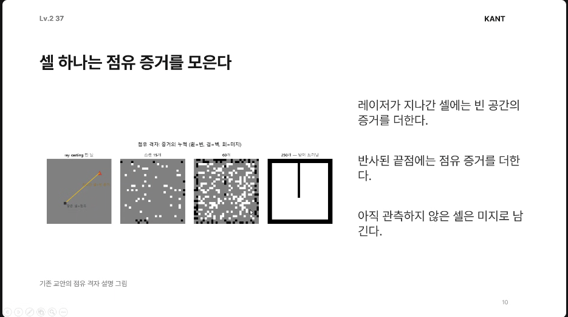

값 : 0, 1

- 0 - 허공
- 1 - 장애물

관측되지 않은 구간: 회색

- 여러번 움직여서 회색을 없애야 함
- 여러번 돌려도 매꿔지지 않을땐 그림판으로 그려줌

최적화

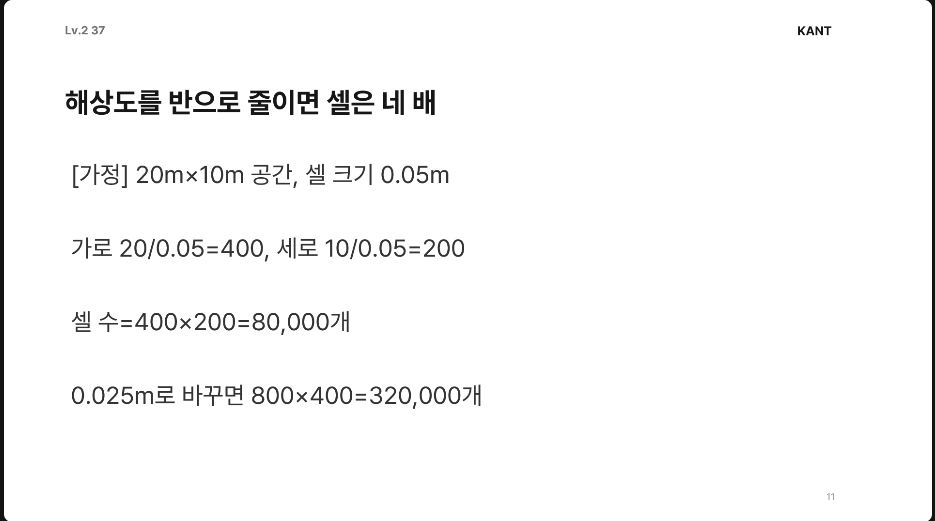

- 1픽셀당 5센치, 10센치
- 1픽셀당 단위가 커지면 해상도 낮아지고 반대는 커진다
- 1픽셀당 0.05m = 터틀봇

scan 매칭때도 해상도가 중요하다

- 1px = 1이면
- 장애물이 30cm면 측정이 불가
- 주어진 환경이 어떤지에 따라 매겨야 함
- 책상 다리가 5센치면 이것보다 이하여야 하는 해상도

scan 범위

- 크면 클수록 처리해야 하는 정보가 많아서 느려질 수 있음

## loop closure

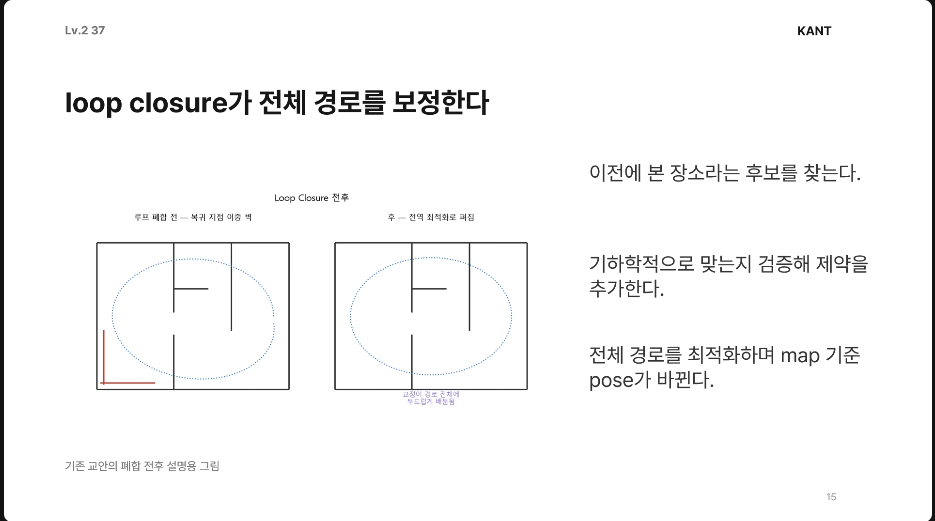

원위치에서 매핑을 하고 다시 원위치로 돌아오는 것

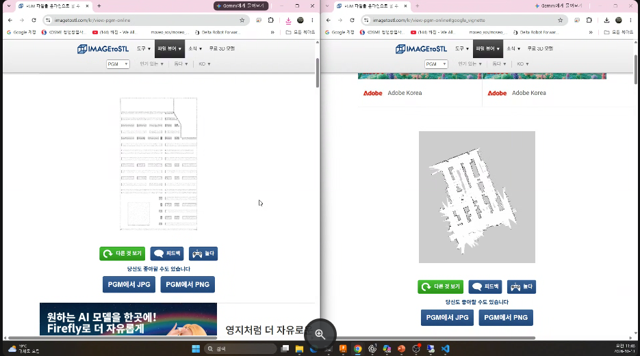

1500평 물류창고

왼쪽 실제 도면

오른쪽 맵

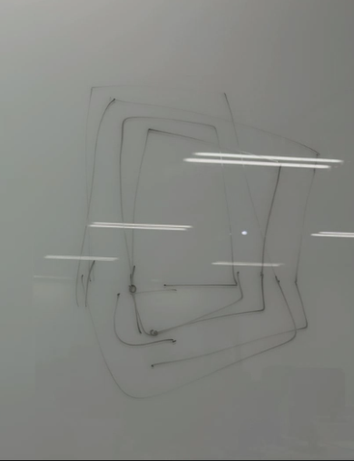

코너를 이어주는 것이 loop closure

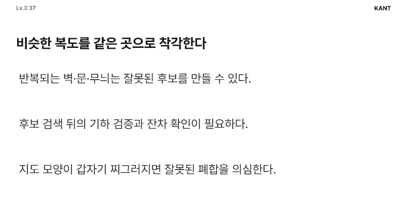

이어지는 과정에 찌그러짐

- 실제로 맵을 점검할 필요 있음

## 카토그래퍼

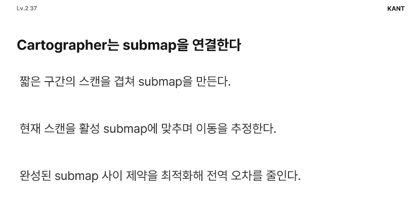

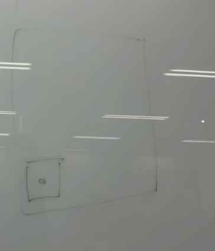

짧은 구간의 맵 = sub map

sub map을 전체로 통합해서 맵과 일치하는지 보는 것

연산이 무겁기 때문에 구독을 해서 연산은 pc에서 하는 것

라즈베리 파이는 가벼운 값만 받는 것

cmd vel로 받는 것 - pc에서

sbc - 노트북 네트워크 연결이 끊기면 안됨

그래서 edge에 최대한 많이 기능을 쌓는거지만

- rasberry pi는 불가
- json 컴퓨터는 가능 - 그래서 프로젝트에 사용

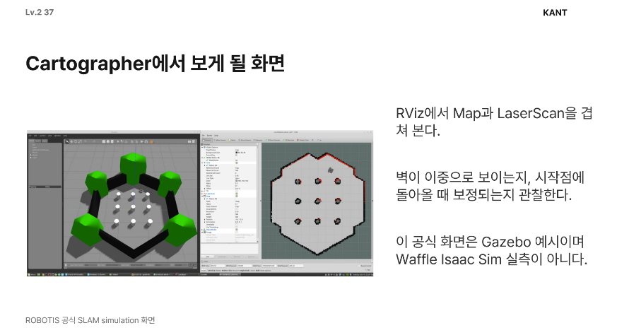

빨간색 점과 검은색 점이 일치하는지 봐야 함

현재 그림은 깔끔한 편

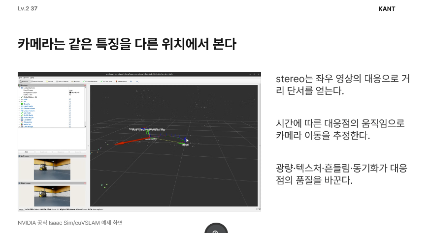

## cuVslam

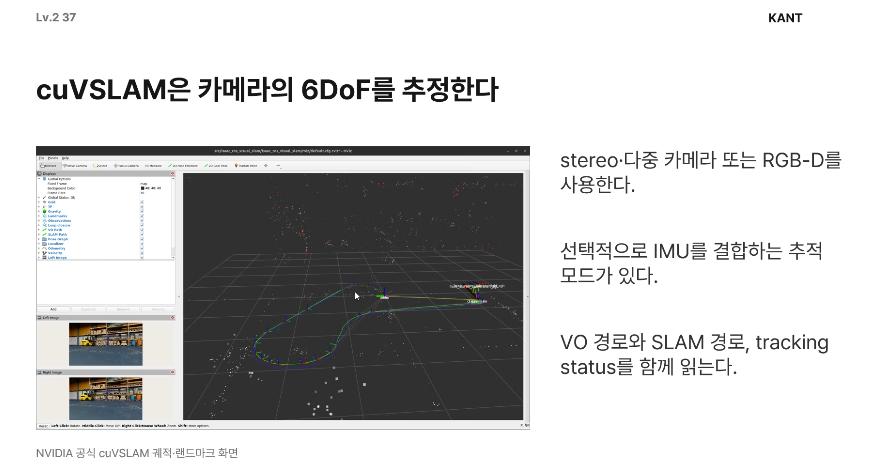

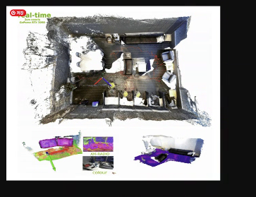

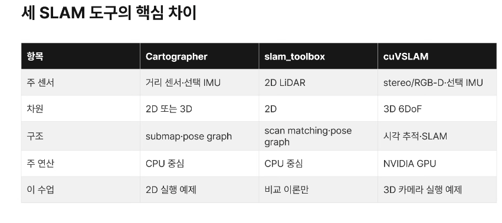

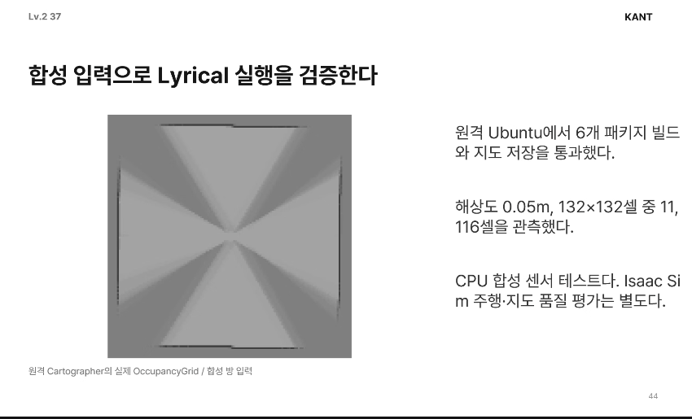
