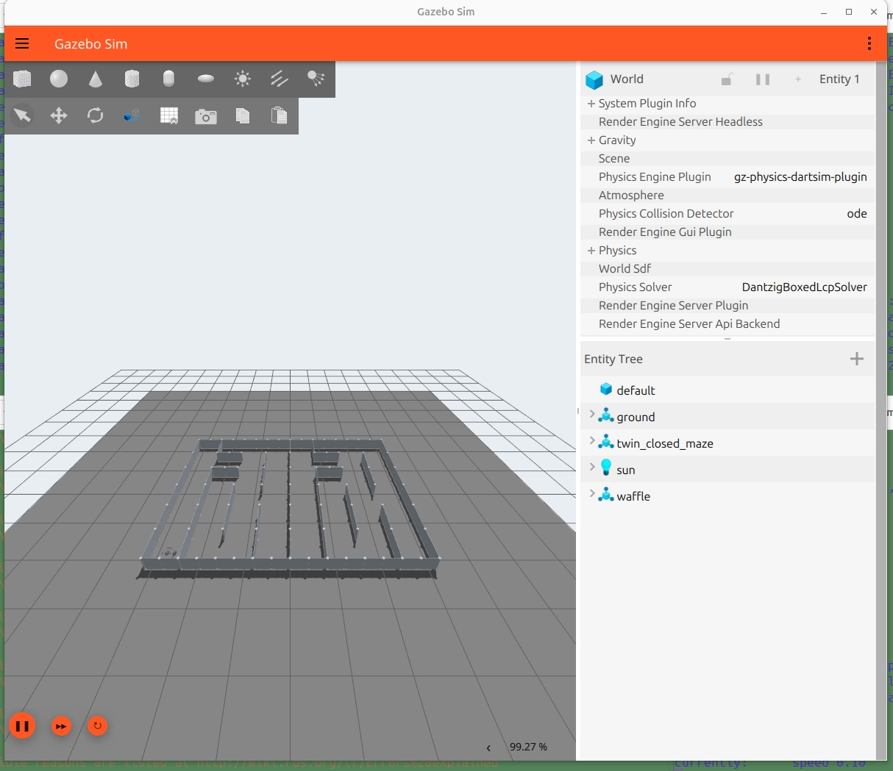
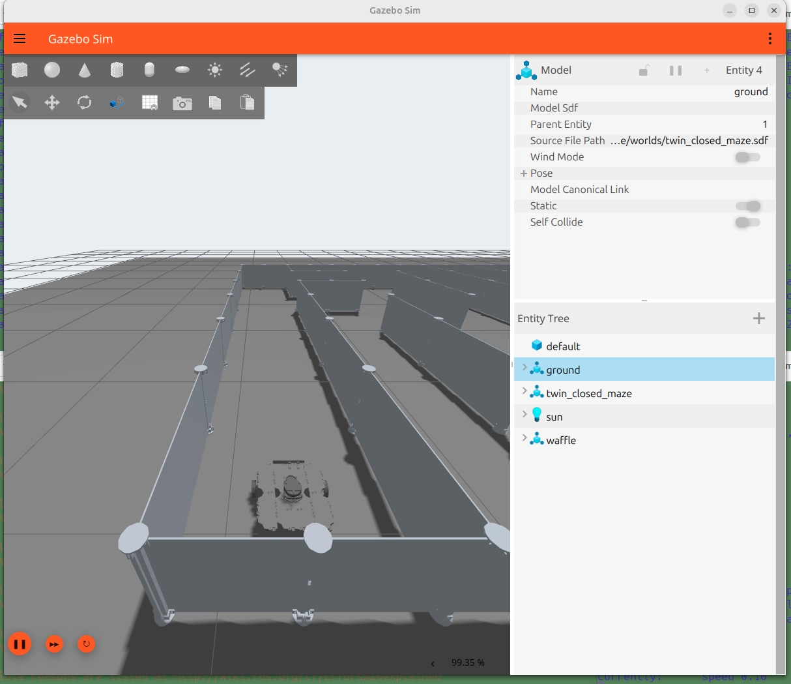
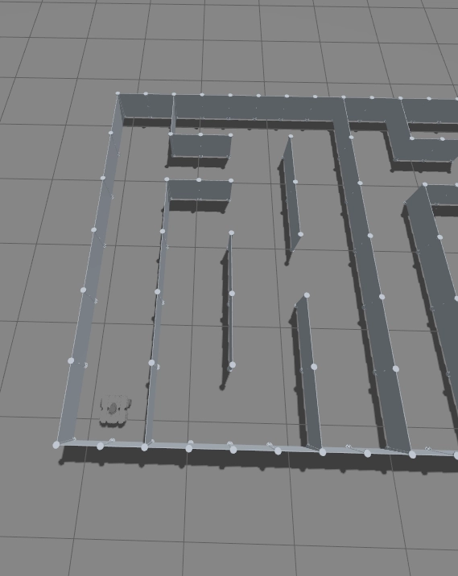
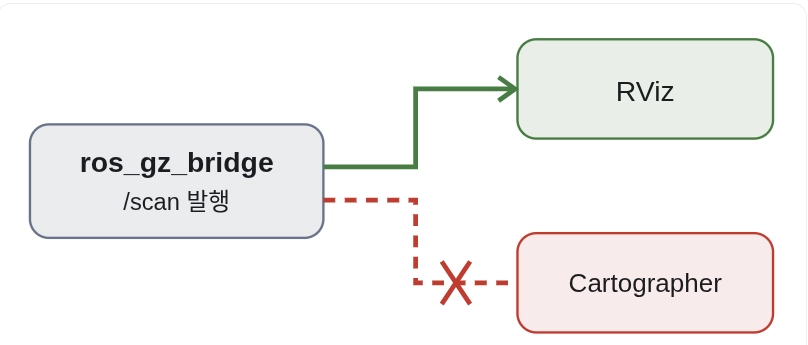
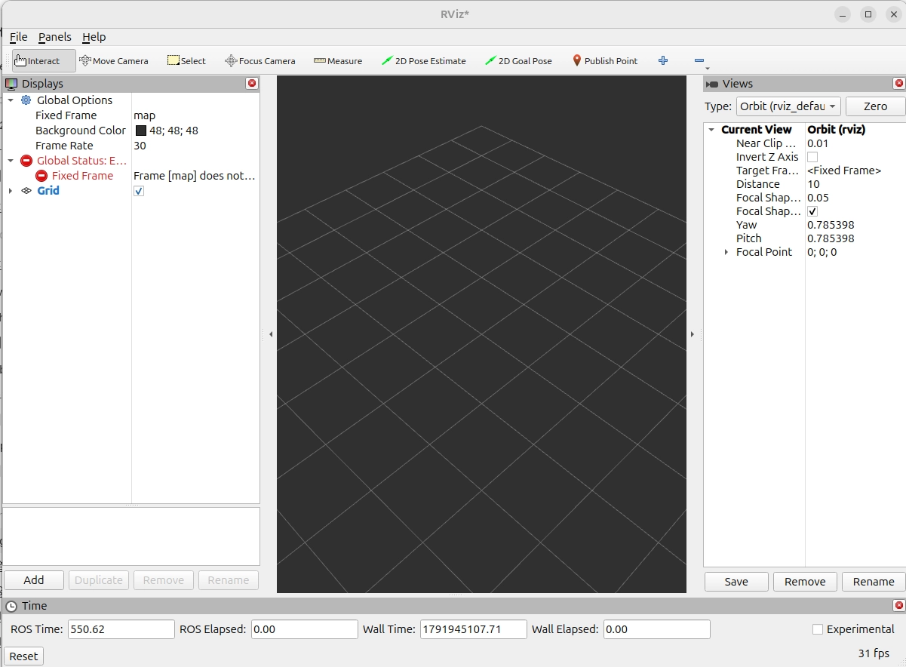
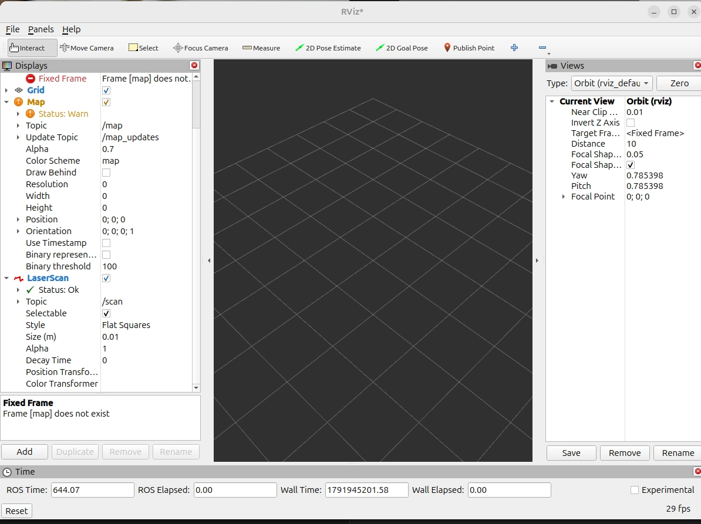
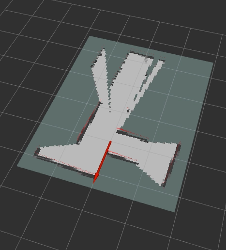
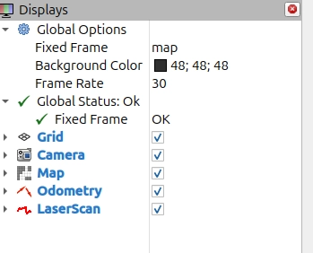
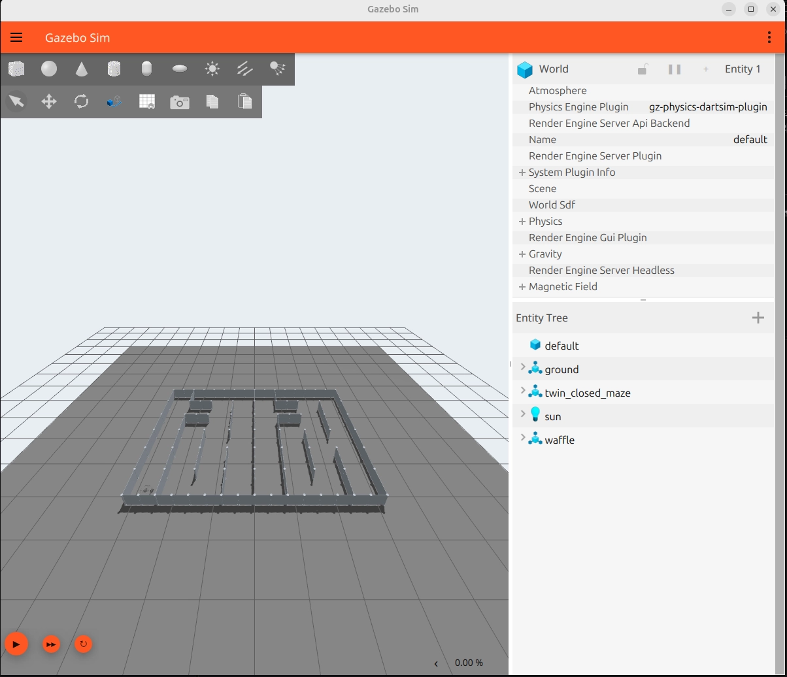

# Day47 — Cartographer 실습 실행·오류 해결 요약

> 환경: ROS 2 Lyrical · Gazebo · Waffle · `waffle_slam_course`  
> 작업 경로: `~/workspaces/waffle-lyrical-slam`  
> 원본 실습 기록을 통합한 실행 참고 문서다. 이번 정리 작업에서 로봇 실행이나 빌드를 재검증한 것은 아니다.

## 바로 찾기

- [1. 실행 전 준비](#1-실행-전-준비)
- [2. 터미널 A~D 실행 코드](#2-터미널-ad-실행-코드)
- [3. 오류별 빠른 대응표](#3-오류별-빠른-대응표)
- [4. 핵심 오류 해결 기록](#4-핵심-오류-해결-기록)
- [5. 초기화·재시작](#5-초기화재시작)
- [6. 튜닝 비교표](#6-튜닝-비교표)
- [7. Nav2 후속 준비](#7-nav2-후속-준비)

## 1. 실행 전 준비

### 환경 확인

```bash
ls /opt/ros/
source /opt/ros/lyrical/setup.bash
echo "$ROS_DISTRO"
which ros2
```

원본 확인 결과는 `jazzy`, `lyrical`이 함께 설치되어 있었고, 활성 환경은 `lyrical`, 실행 파일은 `/opt/ros/lyrical/bin/ros2`였다. 워크스페이스는 최종 실행 기록의 `~/workspaces/waffle-lyrical-slam`으로 통일한다.

### 빌드가 필요할 때만

전체 워크스페이스 빌드는 실제 하드웨어용 `turtlebot3_node` 의존성에서 실패했다. 시뮬레이션 실습에서는 아래처럼 실습 패키지와 그 의존성까지 대상으로 좁히는 방법이 제시되었다.

```bash
source /opt/ros/lyrical/setup.bash
cd ~/workspaces/waffle-lyrical-slam

colcon build --symlink-install --packages-up-to waffle_slam_course
# 위 빌드가 성공한 것을 확인한 후 실행
source install/setup.bash
```

`--packages-up-to`는 필요한 의존성을 포함한다. 누락된 의존성을 자동으로 해결하는 옵션은 아니다. 원본에는 이 변경 후의 최종 빌드 성공 로그가 없으므로 성공 여부는 출력으로 확인한다.

## 2. 터미널 A~D 실행 코드

**A 실행 → 센서 준비 확인 → B 실행 → C 실행 → D 조종** 순서다. 각 실행 터미널은 계속 열어 둔다.

이 문서는 한 PC에서 수행한 실습 기준이다. 원본의 `GZ_PARTITION=waffle_course`는 이후 기록에서 `hae`로 변경되어 최종값을 사용했다. ROS 환경의 탐색 범위도 각 터미널에서 일관되게 적용했다. `LOCALHOST`는 같은 호스트의 노드 탐색을 위한 설정이다. [ROS 2 환경 설정](https://github.com/ros2/ros2_documentation/blob/rolling/source/Get-Started/Configuring-ROS2-Environment.rst)

### 터미널 A — Gazebo + Waffle

```bash
source /opt/ros/lyrical/setup.bash
cd ~/workspaces/waffle-lyrical-slam
source install/setup.bash
[ -f gazebo_install/setup.bash ] && source gazebo_install/setup.bash

export ROS_DOMAIN_ID=27
export ROS_AUTOMATIC_DISCOVERY_RANGE=LOCALHOST
export GZ_PARTITION=hae
export GZ_IP=127.0.0.1

ros2 launch waffle_slam_course gazebo.launch.py gui:=true
```

**확인:** 미로와 Waffle이 나타나고 시뮬레이션이 진행되어야 한다. GUI를 닫는 것과 시뮬레이터 서버 종료는 같다고 가정하지 않는다.

<details>
<summary>원본 화면: Gazebo 미로와 Waffle 배치</summary>







</details>

### 터미널 B — 센서 사전 확인 + Cartographer

```bash
source /opt/ros/lyrical/setup.bash
cd ~/workspaces/waffle-lyrical-slam
source install/setup.bash
export ROS_DOMAIN_ID=27
export ROS_AUTOMATIC_DISCOVERY_RANGE=LOCALHOST

bash preflight.sh cartographer
# 위 점검 결과를 확인한 후 실행
ros2 launch waffle_slam_course cartographer.launch.py
```

원본에서 확인된 preflight 출력:

```text
Checking /clock
Checking /scan
Checking /odom
Checking /joint_states
Messages received. Now check synchronization, calibration and TF using README acceptance steps.
```

**판단:** 메시지 수신은 확인했지만, 시간 동기화·보정·TF까지 검증했다는 뜻은 아니다.

### 터미널 C — RViz

```bash
source /opt/ros/lyrical/setup.bash
source ~/workspaces/waffle-lyrical-slam/install/setup.bash
export ROS_DOMAIN_ID=27
export ROS_AUTOMATIC_DISCOVERY_RANGE=LOCALHOST

rviz2 --ros-args -p use_sim_time:=true
```

| RViz 항목 | 설정 |
| --- | --- |
| Global Options → Fixed Frame | `map` |
| Add → By topic → Map | `/map` |
| Add → By topic → LaserScan | `/scan` |

**확인:** 레이저만 보이는 것과 SLAM 지도 생성은 별개다. `map` 프레임 오류가 나면 아래 오류 표를 확인한다.

### 터미널 D — 키보드 조종

```bash
source /opt/ros/lyrical/setup.bash
source ~/workspaces/waffle-lyrical-slam/install/setup.bash
export ROS_DOMAIN_ID=27
export ROS_AUTOMATIC_DISCOVERY_RANGE=LOCALHOST

ros2 run teleop_twist_keyboard teleop_twist_keyboard --ros-args \
  -p stamped:=true \
  -p frame_id:=base_footprint \
  -p use_sim_time:=true \
  -p speed:=0.1 \
  -p turn:=0.2
```

| 키 | 동작 |
| --- | --- |
| `i` | 전진 |
| `,` | 후진 |
| `j` / `l` | 왼쪽 / 오른쪽 회전 |
| `k` | 정지 |

조종 터미널에 키보드 포커스를 둔다. `stamped:=true`는 원본의 메시지 형식 설정을 유지한 것이다. 움직이지 않는다면 먼저 `ros2 topic info /cmd_vel -v`로 발행자·구독자·메시지 형식과 실제 제어 토픽을 확인한다. 이는 추가 점검 제안이며 원본에서 발생이 확인된 오류는 아니다.

## 3. 오류별 빠른 대응표

| 증상 / 로그 | 원본에서 확인한 사실 | 조치 | 상태 |
| --- | --- | --- | --- |
| 패키지 검색 결과 없음 | 기본 ROS만 source한 초기 상태 | 워크스페이스 overlay 적용 후 재검색 | 설치 부재로 바로 단정하지 않기 |
| `dynamixel_sdk`를 찾지 못함 | `turtlebot3_node` 실패, 다른 패키지들은 aborted | 실습용 `--packages-up-to waffle_slam_course` 빌드 | 제안된 우회, 성공 로그 미기록 |
| `Unknown topic '/scan'` | 새 터미널의 `ROS_DOMAIN_ID`가 비어 있었음 | `export ROS_DOMAIN_ID=27` | 이후 `/scan` 발행자 확인 |
| `Unable to find node '/cartographer_node'` | 해당 확인 시점에 노드를 찾지 못함 | 환경 통일 후 Cartographer 재실행 | `/scan`, `/odom`, `/clock` 구독 확인 |
| `Frame [map] does not exist` | `/map` 토픽은 있었으나 TF의 `map`은 없음 | 환경 → 센서 → 노드 → 시간 → TF 순으로 점검 | 한 가지 원인으로 단정 불가 |
| `TF_OLD_DATA` | 과거 시간의 TF를 무시하는 경고 반복 | 시뮬레이션 시간·리셋·중복 실행 점검 | 근본 원인 미확정 |
| `Non-sorted data ... '(0, odom)'`, exit `-6` | Cartographer odom 처리 순서 위반 | `use_odometry = false` 후 재실행 | 원본에 정상 실행 기록, 임시 우회 |
| 창을 닫고 열어도 초기화 안 됨 | 실행 노트에 기록됨 | GUI와 서버를 구분해 종료·재시작 확인 | 아래 재시작 절차 참고 |

## 4. 핵심 오류 해결 기록

### 4-1. `/scan`이 없다고 나왔던 이유: 도메인 누락

먼저 **점검용 새 터미널에도** 실행 터미널과 같은 환경을 적용한다.

```bash
source /opt/ros/lyrical/setup.bash
source ~/workspaces/waffle-lyrical-slam/install/setup.bash
export ROS_DOMAIN_ID=27
export ROS_AUTOMATIC_DISCOVERY_RANGE=LOCALHOST

echo "ROS_DISTRO=$ROS_DISTRO"
echo "ROS_DOMAIN_ID=$ROS_DOMAIN_ID"
ros2 topic info /scan -v
```

도메인을 맞춘 뒤 원본에서 `/scan` 발행자 `ros_gz_bridge`가 1개 확인되었다. 하지만 구독자는 RViz만 있었다. **센서가 발행되는 것과 Cartographer가 그 센서를 받는 것은 별도로 확인해야 한다.**



### 4-2. `map` 프레임 없음: 노드·토픽·TF를 따로 확인

```bash
ros2 node list
ros2 node info /cartographer_node
ros2 topic list | grep -E 'map|submap|trajectory'
ros2 topic info /scan -v

ros2 run tf2_ros tf2_echo map odom --ros-args -p use_sim_time:=true
# 확인 후 Ctrl+C
ros2 run tf2_ros tf2_echo odom base_footprint --ros-args -p use_sim_time:=true
```

원본의 흐름:

1. 한 시점에는 `/cartographer_node`, `/cartographer_occupancy_grid_node`와 `/map` 토픽이 보였다.
2. 하지만 `tf2_echo map odom`은 `Invalid frame ID "map"`을 출력했다.
3. 다른 확인 시점에는 `/cartographer_node` 자체를 찾지 못했다.
4. 환경을 통일하고 Cartographer를 재실행한 뒤 센서 구독 목록이 확인되었다.

재실행 후 확인된 주요 구독:

```text
/clock : rosgraph_msgs/msg/Clock
/odom  : nav_msgs/msg/Odometry
/scan  : sensor_msgs/msg/LaserScan
```

확인할 TF 연결의 기본 형태는 `map → odom → base_footprint`이며, `base_link` 등 하위 프레임은 로봇 모델 구성에 따른다. `/map`이라는 토픽 이름이 존재하는 것만으로 TF나 실제 지도 데이터가 정상임을 보장하지 않는다.

> 위 구독 목록은 당시 기록이다. 아래의 `use_odometry=false`를 적용하면 Cartographer의 `/odom` 구독이 없어지는 것은 의도된 결과다.

<details>
<summary>원본 오류 화면: map 프레임 없음</summary>





</details>

### 4-3. 시간 문제: `TF_OLD_DATA`

```text
TF_OLD_DATA ignoring data from the past for frame base_footprint
```

**의미:** 수신한 TF가 버퍼에서 과거 데이터로 판단되어 무시되었다. 이 메시지만으로 컴퓨터 시간과 시뮬레이션 시간의 혼용이 원인이라고 확정할 수는 없다.

```bash
ros2 param get /cartographer_node use_sim_time
ros2 param get /robot_state_publisher use_sim_time
ros2 param get /rviz use_sim_time

ros2 topic info /clock -v
ros2 topic info /odom -v
ros2 topic echo /odom --once --field header
ros2 topic echo /odom --once --field header
ros2 topic echo /clock --once
```

RViz 노드명이 다르면 `ros2 node list`에서 실제 이름을 확인한다. `Node not found`는 시간 값이 false라는 뜻이 아니라, 노드 실행·도메인·발견 상태부터 확인해야 한다는 뜻이다.

원본에서는 환경 통일 후 Cartographer와 robot_state_publisher 모두 `Boolean value is: True`였지만 TF 경고는 계속 나타났다. 따라서 “sim time을 켜서 완전히 해결됨”으로 기록하지 않는다.

원본의 `/odom=6711.54초`, `/clock=6946.634초`는 **서로 다른 확인 시점**의 값이다. 두 숫자의 차이만으로 시간 지연이나 역행을 입증할 수 없다. 반복 측정에서 시간이 뒤로 가는지, 리셋 시점과 연결되는지 확인해야 한다.

### 4-4. Cartographer 강제 종료: odom 시간 순서 위반

핵심 오류:

```text
Check failed: last_dispatched_time_ <= next_data->GetTime()
Non-sorted data added to queue: '(0, odom)'
[ERROR] [cartographer_node-1]: process has died
exit code -6
```

Cartographer의 데이터 처리 시간 순서가 깨졌으며, 로그가 지목한 큐는 `odom`이었다. 원본에서는 아래 변경 후 정상 실행되었다고 기록했다.

```lua
-- 변경 전
use_odometry = true,

-- 변경 후: 오류를 피하기 위한 임시 우회
use_odometry = false,
```

당시 수정한 설치 파일:

```text
~/workspaces/waffle-lyrical-slam/install/waffle_slam_course/share/waffle_slam_course/config/waffle_2d.lua
```

지속적으로 유지하려면 다음 **소스 설정에도 반영**하고 빌드·재실행한다. 원본에는 소스 반영이 향후 과제로 남아 있었다.

```text
~/workspaces/waffle-lyrical-slam/src/waffle_slam_course/config/waffle_2d.lua
```

```bash
cd ~/workspaces/waffle-lyrical-slam
colcon build --symlink-install --packages-up-to waffle_slam_course
# 성공 확인 후
source install/setup.bash
# 기존 Cartographer 종료 후 다시 실행
ros2 launch waffle_slam_course cartographer.launch.py
```

**변경의 의미:** Cartographer가 odometry 입력을 사용하지 않게 한다. `/odom` 토픽이나 Gazebo의 이동 계산을 끄는 설정은 아니다. 위치 추정 성능은 환경에 따라 달라질 수 있다.

**남은 과제:** odom 타임스탬프 역행의 근본 원인, TF 시간 문제의 재발 여부, 최종 지도 품질은 별도 검증이 필요하다. 리셋과 연관된 기록이 있지만 리셋만이 원인이라고 확정하지 않는다.

**원본의 후속 화면:** 지도 일부가 표시되고 Fixed Frame 상태가 OK인 캡처가 있다. 해당 시점의 표시 상태는 확인할 수 있지만, 이것만으로 장시간 안정성이나 지도 정확도까지 검증된 것은 아니다.





### 4-5. 전체 빌드 실패: 실물 하드웨어 의존성

```text
Could not find a package configuration file provided by "dynamixel_sdk"
Failed <<< turtlebot3_node
```

다른 `aborted` 패키지들은 모두 독립적으로 오류가 났다는 뜻이 아니다. 먼저 실패한 패키지와 첫 오류부터 확인한다.

동시에 rosdep에서 다음 키의 `noble`용 정의를 해결하지 못했다.

```text
turtlebot3_msgs
hls_lfcd_lds_driver
tf_transformations
```

`Continuing to install resolvable dependencies...` 또는 뒤의 성공 문구가 앞의 미해결 의존성까지 해결했다는 뜻은 아니다. `dynamixel_sdk` 하나만 설치하면 전체 빌드가 반드시 성공한다고 단정하지 않는다. 실습 범위에서는 1절의 대상 제한 빌드를 먼저 사용한다.

## 5. 초기화·재시작

원본에는 Gazebo의 refresh 버튼을 이용한 재시작 메모가 있다. 다만 월드 시간을 되돌리면서 기존 SLAM과 TF 상태를 유지하면 시간 문제를 조사하기 어려워진다. 아래는 이를 피하기 위한 **정리 과정의 권장 절차**다.

1. 조종 터미널에서 `k`로 정지한다.
2. D(조종), B(Cartographer), C(RViz), A(Gazebo)의 실행을 각각 `Ctrl+C`로 종료한다.
3. GUI만 닫힌 상태인지 프로세스 목록으로 확인한다.
4. 환경을 통일한 뒤 A → B → C → D 순서로 새로 실행한다.

```bash
pgrep -af 'gz sim|gzserver|gazebo'
```

이 명령은 프로세스를 확인할 뿐 종료하지 않는다. 다른 작업의 시뮬레이터까지 일괄 종료하지 말고, 이번 실습에서 띄운 실행 터미널과 프로세스를 확인한다. 이 절차는 새 세션을 시작하는 방식이며, 지도 저장 절차는 원본에 기록되어 있지 않다.

<details>
<summary>원본 화면: Gazebo 하단 실행·초기화 컨트롤</summary>



</details>

## 6. 튜닝 비교표

**아래는 노트에 적힌 PPT 비교 기준이며 현재 파일의 실측값이나 upstream 공통 기본값은 아니다.** 먼저 실제 Lua 파일을 확인한다. 개념 설명은 [class.md](./class.md)를 참고한다.

| 파라미터 | 노트의 비교 기준 | 실험 후보 |
| --- | --- | --- |
| `motion_filter.max_angle_radians` | 0.1° | 0.5°, 1° |
| `voxel_filter_size` | 0.025 m | 0.05 m |
| `use_online_correlative_scan_matching` | `true` | `false` |
| `submaps.num_range_data` | 90 | 60, 120 |
| `POSE_GRAPH.optimize_every_n_nodes` | 90 | 120, 180 |

각도는 라디안으로 입력한다.

```lua
TRAJECTORY_BUILDER_2D.motion_filter.max_angle_radians = math.rad(0.1)
```

같은 경로·속도에서 한 항목씩 바꾸고, 벽 겹침·복귀 지점 오차·CPU·RAM·처리 지연을 기록한다. odometry 사용 여부도 비교 조건에 포함한다.

## 7. Nav2 후속 준비

원본에 있는 내용은 설치 및 패키지 확인까지다. **Nav2로 미로 자율주행을 완료했다는 기록은 없다.** Cartographer의 `map` 프레임 오류를 Nav2 설치로 해결한다고 해석하지 않는다.

```bash
source /opt/ros/lyrical/setup.bash
apt-cache policy ros-lyrical-navigation2 ros-lyrical-nav2-bringup
```

설치가 없고 후보 버전이 제공되는 환경에서만 원본의 다음 설치 절차를 사용한다.

```bash
sudo apt update
sudo apt install ros-lyrical-navigation2 ros-lyrical-nav2-bringup
```

```bash
ros2 pkg list | grep -E '^(nav2_bringup|nav2_controller|nav2_planner|nav2_bt_navigator)$'
ros2 pkg prefix nav2_bringup
ls "$(ros2 pkg prefix nav2_bringup)/share/nav2_bringup/params/"
```

원본의 예상 패키지: `nav2_bringup`, `nav2_bt_navigator`, `nav2_controller`, `nav2_planner`. 예상 파라미터 파일: `nav2_params.yaml`. 설치 여부와 사용 가능한 버전은 실행 환경에서 다시 확인한다.

## 완료 판단 체크리스트

- [ ] 모든 터미널이 Lyrical과 `ROS_DOMAIN_ID=27`을 사용한다.
- [ ] Gazebo에서 로봇이 보이고 `/clock`, `/scan`이 들어온다.
- [ ] Cartographer가 실행 중이고 `/scan`을 구독한다.
- [ ] `map → odom → 로봇 프레임` 변환이 확인된다.
- [ ] RViz에서 지도와 스캔이 보이고 주행에 따라 갱신된다.
- [ ] 시간 역행·노드 종료가 재발하지 않는지 확인했다.
- [ ] 임시 odometry 제외 설정과 근본 원인 미해결 상태를 구분했다.

## 원본 노트 및 이미지

| 원본 | 반영한 내용 |
| --- | --- |
| [cartographer 실습](https://app.notion.com/p/3f979696-9395-8088-88a9-ff778a53f5e2) | 환경 확인, TF·센서 진단, 시간 순서 오류, odometry 제외 우회 |
| [cartographer 실습 실행](https://app.notion.com/p/3f979696-9395-8041-9162-c62034fe54eb) | 빌드 실패, 터미널 4개 실행, 실험 후보, 초기화 메모 |
| [cartographer 실습 학습](https://app.notion.com/p/3f979696-9395-8066-a0ad-f84de3fe9e98) | 확인 당시 본문이 비어 있음 |
| [cartographer 실습 확인 장치](https://app.notion.com/p/3f979696-9395-80ab-a9fc-de5fafa8ea4d) | clock·odom 발행자와 타임스탬프 점검 명령 |

원본의 실습 이미지 7개와 실행 이미지 2개를 `./pic/`에 저장하고 관련 절에 상대 경로로 연결했다. 내려받은 실제 형식에 맞춰 `.webp` 확장자를 사용했으며 이미지 내용은 변경하지 않았다.
