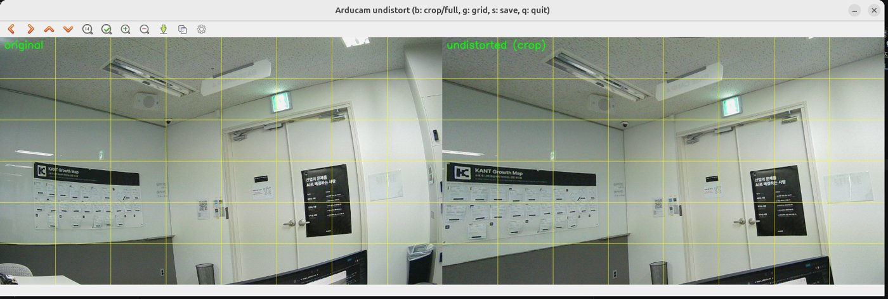
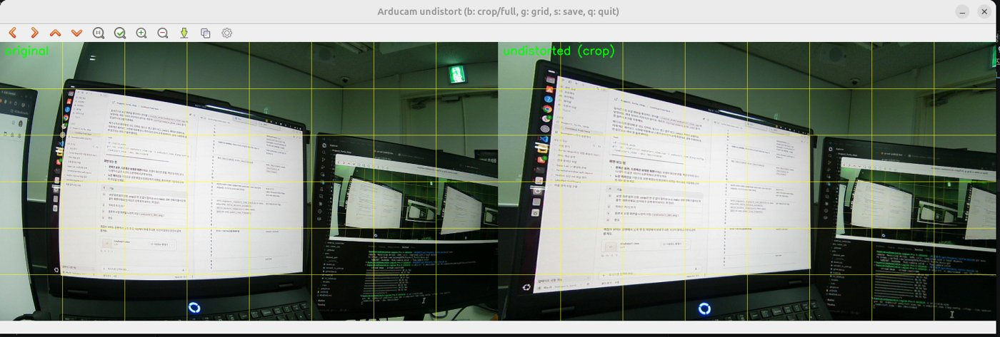
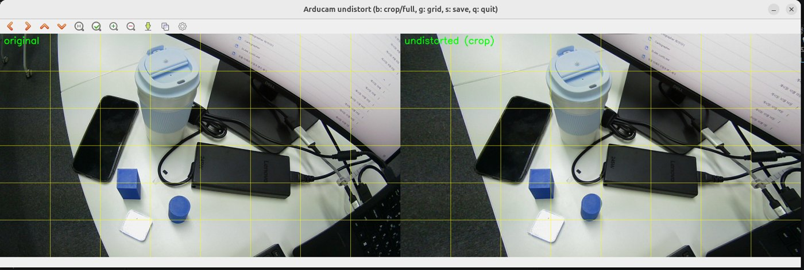
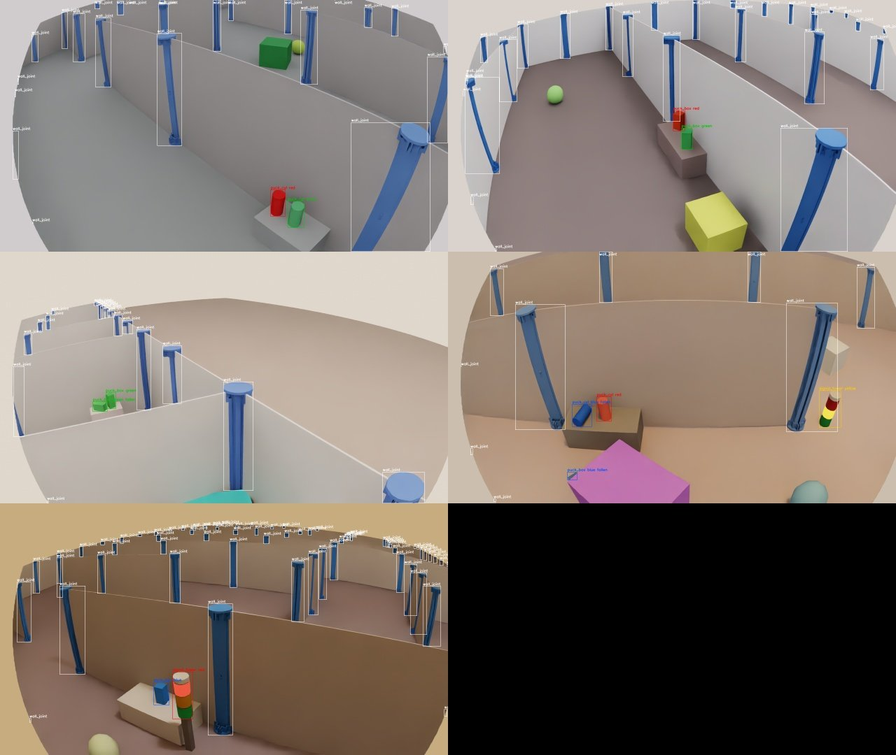
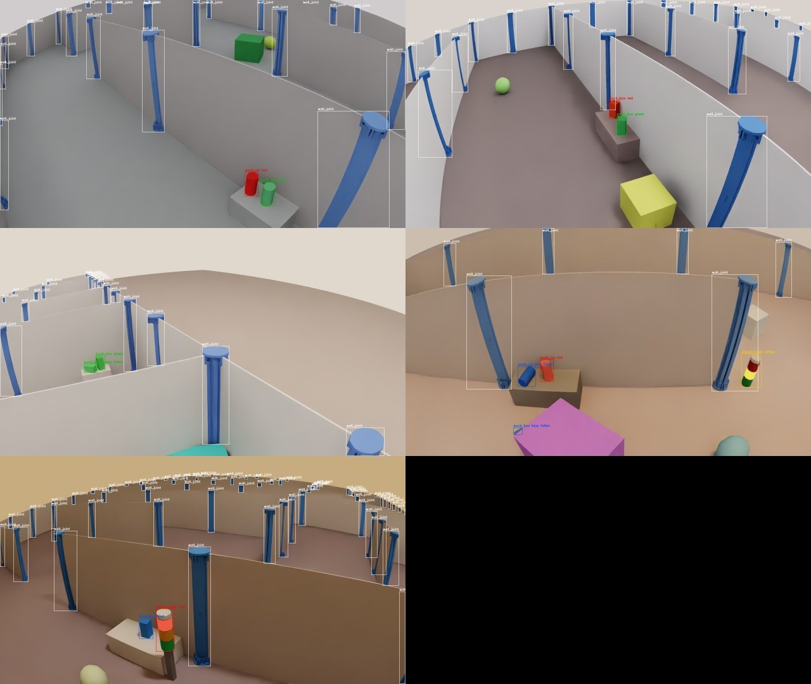
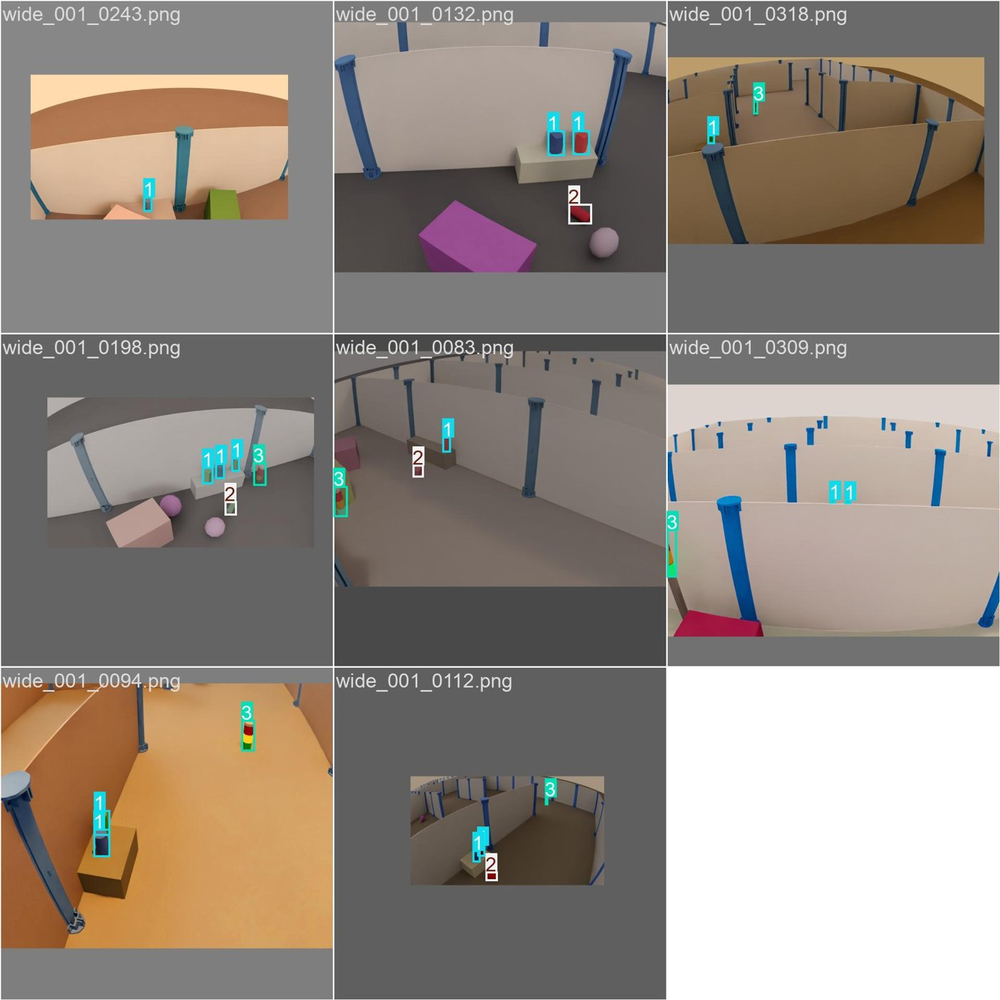
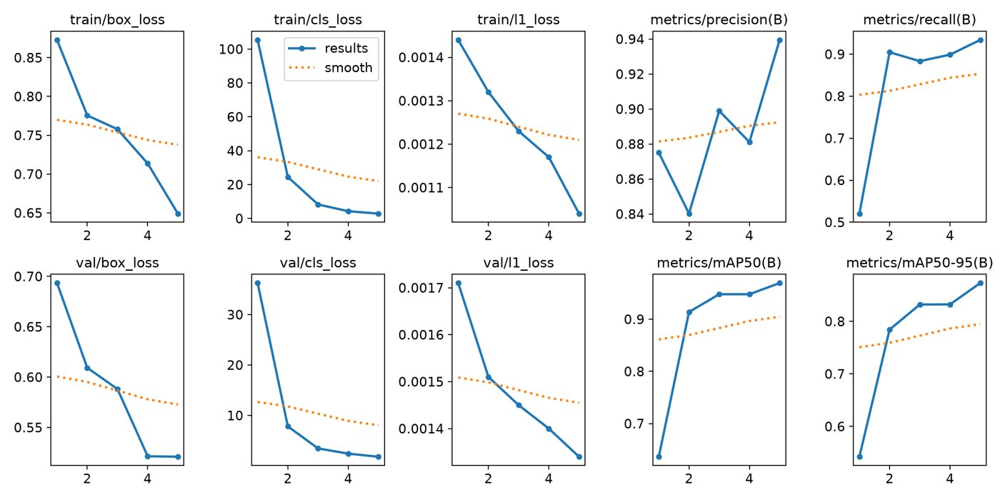
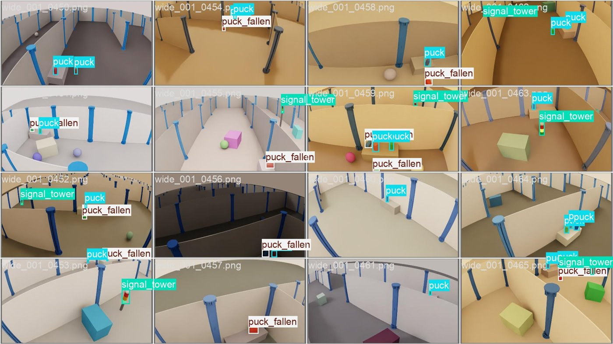
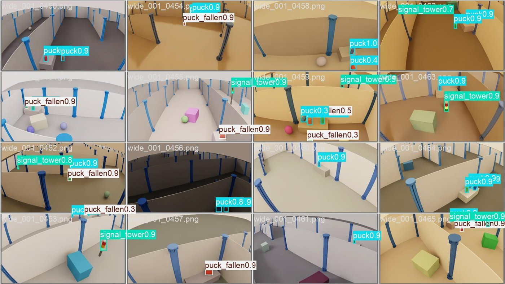
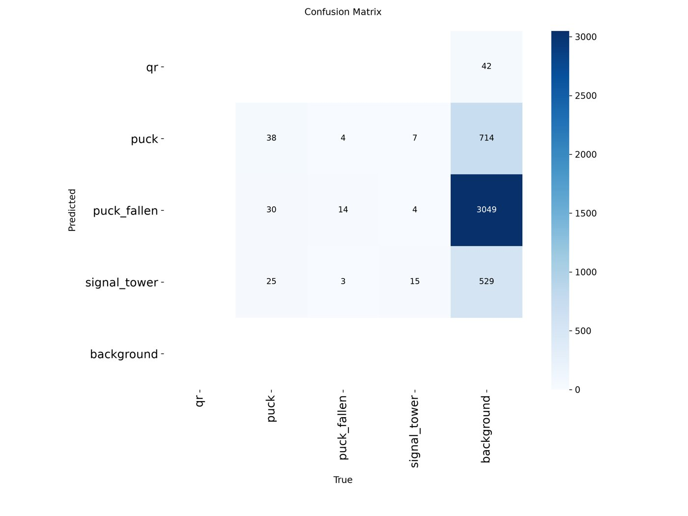

date: 2026.10.21

# Turtle Ninja 비전 작업 일지 (10/21)

> 작성: 김혜민 (비전 담당) · 2026-10-21

오늘은 **두 카메라의 실측값을 합성 데이터에 반영하고, 합성 데이터 → YOLO 학습 → 평가 파이프라인이 끝까지 돈다는 것을 확인**했어요. 시험 학습(5 epoch)은 합성 검증셋에서 mAP50 0.969가 나왔고, 실제 카메라에서는 아직 오탐이 많아요.

| 결과물 | 위치 | 상태 |
| --- | --- | --- |
| D435 내부 파라미터 | `config/camera_wrist.yaml` | 커밋 (`feat/camera_calib`, main 미반영) |
| 합성 데이터 카메라 교체 + fisheye 잘림 우회 | `yolo/dataset_gen/generate.py` | 커밋 (`feat/camera_calib`, main 미반영) |
| 가이드 3.4절 퍽 픽셀 표 | `docs/perception/yolo26_isaac_sim_guide.md` | 커밋 (`feat/camera_calib`) |
| 가이드 4.5절 카메라 실측 반영 | 같은 파일 | 커밋 (`docs/yolo-guide-update`) |
| 합성 데이터 500장 | `yolo/datasets/sim_raw/wide_001` (git 제외) | 생성 완료 |
| 시험 학습 모델 | `~/pa-course/runs/smoke_wide-3` (레포 밖) | 완료 |
| 도구: 보정 뷰어, 노출·WB 도구 | `~/calib_wide/undistort_view.cpp`, `wb_check.cpp` (레포 밖) | 완료 |

## 1. D435(손목) 내부 파라미터 추출

D435는 공장에서 캘리브레이션한 값이 카메라 안에 있어서, 촬영 없이 읽어오기만 했어요.

1. `rs-enumerate-devices -s`로 로봇에 달 개체 확인: 시리얼 **261822078400**, 펌웨어 5.17.3.10
2. `rs-enumerate-devices -c`로 모든 해상도의 내부 파라미터를 파일로 저장
3. 가이드 기준 해상도(Color 640×480) 값을 ROS `camera_info` 형식으로 `config/camera_wrist.yaml`에 저장

| 항목 | 값 |
| --- | --- |
| fx / fy | 606.321 / 606.188 |
| cx / cy | 321.425 / 248.200 |
| 왜곡 | 계수 모두 0 (pinhole) |
| 화각 | 수평 55.65°, 수직 43.19° |
| depth → color 거리 | 약 1.5 cm (yaml 주석에 회전·이동 값) |

- 어제 dmesg에 보인 다른 시리얼(241223120621)은 **같은 카메라의 ASIC 시리얼**이었어요. D435는 한 대뿐이에요.
- 합성 데이터 코드의 손목 카메라 임시값(화각 69°)은 depth 쪽 값이었어요. 컬러는 55.65°라서 3번에서 고쳤어요.

## 2. Arducam(광각) 보정 실시간 확인

10/20에 구한 fisheye K·D(RMS 0.45px)를 실제 영상에 적용해 보니, **화면 가장자리의 직선까지 곧게 펴졌어요.** 눈으로도 보정값이 맞다는 걸 확인한 거예요.

- 도구: `undistort_view.cpp` (C++/OpenCV, 레포 밖 `~/calib_wide/`). 레포의 `config/camera_wide.yaml`을 직접 읽어서 원본(왼쪽)과 보정 화면(오른쪽)을 나란히 보여줘요.
- 참고: YOLO는 보정 전 원본에서 돌리고, 보정은 퍽 바닥 좌표를 계산할 때만 써요(가이드 방침).

## 3. 합성 데이터 카메라 교체와 fisheye 잘림 버그 우회

Isaac Sim으로 YOLO 학습 사진을 만드는 `generate.py`의 카메라를 **실측값으로 바꿨고, 렌더링 결과가 실측 렌즈 모델과 1\~3px 안에서 일치**하는 걸 확인했어요.

### 3-1. 바꾼 내용

|  | 이전 (임시값) | 지금 |
| --- | --- | --- |
| 광각 렌즈 | pinhole, 화각 100° | fisheye, 실측 K·D (화각 94.5°) |
| 광각 높이 | 0.30\~0.50 m | 0.604\~0.624 m (614 mm ± 1 cm) |
| 손목 카메라 | 화각 69° | D435 공장값 (55.65°) |
| 값을 넣는 방식 | 코드에 숫자 직접 | `config/camera_*.yaml`을 읽음 (값이 한 곳에만 있음) |

광각 기울기(20\~45°)는 장착 전이라 임시값 그대로예요.

### 3-2. 1차 시험: 모서리가 잘렸어요

fisheye 왜곡은 적용됐지만, 화면 네 모서리와 좌우 끝이 단색으로 비었어요. 재 보니 모든 방향에서 주점으로부터 정확히 \*\*640px(이미지 폭의 절반)\*\*에서 잘려 있었고, Isaac Sim 6.1.0-rc.26에서 이미 보고된 버그였어요([IsaacSim#838](https://github.com/isaac-sim/IsaacSim/issues/838)).

### 3-3. 우회: 넓게 렌더링하고 잘라내기

- 렌더링 폭을 1280 → **1552**로 넓히고 주점을 136px 옮겨서, 잘림 원이 가장 먼 모서리(771px)까지 덮게 했어요.
- 저장할 때 가운데 1280×720만 잘라내고, 상자 좌표도 같이 옮겨요. 그래서 다음 단계 코드(`convert_to_yolo.py` 등)는 안 바꿔도 돼요.
- 대가: 렌더링 픽셀 약 21% 증가

### 3-4. 검증

합성 사진 5장에 찍힌 퍽·신호등의 3D 위치를 실측 K·D로 투영해서, 실제로 그려진 상자 중심과 비교했어요.

| 비교 모델 | 상자 중심 오차 |
| --- | --- |
| 실측 fisheye K·D | 평균 1.3 px, 최대 2.9 px |
| 왜곡 없는 pinhole (비교용) | 최대 57 px |

참고: 첫 재시험 때 노트북의 `generate.py`가 이전 버전으로 덮어써져 있어서(편집기 저장으로 추정) 다시 저장하고 통과했어요.

## 4. 측정과 문서 갱신

### 4-1. 측정

| 항목 | 결과 | 방법 |
| --- | --- | --- |
| Arducam 실측 FPS | MJPG 1280×720에서 **30.5 fps 안정** | `v4l2-ctl --stream-mmap --stream-count=300` (노트북, 카메라 단독) |
| 광각 장착 계획 | 바닥에서 렌즈까지 **614 mm**, 앞쪽 아래로 사선 | 설계값. 기울기는 장착 후 측정 |
| 퍽 치수 | 사각 30×30×60 mm, 원기둥 Ø30×60 mm | 실물 확인. 가이드·`assets.py` 값과 일치 |
| 노출·WB 고정 | 미완료 (카메라 사용 불가) | 측정 도구 `wb_check.cpp` 작성: 가운데 영역 R·G·B 평균을 보며 키로 온도·노출 조절 |

FPS는 노트북 단독 값이라, Jetson에서 두 카메라 + SLAM·Nav2를 함께 띄운 상태로 다시 재야 해요.

### 4-2. 가이드(`yolo26_isaac_sim_guide.md`) 갱신

- **3.4절 퍽 픽셀 표**: 120° pinhole 가정을 실측 fisheye(94°, fx 853)로 바꿨어요. 1.2 m에서 퍽이 9px → 화면 중앙 **21px**(가장자리 16px)로 커져서, 유효 탐지 거리를 **1.2 m → 1.8 m 안팎**으로 넓혔어요. → `feat/camera_calib`
- **4.5절 합성 데이터**: 카메라 실측 반영, Isaac Sim 6.1 실행 방법, fisheye 잘림 우회 설명 추가 → `docs/yolo-guide-update`

| 거리 | 화면 중앙 | 가장자리(45°) | 이전 표 |
| --- | --- | --- | --- |
| 0.8 m | 32 px | 24 px | 14 px |
| 1.2 m | 21 px | 16 px | 9 px |
| 1.8 m | 14 px | 11 px | 6 px |
| 2.5 m | 10 px | 8 px | – |

## 5. YOLO 학습 파이프라인 시험

합성 데이터 생성 → YOLO 형식 변환 → 학습 → 평가가 **에러 없이 끝까지 돌아가는 걸 확인**했어요. 본 학습이 아니라 설정·경로 문제를 미리 찾는 시험이에요.

### 5-1. 진행 순서

1. **학습 환경**: `~/pa-course/.venv-yolo` (Isaac Sim과 분리). PyTorch 2.11.0 + CUDA 12.8, RTX 5060 인식, ultralytics 8.4.183, `yolo26n` (파라미터 257만, 6.2 GFLOPs)
2. **합성 데이터 생성**: 광각 500장 (`--seed 1`, 약 15분)
3. **변환**: `convert_to_yolo.py` → 500장, 상자 1,383개(장당 2.8개). 벽 연결 부품은 라벨 없이 배경으로 학습(hard negative)
4. **나누기**: 학습 450장 / 검증(`val_sim`) 50장. 실제 영상 검증셋(`val_real`)은 아직 없음
5. **시험 학습**: 입력 1280, 5 epoch, batch 8 → 결과 `~/pa-course/runs/smoke_wide-3`

### 5-2. 학습 과정

모델이 학습할 때 본 사진과 정답 상자(1 = 퍽, 2 = 넘어진 퍽, 3 = 신호등)예요. 회색 테두리는 크기 변환 증강 때문이에요.

| epoch | box\_loss | cls\_loss | P | R | mAP50 | mAP50-95 |
| --- | --- | --- | --- | --- | --- | --- |
| 1 | 0.873 | 105.4 | 0.875 | 0.521 | 0.636 | 0.542 |
| 2 | 0.776 | 24.5 | 0.840 | 0.905 | 0.914 | 0.784 |
| 3 | 0.758 | 8.26 | 0.899 | 0.883 | 0.948 | 0.832 |
| 4 | 0.714 | 4.27 | 0.881 | 0.899 | 0.948 | 0.832 |
| 5 | 0.649 | 2.86 | 0.940 | 0.934 | 0.969 | 0.873 |

### 5-3. 최종 결과 (합성 검증셋 50장)

| 클래스 | 정답 수 | P | R | mAP50 | mAP50-95 |
| --- | --- | --- | --- | --- | --- |
| 전체 | 140 | 0.936 | 0.938 | 0.969 | 0.870 |
| 퍽 | 93 | 0.935 | 0.957 | 0.984 | 0.918 |
| 넘어진 퍽 | 21 | 0.894 | 0.857 | 0.927 | 0.832 |
| 신호등 | 26 | 0.979 | 1.000 | 0.995 | 0.860 |

- 넘어진 퍽이 가장 낮아요. 데이터가 적고(서 있는 퍽의 약 1/4) 누워 있어 더 작게 보여요.
- 파란 벽 연결 부품을 퍽으로 착각한 경우는 안 보였어요.
- **주의**: 같은 방식으로 만든 합성 사진으로 시험해서 점수가 높게 나와요. 실제 성능은 실제 영상으로 봐야 해요. 또 5 epoch라 mosaic 증강이 안 들어갔고(`close_mosaic=10`), 색 증강도 기본값(`hsv_h=0.015`, 가이드 권장 0.3)이었어요.

정답(위)과 모델이 찾은 결과(아래)예요.

### 5-4. 예측 영상

검증 사진 50장에 모델을 돌린 결과예요. planning 기준과 같은 confidence 0.5 이상만 남겼고, 1초에 2장씩 넘어가요. 원본: `~/pa-course/runs/pred_val_sim.mp4`

[🎬 검증 사진 예측 영상 (25초)](pic/pred_val_sim.mp4)

### 5-5. 첫 실물 확인

같은 모델을 Arducam 실시간 영상에 돌려 봤어요(카메라는 로봇에 장착하지 않은 상태).

- **퍽이 아닌 물체를 퍽으로 잡는 오탐이 여러 번** 났어요. 합성 데이터만 5바퀴 학습한 모델이라 예상된 결과예요 (sim-to-real 차이).
- 벽 주변은 안 봐서 연결 부품 오탐은 아직 모름. 상자가 금방 사라져서 내일 `save=True`로 영상을 남겨 다시 분석할 예정이에요.
- 알게 된 것: 카메라 번호는 꼽는 순서에 따라 바뀜 (이때 Arducam = `/dev/video2`). ultralytics에는 `source=2`처럼 숫자로, 창은 `QT_QPA_PLATFORM=xcb`를 붙여야 뜨었어요.

## 6. git 상황 (팀 공유)

**`main`에서 합성 데이터 코드(`yolo/dataset_gen`)가 지워져 있어서, 비전 쪽 오늘 작업 일부는 아직 `main`에 못 들어갔어요.**

| PR | 머지 | 내용 |
| --- | --- | --- |
| #3 `chore/remove-dataset-gen` | 10/20 18:24 | `yolo/dataset_gen` 5개 파일(1,022줄) 삭제 (jje, 10/20 16:47 커밋) |
| #4 `feat/camera_calib` | 10/21 11:16 | Arducam 캘리브레이션 yaml·가이드 (10/20까지 작업) |
| #5 `chore/move-calib-tool` | 10/21 13:35 | 캘리브레이션 도구를 `tools/camera_calib/`로 이동 |
| #2 `feat/base-drive` | 10/21 14:26 | 주행 통합 |

**아직 `main`에 없는 비전 커밋**

| 브랜치 | 커밋 | 상태 |
| --- | --- | --- |
| `feat/camera_calib` | `generate.py` 카메라 교체, `config/camera_wrist.yaml` | PR 전. `main`이 `generate.py`를 삭제해서 **수정/삭제 충돌** 예상 |
| `feat/camera_calib` | 가이드 3.4절 | PR 전 |
| `docs/yolo-guide-update` | 가이드 4.5절 | push 완료, PR 전. 4.5절이 설명하는 코드가 `main`에 없음 |

- 합성 데이터 생성·변환은 코드가 남아 있는 `feat/camera_calib`에서 하고 있어요. 생성 데이터는 git 제외라 브랜치와 무관해요.
- 충돌을 풀 때 `generate.py`만 살리면 안 돼요. 나머지 4개(`assets.py`, `maze.py`, `convert_to_yolo.py`, `viz_labels.py`)가 같이 없어져서 실행이 안 돼요. **5개를 같이 살리거나 같이 지워야** 해요.
- 브랜치 이름 `feat/camera_calib`에 밑줄이 있는데, README 규칙은 "소문자와 하이픈만"이에요.

## 7. 기타

### 7-1. 도메인 랜덤화 과제

교재(Lv.2 56 도메인 랜덤화)의 네 계열(시각·물리·시스템·초기 조건) 틀에 맞춰, 팀 표에 비어 있던 **인지(YOLO)·퍽 조작 항목 15개**를 추가했어요. 퍽 HSV 색, 신호등 점등, 벽 연결 부품(hard negative), 방해물, 바코드 각도·반사, 퍽 질량·마찰, 인지 지연, 퍽 배치 등이에요.

- 기존 표의 카메라 장착 오차(±5 mm, ±2°)와 지금 합성 데이터 코드(높이 ±10 mm)가 달라요. 실습 결과를 본 뒤 맞추기로 해서 코드는 아직 안 바꿨어요.

### 7-2. planner's wish v.2 확인

planning 요청(Notion "planner's wish")이 v.2로 바뀌어 있어서 정리했어요. 토픽 플랜은 다음에 같이 짤 예정이에요.

| 항목 | v.1 | v.2 |
| --- | --- | --- |
| frame\_id | 이름 미지정 | 손목 `camera_optical_frame`, 광각 `birdeye_camera_optical_frame` |
| 퍽 모양 | 없음 | `shape` = cylinder / box / "" 추가 |
| 퍽 자세 | 태그 보이면 방향까지 | z축 = 퍽 긴 축, 모르면 (0,0,0,0) w=0 직접 |
| 신호등 | `/perception/signals` (red/orange/green) | `/perception/traffic_light` (UNKNOWN/RED/YELLOW/GREEN + visible, 약 5 Hz) |
| planning이 버리는 검출 | frame\_id 빈 것 | + 촬영 후 0.5 s 넘은 것, confidence 0.5 미만, 위치 NaN |

비전 쪽에서 정해야 할 것: shape 판별 방식(YOLO 클래스 분리 또는 depth 윤곽), beige 퍽 색 판별, 0.5 s 지연 예산, realsense frame\_id remap.

## 8. 내일(10/22) 할 일과 팀에 확인할 것

**내일 할 일**

- [ ] Arducam 실시간 예측을 `save=True`로 다시 찍어서 오탐 원인 분석
- [ ] 노출·화이트밸런스 고정 (`wb_check`)
- [ ] 퍽 색(red/green/beige 확인)과 무게 측정
- [ ] `feat/camera_calib` 오늘 커밋 PR + `dataset_gen` 충돌 처리
- [ ] planner's wish 최신본 확인 후 토픽 플랜 짜기
- [ ] 도메인 랜덤화 실습 결과 반영

**팀에 확인할 것**

- [ ] PR #3에서 `yolo/dataset_gen`을 지운 이유 (옮길 계획인지, 합성 데이터를 안 쓰기로 한 건지, 비전 담당이 관리하는 건지)
- [ ] 퍽 색이 실제로 red/green/beige인지 (가이드는 R/G/B 가정)
- [ ] 바코드 실물과 원문, 적재함 치수
- [ ] 카메라 장착 일정 (광각 기울기·D435 손목 오프셋 측정에 필요)
