date: 2026.10.22

# Turtle Ninja 비전 작업 일지 (10/22)

> 작성: 김혜민 (비전 담당) · 2026-10-22

오늘은 **실험 기록이 남는 YOLO 학습 노트북을 만들고, 실제 광각 사진 49장으로 처음 실물 평가**를 했어요. 합성 test mAP50은 0.990인데 실물은 **0.176**이었어요. 다만 실물 라벨이 예전 3클래스 번호로 달려 있어서 실제 성능보다 낮게 나왔고, 다시 라벨을 달아야 해요. (v2 노트북 실행은 10/23 오전 11:06)

| 결과물 | 위치 | 상태 |
|---|---|---|
| 10/21 일지 Notion 페이지 (사진 10장·영상) | 혜민님 Notion '프로젝트' DB | 완료 |
| 팀 개인 일지 10/21 행 | teamsparta F팀_닌자터틀 | 4칸 채움 |
| 실험 노트북 v1 (4클래스) | `yolo/train/experiment_1.ipynb` | 실행 완료 (15:27) |
| 실험 노트북 v2 (모양 구분 4클래스, 실물 테스트) | `yolo/train/experiment_1_v2.ipynb` | 실행 완료 |
| 모양 구분 합성 데이터 500장 | `yolo/datasets/turtle_ninja_shape` → `_split_s0_shape4` | 생성 (git 제외) |
| 실물 광각 테스트셋 49장 + 라벨 | `yolo/datasets/real_wide_test` | 촬영·라벨 완료, **라벨 번호 재작업 필요** |
| 실험 결과·가중치 | `yolo/train/results/<RUN_ID>/` | 저장 (git 제외) |
| URDF→USD→MuJoCo 실습 | `~/robot_lab` | 환경 준비까지 |

### 1. 일지 정리와 Notion 이전

10/21 일지를 **사진 10장·영상 1개까지 포함해 Notion으로 옮겨서**, 팀원이 비전 작업을 한 페이지에서 볼 수 있게 했어요.

- **Notion 페이지**: 혜민님 '프로젝트' DB에 "Turtle Ninja 비전 작업 일지 (10/21)" (프로젝트2 · 닌자터틀). 본문 표·체크리스트 그대로, 사진마다 아래에 한 줄 설명.
- **팀 개인 일지**: F팀_닌자터틀 10/21 "yolo headlesss sim" 행의 역할 / 문제 / 접근 / 결과 4칸을 채움.
- **반복 작업으로 정리**: 매일 일지를 Claude Docs와 Notion에 같은 모양으로 남기는 절차를 스킬(`daily-vision-log-notion`)로 만들었어요.

### 2. URDF → USD → MuJoCo 실습 준비

수업 가이드(velog "2026-10-22 URDF,USD -> Mujoco")를 우리 환경(Ubuntu, Isaac Sim 6.1)에 맞춰 보고, **환경 준비와 팀 URDF 확인까지** 했어요. 변환·로딩 실행은 다음에 해요.

1. **환경**: `~/robot_lab` venv에 MuJoCo **3.16.0** 설치 확인
2. **Isaac Sim 6.1 호환 확인**: 가이드의 `URDFImporter` · `URDFImporterConfig` · `import_urdf()`가 6.1에도 있음. 단, 6.1의 `usd_path`는 **파일이 아니라 출력 폴더** → 변환 코드에서 한 줄 수정 필요
3. **팀 URDF 찾음**: `~/Downloads/TurtleNinja_CAD_J5_SimPractice_20261021/robot.urdf` (레포에는 없음)

| 항목 | 내용 |
|---|---|
| 구조 | 링크 52, 관절 51 (fixed 44 + 팔 revolute 5 + 손가락 prismatic 2, b는 a mimic) |
| 메시 | OBJ/STL 111개, 상대 경로, m 단위 |
| 총 질량 | 3.814 kg (가정 섞임) |
| 주의 | 바퀴·조향 fixed(주행 모델 아님), 바닥·팔 받침 고정 없음, 충돌은 팔·손가락만, effort 1 N·m는 임시값 |

- USD 변환은 `-base fixed`로 시작할 예정 (바퀴가 움직이지 않는 팔 검토용 모델).

### 3. 실험 노트북 v1 — 사전학습 가중치 + train/val/test

매 실험의 설정·로그·지표가 자동으로 남는 `experiment_1.ipynb`를 만들고 한 번 돌렸어요. 합성 test mAP50 **0.982**, 학습 50 epoch에 9.5분 걸렸어요.

- **사전학습**: 공식 `yolo26n.pt`(COCO 80클래스)를 내려받아 시작. 로그에 `Transferred 696/708 items` → 헤드만 새로 만들고 나머지는 이어받음
- **데이터 나누기**: 합성 500장을 seed 0으로 train 400 / val 50 / test 50. test는 학습·조기 종료에 안 쓰고 마지막에 한 번만 평가
- **기록**: 노트북 셀 출력 + `run.log`, 설정·환경·클래스·split 목록·지표 json, `summary.md`
- **커널**: `.venv-yolo`에 ipykernel 등록, `jupyter nbconvert --execute --inplace`로 한 번에 실행하면 출력이 노트북에 남음

| 데이터 | 전체 mAP50 | puck | puck_fallen | signal_tower |
|---|---|---|---|---|
| 합성 val | 0.989 | 0.995 | 0.977 | 0.995 |
| 합성 test | 0.982 | 0.985 | 0.965 | 0.995 |

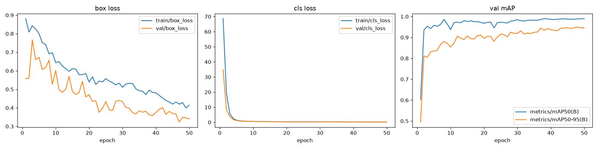

v1 학습 곡선 (box·cls loss, val mAP)

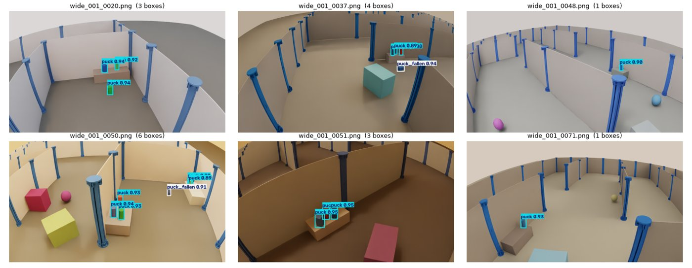

v1 합성 test 예측 샘플 (conf ≥ 0.5)

### 4. Arducam 실시간 확인 — 실물에서는 거의 못 잡음

합성 사진에서는 mAP50이 0.96~0.99인데, **Arducam 실시간 영상에서는 퍽을 거의 못 잡았어요**. 합성 데이터만으로 학습한 모델의 sim-to-real 차이예요.

- **장치 번호**: 이번엔 Arducam = `/dev/video0` (꽂는 순서마다 바뀜, 어제는 video2). `v4l2-ctl --list-devices`로 매번 확인
- **카메라가 뒤집힌 상태** → 프레임을 180° 돌려 예측하고 영상·검출 CSV를 저장하는 스크립트 사용 (`~/pa-course/runs/real_arducam_1022_flip/`)
- 원인 후보: 렌더링과 실물의 모습 차이(조명·반사·노이즈·색), 카메라 각도·거리, 약한 증강
- 결론: **실물 테스트셋을 따로 만들어 숫자로 판단하기로 함**. confidence는 planning 기준과 같은 0.5 유지

### 5. 노트북 v2 — 결과 폴더, mAP50 best, 실물 테스트, 클래스 재정의

v1을 고쳐 `experiment_1_v2.ipynb`를 만들었어요. 바뀐 점은 아래 5가지예요.

| 항목 | v1 | v2 |
|---|---|---|
| 결과 위치 | `~/pa-course/experiments/` | `yolo/train/results/<RUN_ID>/` (폴더에 `.gitignore`) |
| 가중치 선택 | Ultralytics `best.pt` (fitness 기준) | epoch마다 val **mAP50** 최고 → `weights/best_map50.pt`, 평가·추론도 이 파일 |
| 실물 테스트 | 없음 | `real_wide_test/`를 합성과 **따로** 평가: mAP50·클래스별, 사진별 정답 vs 예측, TP/FN/FP |
| loss 그래프 | loss별 따로 | train(실선)·val(점선) 한 그래프, 로그 축 |
| 클래스 | qr, puck, puck_fallen, signal_tower | **qr, puck_cyl, puck_box, signal_tower** |

- **클래스 결정**: 누운 퍽은 따로 구분하지 않고, 퍽은 **원기둥 / 직육면체**로만 나눠요. planning의 `shape`(cylinder / box)와 1:1
- **합성 데이터 재변환**: 기존 라벨은 모양 정보가 합쳐져 있어서 `convert_to_yolo.py --classes shape`로 `sim_raw/wide_001`을 다시 변환(6클래스) → 노트북이 4클래스로 합침. 변환 코드는 안 바꿈

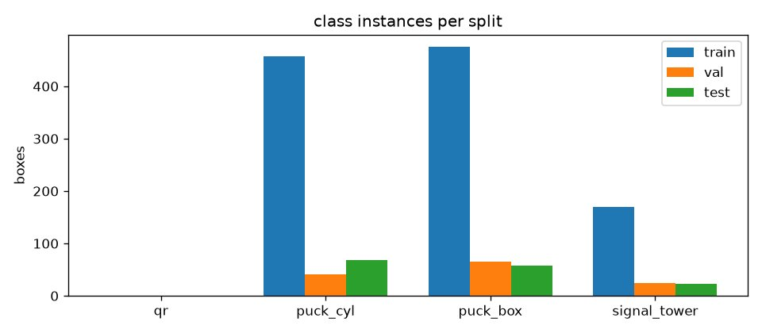

v2 합성 데이터 split별 클래스 상자 수

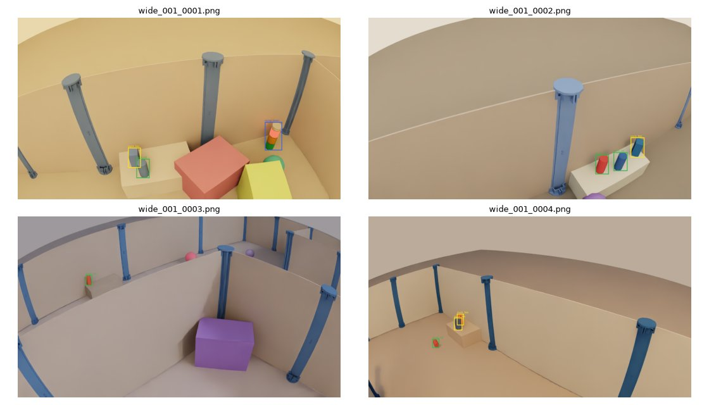

v2 학습 라벨 샘플 (모양별 색)

### 6. 실물 광각 49장 촬영·라벨링과 v2 결과

실제 Arducam 사진 49장(상자 94개)을 찍고 라벨을 달아 v2로 평가했어요. **합성 test mAP50 0.990 → 실물 0.176**이고, conf ≥ 0.5에서 정답 94개 중 13개만 맞게 잡았어요.

- **촬영**: 스페이스바로 저장하는 캡처 스크립트, 1280×720 원본, 180° 회전 후 저장 → `real_wide_test/images/real_0001~0049.jpg`
- **라벨링**: 마우스로 상자를 그리는 OpenCV 도구 → `labels/*.txt`. 물체 없는 배경 사진 2장 포함
- **학습**: 50 epoch, 9.5분. val mAP50 최고 epoch 38 (0.992) → `best_map50.pt`

| 데이터 | 전체 mAP50 | puck_cyl | puck_box | signal_tower | qr |
|---|---|---|---|---|---|
| 합성 val | 0.992 | 0.989 | 0.992 | 0.995 | – |
| 합성 test | 0.990 | 0.984 | 0.993 | 0.995 | – |
| **실물 49장** | **0.176** | 0.529 | 0.000 | – | 0.000 |

실물 정답 상자 라벨 기준: qr 23 · puck_cyl 68 · puck_box 3 · signal_tower 0. 실물 사진별 집계(conf ≥ 0.5, IoU ≥ 0.5): TP 13 · 놓친 정답 FN 81 · 오탐 FP 10.

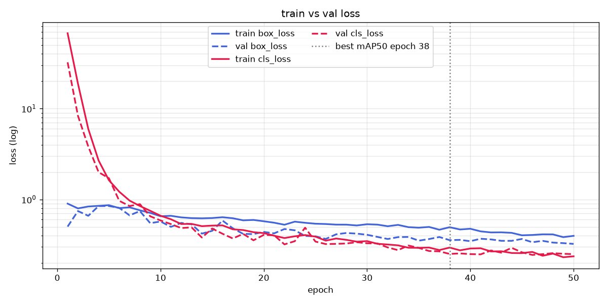

v2 train(실선)·val(점선) loss, 회색 점선 = best mAP50 epoch

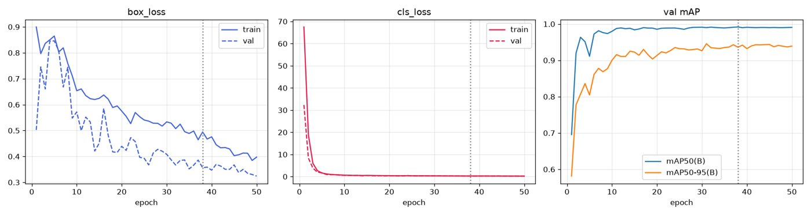

v2 loss별 train·val 비교와 val mAP

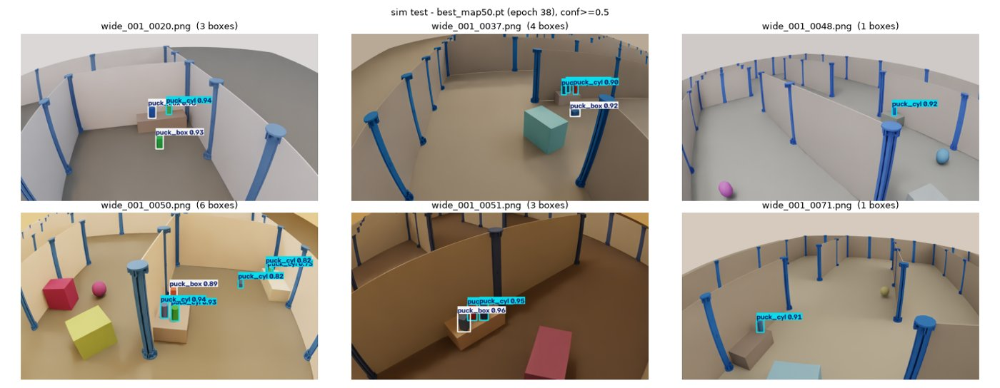

v2 합성 test 예측 (모양별로 잘 구분)

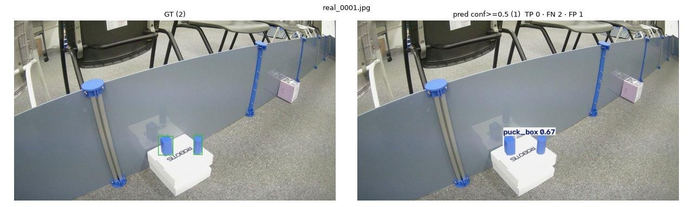

실물 real_0001: 직육면체 퍽을 `puck_box`로 잡았는데 정답 라벨이 puck_cyl(1)라 FP로 계산됨

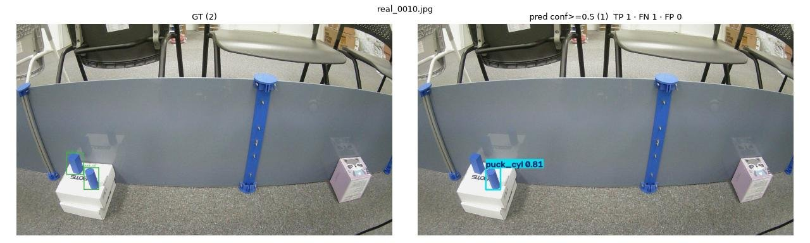

실물 real_0010: 원기둥 퍽 하나 맞힘(TP), 다른 하나 놓침

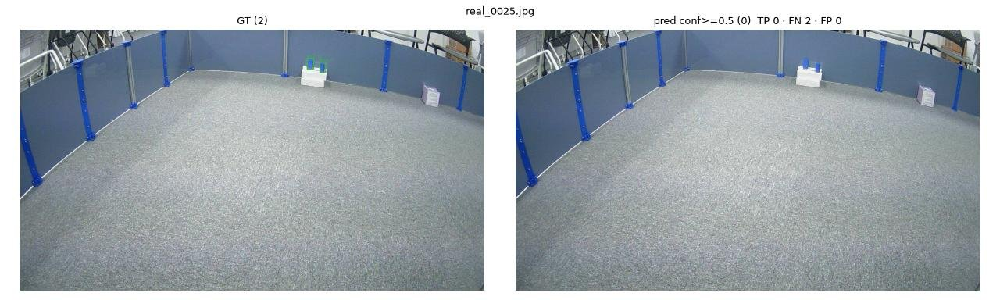

실물 real_0025: 멀리 있는 퍽 2개(수 픽셀) 모두 놓침

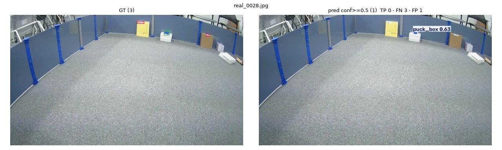

실물 real_0028: 먼 퍽을 puck_box로, QR 2개는 못 잡음

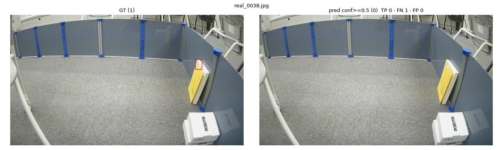

실물 real_0038: 벽의 QR(바코드) 못 잡음 — 합성 데이터에 QR이 없음

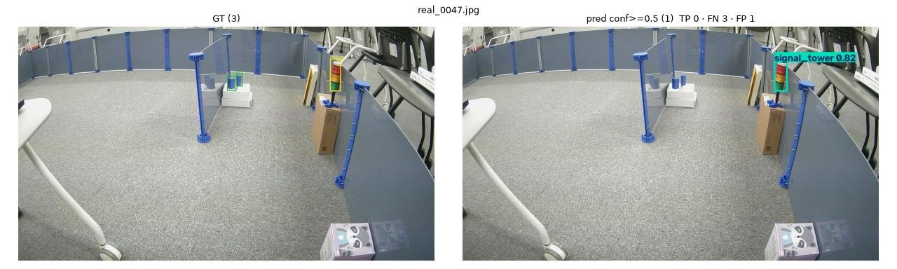

실물 real_0047: 신호등은 정확히 잡았지만 정답 라벨이 2번(예전 번호 = signal_tower)이라 틀린 것으로 계산됨

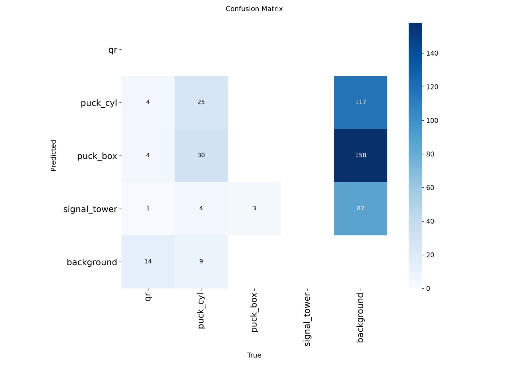

실물 49장 혼동 행렬

### 7. 분석 — 실물 0.176의 원인

점수가 낮은 데는 모델 문제와 라벨·데이터 문제가 섞여 있어요. 라벨부터 고쳐야 진짜 실물 점수를 알 수 있어요.

| 원인 | 근거 | 영향 | 해결 |
|---|---|---|---|
| **실물 라벨이 예전 3클래스 번호** | 라벨 파일의 퍽은 모양과 상관없이 전부 `1`, 신호등은 `2` (real_0001, real_0047) | 직육면체 퍽을 맞게 잡아도 FP, 신호등을 맞게 잡아도 FP → puck_box·signal_tower 점수 0 | 4클래스 번호(0 qr · 1 puck_cyl · 2 puck_box · 3 signal_tower)로 다시 라벨 |
| **합성 데이터에 QR이 없음** | 합성 split의 qr 상자 0개, 실물에는 23개 | qr 23개가 전부 FN | 합성 장면에 바코드·QR 판 추가, 또는 실물 데이터로 학습 |
| **멀리 있는 작은 퍽** | real_0025·real_0028처럼 반대편 벽 앞 퍽은 몇십 픽셀 | 대부분 FN | 가이드 3.4절 유효 거리(~1.8 m) 밖 사진은 따로 표시, 가까운 거리 사진 더 촬영 |
| **sim-to-real 차이** | 가까운 퍽도 자주 놓침(real_0005 등), confidence가 낮음 | recall 저하 | 도메인 랜덤화 강화 + 실물 사진을 섞어 재학습 |

- 좋은 신호도 있어요: 실물에서도 원기둥 퍽은 precision 0.93, 직육면체 퍽·신호등을 모양대로 구분해 잡은 사례가 있어요.
- 라벨을 고치면 TP 13 → 약 20 이상으로 오를 것으로 보여요(라벨 때문에 FP로 잡힌 10개 중 대부분). 정확한 값은 재라벨 후 다시 확인.

### 8. 다음 할 일과 팀에 확인할 것

**다음 할 일**

- [ ] 실물 49장 라벨을 4클래스 번호로 다시 달기 (라벨링 도구도 4클래스로) → 학습 없이 `best_map50.pt`로 실물만 재평가
- [ ] 합성 데이터에 QR·바코드 판 추가 여부 결정 (안 하면 qr은 실물 데이터로만 학습)
- [ ] 실물 사진 더 촬영 (가까운 거리·직육면체 퍽·신호등 포함) → 일부는 학습용, 일부는 `val_real`
- [ ] 도메인 랜덤화 실습 결과 반영해 합성 데이터 보강 → experiment_2
- [ ] 노출·화이트밸런스 고정 (`wb_check --dev /dev/video0`)
- [ ] URDF → USD(6.1, `-base fixed`) → MuJoCo 로딩 검사 실행
- [ ] `convert_to_yolo.py` 기본 클래스를 모양 구분 4클래스로 바꿀지 결정 (feat/camera_calib, main 충돌 처리와 같이)

**팀에 확인할 것**

- [ ] 퍽 모양 구분 4클래스(qr, puck_cyl, puck_box, signal_tower)로 가는 것 공유 — planning `shape`와 맞음
- [ ] 카메라 장착 방향: 실제로 뒤집어 다는지 (뒤집힌다면 ROS 노드에서 180° 회전 + 캘리브레이션 cx·cy 반영)
- [ ] PR #3에서 `yolo/dataset_gen`을 지운 이유
- [ ] 바코드·QR 실물과 원문, 적재함 치수
