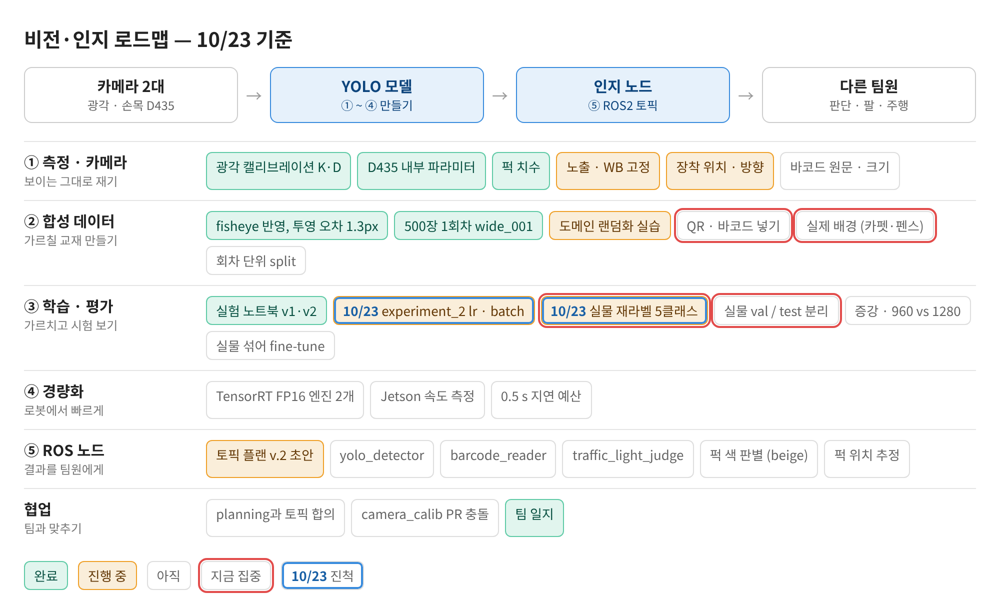
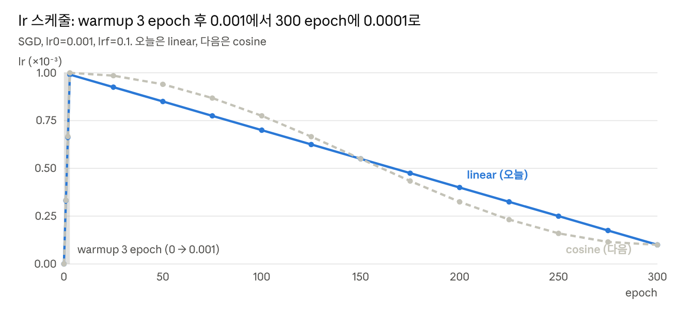
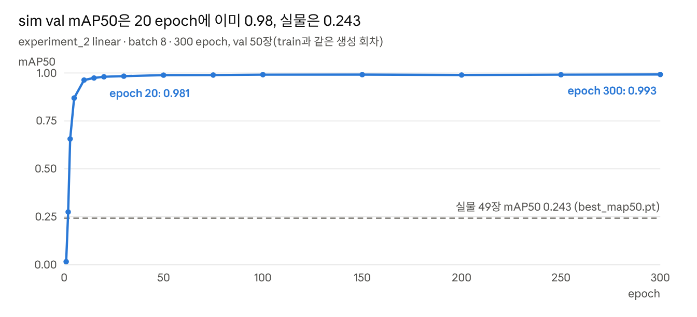
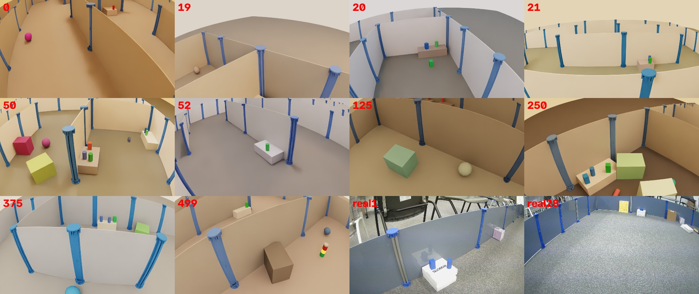
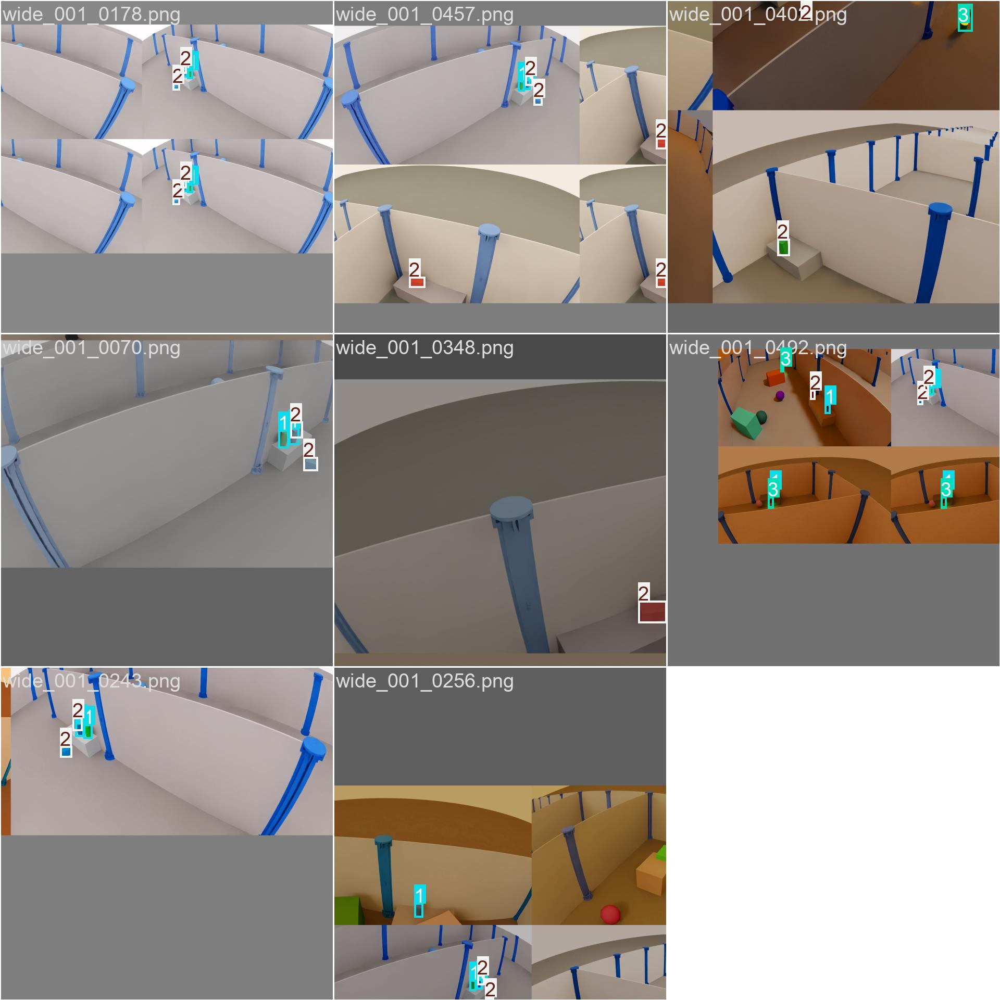
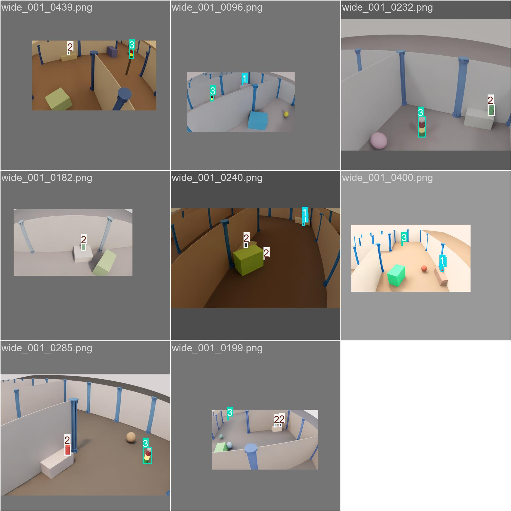

date: 2026.10.23

# Turtle Ninja 비전 작업 일지 (10/23)

> 작성: 김혜민 (비전 담당) · 2026-10-23

팀장 지시(lr 낮게 유지, batch 4단위로 키우기, epoch 수백)에 맞춰 **experiment_2**를 설계하고 돌렸어요. batch 8 결과는 sim val mAP50 **0.993**, 실물 **0.243**이에요.

- 학습 자체는 정상이에요. lr이 설계대로 적용됐어요(peak 0.000991 → 마지막 0.000103).
- 문제는 평가 설계예요. 500장이 생성 1회분(wide_001)에서 나와 train·val·test 분포가 같아서, val이 20 epoch 이후로 아무 정보도 주지 않아요.
- 실물 재라벨 도구를 만들었고, 바코드를 넣어 클래스를 5개로 늘렸어요.
- 입력 크기는 10/21에 960도 검토했는데 실험은 모두 1280으로만 돌렸어요. 다음 실험에서 비교해야 해요.

## 로드맵 진행

10/23에는 ③ 학습·평가에서 두 항목이 진척했어요. 파란 테두리가 그날 진척한 항목, 빨간 테두리가 지금 집중할 항목이에요.

비전·인지 로드맵 10/23 기준

- experiment_2 lr·batch: 진행 중 (linear 시작, batch 8 완료)
- 실물 재라벨 5클래스: 진행 중 (도구 완성, 라벨 작업 전)
- 다음 집중: 실물 재라벨 → 실물 val/test 분리 → 합성 데이터에 QR·바코드·실제 배경

## experiment_2 설계

팀장 지시를 lr 0.001→0.0001(lrf 0.1), batch 8·12·16·20, 300 epoch으로 옮겼어요. 스케줄러는 linear을 먼저 돌리고, 다음에 cosine을 돌려요.

- **optimizer를 SGD로 고정**했어요. experiment_1의 optimizer='auto'는 lr0를 무시하고 AdamW 약 0.00125를 골랐어요.
- lrf는 마지막 lr 값이 아니라 비율이에요. 마지막 lr = lr0 × lrf = 0.001 × 0.1 = 0.0001.
- warmup은 3 epoch, bias lr 0.01에서 시작, momentum 0.8→0.937이에요.

lr 스케줄 (experiment_2 설계값으로 계산)

| batch | 한 epoch step 수 (train 400장) | warmup step | warmup 길이 |
| --- | --- | --- | --- |
| 8 | 50 | 150 | 3 epoch |
| 12 | 34 | 102 | 3 epoch |
| 16 | 25 | 100 (최소값) | 4 epoch |
| 20 | 20 | 100 (최소값) | 5 epoch |

Ultralytics는 warmup을 최소 100 step 하기 때문에 batch 16·20에서는 warmup이 조금 길어져요. 노트북은 batch마다 results.csv의 실제 lr을 설계값과 비교해 ✔/⚠를 찍고, 메모리 부족(OOM)이 나면 기록만 하고 다음 batch로 넘어가요.

## 실행과 중복 실행 정리

16:41에 linear 실행을 시작했는데, 터미널과 에디터에서 한 번씩 실행돼 학습이 두 개 돌고 있었어요. 나중에 시작한 에디터 쪽 커널을 꺼서 정리했어요.

| 결과 폴더 | 시작 | 실행 위치 | 처리 |
| --- | --- | --- | --- |
| experiment_2_linear_20261023_164149 | 16:41:48 | 터미널 nbconvert (커널 135766) | 유지 |
| experiment_2_linear_20261023_164222 | 16:42:21 | 에디터 Jupyter 커널 136729 | kill 136729, 폴더 삭제 |

- 정리 후 nvidia-smi에는 학습 프로세스 하나(5.96 GB)만 남았어요.
- 결과는 b8/results.csv에 바로 저장돼요(train 하위 폴더 없음).
- 학습 중에는 에디터에서 노트북을 열지 않아요. nbconvert가 끝날 때 같은 파일에 결과를 덮어쓰기 때문이에요.

## batch 8 결과

batch 8은 300 epoch을 55분에 끝냈고 GPU 메모리는 최대 6.05 GB를 썼어요. lr은 설계대로 들어갔어요 ✔.

sim val mAP50은 20 epoch에 이미 0.98, 실물은 0.243 (b8/results.csv, run_result.json)

| 평가 세트 | mAP50 | mAP50-95 | P | R |
| --- | --- | --- | --- | --- |
| sim val (50장) | 0.993 | 0.945 | 0.969 | 0.980 |
| sim test (50장) | 0.979 | 0.931 | 0.962 | 0.960 |
| 실물 (49장, 예전 라벨 번호) | 0.243 | 0.126 | 0.322 | 0.186 |

- 실물 클래스별: puck_cyl 0.727, puck_box 0.002, qr 0. TP 27 / FN 67 / FP 29.
- 실물 점수는 아직 믿을 수 없어요. 라벨이 퍽을 모두 1로 적어 두어서, 모델이 직육면체를 맞게 잡아도 FP와 FN으로 계산돼요(real_0001~0004가 모두 TP 1, FP 1, FN 1).
- batch 12는 이어서 학습 중이에요. 16·20은 메모리 부족 가능성이 높아요.

## 학습 검토: 평가 설계가 문제

학습이 빨리 수렴하는 건 학습 실패가 아니라, val이 train과 같은 분포라서 너무 쉽기 때문이에요. 그래서 지금 sim 지표로는 batch나 스케줄러 비교 결론을 낼 수 없어요.

- **500장 모두 생성 1회분**(sim_raw/wide_001, 프레임 0000~0499)이고, 프레임 단위로 무작위 8:1:1 split했어요(예: 0019 train, 0020 test).
- 인접 프레임끼리 완전히 같지는 않아요(흑백 상관 0.1~0.4). 하지만 경기장·벽·퍽 모델·색 범위가 모두 같은 생성기에서 나와요.
- 박스 크기(한 변 중앙값)도 train 44px, val 44px, test 42px, 실물 42px로 같아요. 크기는 원인이 아니에요.
- 실물에는 회색 카펫, 남색 펜스, 펜스 너머 의자가 있는데 sim에는 없고, QR(실물 23개)과 바코드는 학습 데이터에 0개예요.

sim 프레임 10장과 실물 2장 (오른쪽 아래 real1, real28)

### 실제 학습 입력 (mosaic)

mosaic은 학습 이미지 4장을 잘라 붙여 입력 1장(1280×1280)으로 만드는 증강이에요. 마지막 10 epoch(close_mosaic=10)에는 끄고 원본 1장에 크기·위치 증강만 해요.

1 epoch 학습 입력: mosaic 켜짐

291 epoch 학습 입력: mosaic 꺼짐, 회색 여백이 넓음

- 입력이 거의 다 베이지·흰색·갈색 벽이에요. 증강은 있는 장면을 섞고 늘리고 줄이기만 해서, 없는 배경은 만들지 못해요.
- 큰 큐브와 공은 라벨 없는 방해 물체예요.
- 데이터가 400장이라 mosaic에 비슷한 구도가 자주 겹쳐요.

### 바꿀 것 (효과 큰 순서)

1. 재라벨한 실물을 real_val(모델 선택·early stop)과 real_test(최종 보고)로 나눠요. 기준을 sim val에서 real val mAP50으로 바꿔요.
2. sim은 생성 회차 단위로 나눠요. seed와 배치를 바꿔 wide_001~00N을 만들고 회차별로 train/val/test를 정해요.
3. 생성 다양성: QR·바코드 에셋, 바닥(카펫)·벽 색, 벽 너머 배경, 물체 질감·색, 카메라 높이·pitch, 블러·노이즈·JPEG. 도메인 랜덤화 코드는 혜민님 실습 중이라 손대지 않았어요.
4. 학습 변수: 지금은 hsv_h만 지정돼 있어요. 후보는 아래 표예요.
5. 실물 라벨 20~30장을 train에 섞어요.

| 변수 | 제안값 | 이유 |
| --- | --- | --- |
| hsv_s / hsv_v | 0.7 / 0.5 | 실물 밝기·채도 차이 |
| scale | 0.7 | 원거리·근거리 |
| degrees / translate | 5 / 0.2 | 카메라 흔들림·구도 |
| mixup / copy_paste | 0.1 / 0.3 | 배경·물체 조합 |
| erasing | 0.4 | 부분 가림 |
| freeze | 10 | backbone 고정, 합성 질감 과적합 방지 |
| weight_decay | 0.001 | 정규화 |

## 실물 재라벨 도구와 5클래스

바코드가 경기장에 나온다고 해서 클래스를 5개로 늘렸어요. 실물 49장(박스 94개)의 박스 위치는 맞고 클래스 번호만 예전 기준이라, 번호만 고치는 도구 yolo/train/relabel_real.py를 만들었어요.

| 예전 번호 | 박스 수 | 새 번호 | 처리 |
| --- | --- | --- | --- |
| 0 qr | 23 | 0 qr | 자동 |
| 1 puck | 68 | 1 puck_cyl / 2 puck_box | 사람이 키로 고름 |
| 2 signal_tower | 3 | 3 signal_tower | 자동 |
| – | – | 4 barcode | 마우스로 새로 그림 |

- 실행: ~/pa-course/.venv-yolo/bin/python relabel_real.py (CPU만 써서 학습과 같이 돌려도 돼요).
- u로 확인이 필요한 퍽으로 이동 → 1/2. 드래그로 새 박스를 그리면 barcode?로 생기고 숫자키로 확정. r 삭제, a/d 이미지 이동(자동 저장), q 저장 후 종료.
- 결과는 real_wide_test/labels_5cls/에 저장돼요. 원본 labels/는 그대로이고, 중간에 꺼도 이어서 할 수 있어요.
- 지금 돌고 있는 experiment_2는 4클래스라 바코드를 학습하지 않아요. 5클래스 학습은 합성 데이터에 QR·바코드를 넣는 것부터 해야 해요.

## 입력 크기 960 vs 1280

실험은 전부 imgsz=1280으로만 돌렸어요. 10/21 분석에서 960도 1.2m까지는 여유가 있다고 결론 내놓고 비교 실험에 넣지 않았어요.

| 거리 | 1280 입력 (중앙 / 가장자리) | 960 입력 (환산) |
| --- | --- | --- |
| 1.2m | 21px / 16px | 약 16px / 12px |
| 1.8m | 14px / 11px | 약 10px / 8px |

- 학습 때는 1280×720 원본을 1280×1280 정사각형으로 넣어요(rect: false). mosaic이 꺼지는 구간에는 입력의 약 44%가 회색 여백이에요. val·추론은 1280×736이에요.
- 960은 픽셀 수가 약 56%라 batch 16까지 올릴 수 있어요. 대신 1.8m 퍽은 8~10px로 작아져요.
- 배포 계획의 광각 엔진은 736×1280(TensorRT FP16)이에요. 실물 mAP50과 거리별 recall로 960과 1280을 비교한 뒤 확정해요.

## 보류와 다음 할 일

MuJoCo 실습(URDF → USD → MuJoCo)은 0단계(환경)까지 하고 보류했어요.

- [ ] experiment_2 linear 나머지 batch(12·16·20) 확인, 이어서 COS_LR = True로 cosine 실행
- [ ] 실물 49장 재라벨 (relabel_real.py)
- [ ] 재라벨 후 best_map50.pt로 실물 평가 다시 (labels_5cls)
- [ ] experiment_3: 실물 val/test 분리, 증강 변수, imgsz 960 vs 1280 비교 (코드 수정 허락 필요)
- [ ] 합성 데이터에 QR·바코드 넣을지 결정, 생성 회차 단위 split
- [ ] 카메라 노출·WB 고정 (wb_check --dev /dev/video0), 카메라 거꾸로 장착 확인
