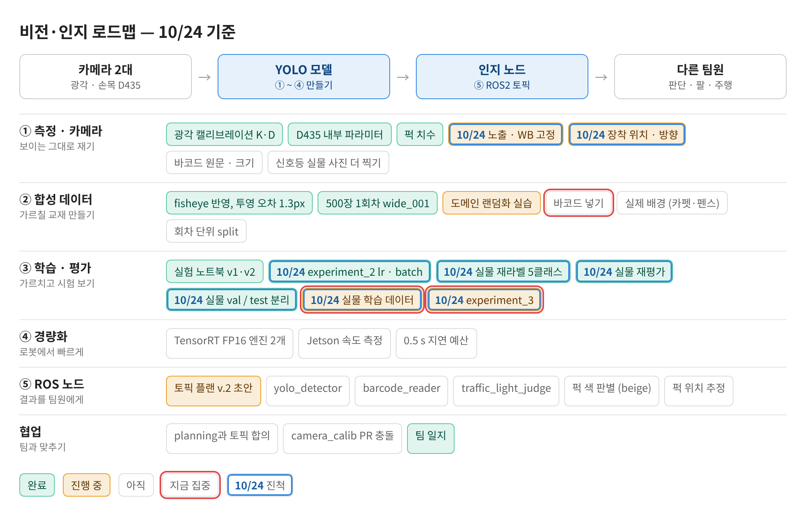
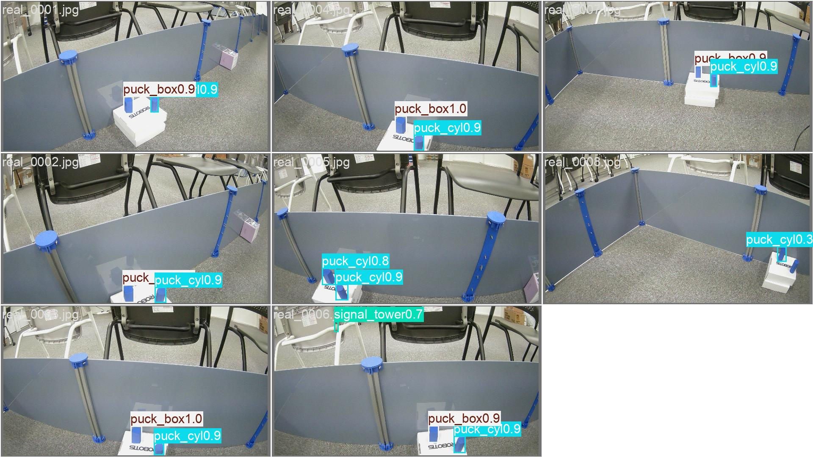
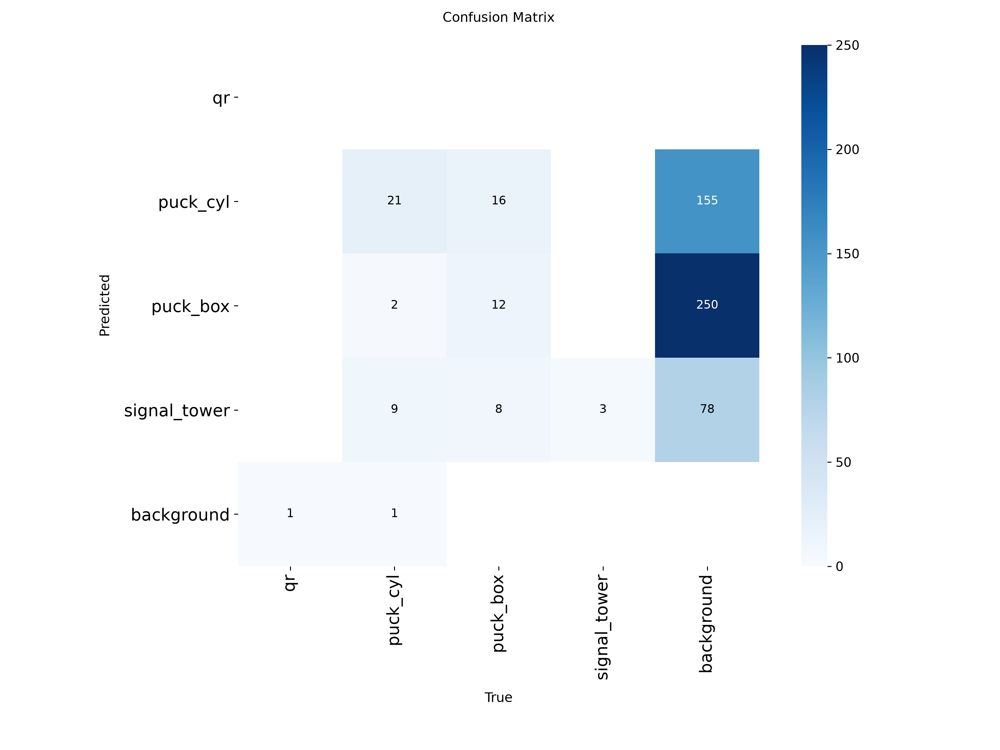
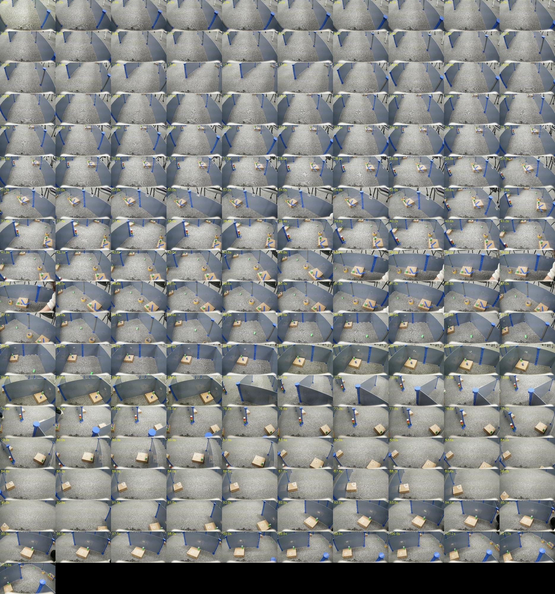
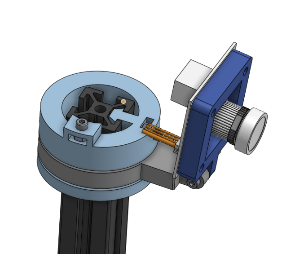
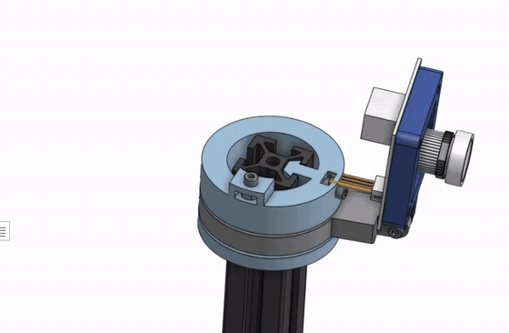

date: 2026.10.24

# Turtle Ninja 비전 작업 일지 (10/24)

> 작성: 김혜민 (비전 담당) · 2026-10-24

실물 test 라벨을 5클래스로 다시 달고 experiment_2 모델을 재평가했더니 실물 mAP50이 0.24~0.30 → **0.57~0.62**로 올랐다(퍽은 0.80~0.89). 낮은 점수의 주원인은 모델보다 **라벨**이었다. 실물 49장을 val 23 / test 26으로 나누고, 팀원 영상 프레임 174장을 초벌 라벨 → 확인해 실물 학습 데이터로 만든 뒤 **experiment_3**(sim+실물, 7개 run)를 돌려 두었다. Onshape으로 버드아이뷰 카메라 브라켓도 만들었다.

- 결과·평가 파일은 archive에, 데이터셋만 레포에 쌓기로 정함
- nbs=64 때문에 batch 8과 16 결과가 똑같았던 원인을 찾음 → experiment_3는 nbs=batch
- 카메라는 자동 노출·WB 그대로 쓰기로 결정

## 로드맵 진행

오늘은 ② 데이터(실물 라벨·실물 학습셋)와 ③ 평가(실물 val/test 분리, 재평가)가 진척했다. 파란 테두리가 오늘 진척한 항목.

비전·인지 로드맵 10/24 기준

- ✅ 실물 test 라벨 5클래스로 재작성 (real_wide_test/labels_5cls)
- ✅ 실물 val/test 분리 (real_split5, val 23 / test 26)
- 🟡 실물 학습 데이터 174장 (qr 라벨 기준 확인 필요)
- 🟡 experiment_3 학습 중
- ✅ 버드아이뷰 카메라 브라켓 (Onshape)

## 실물 재평가 (새 라벨)

| batch | sim val mAP50 | 실물 (옛 라벨) | 실물 (새 라벨) | puck_cyl | puck_box | signal_tower |
|---|---|---|---|---|---|---|
| 8 | 0.993 | 0.243 | 0.604 | 0.817 | 0.847 | 0.753 |
| 12 | 0.992 | 0.297 | 0.567 | 0.871 | 0.888 | 0.509 |
| 16 | 0.993 | 0.243 | 0.604 | 0.817 | 0.847 | 0.753 |
| 20 | 0.993 | 0.222 | 0.615 | 0.804 | 0.824 | 0.830 |

- qr은 모든 모델이 0 (실물 qr 1개뿐), 바코드는 아직 학습 안 함
- batch 8과 16이 완전히 같은 건 nbs=64 때문(작은 batch는 기울기를 모아서 64 단위로 업데이트)

b12 실물 예측 예시

b12 confusion matrix (실물)

## 실물 val/test 분리

실물 49장을 학습에 쓰지 않고 **val 23장(real_0014~0036) / test 26장(나머지)**으로 나눴다. val은 모델 고르기용, test는 마지막 점수용. 학습용 실물은 따로 모은다.

## 학습용 실물 데이터 모으기

- 직접 촬영: capture_real.py 작성(SPACE 사진, r 녹화). 노출·WB 고정은 카메라가 자동 값을 알려주지 않아 초록색/과노출이 됨 → **자동 그대로 쓰기로 결정**
- 팀원 영상 프레임 real_raw(357장) 사용
- prelabel_real_raw.py로 초벌 라벨: 박스 524개, 확인 필요 273개, 빈 사진 136장
- review_labels.py로 확인: 179장 확인, **174장 사용**

| 구분 | 사진 | qr | puck_cyl | puck_box | signal_tower | barcode |
|---|---|---|---|---|---|---|
| real train | 174 | 124 | 120 | 73 | 72 | 58 |

qr 124개는 펜스의 흰 사각형을 qr로 단 것일 수 있다(val/test에서는 barcode). 기준을 맞춰야 한다.

팀원 영상 프레임 모음 (real_raw)

## experiment_3 설계와 실행

- 5클래스, 학습 = sim + 실물 174장
- 모델 선택은 실물 val 23장 기준(2에폭마다 평가, 50번 안 좋아지면 중단)
- nbs=batch, SGD, lr0 0.001, epochs 300, imgsz 1280

| run | batch | lr 스케줄 | 증강 | 기타 | 실물 학습 |
|---|---|---|---|---|---|
| A | 16 | linear | 기본 |  | O |
| B | 16 | cosine | 기본 |  | O |
| C | 16 | cosine | 강하게 |  | O |
| D | 8 | cosine | 강하게 |  | O |
| E | 16 | cosine | 강하게 | imgsz 960 | O |
| F | 16 | cosine | 강하게 | freeze 10 | O |
| S | 16 | cosine | 강하게 | sim만 | X |

19:54부터 실행 중, 결과는 archive results/experiment_3_20261024_195441/

## 버드아이뷰 카메라 브라켓

Onshape으로 버드아이뷰 카메라 브라켓을 만들었다.

Onshape 카메라 브라켓 (위: 사진, 아래: 참조 영상 GIF)

## 다음 할 일

- [ ] experiment_3 결과 해석 → 실물 val/test 기준 최고 run 고르기
- [ ] 펜스 흰 사각형 qr / barcode 기준 정하고 real train 라벨 맞추기
- [ ] 합성 데이터에 바코드 추가
- [ ] signal_tower 실물 사진 더 모으기
- [ ] 레포에 쌓인 이전 학습 결과를 archive로 옮기기
