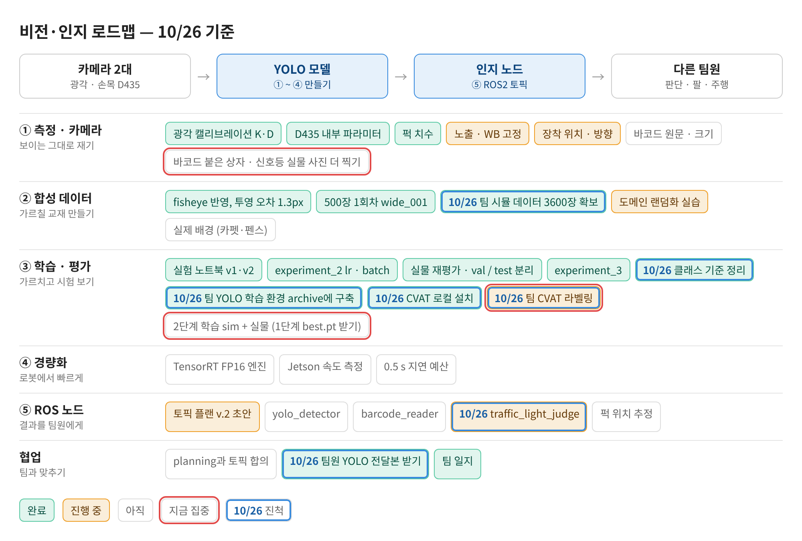
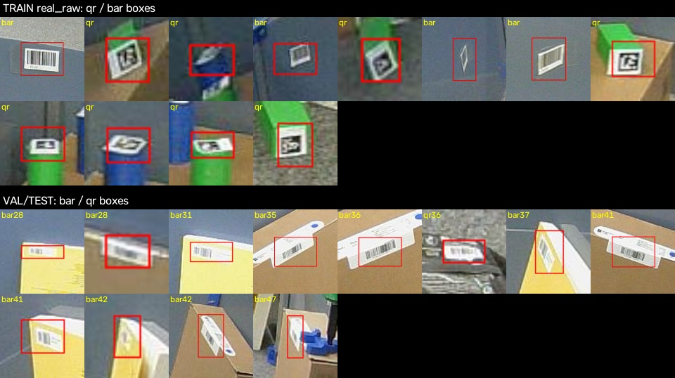
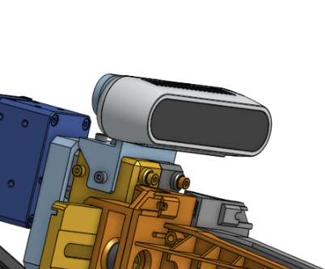
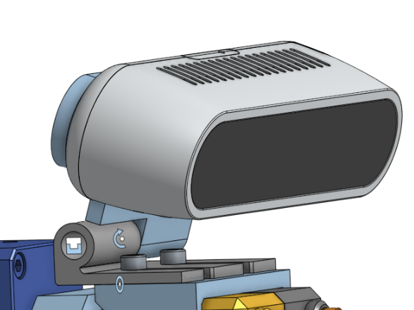
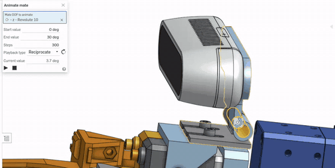

date: 2026.10.26

# Turtle Ninja 비전 작업 일지 (10/26)

> 작성: 김혜민 (비전 담당) · 2026-10-26

오늘은 **팀 기준으로 갈아타고 학습 준비를 끝낸 날**이에요. 학습은 돌리지 않았어요.

- AprilTag는 전용 검출기가 맡고, YOLO는 팀 6클래스(red/green × 원기둥·직육면체, barcode, traffic_light)로 가요.
- experiment_3의 바코드 0점 원인을 사진으로 다시 확인했어요. 라벨 섞임이 아니라 **학습셋에 상자 바코드가 없어서**예요.
- 팀원 YOLO 전달본(시뮬 3600장, 실제 154장)을 archive에 풀고 가상환경·data.yaml까지 만들었어요. 레포는 건드리지 않아요.
- CVAT을 로컬에 설치하고, 팀장님 CVAT에서 신호등 184장을 라벨링했어요.
- 리얼센스 브라켓을 각도 조절되게 바꾸었어요(Onshape).

## 로드맵 진행

오늘은 ③ 학습·평가 칸이 가장 많이 움직였어요. 파란 테두리는 오늘 진척한 항목, 빨간 테두리는 다음에 집중할 항목이에요.

비전·인지 로드맵 10/26 기준

- ✅ 클래스 기준 정리 (팀 6클래스, AprilTag는 전용 검출기)
- ✅ 팀 YOLO 학습 환경 archive에 구축 / 팀 시뮬 데이터 3600장 확보
- ✅ CVAT 로컬 설치
- 🟡 팀 CVAT 라벨링 (신호등 184장, 사진 포함 내보내기 남음)
- 🟡 traffic_light_judge (HSV로 색 판정하는 방향 확인)
- ✅ experiment_3 (10/25 결과: 실물 test 0.745)

## 클래스 기준 정리와 라벨 확인

**AprilTag는 YOLO에서 뺀다.** 전용 검출기가 ID와 위치·각도까지 알려주기 때문이에요. 멀리 있는 퍽의 태그는 못 읽을 수 있지만, 퍽 자체는 YOLO가 잡아요.

| 번호 | 팀 기준 (이제) | 우리 experiment_3 (이전) |
|---|---|---|
| 0 | red_cyl | apriltag(예전 qr) |
| 1 | green_cyl | puck_cyl |
| 2 | red_box | puck_box |
| 3 | green_box | signal_tower |
| 4 | barcode | barcode |
| 5 | traffic_light | – |

**바코드 0점 원인 정정.** 10/25에는 라벨이 섞였다고 봤는데 틀렸어요.

- 학습 사진의 qr 124개 = 퍽 위 AprilTag
- val/test의 barcode = 상자에 붙은 진짜 바코드
- 학습 사진의 바코드는 회색 벽에 붙은 것뿐 → 상자 바코드 사진이 필요

위: 학습 사진의 qr·bar 박스, 아래: val/test의 bar 박스

## 팀 YOLO 학습 환경 (archive)

| 항목 | 내용 |
|---|---|
| 위치 | archive/team_yolo/yolo/ (TIL git 제외) |
| 가상환경 | torch 2.11.0+cu128, ultralytics 8.4.185, albumentations 2.0.8, CUDA True |
| 데이터 | 시뮬 2854 / 358 / 388, 실제 106 / 24 / 24 |
| data.yaml | prepare_data.py --real_repeat 6, 2단계 실제 비중 약 18% |
| 설정 | imgsz 960, batch 16, AdamW, mosaic 끔, hsv_h 0.01 |
| 순서 | 1단계 시뮬만(150 ep) → 2단계 시뮬+실제(60 ep) |

- 1단계 best.pt가 tar에 없어서 팀원에게 받아야 해요. 학습은 아직 안 돌렸어요.

## CVAT 설치와 팀 라벨링

- 로컬: CVAT v2.80.0을 Docker로 archive/cvat에 설치, localhost:8080 로그인까지
- 팀장님 CVAT: organization 합류, 신호등 task 라벨링 → 184프레임, traffic_light 182박스
- 라벨만 내보내져서(Save images 꺼짐) 내일 사진 포함으로 다시 받아요. 팀장님 노트북이 꺼지면 서버도 꺼져요.

## 신호등 색 판정 방향

YOLO는 traffic_light 박스만 찾고, 박스 안을 HSV로 봐요. V(밝기)가 아주 높은 픽셀이 없으면 꺼짐, 있으면 그 부분의 H(색상)로 빨강·노랑·초록을 정해요. 램프가 하얗게 날아가면 둘레 색이나 밝은 부분의 위치를 같이 봐요. 문턱값은 라벨링한 신호등 184장으로 정해요.

## 리얼센스 브라켓 각도 조절

Onshape으로 리얼센스(D435) 브라켓을 각도가 조절되게(0~30°) 바꿨어요.

전: 카메라가 브라켓에 고정

후: 힌지로 각도 조절

각도 조절 동작 (0~30°)

## 작업 공간 정리

- 레포는 건드리지 않기로. 오전에 바꿨던 레포 파일 4개는 원래대로 되돌림
- capture_real.py 저장 위치 → archive/team_yolo/yolo/datasets/real_frames/<이름>/
- TIL Day52~55(10/21~24) 정리

## 다음 할 일

- [ ] 팀장님 CVAT에서 신호등 task를 사진 포함으로 다시 내보내기
- [ ] 배정받은 task 라벨링 마무리 → completed
- [ ] 바코드 붙은 상자 · 신호등 실물 사진 찍기
- [ ] 1단계 best.pt 받기 → 2단계 학습
- [ ] 신호등 HSV 판정 문턱값 실험
- [ ] 레포에 쌓인 이전 학습 결과 옮기기 (위치 받으면)
