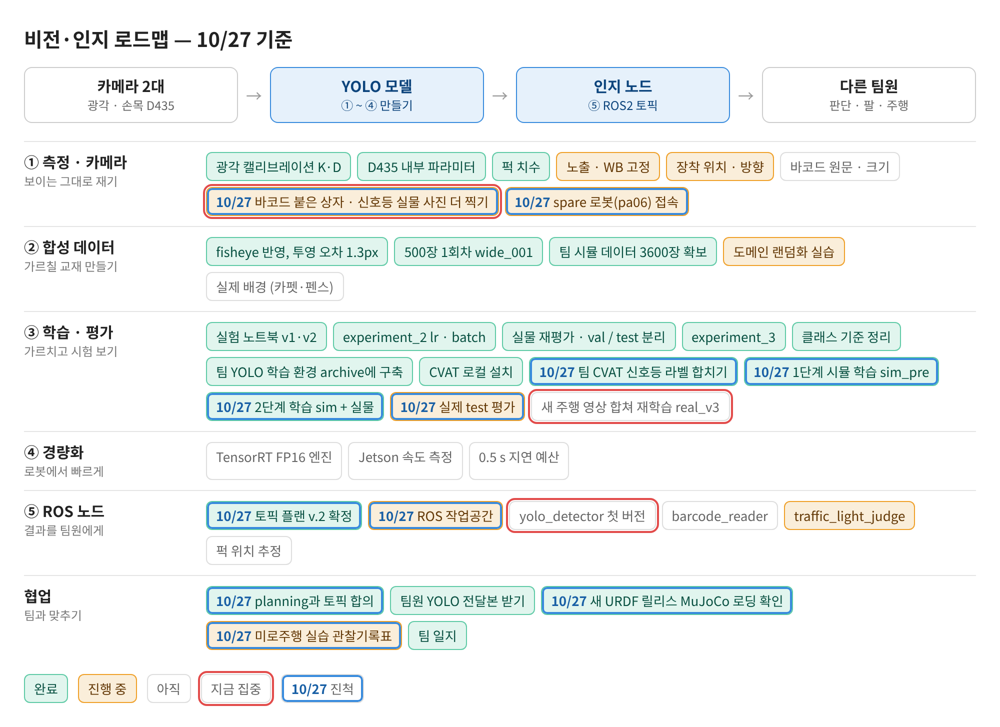
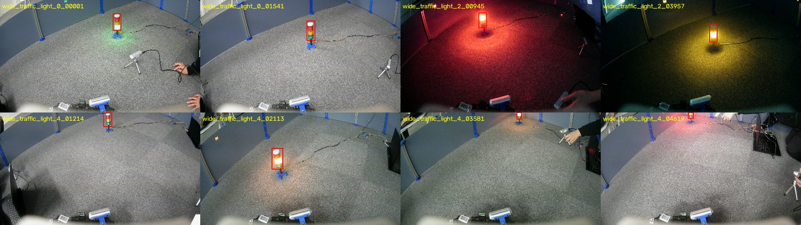
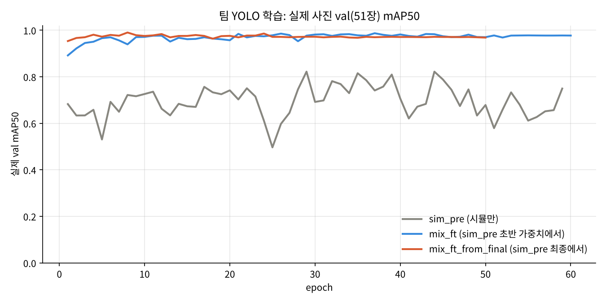
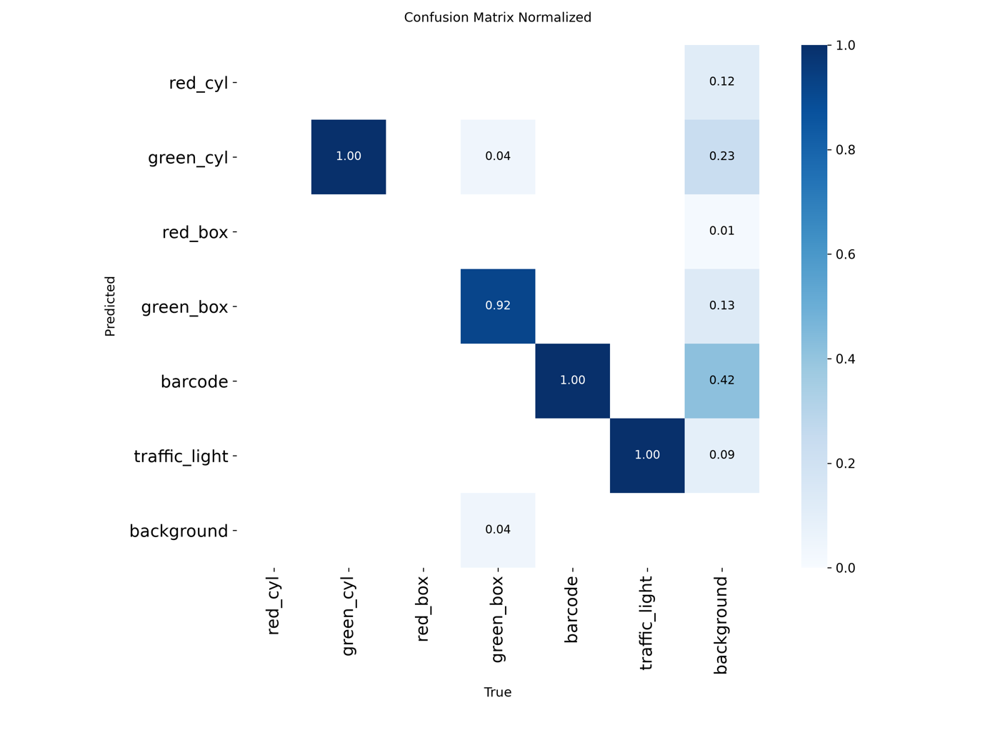
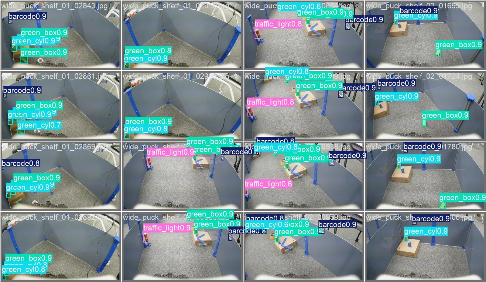
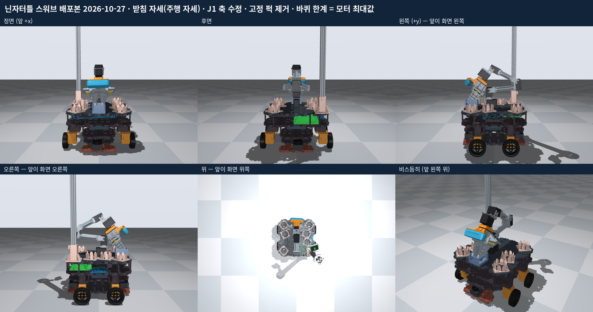

date: 2026.10.27

# Turtle Ninja 비전 작업 일지 (10/27)

오늘은 **팀 YOLO 2단계 학습을 끝내고, 인지 노드를 시작할 준비를 한 날**이에요.

- 신호등 사진을 팀 실제 데이터에 합쳐 real_v2를 만들고, 2단계 학습까지 돌렸어요. 실제 val mAP50이 0.822에서 0.99로 올랐어요.
- 새 URDF 릴리스(스워브)를 MuJoCo로 불러와 뷰어로 확인했어요.
- planning과 토픽을 맞췄어요. v.2 그대로, frame_id는 URDF 이름, ROS 2 Lyrical이에요.
- spare 로봇 접속은 실패했어요. 원인은 라즈베리 파이 전원이 꺼져 있던 거였어요.
- 팀장님과 주행 영상 1개를 더 찍어 라벨링했어요. 다음에 합쳐서 다시 학습해요.

## 로드맵 진행

③ 학습·평가와 ⑤ ROS 노드 칸이 많이 움직였어요. 파란 테두리는 오늘 진척한 항목, 빨간 테두리는 다음에 집중할 항목이에요.

비전·인지 로드맵 10/27 기준

- ✅ 팀 CVAT 신호등 라벨 합치기 (사진 포함 내보내기 → real_v2)
- ✅ 1단계 시뮬 학습 sim_pre / 2단계 학습 sim + 실물
- ✅ 토픽 플랜 v.2 확정, planning과 토픽 합의
- ✅ 새 URDF 릴리스 MuJoCo 로딩 확인
- 🟡 실제 test 평가 (실행, 정리 남음) / ROS 작업공간 / spare 로봇 접속 / 관찰기록표

## 신호등 데이터 합치기 (real_v2)

어제 라벨만 내보내졌던 신호등 task를 **Save images를 켜고** 다시 받았어요(184장).

- 팀 데이터 real은 그대로 두고 복사해서 real_v2를 만들었어요.
- 같은 영상의 비슷한 프레임이 train과 val에 섞이면 점수가 부풀려져요. 그래서 **영상 단위로** 나눴어요: 영상 2·4 → train, 0 → val, 1 → test.
- 화면 아래 18%(로봇 차체, 임시로 붙인 바코드)는 회색으로 가렸어요. 라벨 없는 바코드가 '배경'으로 학습되는 걸 막기 위해서예요. 신호등 박스는 전부 위쪽이라 영향이 없어요.
- 결과: real_v2 = train 252 / val 51 / test 35장

신호등 라벨 예시 (CVAT 내보내기)

## 팀 YOLO 2단계 학습

| 학습 | 시작 가중치 | 최고 실제 val mAP50 | 마지막 mAP50 / mAP50-95 |
|---|---|---|---|
| sim_pre | – (시뮬만, 59 ep) | 0.822 (ep29) | – |
| mix_ft | sim_pre 초반 (≈ep3~4) | 0.987 (ep37) | 0.977 / 0.779 |
| mix_ft_from_final | sim_pre 최종 best | 0.990 (ep8) | 0.968 / 0.795 (50 ep 조기 종료) |

- 실제 사진을 섞자 크게 올랐어요. 두 mix 학습은 거의 같아요.
- mix_ft는 sim_pre가 끝나기 전에 초반 가중치로 시작해서, 최종 가중치로 한 번 더 돌려 비교했어요.

실제 val mAP50 변화 (epoch별)

**주의할 점**

- val에 빨간 물체(red_cyl, red_box)가 없어요. 그래서 0.99는 빨간 물체 성능을 포함하지 않은 숫자예요.
- 배경 오검출(아무것도 없는 곳에 박스)이 green_cyl·green_box·barcode 쪽에 있어요. 실제 사용은 conf 0.5 기준이라 test에서 다시 확인해요.

혼동 행렬 (mix_ft_from_final, 실제 val)

val 예측 예시 (mix_ft_from_final)

## 새 URDF 릴리스 MuJoCo 확인

팀이 10/27 스워브 버전 URDF(USD 포함)를 배포했어요. 조향 4 · 구동 4 · 팔 5 · 손가락 2 관절이에요.

- 정적 검사(inspect_robot.py): 오류 0, 경고 3 (package:// 경로, mimic)
- MuJoCo 로딩(mujoco_smoke.py): 7.2초, body 16 · 관절 15 · geom 787 · mesh 176
- 중력 0·명령 없이 돌려도 조향 관절이 ±0.47~0.62 rad 돌아가요 → REVIEW (충돌 형상 겹침 의심)
- 뷰어에서 Reset하면 팔이 떨어져요. URDF 로더가 모터(actuator)를 만들지 않고 중력은 켜져 있어서예요. 모터를 붙인 MJCF가 다음 단계예요.
- Onshape 어셈블리에 직접 관절(dof_ 이름)을 주고 onshape-to-robot으로 URDF를 뽑는 방법도 알아봤어요. 받은 문서는 링크된 부품이라 내 복사본이 필요해요.

새 릴리스 모습 (팀 배포본 그림)

## planning과 토픽 합의

| 항목 | 결정 |
|---|---|
| 토픽 | planner's wish v.2 그대로 (detections · task_text · traffic_light) |
| label · shape | 팀 6클래스 YOLO 결과로 바로 채움 (red/green, cylinder/box) |
| id · orientation | AprilTag 검출기. 못 읽으면 id "", orientation (0,0,0,0) |
| position | 첫 버전은 NaN, 위치 추정은 다음 |
| frame_id | URDF 이름: 광각 birdeye_camera_optical_frame, 손목 d435_cad_optical_proxy_frame |
| 환경 | ROS 2 Lyrical, 작업공간 archive/ros_ws |

- (0,0,0,0)은 '서 있음'(0,0,0,1)으로 오해되지 않게 일부러 넣는 '모름' 값이에요.
- NaN(Not a Number)은 '값 없음'이에요. 0을 넣으면 '카메라 위치에 퍽이 있다'로 읽혀요. planning은 NaN 검출을 버리므로 첫 연결 테스트는 topic echo로 확인해요.

## spare 로봇 접속

- pa06.local 이름 접속 실패 → arp-scan으로 교실 와이파이(10.2.12.x)를 훑음: 17대 응답, 라즈베리 파이 없음
- 원인: 파이 전원이 꺼져 있었음
- IP는 1주일마다 바뀜(DHCP) → MAC 주소로 IP 예약을 요청할 예정

## 기타

- 미로주행 실습 관찰기록표 엑셀(29탭, 판정 드롭다운·자동 집계)
- 팀장님과 주행 영상 1개 촬영·라벨링 (다음에 real_v3로 합침)

## 다음 할 일

- [ ] 새 주행 영상 CVAT 내보내기 → real_v3 (가리기 끄기, 시간 구간으로 나누기) → 재학습
- [ ] 실제 test 평가 클래스별 정리
- [ ] spare 로봇 켜고 접속, IP 예약 요청
- [ ] archive/ros_ws 만들고 yolo_detector 첫 버전
- [ ] 신호등 HSV 문턱값 실험 (찍어 둔 사진 사용)
