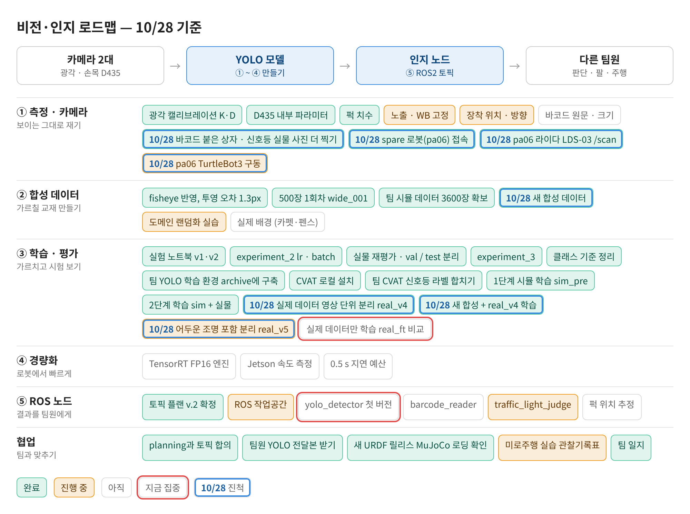
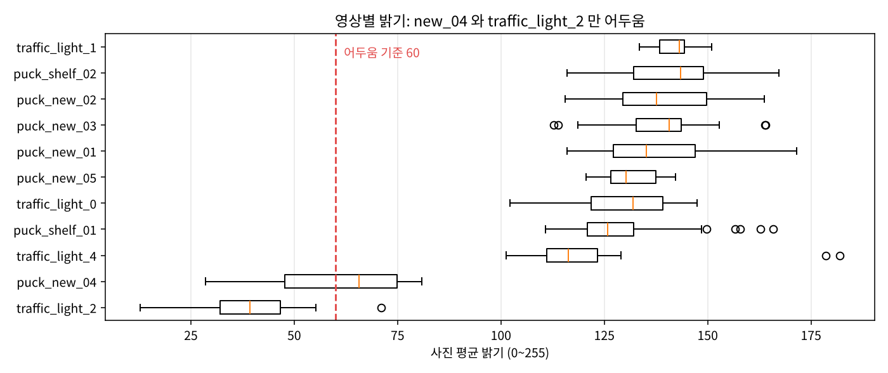
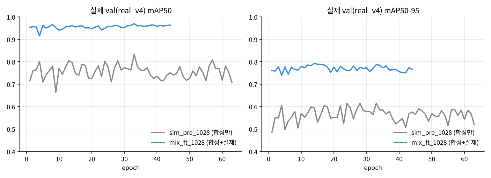
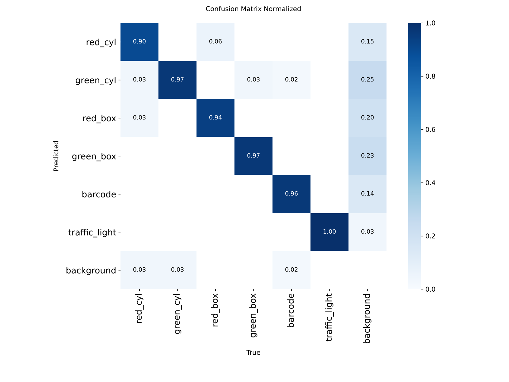
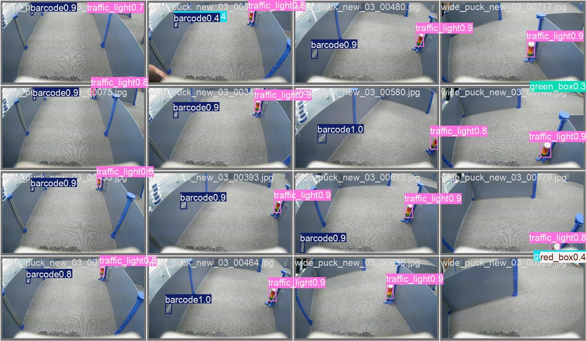
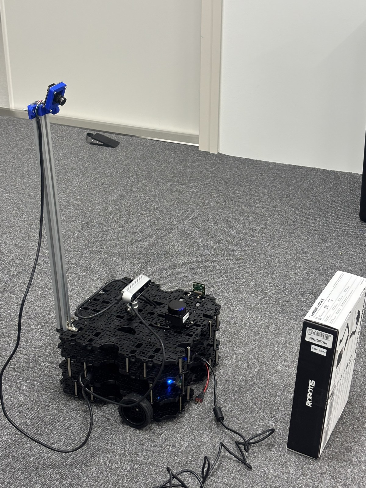
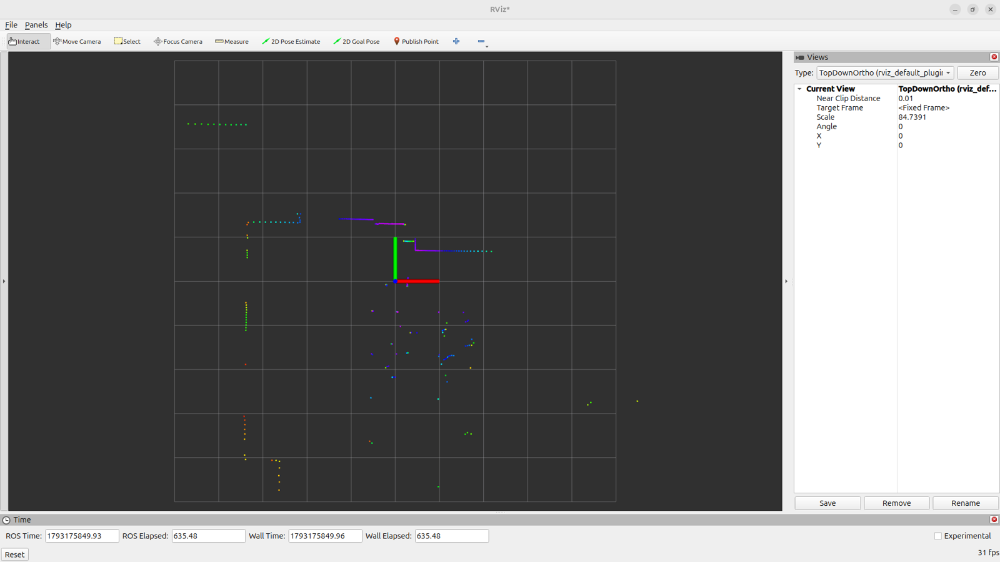

date: 2026.10.28

# Turtle Ninja 비전 작업 일지 (10/28)

오늘은 **실제 데이터를 제대로 나누고 새 합성 데이터로 다시 학습한 날**이에요. spare 로봇(pa06)은 접속부터 라이다까지 살렸어요.

- 팀 실제 데이터의 기존 split 에 같은 영상 프레임이 섞여 있는 걸 찾고, 영상 단위로 다시 나눴어요(real_v4).
- 팀장님 새 합성 데이터(아크릴 반사 반영)로 1단계 → 2단계 학습: 실제 val mAP50 0.834 → 0.961.
- 어두운 조명 영상이 test 에 몰려 있는 걸 밝기로 확인하고, 어두운 사진도 학습에 들어가게 다시 나눴어요(real_v5). 실제 데이터만 학습하는 노트북 준비.
- pa06: MAC 주소로 IP를 찾아 접속하는 `ssh-pa06`, 라이다 LDS-03 `/scan` 10 Hz, TurtleBot3 Lyrical 소스 빌드.
- 대화를 YOLO·터틀봇 둘로 나누고 공용 기록(shared_progress)으로 이어요.

## 로드맵 진행

① 측정·카메라(pa06)와 ③ 학습·평가 칸이 많이 움직였어요. 파란 테두리 = 오늘 진척, 빨간 테두리 = 다음 집중.

- ✅ 실제 데이터 영상 단위 분리 real_v4 / 새 합성 + real_v4 학습
- ✅ 새 합성 데이터 확보 / 새 영상 5개 라벨 합침
- ✅ pa06 접속 · 라이다 /scan
- 🟡 어두운 조명 포함 분리 real_v5 (노트북 준비) / pa06 TurtleBot3 구동 (빌드 완료, bringup 남음)

## 실제 데이터 다시 나누기

팀장님 요청: "비슷한 frame 들이 train, val, test 에 섞이지 않게".

- 팀 실제 데이터(선반 영상 2개, 154장)의 기존 split 을 보니 같은 영상의 6번째 프레임은 test, 209번째는 train 처럼 **번갈아 섞여 있었어요**. 점수가 부풀려지는 원인이에요.
- `build_real_split.py`: 팀 실제 + 신호등 184장 + 새 영상 311장을 모아 **영상 하나를 통째로 한 split 에** 넣음 → real_v4 = train 490 / val 112 / test 47, val·test 모두 6클래스

**어두운 조명 문제.** 밝기를 재 보니 어두운 영상은 new_04(평균 61)와 traffic_light_2(평균 40) 둘뿐인데, new_04 가 통째로 test 에 들어가 있었어요. 모델은 어두운 퍽을 한 번도 못 보고 시험을 본 셈이에요.

- real_v5: 새 영상 new_01~05 와 traffic_light_2 를 **시간 구간 6개**로 잘라 train · test · train · train · val · train 순서로 배정
- split 이 바뀌는 경계 바로 뒤 90 프레임(약 3초)은 버림 → 바로 옆 프레임이 다른 split 에 들어가지 않음
- 결과: train 490(어두움 45) / val 68(2) / test 52(9), 모든 split 6클래스
- 한계: 같은 영상의 다른 구간이 train·test 에 같이 있어서 영상 단위 분리보다 점수가 조금 후할 수 있음

## 새 합성 데이터로 2단계 학습

| 학습 | 데이터 | 끝난 epoch | 실제 val mAP50 | mAP50-95 |
|---|---|---|---|---|
| sim_pre_1028 | 새 합성 2834장만 | 63 (best 33) | 0.834 | 0.616 |
| mix_ft_1028 | 합성 + real_v4 ×2 (실제 약 26%) | 44 (best 14) | 0.961 | 0.793 |

- 예전 0.99 는 빨간 퍽이 없는 쉬운 val 이었음. 이번 val 은 처음 보는 영상 + 빨간 퍽 포함이라 더 어려운 시험
- 합성만: 같은 색끼리 모양 헷갈림(green_box → green_cyl 31%, red_box ↔ red_cyl 17~21%), 배경을 바코드로 보는 오검출
- 합성 + 실제: 클래스별 mAP50 red_cyl 0.887(가장 낮음), green_cyl 0.961, red_box 0.990, green_box 0.977, barcode 0.956, traffic_light 0.995

**결과 보기 도구**: `experiments/results_1028.ipynb`(곡선 비교·혼동 행렬·test 클래스별·test 사진), 노트북 커널이 안 잡힐 때를 위한 `experiments/results_report.py`(PNG 저장). 다음 학습용 `experiments/real_only_1028.ipynb`(real_v5 로 합성 없이 실제만, test 를 밝음·어두움으로 나눠 평가).

## spare 로봇 pa06

IP가 매주 바뀌고 예약은 할 수 없어서, **MAC 주소로 현재 IP를 찾아 접속**하게 만들었어요.

- `ssh-pa06` 함수(노트북 .bashrc): arp-scan 으로 MAC d8:3a:dd:ca:bf:fe 를 찾아 그 IP로 접속
- 로봇: TurtleBot3 Waffle Pi + 위층 라이다 LDS-03 + RealSense D435 + 광각 카메라 기둥, Ubuntu 26.04 · ROS 2 Lyrical
- Xmen 프로젝트 파일 백업 후 정리, `.bashrc` 를 Lyrical + ROS_DOMAIN_ID=50 으로

**라이다**: `ros-lyrical-coin-d4-driver` 설치, 포트를 `/dev/ttyUSB0` 으로 바꾼 설정 사본 → `/scan` 10 Hz, 노트북 RViz 에서 수신. 정면 27 cm 박스로 앞 방향(+x) 확인, 라이다 바로 뒤 카메라 보드가 약 22 cm 에 찍힘 → 나중에 range_min 0.25 m

**TurtleBot3 구동 패키지**: Lyrical apt 에 bringup·node 가 없어서 ROBOTIS 소스를 `~/ninja_ws` 에서 빌드(description·node·bringup, 3분 37초). Lyrical 에 맞추느라 고친 것 2가지: tf2·message_filters 헤더 `.h` → `.hpp`, message_filters Subscriber 에 QoS 인자 추가. 빌드 중 VS Code Remote-SSH 서버 + 병렬 컴파일로 메모리가 바닥나 SSH 가 먹통이 됐었음 → 파이에서는 `MAKEFLAGS="-j1"`, `--parallel-workers 1`, VS Code Remote 끄고 빌드.

## 다음 할 일

- [ ] real_only_1028.ipynb 실행: 실제만 학습(real_ft_1028) → test 밝음·어두움 비교
- [ ] 공정 비교가 필요하면 mix 도 real_v5 로 다시
- [ ] pa06 bringup → /odom·TF 확인, OpenCR 펌웨어 확인, 키보드 조종
- [ ] cartographer 지도 → Nav2, 아크릴 벽이 라이다에 찍히는지 확인
- [ ] VS Code 노트북 커널 문제 정리