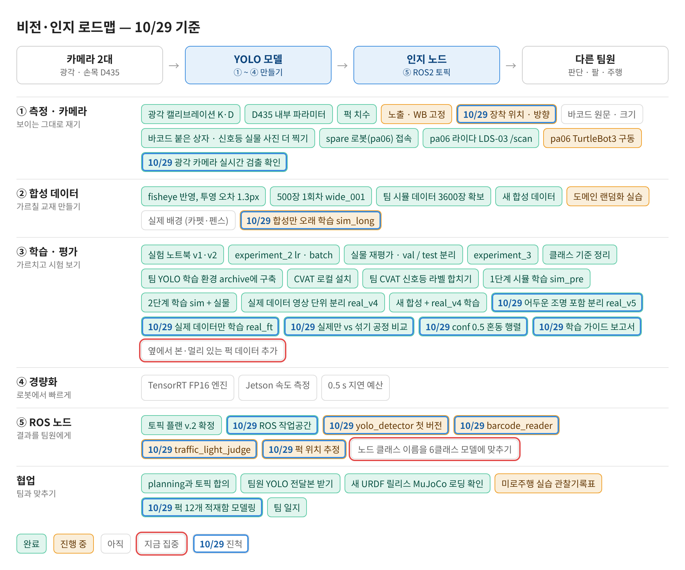
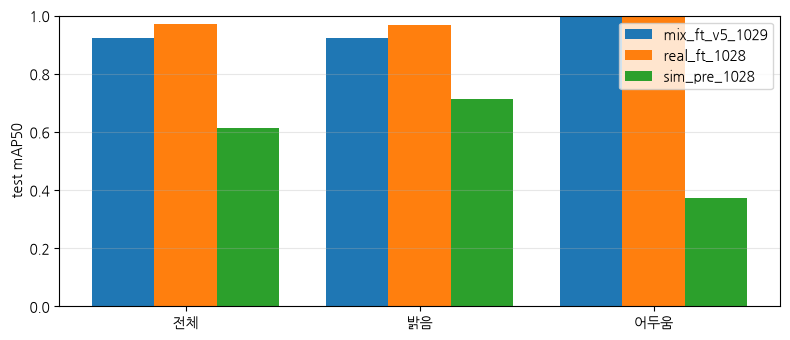
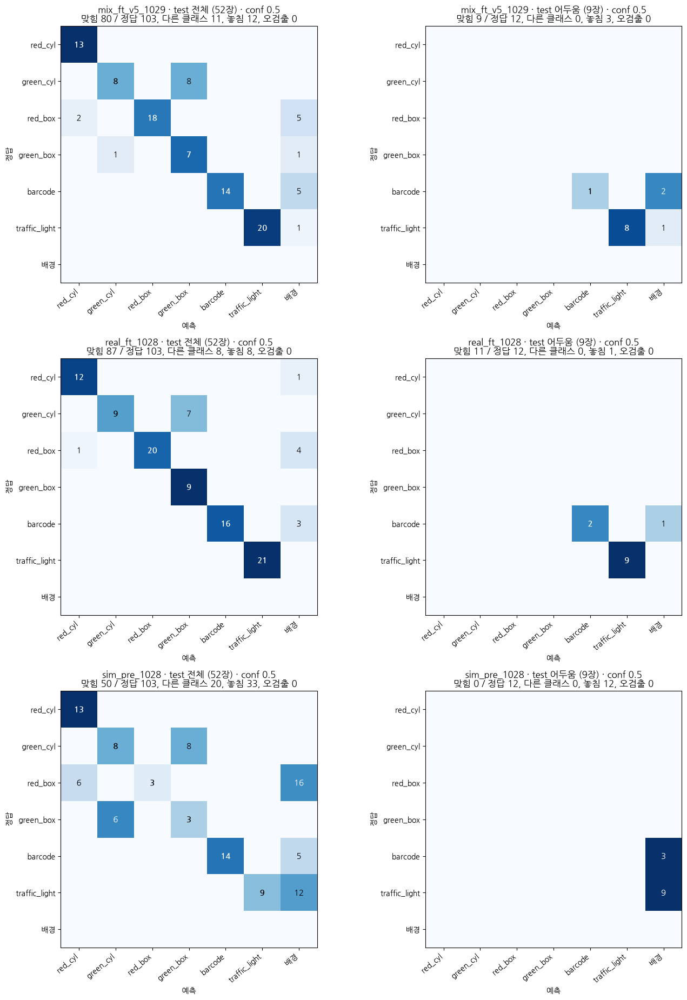
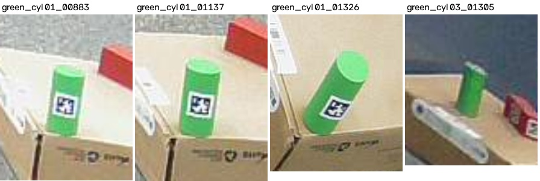
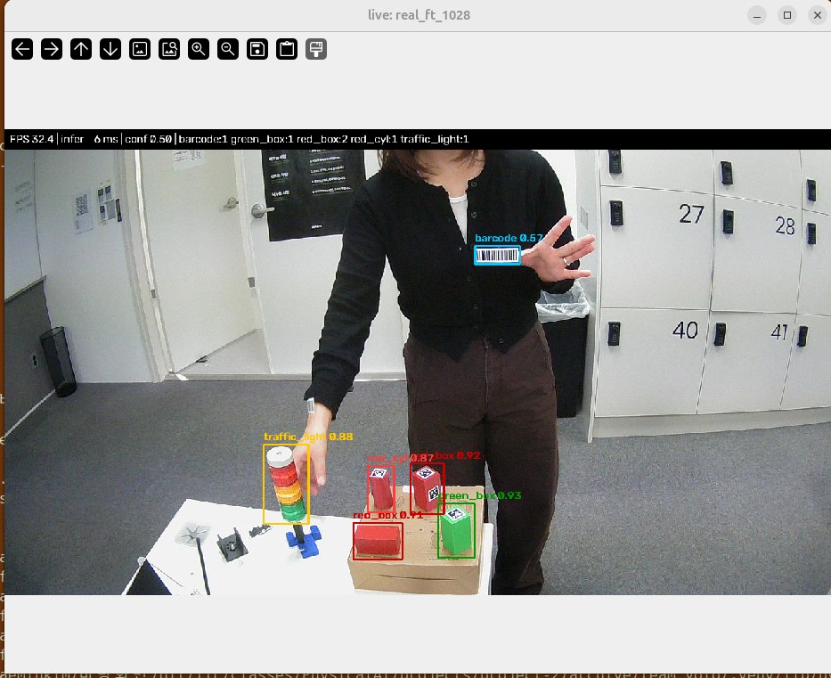
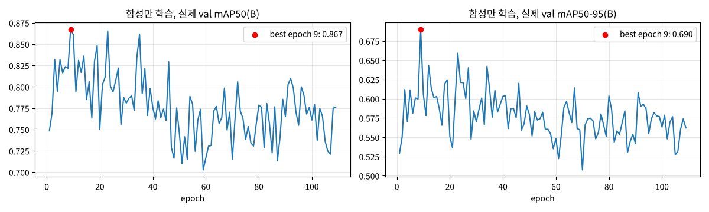
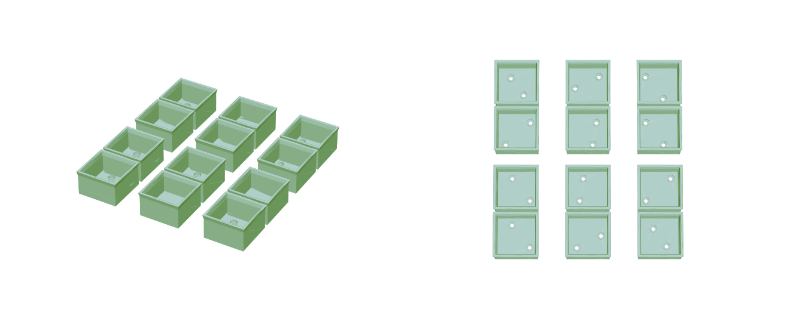
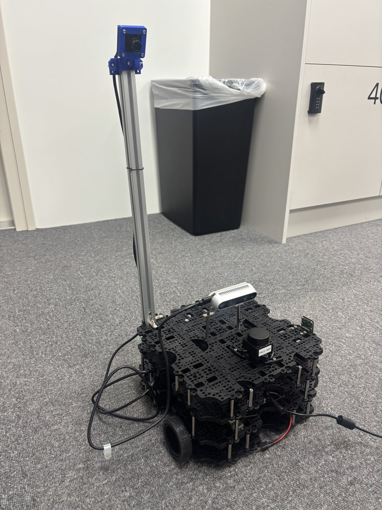

date: 2026.10.29

# Turtle Ninja 비전 작업 일지 (10/29)

오늘은 **실제 데이터만으로 미세조정한 모델을 최종 모델로 정하고, 그 모델을 받아 쓸 ROS 인지 노드를 만든 날**이에요. 학습 과정은 처음 보는 사람도 따라 할 수 있게 가이드 보고서로 정리했어요.

- 실제 데이터만 학습(real_ft_1028): 실제 test mAP50 **0.969** (합성만 0.615), 어두운 사진 0.371 → **0.995**
- 합성+실제 섞기(mix_ft_v5_1029)와 같은 조건으로 비교: 0.924 → 실제만 학습을 최종 모델로
- conf 0.5 혼동 행렬 추가, 광각 카메라 실시간 검출(32 FPS) 확인
- 합성만 오래 학습(sim_long_1029): best 는 9 epoch, 이후 실제 점수가 떨어짐
- ROS 2 `perception` 패키지: 탐지·바코드 노드, 메시지 4개, 빌드와 테스트 9개 통과
- 퍽 12개 적재함 모델링, 학습 가이드 보고서(report.md · html)

## 로드맵 진행

③ 학습·평가와 ⑤ ROS 노드 칸이 많이 움직였어요. 파란 테두리 = 오늘 진척, 빨간 테두리 = 다음 집중.



- ✅ 어두운 조명 포함 분리 real_v5 / 실제 데이터만 학습(최종) / 실제만 vs 섞기 비교 / conf 0.5 혼동 행렬 / 학습 가이드 보고서
- ✅ 광각 카메라 실시간 검출 / ROS 작업공간 / 퍽 12개 적재함 모델링
- 🟡 yolo_detector · barcode_reader · 신호등 판정 · 퍽 위치 추정 (구현·테스트 완료, 실제 카메라 연결 남음)
- 🟡 합성만 오래 학습 sim_long (평가 중)

## 실제 데이터만 학습 → 최종 모델

어제 만든 real_v5(어두운 사진도 train 에 들어가게 나눈 실제 데이터)로, 합성 1단계 모델(sim_pre_1028)에서 출발해 **실제 사진 490장만**으로 미세조정했어요.

| 모델 | 학습 데이터 | test mAP50 | mAP50-95 | 어두움 mAP50 |
|---|---|---|---|---|
| sim_pre_1028 | 합성만 | 0.615 | 0.377 | 0.371 |
| **real_ft_1028 (최종)** | 합성 → 실제만 | **0.969** | **0.728** | **0.995** |
| mix_ft_v5_1029 | 합성 → 합성 + 실제 ×2 | 0.924 | 0.688 | 0.995 |

- 학습 시간: 실제만 약 5분(41 epoch, best 11) / 섞기 약 48분(52 epoch, best 22)
- 섞기는 val(0.968)과 어두운 사진 mAP50-95(0.823), red_cyl(0.995)은 조금 낫지만 green_box 가 0.757 로 떨어짐
- test 가 52장이라 차이가 크다고 보긴 어렵지만, 점수와 학습 시간 모두 실제만 학습이 나아서 최종으로 정함



## conf 0.5 혼동 행렬

ultralytics 가 자동으로 그리는 혼동 행렬은 conf 0.001 로 계산해서 오검출이 크게 보여요. planning 기준인 **conf 0.5** 로 다시 그리는 셀을 노트북에 넣었어요 (앞으로 결과 노트북마다 넣기로 함).



- 최종 모델: 정답 103개 중 **맞힘 87, 다른 클래스 8, 놓침 8, 오검출 0**
- 세 모델 모두 green_cyl → green_box 를 7~8개 똑같이 틀림 → 라벨 실수를 의심했지만 라벨은 맞았음. 그 구간은 원기둥을 **옆에서** 본 장면이라 윗면의 동그라미가 안 보여서 사각기둥처럼 보임



## 광각 카메라 실시간 검출

`scripts/live_detect.py`: 학습 사진과 같은 조건(MJPG 1280×720, imgsz 960, conf 0.5)으로 카메라를 열고 박스를 그려요. `s` 키로 화면과 원본을 같이 저장해서 틀린 장면을 다음 라벨링 데이터로 모을 수 있어요.



- 학습 때와 다른 시점(옆에서 본 책상, 처음 보는 배경)에서도 오검출 없이 잡음
- 옆에서 보면 빨간 사각기둥을 원기둥으로 자주 잡고, 멀리 가면 더 헷갈림 → 실제 장착 각도·거리의 데이터 추가, imgsz 1280 시험, 가까워졌을 때 여러 프레임 다수결로 확정

## 합성만 오래 학습 (sim_long_1029)

1단계(합성만) 모델은 어제 63 epoch 에서 일찍 멈췄어요. 멈추는 기준(patience)을 30 → 100 으로 늘리고 최대 300 epoch 으로 더 오래 학습해 봤어요 (`experiments/sim_long_1029.ipynb`).



- best 는 **9 epoch** (실제 val mAP50 0.867 / mAP50-95 0.690), 이후 오르내리며 떨어져서 109 epoch 에서 멈춤 (마지막 0.776 / 0.562)
- 합성 사진에 오래 맞출수록 실제 사진 점수는 오히려 떨어짐 = 합성과 실제의 차이(도메인 차이). 합성은 짧게 배우고 실제로 미세조정하는 지금 방식이 맞다는 근거
- best.pt 에서 실제만 미세조정했을 때 최종 모델보다 나은지는 노트북 셀 7로 이어서 확인

## ROS 인지 노드 (perception 패키지)

planning 요청 토픽에 맞춰 `ros2_ws/src/perception` 패키지와 메시지 4개를 만들고, 빌드와 테스트까지 마쳤어요.

| 토픽 | 메시지 | 노드 | 내용 |
|---|---|---|---|
| `/perception/detections` | `DetectionArray` (`PuckDetection[]`) | `wide_detector`, `wrist_detector` | bbox, 퍽 색, AprilTag ID, 카메라 기준 위치. `camera` 로 구분 |
| `/perception/signals` | `SignalState` | `wide_detector` | red / orange / green / off / unknown |
| `/perception/task_text` | `TaskText` | `barcode` | 벽 바코드 원문 (여러 프레임 일치 후 한 번만) |

- **탐지 노드**: 광각·손목 노드를 한 프로세스(`detectors`)에서 돌려 GPU 메모리(CUDA context)를 하나만 씀. `.pt` 와 Jetson 의 `.engine` 을 그대로 불러옴. 손목 노드는 상태 머신이 `~/enable` 서비스로 켜고 끔
- **퍽 후처리**: 색(HSV), AprilTag(36h11) ID, 위치는 손목 depth 우선 → 없으면 태그 코너 PnP(광각은 fisheye 왜곡 보정 후) → 둘 다 안 되면 `has_pose=false`
- **신호등**: bbox 를 위·가운데·아래 칸으로 나눠 밝기 비교 + 최근 5프레임 중 3번 다수결. 화면에 없으면 unknown 을 계속 보냄 (못 봄과 꺼짐을 구분)
- **바코드**: YOLO 바코드 bbox 를 잘라 키워서 판독, 안 되면 전체 화면·절반 크기로 다시 시도. 같은 문자열이 5프레임 중 3번 나와야 확정
- **이미지 QoS**: 1280×720 이미지를 best_effort 로 받으면 프로세스 사이에서 거의 다 유실돼서 reliable + depth 1 로
- **실행 확인**: `colcon build` 3회(20:17 interfaces + perception, 20:22·20:24 perception) 성공, `pytest` 9개 통과 (색 판정 3, 신호등, 다수결, 태그 ID·자세, 태그 없음, depth 점, EAN-13 바코드)

```bash
ros2 launch perception perception.launch.py \
    wide_model:=$HOME/models/wide_736x1280.engine wrist_model:=$HOME/models/wrist_480x640.engine
cd ros2_ws && PYTHONPATH=src/perception python3 -m pytest src/perception/test
```

- **확인 필요**: 노드 설정의 클래스 이름이 예전 5클래스(`puck_cyl`, `puck_box`, `signal_tower`)로 되어 있음. 지금 모델은 6클래스(`red_cyl` … `traffic_light`)라 그대로 쓰면 퍽 후처리와 신호등 판정이 안 돔 → `perception.yaml` 의 `puck_classes`, `signal_class` 를 맞춰야 함. conf 도 0.35 → planning 기준 0.5 확인

## 퍽 12개 적재함 모델링

로봇이 모은 퍽을 담을 적재함을 모델링했어요. 퍽 1개씩 들어가는 칸 12개(3×4), 바닥에 고정 구멍.



## spare 로봇 pa06

광각 카메라 기둥을 뒤쪽에 세우고, 위층에 RealSense D435 와 라이다를 올린 상태예요.



## 학습 가이드 보고서

처음 보는 사람이 그대로 따라 할 수 있게 `archive/report/report.md` 로 정리했어요 (팀 노션에는 그림이 들어간 `report.html` 을 첨부).

- 0 한눈에 보기 → 1 전체 흐름 → 2 하드웨어 → 3 프로그램 세팅(venv·커널·CVAT) → 4 데이터(촬영·라벨링·나누기) → 5 학습 2단계 → 6 지표 → **7 그래프 읽는 법** → 8 결과 → 9 실시간 확인 → 10 문제 해결 → 11 한계
- 7장: 손실·mAP·PR·F1·혼동 행렬·밝기 분포를 모양별로 어떻게 읽고 무엇을 고치는지 (예시 그래프 + 실제 결과)
- F1-신뢰도 곡선에서 conf 0.2 ~ 0.65 가 평평 → **conf 0.5 를 써도 손해가 거의 없다**는 근거 확인

## 다음 할 일

- [ ] perception 노드 클래스 이름을 6클래스 모델에 맞추고, 실제 광각 카메라 토픽으로 실행
- [ ] sim_long best 에서 실제만 미세조정 → 최종 모델과 비교
- [ ] 옆에서 본·멀리 있는 퍽 사진 모아 라벨링 (live_detect `s` 키)
- [ ] TensorRT 엔진(광각 736×1280) 만들기
- [ ] pa06 bringup → 키보드 조종 → cartographer
