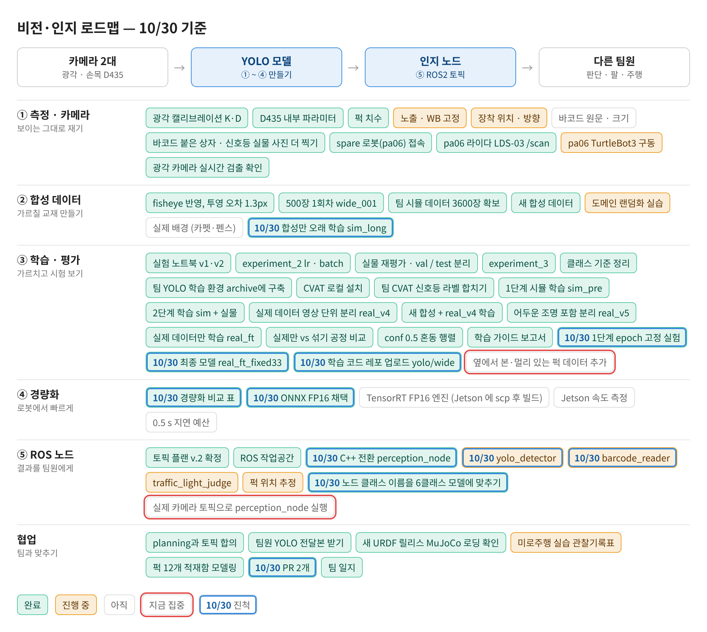
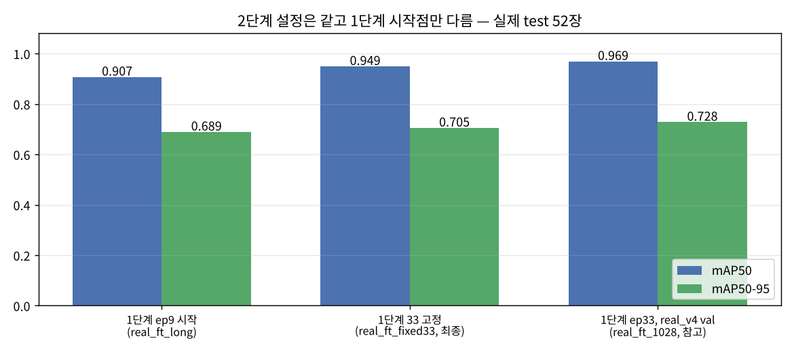
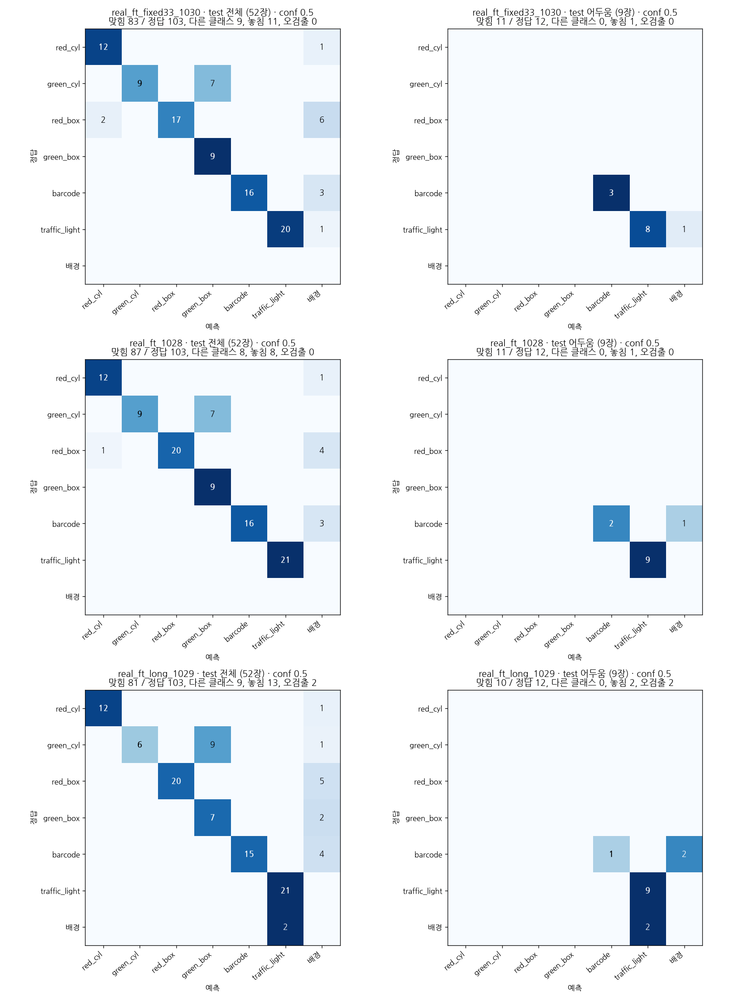
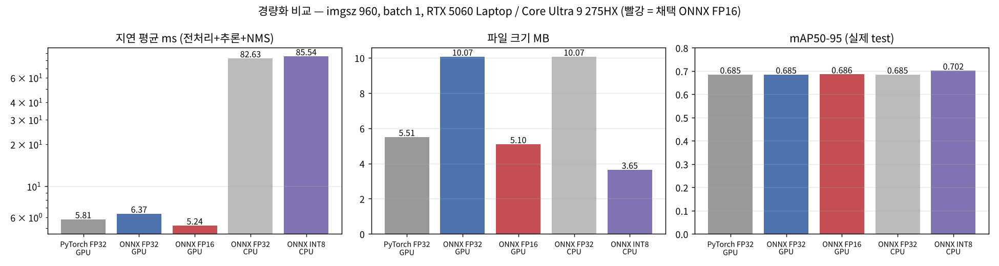

date: 2026.10.30

# Turtle Ninja 비전 작업 일지 (10/30)

> 작성: 김혜민 (비전 담당) · 2026-10-30

오늘은 **최종 모델을 다시 정하고, 학습 코드 · 경량화 결과 · 인지 노드를 팀 레포에 올린 날**이에요.

- 같은 설정인데 test 가 0.907 / 0.969 로 갈린 원인 = **1단계를 몇 epoch 에서 끊었나** → 1단계를 33 epoch 으로 고정한 모델(test **0.949**)을 최종으로
- 팀장님 지시대로 `yolo/wide/` 정리: README, hyp.yaml, 스크립트 8개, 실행 결과가 들어간 train.ipynb → PR
- 경량화 비교(PyTorch / ONNX FP32 · FP16 · INT8) → **ONNX FP16 채택** (5.1 MB, 5.24 ms, 정확도 손실 없음)
- perception 패키지를 **C++ (ONNX Runtime)** 로 전환, 6클래스 · conf 0.5 반영 → PR

## 로드맵 진행

③ 학습 · 평가, ④ 경량화, ⑤ ROS 노드 칸이 움직였어요. 파란 테두리 = 오늘 진척, 빨간 테두리 = 다음 집중.

비전·인지 로드맵 10/30 기준



- ✅ 1단계 epoch 고정 실험 / 최종 모델 real_ft_fixed33 / 학습 코드 레포 업로드 yolo/wide
- ✅ 경량화 비교 표 / ONNX FP16 채택
- ✅ perception C++ 전환 / 노드 클래스 이름 6클래스 · conf 0.5 / PR 2개
- ⬜★ 옆에서 본 · 멀리 있는 퍽 데이터, 실제 카메라 토픽으로 perception_node 실행

## 최종 모델: 1단계를 언제 끊느냐가 문제였다

어제 합성만 오래 학습한 모델(sim_long, best epoch 9)에서 실제 데이터로 미세조정했더니 test 가 **0.907** 로, 기존 최종 모델(0.969)보다 낮았어요. 2단계 설정(데이터 · lr0 0.0005 · 최대 60 epoch)은 완전히 같았어요.

| 2단계 모델 | 1단계 시작 가중치 | 1단계 best 를 고른 val | test mAP50 / 50-95 | conf 0.5 맞힘 / 103 |
|---|---|---|---|---|
| real_ft_long_1029 | sim_long **ep9** | real_v5 val (68장) | 0.907 / 0.689 | 81 (오검출 2) |
| **real_ft_fixed33_1030 (최종)** | **33 epoch 고정**, last.pt | 안 고름 | **0.949 / 0.705** | 83 (오검출 0) |
| real_ft_1028 (참고) | sim_pre **ep33** | real_v4 val (new_03 포함) | 0.969 / 0.728 | 87 (오검출 0) |

- val 이 68장으로 작아서 1단계 best epoch 가 운에 따라 9 로 뽑혔고, 합성을 덜 배운 상태에서 출발한 게 원인
- 1단계를 **33 epoch 으로 고정**(patience 0, val 로 안 고름)하니 0.907 → 0.949 로 차이의 대부분이 메워짐
- 0.969 모델은 1단계 epoch 를 real_v4 val 로 골랐는데, 그 val 의 new_03 영상 일부가 지금 test 에 있어서 약간 유리했을 수 있음 → **real_v5 만으로 재현되는 fixed33 를 최종으로** 정함
- 어두운 사진: mAP50 0.995, mAP50-95 0.823 (오히려 더 좋음)

1단계 시작점만 바꾼 세 모델의 실제 test 점수



conf 0.5 혼동 행렬 (위부터 fixed33 · 1028 · long / 왼쪽 test 전체, 오른쪽 어두움)



- 세 모델 모두 green_cyl → green_box 7~9개 (옆에서 본 원기둥), fixed33 은 red_box 놓침 6개가 가장 큰 손해

## yolo/wide 레포 업로드

팀장님 지시: README · configs · scripts · 대표 노트북 1개만 올리고, 데이터 · runs · 가중치 · 절대경로 yaml · yolo26n.pt 는 제외.

- `README.md`: 클래스, 폴더, 환경(ultralytics 8.4.185 · torch 2.11), 데이터(합성 2834/392/374, 실제 490/68/52), 실행 명령, 1차/2차 설정, 최종 성능, 한계, Jetson 배포
- `configs/hyp.yaml`: 1차(sim) **33 epoch 고정 · patience 0**, 2차 단계 이름 mix → **real**
- `scripts/` 8개: 프레임 추출, 실제 데이터 나누기, data.yaml 만들기, 학습, 평가, 예측, 실시간 검출, ONNX 내보내기
- `notebooks/train.ipynb`: 1 · 2단계 학습 → 학습 곡선 → 실제 test 평가 → conf 0.5 혼동 행렬 → 사진 (실행 결과 포함, 경로는 `<wide>` 로 표시)
- 가중치는 보안상 공유 드라이브에 안 올리고 PC 에 두었다가 Jetson 으로 `scp`
- 노트북 출력에 실험 폴더 경로(real_v5 등)가 찍히던 것 → prepare_data.py 가 바로가기 링크를 풀지 않게 고쳐서 정리

## 경량화 비교 → ONNX FP16

`experiments/quantize_wide_1030.ipynb`, 같은 조건: imgsz 960 정사각형, batch 1, 실제 test 52장, mAP 는 conf 0.001 · IoU 0.7. 지연 = 전처리 + 추론 + NMS (워밍업 20회 후 208회).

| 형식 | 장치 | 크기 MB | mAP50 | mAP50-95 | barcode | traffic_light | 퍽 평균 | 지연 평균 / p99 ms | FPS |
|---|---|---|---|---|---|---|---|---|---|
| PyTorch FP32 | GPU | 5.51 | 0.928 | 0.685 | 0.968 | 0.995 | 0.901 | 5.81 / 7.21 | 172 |
| ONNX FP32 | GPU | 10.07 | 0.928 | 0.685 | 0.968 | 0.995 | 0.901 | 6.37 / 7.87 | 157 |
| **ONNX FP16** | **GPU** | **5.10** | **0.928** | **0.686** | 0.967 | 0.995 | 0.901 | **5.24 / 6.14** | **191** |
| ONNX FP32 | CPU | 10.07 | 0.928 | 0.685 | 0.968 | 0.995 | 0.901 | 82.63 / 159.15 | 12 |
| ONNX INT8 | CPU | 3.65 | 0.949 | 0.702 | 0.970 | 0.995 | 0.932 | 85.54 / 207.61 | 12 |

경량화 비교 (지연 · 크기 · 정확도, 빨강 = 채택)



- 장비: Intel Core Ultra 9 275HX / RTX 5060 Laptop (드라이버 595.99.02), onnxruntime-gpu 1.31.1, opset 18
- **FP16**: 정확도 그대로(클래스별 차이 최대 0.001), 크기 절반, 가장 빠르고 p99 도 가장 안정 → 채택
- **INT8 1차는 mAP 0**: 마지막 출력 하나에 상자 좌표(0~960)와 클래스 점수(0~1)가 같이 들어 있어, int8 눈금 하나로 줄이면 점수가 전부 0 이 됨 → **Detect 층만 FP32** 로 두고(U8S8, 실제 train 490장 보정) 해결
- INT8 은 CPU 에서도 FP32 보다 빠르지 않음(85.5 vs 82.6 ms). 정확도가 오른 건 test 52장의 흔들림
- 먼 퍽(짧은 변 < 16 px)은 test 에 2개뿐이라 참고용. Jetson 에서는 ONNX 를 TensorRT FP16 엔진으로 빌드할 예정

## perception 노드 C++ 전환

팀 요청으로 Python(ultralytics) 노드를 **C++ (ONNX Runtime)** 로 바꿨어요. 레포 구조에 맞춰 `perception/perception/` 폴더 대신 `src/` 에 넣고, Python 패키지용 `resource/` · `setup.py` · `setup.cfg` 는 지웠어요.

- `resource/perception` 은 Python 패키지가 ROS 에 "설치됨"을 등록하는 빈 표시 파일 → C++ 은 `ament_package()` 가 자동으로 만들어서 불필요
- 최종(레포): 노드 하나 `perception_node` 가 광각 · 손목 탐지와 바코드 판독을 모두 맡음 (카메라별 콜백 그룹, 같은 모델이면 세션 하나)
- `yolo.cpp`: letterbox → ONNX Runtime 실행(FP32 · FP16 입력 모두) → 출력 해석 · NMS. provider `cuda | tensorrt | cpu`, 못 쓰면 CPU 로 경고 후 실행. 입력 크기 · 클래스 이름은 모델에서 읽음
- `postproc.cpp`: 퍽 색 · 신호등 · 다수결 · AprilTag · depth · 바코드 (OpenCV 4.6 · 4.7+ · 5.x 모두 빌드)
- 설정: 클래스 이름 6클래스(red_cyl … traffic_light), **conf 0.5**
- 확인: 클라우드 ROS 2 Jazzy 에서 빌드 경고 0, **gtest 10개 통과**, 실제 fp16.onnx + test 사진으로 `/perception/detections` · `/perception/signals` 출력이 정답 상자와 일치

```bash
ros2 launch perception perception.launch.py wide_model:=$HOME/models/wide_fp16.onnx provider:=cuda
cd ros2_ws && colcon test --packages-select perception && colcon test-result --verbose
```

## 다른 세션에서 한 것

다른 대화에서 남긴 메모와 PC 파일을 보고 정리했어요.

**수업: 로봇팔 제어와 정책학습 (MoveIt 2 · cuMotion · Isaac Lab)** — TIL Day60 `class.md`(교재 요약) + `lecture_note.md`(강의 녹음 49분 정리)

- 계획(MoveIt · cuMotion) · 제어(ros2_control · Servo) · 학습(Isaac Lab 정책)의 역할을 나누고, 같은 관절에는 명령을 하나만 보냄
- cuMotion = 경로를 GPU 로 계산하는 서버 (주행의 nvblox 와 같은 관계). Lyrical 용 Sim 브리지는 선생님이 배포 예정
- 실행 전 RViz ↔ 실제 로봇 관절을 하나씩 비교, 관절 범위는 선이 꼬이는 각도까지 보고 정함
- 정책학습: 초기 자세를 랜덤으로, 급격한 행동에 벌점, 팔만 먼저 학습 후 차체를 붙이고 작은 Task 를 이어 붙임
- **비전 할 일로 이어짐**: 힘 센서가 없어서 집기 성공은 토크 + **손목 카메라**로 판단. 집어 올린 퍽은 카메라 기준 위치가 고정돼야 하고, 멀어지면 떨어뜨린 것 → 재탐색
- 모델 양자화(쓸 동작 범위만 추려서 경량화)는 다음 주 화요일(11/3) 수업

**perception C++ 최종본 다듬기** — 레포 `ros2_ws/src/perception`

- 실행 파일 여러 개(detector · detectors · barcode)를 노드 하나 `perception_node` 로 합침: 카메라별 탐지 단계 + 바코드 단계, 카메라마다 콜백 그룹을 따로 두어 광각 · 손목이 서로 기다리지 않음
- 두 카메라가 같은 모델 파일이면 ONNX Runtime 세션을 하나만 만듦
- 서비스: `/perception/wide/enable`, `/perception/wrist/enable`, `/perception/barcode/enable`, `/perception/barcode/reset`
- 바코드는 같은 프레임의 barcode 상자를 바로 써서 읽음 (토픽을 다시 받지 않음)

오늘 pa06(터틀봇) 세션은 새 기록이 없었어요 (마지막 상태: bringup 중 xacro 설치 필요).

## 다음 할 일

- [ ] PR 2개 (feat/yolo-wide, feat/perception-node) 리뷰 · 머지
- [ ] PC 에 ONNX Runtime C++ 설치 → perception_node 를 실제 광각 카메라 토픽으로 실행
- [ ] Jetson 으로 모델 scp → TensorRT FP16 엔진 · 속도 측정
- [ ] 옆에서 본 · 멀리 있는 퍽 사진 모아 라벨링 (red_box 놓침 6개)
- [ ] pa06 bringup → 키보드 조종 → cartographer
- [ ] 손목 카메라로 집은 퍽의 상대 위치가 고정인지 보고 집기 성공 · 실패 판단 (수업에서 나온 비전 할 일)
