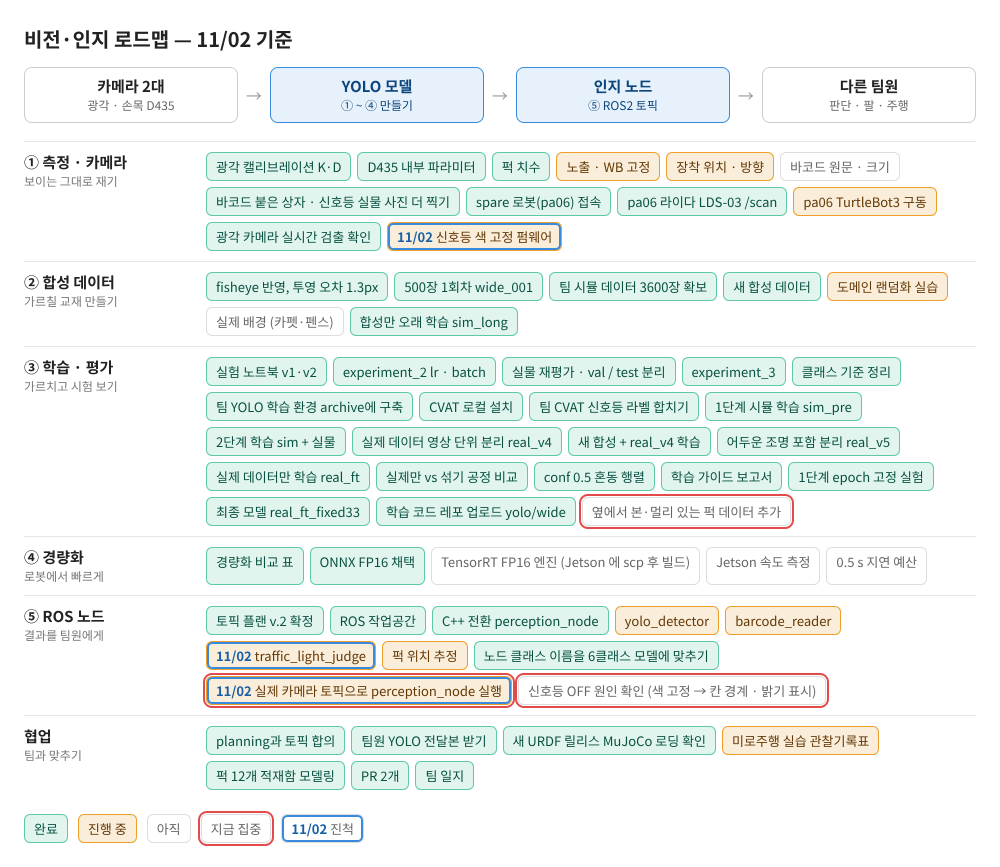
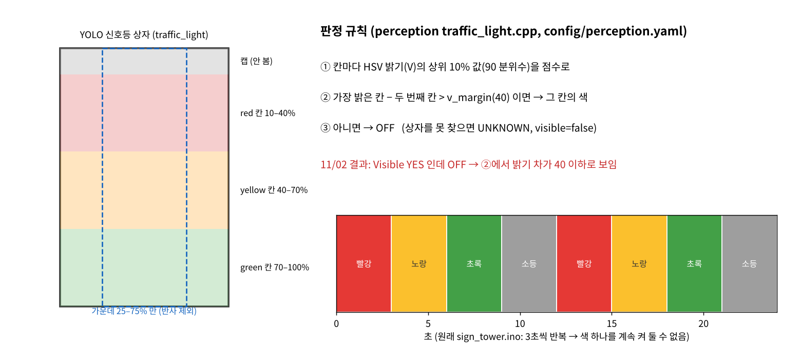

date: 2026.11.02

# Turtle Ninja 비전 작업 일지 (11/02)

> 작성: 김혜민 (비전 담당) · 2026-11-02

오늘은 **Jetson 에서 광각 탐지 결과를 확인하고, 신호등 인식을 실물로 시험해 본 날**이에요. 신호등은 찾았는데 색은 OFF 로 나와서, 원인 후보를 정리하고 색을 고정해 시험할 수 있게 신호등 펌웨어를 준비했어요.

- Jetson 광각 탐지: 노트북에서 SSH(-Y) 뷰어로 카메라 영상 + 탐지 상자 확인, 화면을 줄여 10 Hz 이하 → **약 15 Hz**
- 실물 시험: 신호등 상자는 찾음(**Visible YES**), 불은 셋이 돌아가며 켜지는데 판정은 **OFF**
- 원인 후보: 칸 사이 밝기 차가 기준(40)보다 작음 / 상자와 실제 램프 칸 위치가 어긋남 / 점멸 중에 찍힘
- 신호등 OpenCR 코드(sign_tower.ino)가 3초마다 색을 바꿔서 한 색을 고정할 수 없음 → 시리얼 명령으로 색을 고정하는 판을 받음 (업로드 전)

## 로드맵 진행

① 측정 · 카메라와 ⑤ ROS 노드(신호등 · 실제 카메라 실행) 칸이 움직였어요. 파란 테두리 = 오늘 진척, 빨간 테두리 = 다음 집중.

- 🟡 traffic_light_judge: 실물 시험 → 찾지만 OFF 판정
- 🟡 신호등 색 고정 펌웨어: 시리얼 r/y/g/o/a 판 받음, 업로드 전
- 🟡 실제 카메라 토픽으로 perception_node 실행: Jetson 광각 탐지를 SSH 뷰어로 확인 (~15 Hz)
- ⬜★ 신호등 OFF 원인 확인 (색 고정 → 칸 경계 · 밝기 표시)

## Jetson 광각 탐지 확인

Jetson 에서 perception 을 켜고, 노트북에서 `ssh -Y` 로 접속해 탐지 결과를 화면으로 봤어요.

- 뷰어(Python): `/wide_cam/image_raw` 영상과 `/perception/wide/detections` 탐지 결과를 `TimeSynchronizer`(큐 30)로 같은 시각끼리 묶어서 상자 · 클래스 · 모양 · 신뢰도를 그림
- 실행 전 `/opt/ros/lyrical/setup.bash` 와 레포 `ros2_ws/install/setup.bash` 를 source

| 버전 | 바꾼 것 | 화면 속도 |
|---|---|---|
| 1 | 원본 크기 그대로 `imshow` (X 포워딩) | 10 Hz 이하 |
| 2 | `cv2.resize(frame, (640, 360))` 후 표시 | 약 10 Hz |
| 3 | 같은 축소를 `imshow` 한 줄로 합침 | 약 15 Hz |

- 느린 원인은 탐지가 아니라 **원본 크기 영상을 SSH X 포워딩으로 보내는 것** → 보여 주는 화면만 줄임 (탐지 입력은 그대로)
- 2 → 3 은 코드 차이가 거의 없어서, 속도 차이는 네트워크 상태 영향일 수 있음

## 신호등 실물 시험: 찾지만 OFF

인지 노드의 신호등 판정은 색이 아니라 **칸별 밝기**로 해요. 렌즈는 꺼져 있어도 빨강 · 노랑 · 초록 색이 보이기 때문이에요.

| 단계 | 하는 일 | 값 (config/perception.yaml) |
|---|---|---|
| 칸 나누기 | YOLO 신호등 상자를 위 → 아래로 나눔, 가로는 가운데만 | red 10–40%, yellow 40–70%, green 70–100%, 가로 25–75% |
| 칸 점수 | 칸마다 HSV 밝기(V)의 90 분위수 | – |
| 색 결정 | 가장 밝은 칸이 두 번째보다 v_margin 이상 밝으면 그 색, 아니면 OFF | v_margin 40 |
| 확정 | 최근 5장 중 3장 같으면 확정. 못 찾으면 UNKNOWN + visible=false | window 5, need 3 |

- 결과가 Visible YES · OFF 라는 건 상자는 찾았는데 ③에서 밝기 차가 40 을 못 넘었다는 뜻
- 원인 후보
    - 카메라 자동 노출 때문에 켜진 칸과 꺼진 칸의 밝기 차가 작음
    - 탐지 상자와 실제 램프 칸 위치가 다름 (칸 비율은 아직 [확인 필요] 값)
    - 3초마다 바뀌는 점멸과 노출 시간이 겹쳐 여러 불이 같이 찍힘
- 바로 기준값(40)을 낮추지 않고, **한 색을 계속 켠 상태**에서 다시 보기로 함. 그래도 OFF 면 상자 위에 칸 경계와 칸별 점수를 그려서 원인을 나눔

## 신호등 펌웨어: 색 고정

신호등은 전용 OpenCR 에 따로 연결돼 있고, 전원만 들어오면 색이 계속 바뀌어요.

- 원래 `sign_tower.ino`: 릴레이 핀 5 · 6 · 7, **LOW = 켜짐 / HIGH = 꺼짐**, 3초씩 빨강 → 노랑 → 초록 → 소등 반복
- 시리얼 명령으로 색을 고정하는 판을 받음 (115200 baud, 시작은 모두 꺼짐, 다음 명령까지 유지)

| 명령 | 동작 |
|---|---|
| `r` | 빨강 유지 |
| `y` | 노랑 유지 |
| `g` | 초록 유지 |
| `o` | 모두 끄기 |
| `a` | 원래처럼 3초씩 자동 반복 |

- 라즈베리파이가 연결돼 있지 않아 SSH 로는 못 올림 → **노트북과 신호등 OpenCR 을 USB 로 직접 연결**해 Arduino IDE 로 업로드
- 핀 번호는 원래 코드와 같지만 아직 컴파일 · 실물 확인 전
- 노트북 없이 색을 바꾸고 싶어서 **터틀봇 리모컨(RC-100 계열)** 으로 색을 고르는 방법을 검토 중 → 리모컨 종류와 OpenCR 에 꽂힌 수신기부터 확인해야 함

## 다음 할 일

- [ ] sign_tower.ino 색 고정 판 업로드 → r / y / g 각각 고정해서 신호등 판정 확인
- [ ] 그래도 OFF 면: 상자 위에 칸 경계 · 칸별 점수 그려서 칸 비율 · v_margin 실측
- [ ] 리모컨(RC-100) 수신기 확인 → 리모컨으로 색 선택
- [ ] 레포 통합본(perception TensorRT, firmware, tools/jetson) 받아서 빌드 · 실행 (내일)
- [ ] TIL Day60 README · class.md 반영
