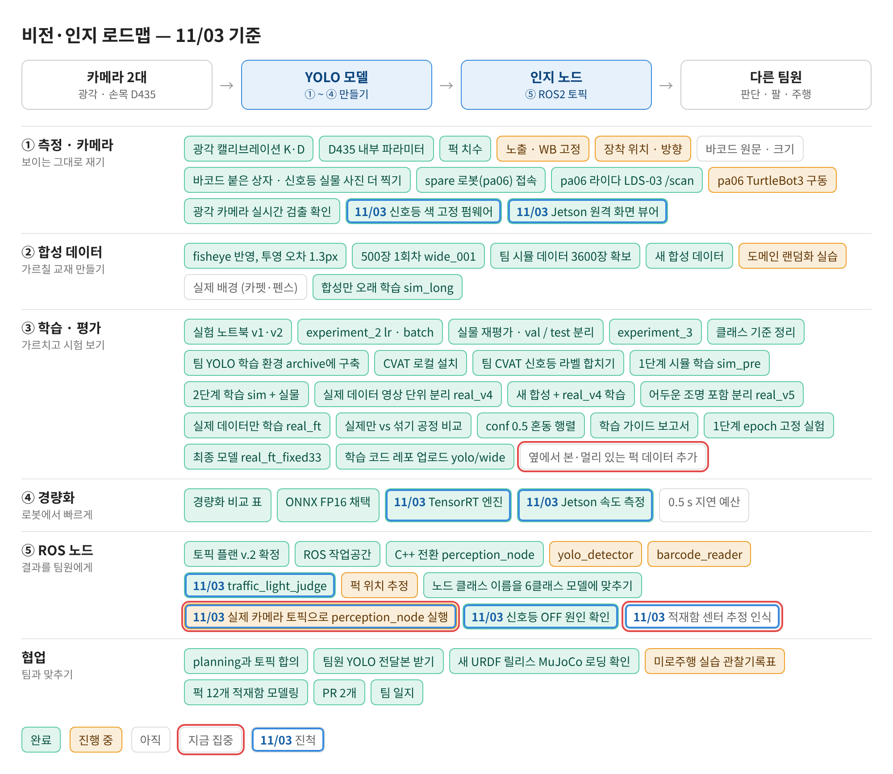
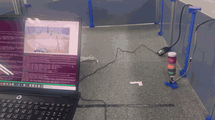
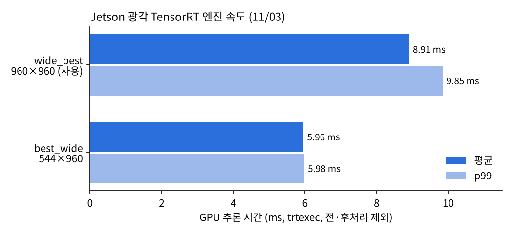

date: 2026.11.03

# Turtle Ninja 비전 작업 일지 (11/03)

> 작성: 김혜민 (비전 담당) · 2026-11-03

오늘은 **신호등을 리모컨으로 제어할 수 있게 만들고, 그걸로 신호등 인지를 통과시킨 날**이에요. Jetson 쪽 광각 엔진이 최종 모델인지도 확인했어요.

- 신호등 OpenCR 펌웨어를 **RC-100 리모컨용**으로 새로 만들어 업로드 → 선생님께 `.ino` 전달
- 리모컨으로 색을 고정하고 시험 → 신호등 인지 **통과** (팀장님 노트북으로 확인)
- Jetson `wide_best.onnx` 가 최종 모델(`real_ft_fixed33_1030`)과 **md5 가 같음** 확인 → 그대로 사용 (평균 8.91 ms)
- 팀 회의: 비전 다음 과제 = **적재함 센터 추정 인식**

## 로드맵 진행

① 측정 · 카메라, ④ 경량화, ⑤ ROS 노드 칸이 움직였어요. 파란 테두리 = 오늘 진척, 빨간 테두리 = 다음 집중.



- ✅ 신호등 색 고정 펌웨어 (리모컨판) · Jetson 원격 화면 뷰어
- ✅ TensorRT 엔진 확인 · Jetson 속도 측정
- ✅ traffic_light_judge 실물 시험 통과 · 신호등 OFF 원인 확인
- ⬜★ 적재함 센터 추정 인식, 실제 카메라 토픽으로 perception_node 실행 (끝무렵 광각 영상이 안 들어옴)

## 신호등 OpenCR 펌웨어: 리모컨으로 색 선택

어제 OFF 판정이 점멸 때문인지 확인하려면 한 색을 계속 켜 둘 수 있어야 했어요. 시리얼 명령으로 고정하는 판을 먼저 올리고, 노트북 없이도 바꿀 수 있게 **RC-100 리모컨판**까지 만들었어요.

| 버튼 | 동작 |
|---|---|
| (전원 켜짐) | 모두 꺼진 채로 대기 |
| 1 | 빨강 → 노랑 → 초록 → 소등, 3초씩 반복 |
| 2 / 3 / 4 | 빨강 / 노랑 / 초록 고정 |
| U | 빨·노·초 중 랜덤 색 12번 깜빡임 (0.5초 켜짐 + 0.5초 꺼짐) → 이전 모드로 |
| 그 밖의 버튼 | 모두 끄기 |

- 릴레이 핀 5 = 빨강, 6 = 노랑, 7 = 초록, **LOW = 켜짐**
- 수신기는 OpenCR UART 포트(`Serial2`, 57600) → ROBOTIS `RC100` 라이브러리 `rc.begin(1)`
- 버튼을 누르고 있는 동안 같은 값이 계속 와서, **새로 눌린 비트만** 처리 (1번 상태에서 다른 버튼이 안 먹던 문제)
- USB 시리얼(115200)로도 `1 2 3 4 u o ?` 로 시험 가능, 받은 리모컨 값을 `RC100 data = …` 로 출력
- 빌드 · 업로드: 노트북 `~/pa-opencr-build` (모듈1 수업 때 만든 환경)

```bash
BASE=$HOME/pa-opencr-build
"$BASE/bin/arduino-cli" --config-file "$BASE/arduino-cli.yaml" compile --fqbn ROBOTIS:OpenCR:OpenCR \
  --output-dir "$BASE/output" "$BASE/sketches/sign_tower_rc"
"$BASE/uploader-src/arduino/opencr_develop/opencr_ld/opencr_ld" /dev/ttyACM0 115200 "$BASE/output/sign_tower_rc.ino.bin" 1
```

- 막혔던 것: 포트 이름 오타(`/dev/tyACM0`), `dmesg` 권한(`sudo` 필요), power/mode 를 누른 뒤 리모컨이 잠시 반응 없음 → 다시 연결되며 해결
- 업로드 성공 기준: `CRC OK` 와 `[OK] Download` 가 둘 다 나와야 함 (종료 코드만으로는 판단 못 함)

## 신호등 인지 시험: 통과

리모컨으로 색을 고정해 두고 `/perception/traffic_light` 판정을 확인했어요. 팀장님 노트북에서 같이 보고 **통과**로 정리했어요.



- 어제 OFF 는 3초마다 바뀌는 점멸 중에 찍힌 영향으로 정리 (색을 고정하니 판정이 나옴)
- 칸 비율(`traffic_light.red/yellow/green`) · `v_margin` 40 은 그대로 둠

## Jetson 연결 · 원격 뷰어

팀장님이 Jetson Wi-Fi 를 바꿔서 다시 연결했어요.

- 처음에 `Connection refused` → 받아 적은 IP 가 틀렸었음 (그 주소는 다른 기기, MAC 주소로 확인)
- Jetson `ROS_DOMAIN_ID = 17` (`~/.bashrc`). 새로 연 SSH 는 0 이라 토픽이 안 보였음
- 노트북 뷰어 `tl_viewer.py` + 실행 스크립트 `jetson_view.sh` (복사 → `ssh -Y` → Jetson `~/.bashrc` 설정 그대로 실행)
    - 광각 영상 + 신호등 판정 + 퍽 상자, 신호등을 드래그하면 칸 경계 · 칸별 밝기 점수 표시
    - 창 크기 조절(`+` / `-`), 영상이 없으면 안내 화면
- VS Code 터미널은 화면 전달을 안 해서, 창은 노트북 일반 터미널에서 띄워야 함

## 광각 엔진 확인: wide_best = 최종 모델

| 엔진 | 만든 날 | 입력 | 평균 | p99 | 초당 |
|---|---|---|---|---|---|
| **wide_best (사용)** | 11/02 | 960×960 | 8.91 ms | 9.85 ms | 112 |
| best_wide | 11/03 (팀원) | 544×960 | 5.96 ms | 5.98 ms | 167 |



- `~/wide_best.onnx` md5 `8a7dae2b…` = 노트북 `real_ft_fixed33_1030/weights/best.onnx` → 최종 모델로 만든 엔진
- 최종 `best.pt` 를 Jetson `~/Desktop/1030_best.pt` 로 보냄
- 544×960 이 1.5배 빠르지만(1280×720 영상에 여백 없음) 누가 만든 건지 확인 전이라 **우리가 만든 wide_best 유지**
- 시간은 `trtexec` GPU 추론만 (전처리 · NMS 제외)
- 끝무렵 `perception` 을 다시 켰는데 `/perception/wide/detections` 가 안 나옴 → 광각 영상(`/wide_cam/image_raw`) 이 안 들어오는 것으로 보임, 내일 확인
- 참고: 팀원 정조은 11/03 개인 일지에 best_wide(544×960) 를 만든 기록이 있음 (같은 화면 검출 4개 동일), 신호등 판정을 흰색 비율로 바꾼 것과 Fast DDS 큰 데이터 전송 · 압축 전송 설정도 있어 → 내일 엔진 · 설정 합치기 (광각 영상이 안 온 것도 이 전송 설정과 관련 있을 수 있음)

## 팀 회의: 강화학습 회의

비전 관련 결정만 정리했어요.

- **적재함 센터 추정 인식 (비전)**: 수 mm 오차로 퍽이 S1 / S2 경계에 걸림, YOLO 는 S1 / S2 구분 불가
    - 안 A: 적재함에 AprilTag → ID 로 칸 확인, 태그가 퍽에 가려지면 적재로 판단 · 로그
    - 안 B: 손목 카메라로 칸 센터 추정, 두 칸이 보이면 S1 / S2 XY 범위 안의 센터 선택 (약 1초 추가, 허용)
- 칸별 **룩 자세**: 그리퍼 · 퍽이 손목 카메라를 가리지 않게 칸마다 정의 (매니퓰레이션과 시뮬 시험)
- 데이터셋은 원거리 · 근거리 모두 촬영 → 남은 red_box 놓침(옆 · 먼 퍽) 과제와 같은 방향
- ONNX 학습 결과는 실물 테스트로 검증, 잘못 학습하면 같은 입력에도 늘 엉뚱한 결과

## 다른 작업

- TIL Day61 에 11/02 강의(edgecomputing · 63강 ONNX Runtime) 정리를 빠뜨려서 추가 (TIL 폴더가 4th-month 로 옮겨진 것도 확인)
- 선생님 요청으로 리모컨 펌웨어 `sign_tower_rc.ino` 전달

## 다음 할 일

- [ ] 광각 영상이 안 들어오는 원인 확인 (`usb_cam` 살아 있는지, `/dev/video6`, `ros2 topic hz`)
- [ ] 적재함 센터 추정 인식: AprilTag(안 A) / 손목 카메라 센터(안 B) 결정 → 설계
- [ ] 옆에서 본 · 멀리 있는 퍽 사진 라벨링 (red_box 놓침)
- [ ] 팀원이 만든 544×960 엔진 · 신호등 흰색 비율 판정 · 전송 설정과 우리 쪽 합치기 → 엔진 하나로 정하기
- [ ] TIL Day60 README · class.md 반영
