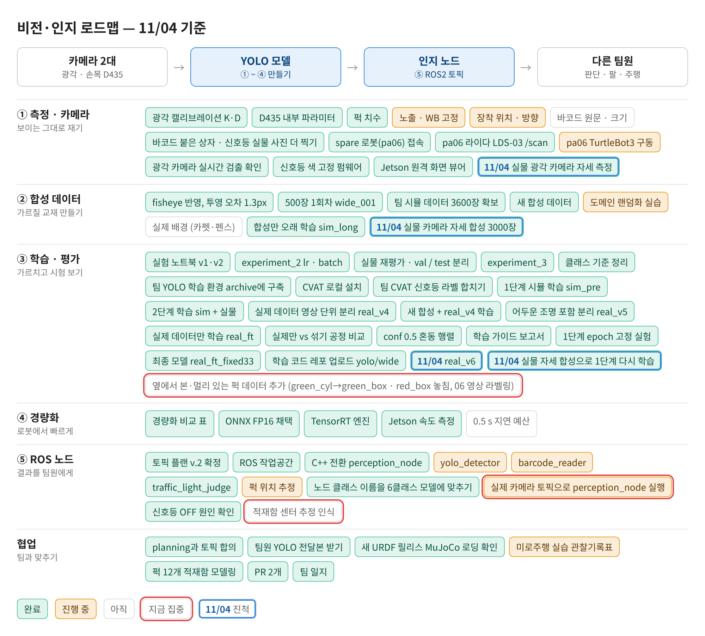
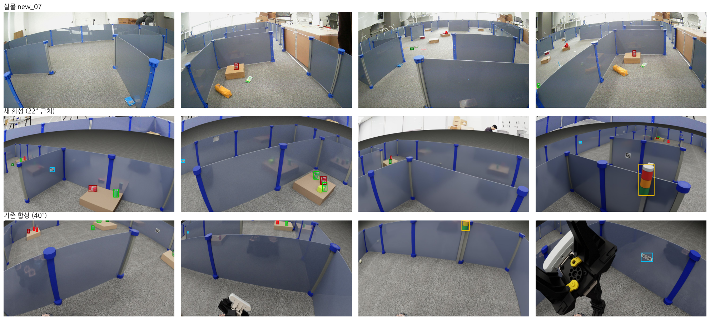
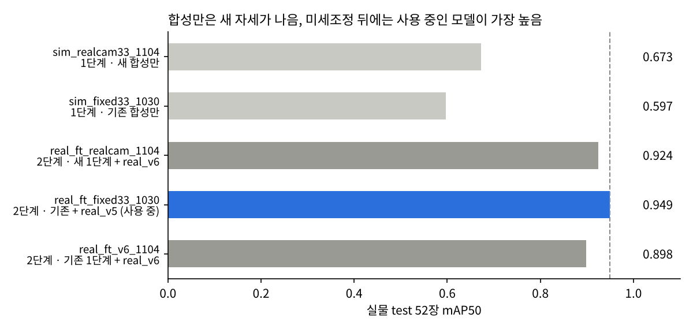
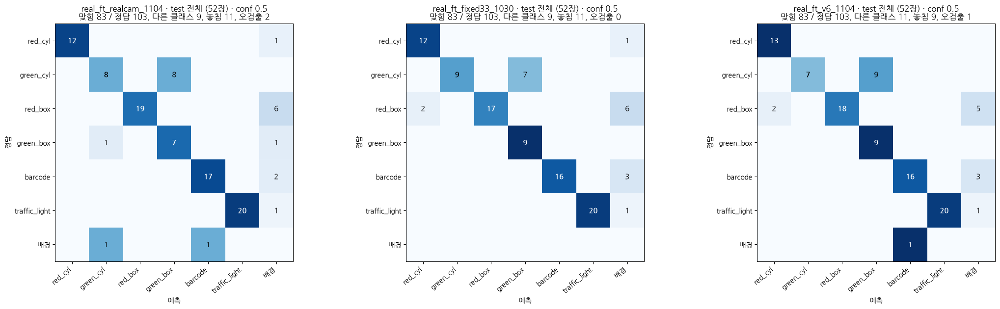

date: 2026.11.04

# Turtle Ninja 비전 작업 일지 (11/04)

> 작성: 김혜민 (비전 담당) · 2026-11-04 (11/06 에 정리)

오늘은 **합성 데이터의 카메라 자세를 실물에 맞춰 다시 만들고, 1단계부터 다시 학습해 비교한 날**이에요.

- 실물 광각 카메라는 높이 약 0.58 m 에서 **아래로 22°** 숙임 (팀 URDF · 기존 합성은 40°)
- Isaac Sim 6.2 설치 → 숙임 18 · 22 · 26° 합성 **3000장** 새로 생성
- new_07 라벨을 더해 **real_v6** (train 685장)
- 1단계(합성만)는 실물 test mAP50 **0.597 → 0.673** 으로 좋아졌지만, 실물로 미세조정한 뒤에는 차이가 거의 사라짐 → **배포 모델 real_ft_fixed33_1030 유지**

## 로드맵 진행

① 측정 · 카메라, ② 합성 데이터, ③ 학습 · 평가 칸이 움직였어요. 파란 테두리 = 오늘 진척, 빨간 테두리 = 다음 집중.

- ✅ 실물 광각 카메라 자세 측정 (높이 약 0.58 m · 아래로 22°)
- ✅ 실물 카메라 자세 합성 3000장 (sim_realcam_1104)
- ✅ real_v6 · 실물 자세 합성으로 1단계 다시 학습
- ⬜★ 옆에서 본 · 멀리 있는 퍽 데이터 (06 영상 라벨링), 적재함 센터 추정 인식

## 실물 카메라 자세 측정: 합성이 바닥을 너무 많이 봄

pa06 Arducam 실물 영상(wide_puck_new_06 · 07)과 기존 합성 사진을 나란히 보니 카메라 자세가 달랐어요.

| | 높이 | 아래로 숙임 | 화면 |
|---|---|---|---|
| 실물 (06 · 07 영상에서 잼) | 약 0.58 m | 약 22° | 벽 너머 강의실이 위 1/4, 팔 안 보임 |
| 기존 합성 (팀 URDF) | 약 0.55 m | 40° | 거의 바닥, 팔 · D435 가 자주 보임 |

- 잰 방법: 렌즈 왜곡을 편 사진에서 기둥(수직선)이 모이는 점 → 숙임 22°, 벽(높이 0.39 m) 위 · 아래 끝 각도 → 높이 0.57 · 0.59 m (기둥 2개)

## 새 합성 3000장 (Isaac Sim 6.2)

팀 합성 생성기가 Isaac Sim 6.1 에서는 안 돌아서 **Isaac Sim 6.2 (Isaac Lab v3.0.0)** 를 `~/pa-course/IsaacLab-6.2` 에 설치했어요. 팀 저장소는 고치지 않고 감싸는 스크립트를 따로 만들었어요.

- `scripts/make_sim_realcam.py`: 카메라 숙임 각도만 바꿔 팀 생성기(`make_yolo_dataset.py`)를 실행
- `scripts/make_robot_usd.py`: 생성기에 필요한 로봇 USD 를 `sim_assets/` 에 만듦
- `datasets/sim_realcam_1104/`: 500장 × 6묶음 = **3000장, 상자 7908개** (생성 스크립트 `scripts/run_sim_realcam_1104.sh`)
    - 숙임 18 · 22 · 26° (실물 22° ± 흔들림) × 실제 A 경기장 / 무작위 미로
    - 팔 항상 접음, 대상 거리 0.25–2.5 m (기존 1.8), 배경 밝기 0.8–1.6 배 (실물이 밝음)
- 실물 데이터: new_07 라벨을 CVAT 에서 내보내 **real_v6** (train 685 / val 68 / test 52, test 는 real_v5 와 같음)

## 학습 비교: 1단계는 좋아지고, 최종 성능은 그대로

1단계는 합성만 33 epoch 고정(`hyp_fixed.yaml`, last.pt), 2단계는 real_v6 미세조정(lr0 0.0005, 최대 60, patience 30)으로 전과 같은 방식이에요. 결과는 `experiments/sim_realcam_1104.ipynb`.

| 모델 | 설명 | mAP50 | mAP50-95 | 재현율 | conf 0.5 맞힘 (103개) |
|---|---|---|---|---|---|
| sim_realcam33_1104 | 새 합성만 (1단계) | 0.673 | 0.409 | 0.621 | - |
| sim_fixed33_1030 | 기존 합성만 (1단계) | 0.597 | 0.383 | 0.612 | - |
| real_ft_realcam_1104 | 새 1단계 + real_v6 | 0.924 | 0.674 | 0.914 | 83 |
| **real_ft_fixed33_1030** | 기존 1단계 + real_v5 (**사용 중**) | **0.949** | **0.705** | 0.891 | 83 |
| real_ft_v6_1104 | 기존 1단계 + real_v6 | 0.898 | 0.659 | 0.815 | 83 |

- **합성만 학습(1단계)**: 실물 자세에 맞춘 쪽이 확실히 나음. red_cyl 0.87 → 0.995, red_box 0.45 → 0.70, traffic_light 0.52 → 0.62. barcode 는 0.96 → 0.85 로 내림. green_box 는 둘 다 0.1 대라 합성만으로는 거의 못 찾음
- **실물로 미세조정한 뒤(2단계)**: 같은 real_v6 끼리는 새 1단계가 mAP50 +0.026, 재현율 0.815 → 0.914 로 나음. 하지만 지금 쓰는 real_ft_fixed33_1030(0.949)은 못 넘음
- conf 0.5 에서는 세 모델 모두 103개 중 **83개**로 같음 (오검출 2 · 0 · 1)
- test 가 52장(어두운 사진 9장)뿐이라 0.02~0.03 차이는 우연일 수 있음 → **배포 모델은 real_ft_fixed33_1030 그대로**

- 세 모델이 똑같이 틀리는 것: **초록 원기둥 → 초록 상자 7~9개**, **빨간 상자 놓침 5~6개**
- 합성을 바꿔도 그대로라 실물 데이터나 라벨 쪽 문제로 보임 (멀리 있는 초록 원기둥, 가려진 빨간 상자)

## 다른 작업

- pa06(라즈베리파이) VS Code 원격 연결: IP 가 매주 바뀌어서 `~/.ssh/config` 에 MAC 주소로 IP 를 찾는 ProxyCommand 를 시도 → **안 됨**, Claude Code 에서 이어 보려고 메모(`claude/pa06_vscode_ssh_memo.md`) 남김. 터미널 `ssh-pa06` 은 그대로 사용
- 팀 회의록에 11/04 기록은 없음

## 다음 할 일

- [ ] 초록 원기둥 ↔ 초록 상자를 헷갈린 test 사진 직접 보기 (거리 · 가림 · 라벨 실수 중 무엇인지)
- [ ] 06 영상 라벨링 (CVAT task 1) → real_v7 로 다시 미세조정
- [ ] test 사진을 늘려서 모델끼리 다시 비교
- [ ] 광각 영상 안 들어오는 문제 · 팀원 엔진 · 전송 설정 합치기 (11/03 에서 이어짐)
- [ ] 적재함 센터 추정 인식: AprilTag / 손목 카메라 센터 결정
- [ ] pa06 VS Code 연결 (Claude Code)
