# 11/05 로보월드 참관에서 배운 것

수업 대신 PA 1기 20명이 로보월드에 다녀왔어요. 아래는 담임매니저님이 부스 관계자들과 나눈 대화를 정리해 슬랙에 올린 글을 요약한 것이에요.
([원문: pa-1기-질문잡담방](https://2026kant.slack.com/archives/C0BBNNAUR0E/p1793881773389769))

## 1. 로봇 산업 동향

- **하드웨어는 해외 부품 의존도가 높음**: 국내 기업은 단가 · 생산 비용 때문에 중국산 부품을 많이 씀. 중국 기업도 미국 · 대만 부품을 쓰기도 함 → 기술력만큼 부품 단가 · 공급망도 중요
- **국내 기업은 소프트웨어로 경쟁**: 하드웨어를 만드는 것보다 기존 하드웨어를 얼마나 잘 제어하고 어떤 기능 · 서비스를 만드는지가 중요
- **새 분야로 확장**: 오래된 로봇 기업들도 신사업 추진
  - 휴머노이드: 주로 공장 인력 대체용
  - 4족 보행(로봇개): 탐사 · 점검, 바퀴 달린 것 / 아닌 것 두 종류 (목적에 따라)
  - 물류 · 제조 로봇: 물류 이동, 공정 자동화

## 2. 취업 동향 · 현업 조언

| 주제 | 내용 |
|---|---|
| 학력 vs 경험 | 대기업은 석사 선호 경향, 그 외는 실제 역량 · 경험을 더 봄 |
| 프로젝트 | 규모보다 **내가 맡은 역할과 해결한 문제**. 작은 프로젝트라도 구상 → 실제 구동까지 직접 한 경험 |
| AI 활용 | 현업은 AI 활용이 거의 100% → 문법 암기보다 **AI 를 어떻게 활용했는지**. 단, 생성된 코드를 이해 · 수정할 기본기는 필요 |
| 태도 | 신입은 배우려는 자세, 모르는 것을 어떻게 배우고 어려운 상황에 어떻게 대응하는지 |
| 부트캠프 | 부트캠프 수료 후 바로 로봇 업계로 간 사례, 터틀봇으로 로봇 공부를 시작한 개발자도 있었음 |

정리해 둘 것 (프로젝트 규모와 상관없이):

1. 처음 구상부터 실제 구동까지 직접 한 경험
2. 내가 맡은 역할 · 구현한 기능
3. 생긴 문제와 해결하려고 시도한 방법
4. AI 를 어떤 과정에서 어떤 목적으로 썼는지
5. 최종 결과물과 그 과정에서 얻은 기술 경험

→ 우리 프로젝트에 적용: 비전 일지 · TIL 의 문제점 / 해결 방법 / 결과 칸이 바로 이 기록. YOLO 평가 방식 바로잡기(test 분리 · seed 반복)나 1.2 m 채점 기준처럼 **왜 그렇게 정했는지**를 남겨 두기

## 3. 부스에서 본 것 (슬랙 사진 · 영상)

번호를 누르면 사진 · GIF 가 열려요. 전체 목록은 [README 참조 자료](README.md#참조-자료-1105-슬랙-pa-1기-질문잡담방).

### 손 · 그리퍼
장갑을 끼고 로봇 손 원격 조작([27](pic/27_IMG_2143.jpg) · [28](pic/28_IMG_2144.jpg)), 관절 데이터를 화면에 띄우는 로봇 손([43](gif/43_IMG_2203.gif) · [44](gif/44_IMG_2202.gif)), 여러 종류의 그리퍼([42](gif/42_IMG_2204.gif) · [48](gif/48_IMG_2207.gif)), 컵 집기([49](gif/49_IMG_2208.gif))

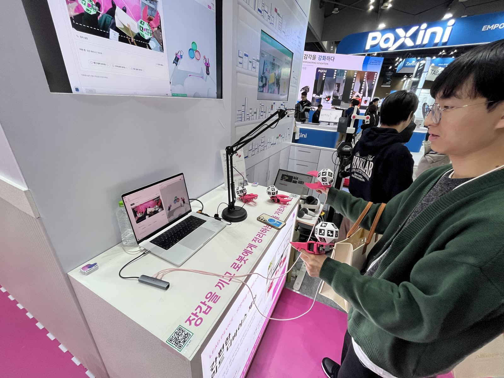 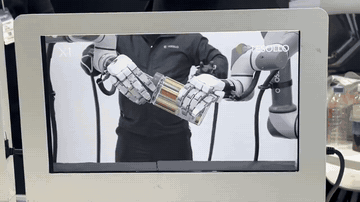 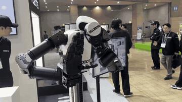

### 사람 동작을 로봇으로 옮기기
이기종 리타게팅([33](gif/33_IMG_2174.gif)), 원격 조작([34](gif/34_IMG_2176.gif)) → 사람이 시범 보인 데이터로 로봇 정책을 학습하는 흐름

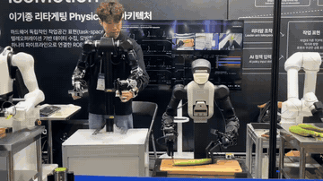 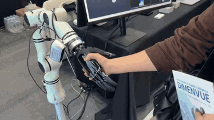

### VLA 양팔 작업
레인보우로보틱스 RB-Y1 '꽃을 든 Y1'([50](pic/50_IMG_2196.jpg) · [51](pic/51_IMG_2197.jpg)) = 말로 지시한 작업을 비전 + 언어로 이해해 양팔로 수행

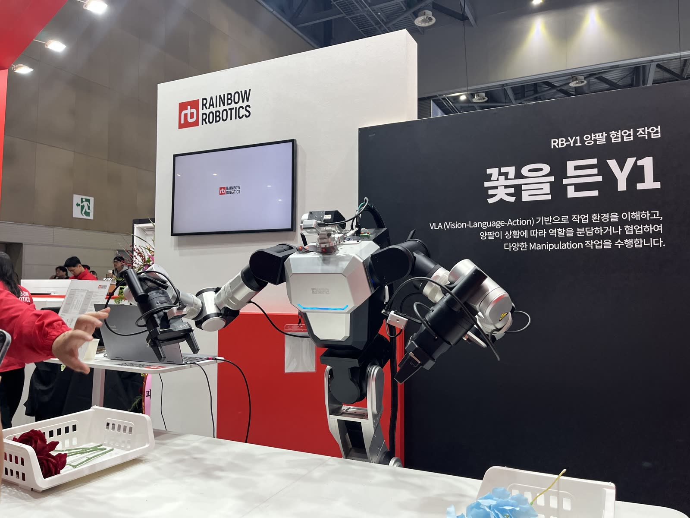 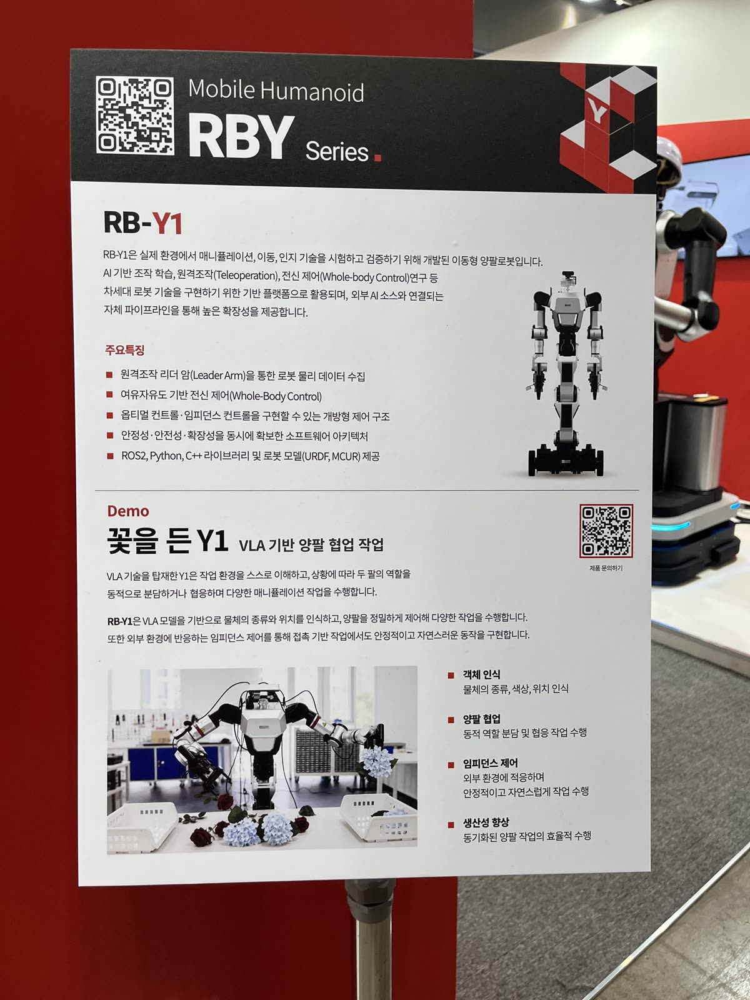

### 4족 · 휴머노이드 시연
RB-Q10([52](pic/52_IMG_2199.jpg)), 시연 구역([24](gif/24_IMG_2164.gif) · [32](pic/32_IMG_2168.jpg) · [35](gif/35_IMG_2179.gif) · [53](gif/53_IMG_2120.gif)), 로보티즈 공연([54](gif/54_IMG_2163.gif) · [55](gif/55_IMG_2162.gif))

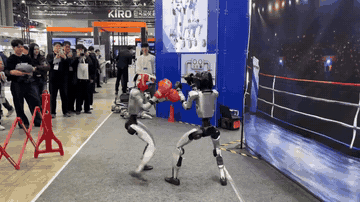 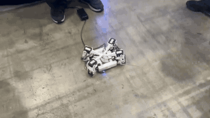 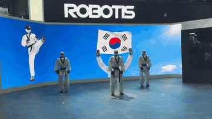

### 비전
Edge AI 탐지 · 추적 라이브러리(PRISM AI, 열화상 포함, [57](pic/57_IMG_2171.jpg)), 실시간 객체 인식 화면([58](pic/58_IMG_2188.jpg)) → 우리 광각 YOLO · Jetson TensorRT 와 같은 계열

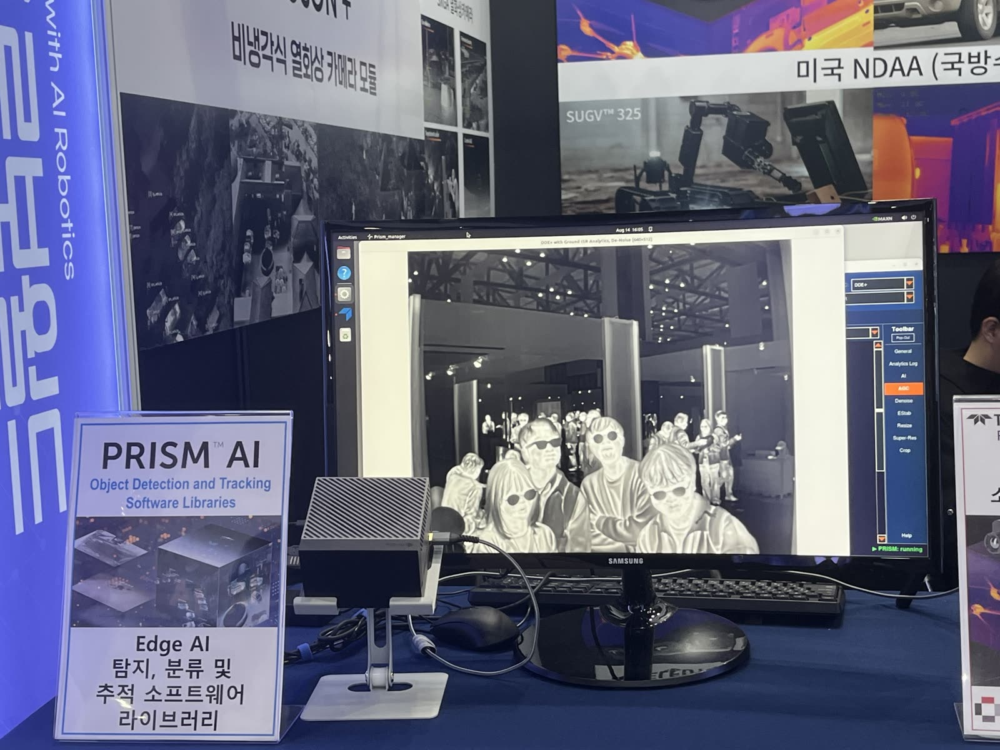 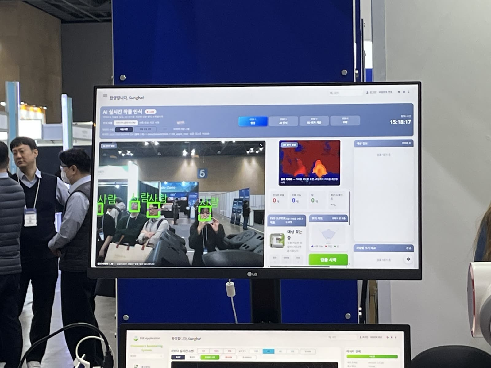

### 미니 공장
로봇 팔 여러 대 + 라인 트랙 · 컨베이어([20](gif/20_IMG_3704.gif)) — 바닥 라인을 따라 움직이는 구성

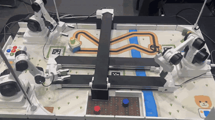

## 4. 추천 전시회

- **AW 2027** (코엑스, 내년 초): 산업 자동화 · 스마트팩토리 · 제조 로봇. 현장 관계자들이 로보월드보다 더 기대한다고 함
- https://www.automationworld.co.kr/overview-exhibition
