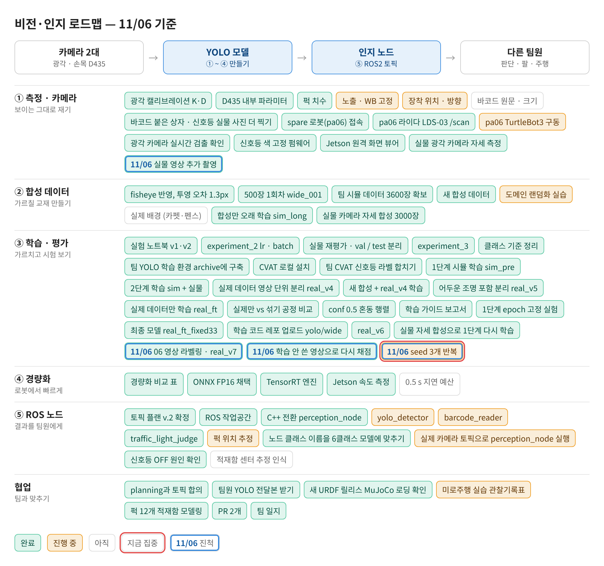
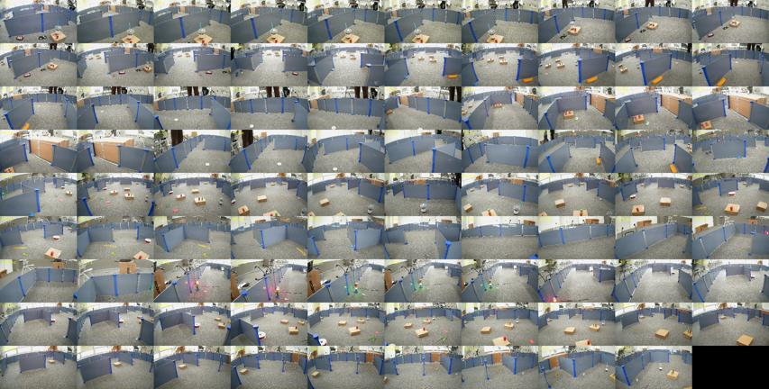
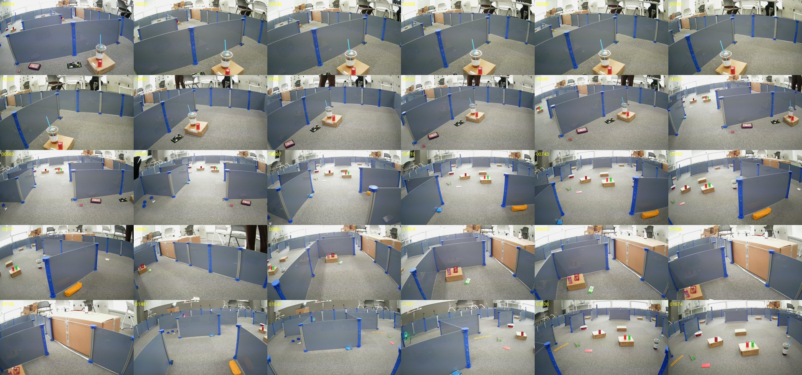
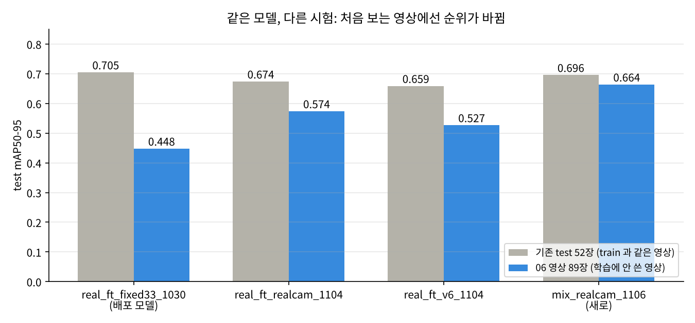
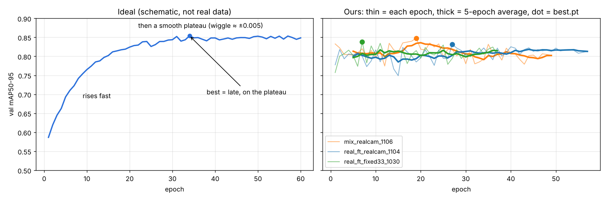

date: 2026.11.06

# Turtle Ninja 비전 작업 일지 (11/06)

> 작성: 김혜민 (비전 담당) · 2026-11-06 (금)

오늘은 **학습에 한 번도 안 쓴 영상(06)으로 모델들을 다시 채점해 보고, 지금까지의 점수가 후했다는 걸 확인한 날**이에요.

- 06 영상 286장 → 비슷한 장면을 빼고 **89장**만 라벨링 (모델 예측을 초벌 라벨로 올려 고치는 방식)
- 06 으로 다시 채점하니 배포 모델(real_ft_fixed33_1030)이 **0.705 → 0.448** 로 가장 낮고, 새로 학습한 **mix_realcam_1106 이 0.664** 로 가장 높음
- 같은 영상에서 뽑은 기존 test 52장은 train 과 너무 비슷해서 점수가 후했음
- 운인지 확인하려고 **seed 3개 반복 실험** 시작, 새 실물 영상 한 편 촬영

## 로드맵 진행

③ 학습 · 평가 칸이 움직였어요. 파란 테두리 = 오늘 진척, 빨간 테두리 = 다음 집중.

- ✅ 06 영상 라벨링 · real_v7 (286 → 89장, CVAT 초벌 라벨)
- ✅ 학습 안 쓴 영상으로 다시 채점 (06 mAP50-95: 배포 모델 0.448, mix 0.664)
- ✅ 실물 영상 추가 촬영 (약 2분, 프레임 242장)
- 🟡★ seed 3개 반복 (실물만 vs mix, seed 42 · 7 · 123)

## 06 영상 라벨링: 286장 → 89장

06 영상은 천천히 움직이며 찍어서 바로 옆 프레임끼리 거의 같았어요. 다 그리면 시간이 오래 걸려서 비슷한 장면을 빼고 추렸어요.

- 추리는 방법: 영상 전체를 한 장에 모은 훑어보기 사진(contact.jpg)에서 프레임마다 축소 영상을 비교 → 직전에 고른 6장과 충분히 다를 때만 남김 → **89장**
- 초벌 라벨: `scripts/prelabel_cvat.py` (새로 만듦) 가 지금 모델의 예측을 CVAT YOLO 1.1 zip 으로 만들어 줌 → CVAT task #3 에 올리고 사람은 틀린 것만 고침
- 상자는 회전하지 않음: 모델이 똑바른 상자만 내고, YOLO 1.1 내보내기에 회전 정보가 없어서 기울이면 오히려 틀어짐

라벨 확인 결과: 89장 모두, 상자 104개 (red_cyl 36 · red_box 34 · green_cyl 25 · traffic_light 9). 상자 없는 34장은 물체가 안 보이는 장면이 맞았고, green_box · barcode 는 이 영상에 없음.

## 학습 안 쓴 영상으로 다시 채점

real_v7 = real_v6 그대로 + 06 의 89장을 test 에 추가 (`experiments/real_v7_1106.ipynb`). 같은 모델을 기존 test 52장과 06 으로 나눠 채점했어요.

| 모델 | 기존 52장 mAP50-95 | **06 mAP50-95** | 전체 141장 |
|---|---|---|---|
| real_ft_fixed33_1030 (배포 모델) | **0.705** | 0.448 | 0.589 |
| real_ft_realcam_1104 | 0.674 | 0.574 | 0.635 |
| real_ft_v6_1104 | 0.659 | 0.527 | 0.608 |
| **mix_realcam_1106** (새 합성 + 실물 ×3) | 0.696 | **0.664** | **0.691** |

- 기존 52장에서 1등이던 배포 모델이 06 에서는 꼴찌 → 기존 test 는 train 과 같은 영상의 몇 초 떨어진 장면이라 후했음
- mix 는 06 에서 배포 모델보다 +0.22, 모든 클래스에서 가장 높음
- 마지막 conf 0.5 혼동 행렬 셀은 GPU 메모리 부족(다른 노트북 커널이 3.3 GB 차지)으로 멈춤 → 한 장씩 · 모델마다 메모리를 비우게 고침

## 다른 사람 프로젝트와 비교 (velog: USC 트럭 YOLO)

비슷한 YOLO 과제에서 1등 한 글과 우리 진행 방식을 비교했어요. 그 글의 핵심은 "점수를 어디까지 믿을 수 있나"였어요.

| 그 글에서 한 것 | 우리 |
|---|---|
| 같은 영상의 프레임이 train · test 에 섞인 걸 영상 ID · 시간 · pHash 로 확인 | 10/28 영상 단위 분리(real_v4)는 했지만, real_v5 부터 어두운 사진 때문에 다시 시간 구간 분리 → val · test 가 train 과 같은 영상 |
| val 로만 고르고, 모델을 잠근 뒤 test 1번 | test 를 보고 배포 모델을 고름 |
| 비슷한 두 후보를 seed 3개로 다시 확인 | seed 반복 없음 (모두 seed 42) |
| 물체 크기 분포(Small · Medium 94%)를 보고 입력 크기 결정 | 크기 분포는 안 봄 |

- 이미 우리가 앞선 것: 6클래스 · 합성 → 실물 2단계 · Jetson 속도 · conf 0.5 혼동 행렬 · 틀린 사진 직접 보기
- 바꿀 것: 06(새 영상)을 주 점수로, 결정은 val 로, 비슷하면 seed 3개

## val 학습 곡선이 들쭉날쭉한 이유

이상적인 val mAP 곡선은 빠르게 오르다가 평평해지고(epoch 간 ±0.005 정도), 가장 좋은 epoch 이 평평한 구간 뒤쪽에 있어요. 우리 곡선은 epoch 1 부터 0.80 근처에서 시작해 ±0.02~0.07 로 흔들리고, best epoch 이 7 · 19 · 27 로 제각각이었어요.

- 원인: val 이 68장 · 상자 140개(red_box 12개)뿐이라 상자 1개만 바뀌어도 mAP 가 0.01 움직임 + train 과 같은 영상이라 너무 쉬움
- 지금 best.pt 는 운 좋게 튄 epoch 이고, 조기 종료(patience 30)도 그 튄 값부터 셈
- 고치는 법: 학습에 안 쓴 영상으로 val 만들기, 5 epoch 평균으로 고르기

## seed 반복 실험 시작

**seed** = 학습 중 무작위(사진 순서 · 증강 · 새 층 초기값)의 시작 번호예요. 같은 설정이라도 seed 만 바꾸면 mAP 가 0.01~0.03 달라질 수 있어서, 한 번 이긴 게 운인지 확인하려면 seed 를 바꿔 몇 번 더 돌려야 해요.

- `experiments/seed_1106.ipynb`: 실물만 · mix 를 seed 7 · 123 으로 더 학습 (기존은 seed 42), hyp.yaml 은 그대로 두고 `hyp_seed7.yaml` · `hyp_seed123.yaml` 을 노트북이 만듦
- **결과를 보기 전에 판단 기준을 정함**: 06 mAP50-95 에서 seed 3개 모두 mix 가 이기고, 평균 차이가 흔들림보다 크면 mix 로 바꿀 근거
- 실물만 seed 7 · 123, mix seed 7 은 끝남. 밤에 로그아웃하면서 mix seed 123 이 12 epoch 에서 멈춤 → 내일 다시

## 새 실물 영상 촬영

나중에 쓸 val · test 를 위해 광각 영상을 한 편 더 찍었어요 (`record_arducam.sh`, pa06 → 노트북 SSH 녹화, 재압축 없음).

- `wide_puck_new_20261106_160518.mkv` 약 2분 → `extract_frames.py` 로 0.5초마다 가장 선명한 프레임 → **242장**
- 녹화 중 학습에는 영향 없음 (녹화는 CPU · 디스크만 씀). 단 `live_detect.py` 처럼 GPU 를 쓰는 건 학습 중에 피함
- ffmpeg 의 `non monotonically increasing dts` 경고: Wi-Fi 로 같은 밀리초에 두 프레임이 들어와 시각이 겹친 것, 프레임은 그대로 저장됨

## 다른 작업

- 11/04(수) 일지 작성 (Claude Doc · TIL Day63)
- pa06 VS Code 원격 연결: Claude Code 에서 이어 보려고 메모

## 다음 할 일

- [ ] mix seed 123 다시 학습 → seed 결과로 판단
- [ ] 새 영상 프레임 추리기 · 라벨링 (val 또는 test 용)
- [ ] 결정은 val 로, test 는 마지막에 한 번
- [ ] 적재함 센터 추정 인식 · 광각 영상 문제 (11/03 에서 이어짐)
