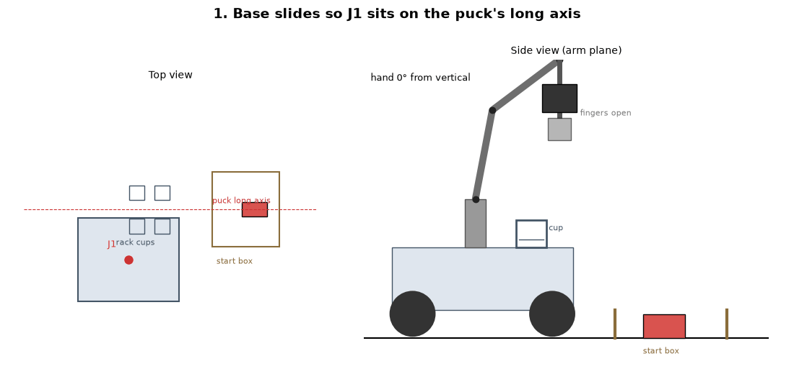
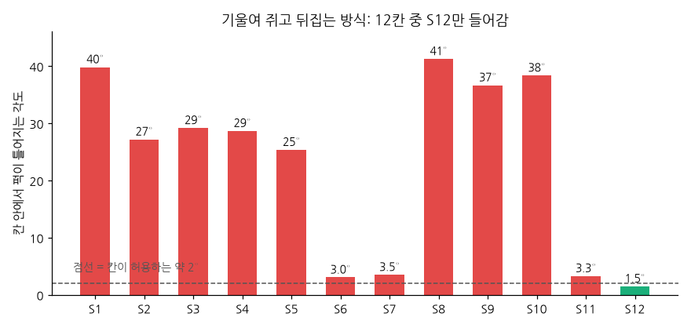
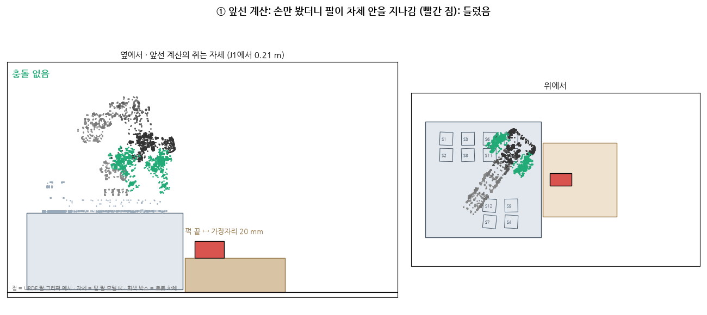
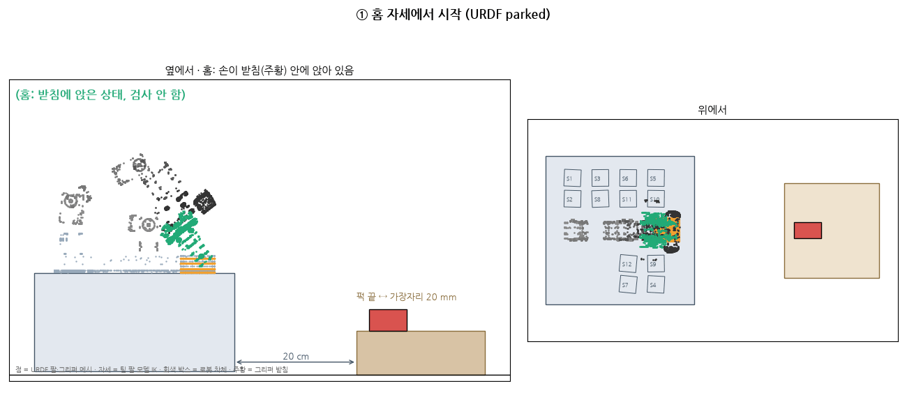
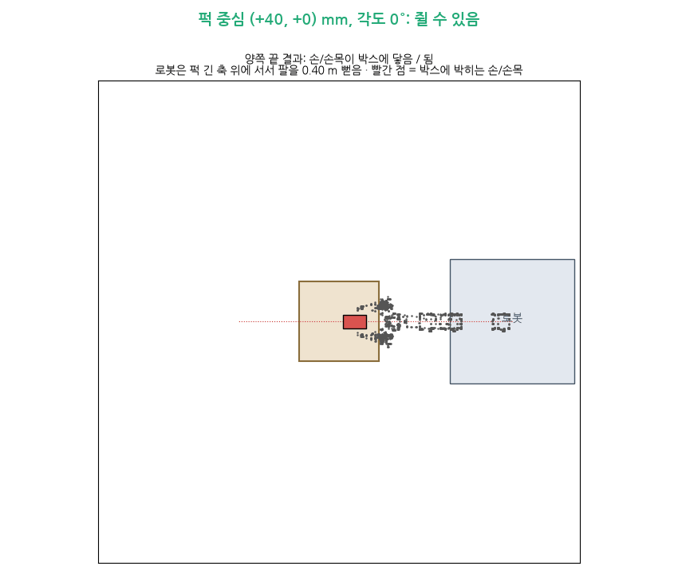
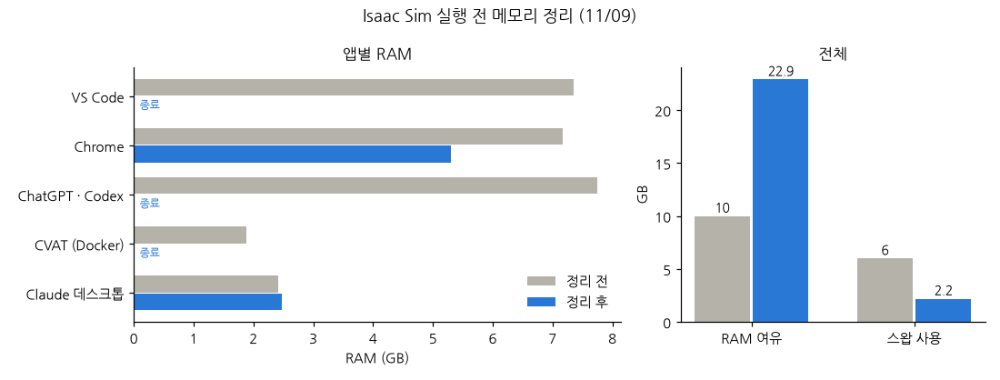

date: 2026.11.09

# Turtle Ninja 매니퓰레이터 강화학습 준비 일지 (11/09)

> 작성: 김혜민 · 2026-11-09 (월)

오늘은 **매니퓰레이터를 다른 방식으로 학습시켜 보려고 실제 팔 모델로 동작이 가능한지부터 계산하고, 새 강화학습(학습2)을 시작할 자리를 만든 날**이에요.

- 팀원 둘이 매니퓰레이터 학습을 서로 다른 방식으로 해서 시뮬 점수가 더 좋은 쪽을 최종으로 고르기로 함
- 학습1 (누운 퍽을 다시 쥐지 않고 한 번에 12칸에 넣기): 수평으로 퍽 끝을 쥐면 12칸 모두 되지만, 박스 위 누운 퍽 자세의 **22%만** 쥘 수 있어서 **보류**
- 계산을 GIF 로 그려 보다가 내 계산의 실수 2개를 찾음 (팔 ↔ 차체 충돌 빠뜨림, 그리퍼 받침이 비어 있음)
- 학습2 (무작위로 칸이 찬 적재함에서 퍽을 안 치고 넣고 빼서 주사위 모양으로 놓기) 준비: `feat/mission-system` 으로 옮김, 혁무님 보정값 위치 확인
- Isaac Sim 느림: `nvidia-powerd` 켜고 메모리 정리 (RAM 여유 10 → 22.9 GB)

## 학습1: 누운 퍽을 한 번에 쥐어 12칸에 넣기

지금 팀 방식은 누운 퍽을 그리퍼 받침에 기울여 넣고 눌러 세운 뒤 다시 쥐어요 (`park`). 실물에서 mm 단위 조정이 계속 필요해서, **다시 쥐지 않고 한 번에** 넣는 방식을 찾아봤어요. 조건은 **적재함 12칸을 모두 쓸 것**.

### 첫 생각: 기울여 쥐고 손 안에서 뒤집기 → 안 됨

손을 45° 기울여 퍽 끝을 쥐고, 옮기면서 손을 90° 돌려 퍽을 세우는 방식이에요.

그런데 팔 관절이 5개라 손이 기울어진 채로는 J5 로 퍽을 세로축으로 돌릴 수 없어요. 그래서 칸 안에서 퍽이 틀어지는 각도가 **J1 에서 그 칸을 보는 방향으로 정해져** 버려요. 칸은 36 mm, 퍽은 34.8 mm 라 약 2° 까지만 들어가요.

- 12칸 중 **S12 만** 들어감, 8칸은 25–41° 틀어짐
- J1 바로 옆 4칸 (S6 · S7 · S11 · S12) 만 쓰는 방법도 있지만 12칸을 다 써야 해서 제외

### 수평으로 퍽 끝 쥐기 → 12칸 모두 됨, 단 조건이 좁음

손을 바닥과 수평으로 눕혀 퍽 끝 25 mm 를 쥐고, 옮기면서 손을 수직으로 세우면 퍽이 손끝 아래로 세워져 매달려요. 손이 수직이라 지금 STORE 처럼 **J5 로 칸 방향을 맞출 수 있어서 12칸 모두** 돼요.

팀 팔 모델 (`config/arm_kinematics.yaml`) 로 IK 를 풀고 URDF 메시를 그대로 그려서 확인했어요 (빨간 점 = 차체 · 바닥 · 박스에 박히는 부분).

- ① 처음 계산은 손과 박스만 봐서 "J1 에서 0.21 m 면 됨" 이라고 했는데, 그려 보니 **팔꿈치 · 손목이 차체 안을 지나감** → 틀림
- ② 차체까지 넣으니 손끝이 **J1 에서 0.38–0.40 m** 일 때만 충돌 없음 → 로봇이 박스에서 **약 20 cm 떨어져** 서야 함
- ③ 퍽 끝이 박스 가장자리에서 35 mm 면 손목이 박스에 닿음 → **약 20 mm 안** 이어야 함
- ④ 12칸 모두 손을 세워 넣기 가능

URDF 를 다시 보니 그리퍼가 쉬는 **받침 (`gripper_park_stand`)** 이 계산에 꼭짓점만 들어가 있었어요. 꽉 찬 상자로 고치고 **홈 자세 (parked) 부터** 다시 계산했어요.

- P0 → 퍽 위 → 쥐기 → 들기 → 칸 → 놓기 → P0 의 모든 중간 자세가 차체 · 받침과 충돌 없음, 12칸 모두
- 받침에서 P0 로 빠지는 동작은 팀이 쓰는 기존 경로를 그대로 쓴다고 봄 (관절을 직선으로 움직이면 받침에 닿음)

### 퍽이 여러 위치에 누워 있으면? → 22% 만

박스 (205 × 205 mm) 위 어디에나, 어떤 각도로나 누운 퍽을 놓고 (5 mm · 15° 간격, 9,736 가지), 로봇이 퍽 긴 축 위에 서서 양쪽 끝 중 하나로 쥘 수 있는지 봤어요.

- **22%** 만 쥘 수 있음, **박스 가운데는 어떤 각도로도 안 됨** (손목이 박스 윗면에 닿음)
- 퍽이 가장자리 근처에 있고 긴 축이 그 가장자리를 향할 때만 됨
- 시뮬 기본 배치 (박스 중심 ±40 mm) 에서는 0° 로 누웠을 때만 되고 15° 만 돌아도 안 됨
- → 나머지 78% 를 처리할 방법 (가장자리로 밀어 옮기기 등) 이 필요해서 **학습1 보류**

계산 코드 · 자세 파일: `classes/PhysicalAi/projects/project-2/archive/manipulator/training1/`

## 학습2 준비: 칸이 무작위로 찬 적재함에서 넣고 빼기

새로 할 강화학습은 **이미 적재된 퍽을 치지 않고 피해서 새로 넣거나, 적재된 퍽을 차례로 접촉 없이 빼서 주사위 모양으로 놓기** 예요.

- 팀 저장소를 `feat/mission-system` (64eafaf, jje 11/09) 으로 옮기고 최신 확인. 혁무님 11/09 저녁 실물 보정 (060a157) 포함, **혁무님이 써도 된다고 확인**
- main (11/02) 에는 팔 보정 파일이 아직 없음 → 학습 기준 = `feat/mission-system` 64eafaf

| 파일 | 들어 있는 것 |
|---|---|
| `config/arm_paths.yaml` | 칸별 넣기 · 빼기 경로 (실물 성공 기록을 그대로 재생) |
| `config/control.yaml` | 칸별 넣기 · 빼기 보정, 퍽 집기 보정 |
| `config/rack_cells.yaml` | 12칸 실측 위치 · 각도, 넣기 · 빼기 순서 제약 |
| `config/arm_kinematics.yaml` | 팔 모델 (J1 영점, 처짐 보정) |

- `arm_paths.yaml` 에는 칸마다 **실물로 해 본 적재 조합이 하나씩** 뿐이고 "그보다 더 찬 상태는 실물로 해 본 적 없음" 이라고 적혀 있음 → 지금은 넣는 순서를 고정해서 피하는 중. 이 빈자리가 학습2 대상
- 시뮬에는 아직 팔 학습 환경이 없음 (지금 있는 과제는 모두 주행용)
- 학습 코드는 팀 저장소가 아니라 `archive/manipulator/` 에서 하기로 함 (팀 저장소는 읽기만)

## Isaac Sim 느림

- `nvidia-powerd` 켬: 서비스는 동작, D-Bus 오류는 남음 (허용 설정 파일 없음). GPU 전력 한도 115 W (최대)
- Isaac Sim 이 꺼진 채로 잰 GPU 17 W · 800 MHz 는 쉬는 상태라 판단 불가 → Isaac Sim 을 켜고 다시 재야 함
- `clickhouse` 는 CVAT (Docker 18개) 의 통계 데이터베이스였음
- 스왑 = RAM 이 모자랄 때 디스크를 임시 메모리로 쓰는 것. Isaac Sim 데이터가 스왑으로 밀리면 크게 느려짐

- VS Code · ChatGPT · CVAT 를 끄니 RAM 여유 **10 → 22.9 GB**, 스왑 **6 → 2.2 GB**
- 실행해 보니 `$ISAACLAB_PY` 가 비어 있었고, 이 저장소에 시뮬용 로봇 모델 (USD) 이 없어서 아직 못 돌림 → `convert_team_robot.py` 로 만들어야 함

## 다음 할 일

- [ ] `export ISAACLAB_PY=~/pa-course/IsaacLab-6.2/.venv/bin/python` 를 `~/.bashrc` 에 넣기
- [ ] `convert_team_robot.py` 로 팀 로봇 USD 만들기 → Isaac Sim 켜고 GPU 전력 다시 재기
- [ ] 학습2 환경 설계: 칸 무작위로 채우기, 넣기 · 빼기 · 주사위 놓기, 접촉하면 벌점
- [ ] 혁무님께 실물에서 옆 칸 퍽에 닿았던 기록 (`arm_tests/runs`) 받기
- [ ] 학습1 다시 볼 때: 가장자리에서 먼 78% 처리 방법
