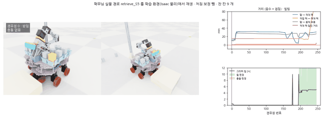
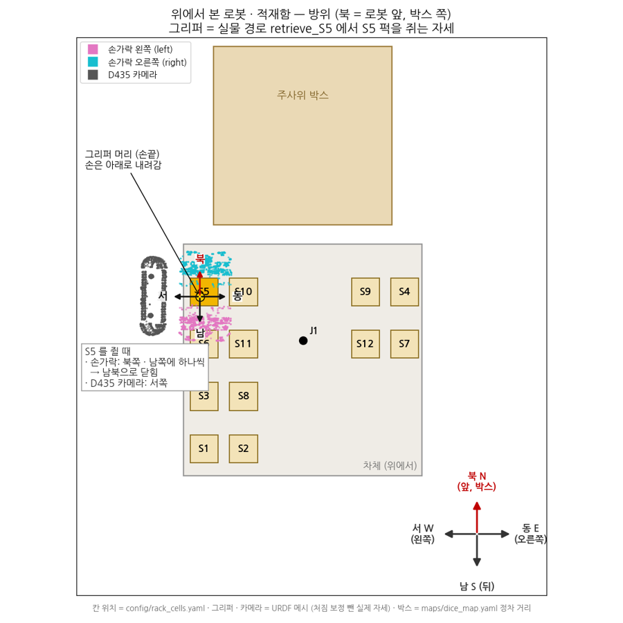
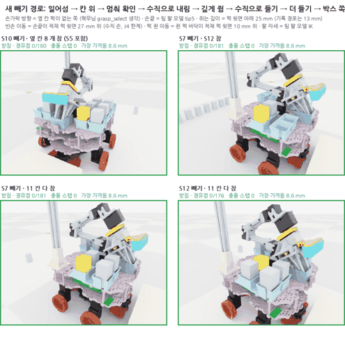
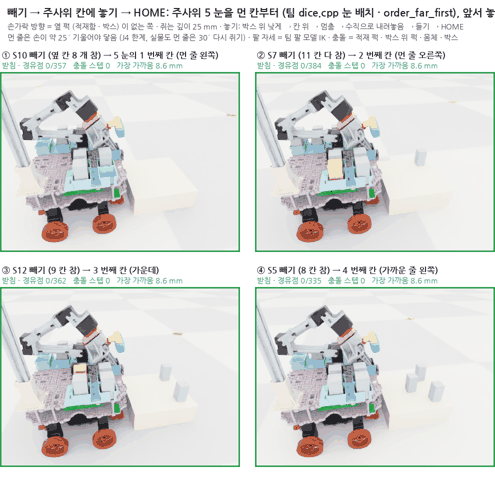
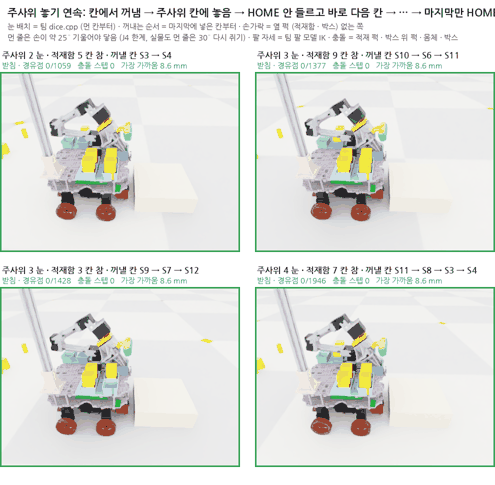
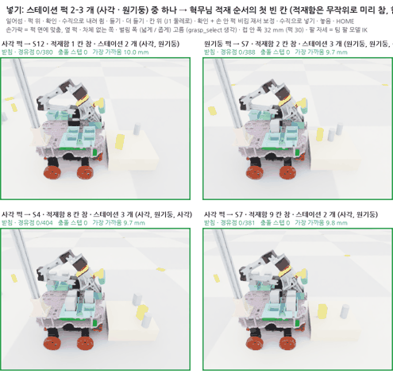

date: 2026.11.10

# Turtle Ninja 매니퓰레이터 학습2 일지 (11/10)

> 작성: 김혜민 · 2026-11-10 (화)

오늘은 **학습2 강화학습 환경을 만들고, 혁무님이 만든 집기 · 넣기 방식을 시뮬에서 그대로 따라 하도록 동작을 다시 설계한 날**이에요.

- 학습2 환경 코드 작성: `classes/PhysicalAi/projects/project-2/archive/manipulator/training2/`
- 팀 실물 경로를 시뮬에서 재생해 보니 처짐 보정 때문에 퍽을 못 집음 → 처짐을 거꾸로 빼는 계산 추가
- 처음 만든 동작은 퍽을 이상하게 쥐어서 옆 퍽과 닿음 → 혁무님 방식 (손가락을 빈 쪽으로) 으로 다시 설계
- 꺼내기 · 주사위 놓기는 **퍽 사이 HOME 안 들르고 이어서**, 적재는 **스테이션 퍽을 전부** 넣기
- 학습 t1 을 23:04 에 tmux 로 시작

## 학습2 환경 만들기

강화학습 환경은 Isaac Lab 6.2 `DirectRLEnv` 로 만들고, 학습은 rsl_rl PPO 로 해요.

| 파일 | 하는 일 |
|---|---|
| `cfg.py` | 장면 (로봇 · 퍽 · 박스) · 보상 · 학습 설정 |
| `env.py` | 학습 환경 (넣기 · 꺼내기, 충돌 계산) |
| `geometry.py` | URDF 에서 팔 표면 점 · 몸체 상자를 만들어 충돌 거리 계산 |
| `sag.py` | 팀 팔 모델의 처짐 보정을 거꾸로 계산 (명령값 ↔ 실제 자세) |
| `train.py` · `run_tmux.sh` | 학습 실행 (tmux 세션 `train2`) |

시뮬에서 알게 된 것:

- 퍽은 **30 × 30 × 60 mm** (팀 `wrist_pose.hpp`). 34.8 mm 는 누운 퍽 높이였음
- USD 가 적재함 · 받침 · 차체를 한 몸체로 합쳐서, 충돌은 URDF 모양으로 따로 계산
- 손목 ↔ link2 충돌 모양이 HOME 에서 원래 겹침 (팀 MoveIt 설정도 이 쌍을 끔) → 시뮬에서도 뺌
- 칸 안 퍽이 미세하게 흔들려 넘어져서, 적재된 퍽은 로봇에 붙어 따라가는 고정 물체로 둠

## 팀 실물 경로 재생

`arm_paths.yaml` 의 칸별 경로를 시뮬에 그대로 넣으니 손이 퍽보다 위에서 멈춰요. 이 경로는 팔이 처지는 만큼 **미리 더한 명령값**이라서, 처짐을 빼서 실제 자세로 바꿔야 해요.

- 처짐을 뺀 뒤 재생하니 혁무님이 기록한 실물 접촉 (S7 ← S12, S10 ← S5) 이 시뮬에서도 똑같이 나옴 → 시뮬 판정이 맞다는 확인

## 젯슨 코드 확인

팀 코드가 GitHub 이 아니라 **젯슨에서 계속 고쳐지고 있었음**. 젯슨 (10.2.10.231) 을 찾아 비교하고, `feat/mission-system` 을 pull (64eafaf → fd6f60b, mission transfer_planner 만 바뀜).

## 그리퍼 방향 정리

설명을 주고받기 쉽게 그리퍼 머리에 방위를 그려 봤어요 (북 = 로봇 앞, 박스 쪽).

- 혁무님 방식: 퍽을 집을 때 J5 로 손목을 돌려 **손가락이 옆 퍽이 없는 빈 틈 쪽으로 벌어지게** 함
- 처음 시뮬 동작은 이걸 안 해서 옆 퍽과 닿았음 → 다시 설계

## 꺼내기 동작 다시 설계

1. 받침에서 일어섬 (팀 경로 그대로)
2. **숙이지 않고 선 채로** 꺼낼 칸 위로 감
3. 멈춰서 확인
4. 수직으로 내림 → 퍽 윗면 **25 mm 아래** 를 쥠 (손끝으로 얕게 쥐지 않게)
5. 수직으로 들고, 적재된 퍽 위로 더 높이 들어서 박스 쪽으로

손가락은 옆 퍽이 없는 쪽으로 열고, J5 는 손끝 위치를 그대로 둔 채 돌려요 (IK).

## 주사위 놓기 (이어서)

주사위 눈 개수는 무작위, 눈 배치는 팀 `dice.cpp` (먼 칸부터). 하나 놓고 **HOME 안 들르고 바로 다음 칸** 으로 가고, 마지막에만 HOME 이에요.

이어서 하니 버그 두 개가 나왔어요.

- 팀 일어서기 경로가 한 번에 크게 움직여서 **몸체가 흔들리고 칸 안 퍽이 18 mm 튐** → 관절을 0.04 rad 씩 나눠 움직임
- 놓은 자세에서 바로 다음 칸으로 가면 **J5 가 한계에 걸려** 손가락이 옆 퍽 쪽을 향한 채 내려감 → 두 방향을 다 만들어 보고 칸 위에서 방향이 맞는 쪽을 고름

- 4가지 경우 모두 충돌 0, 떨어뜨림 0
- 먼 줄은 손을 약 25° 기울여야 닿아서 놓는 자리가 10–14 mm 어긋남 (보정 학습이 고칠 부분)

## 스테이션 적재

스테이션에는 퍽 2–3 개 (네모 · 원기둥 섞임) 가 무작위로 있고, 적재함은 일부가 미리 찬 상태. 퍽을 **가까운 것부터 전부** 집어서 혁무님 적재 순서 (`planning.yaml` cargo_slots: S12 → S7 → S9 → …) 의 첫 빈 칸에 넣어요. 스테이션 방문 순서는 팀 `collect_order` (B1 → B2 → B4 → B5 → B6 → B3).

퍽 상태별로 혁무님 방식을 그대로 옮겼어요.

| 퍽 | 방법 (팀 코드) |
|---|---|
| 가까이 선 퍽 | 수직 손으로 집음 |
| 먼 쪽 선 퍽 | 손을 기울여 집고 가까운 빈자리에 내려놓은 뒤 수직으로 다시 쥠 (`regrasp_nodes`) |
| 누운 네모 퍽 | 받침에 기울여 넣고 놓은 뒤 눌러 세우고 다시 쥠 (`park_stand`, 꽂아 누르기) |

- 칸 여유가 한쪽 1 mm 라서, 칸 위에서 손 안 퍽 위치 · 방향을 재고 맞춰서 넣음 (실물 = 손목 카메라)
- 누운 퍽: 눌러서 섰다가 손을 떼면 다시 넘어감 → 누르는 자리 −16 → **−22 mm**, 다시 쥐는 자리 **+4 mm** 로 바꾸니 0° 로 서서 칸에 들어감

### 팀 방식으로 못 집는 배치

박스 위 자리별로 계산해 보니:

- 원기둥: 박스 전체 됨
- 선 네모: 먼 쪽에서 면이 35° 넘게 돌아 있으면 안 됨 (팀 규칙)
- 누운 네모: 로봇에서 0.25 m 까지는 됨, **0.29 m 부터 (박스 먼 쪽 절반) 거의 안 됨** — 손을 30° 기울여도 퍽이 굴러 손가락 깊이가 모자람

무작위 배치 16개 중 6개만 처음부터 끝까지 계획됐어요. 못 집는 배치를 어떻게 할지는 따로 정해야 해요.

## 학습 t1 시작

23:04 에 `bash run_tmux.sh t1` 로 학습 시작 (env 256개 · 3000번, 약 9시간). 이 학습은 기본 경로 없이 처음부터 배우는 방식이에요.

- 11/11 새벽 2:46, 1210번에서 관측값 NaN 으로 멈춤 (물리가 터진 env 하나)
- 보상은 −125 → −32 로 올랐지만 **성공은 끝까지 0** → 처음부터 배우는 방식은 퍽 옮기기를 못 배움

## 다음 할 일

- [ ] 학습 에피소드를 이어서 하는 방식 (적재 = 스테이션 퍽 전부, 꺼내기 = 주사위 눈 수만큼, 퍽 사이 HOME 없음) 으로 바꾸기
- [ ] 혁무님 방식 기본 경로에 보정만 배우는 학습으로 다시 하기
- [ ] 못 집는 배치 (먼 누운 퍽 · 많이 돈 먼 퍽) 처리 방법 정하기
- [ ] 혁무님께 꺼내기 순서 (지금은 마지막에 넣은 칸부터) 가 미션에 정해져 있는지 확인
