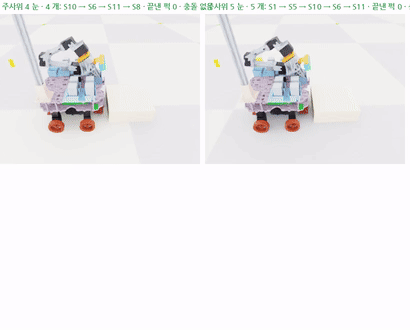
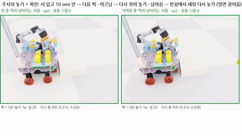
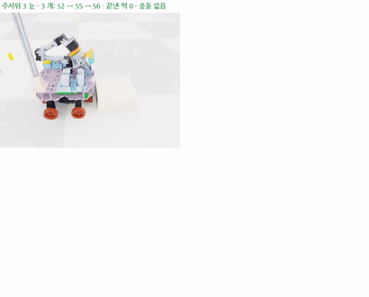
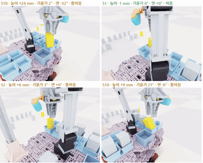

date: 2026.11.11

# Turtle Ninja 매니퓰레이터 학습2 일지 (11/11)

> 작성: 김혜민 · 2026-11-11 (수)

오늘은 **처음부터 배우는 학습을 접고 혁무님 방식 기본 경로 위에 보정만 배우는 학습으로 바꾸고, 삐뚤어진 퍽을 툭 건드려 바로잡는 정책을 처음으로 성공시킨 날**이에요.

- t1 (처음부터 배우기): 1210번에서 NaN 으로 멈춤, 성공 0 → 보정 학습 (residual) 으로 바꿈
- 주사위 놓기를 다시 설계: 정면 + J5 원점, 놓는 순서, 먼 자리 다시 쥐기, 놓은 뒤 확인 루프
- 움직임: 빈 공간은 빠르게, 멈추는 곳 사이 가감속 한 번으로 부드럽게, 덜컹하면 감점
- 툭 건드리기 정책 200번 → 성공 91%, 배포 형식으로 내보내 팀 저장소 새 브랜치에 커밋
- 22:04 밤 학습 시작 (기본 경로 실패율 → r4 → n2fast)

코드 위치: `classes/PhysicalAi/projects/project-2/archive/manipulator/training2/`

## t1 결과와 방향 바꾸기

어제 밤 시작한 t1 은 새벽 2:46, 1210번에서 관측값 NaN 으로 멈췄어요. 보상은 올랐지만 성공은 끝까지 0 이었어요.

- 처음부터 배우게 하면 퍽을 쥐고 칸에 넣는 긴 동작을 찾지 못해요
- 그래서 **혁무님 방식으로 계산한 기본 경로를 따라가면서, 관절에 작은 보정값만 더하는** 방식으로 바꿨어요 (`env_res.py`)
- 물리가 터진 env 는 그 env 만 다시 시작 (`env.py` `_bad_state`)

## 이어서 하는 에피소드

퍽 하나마다 HOME 에 가지 않고 이어서 하도록 바꿨어요 (`library.py`).

| 종류 | 한 에피소드 |
|---|---|
| 적재 | 스테이션 하나의 퍽 2–3개 (선 네모 · 원기둥 · 누운 네모, 무작위 자리 · 각도) 를 가까운 것부터 전부 칸에 넣기 |
| 꺼내기 | 여러 칸에서 꺼내 주사위 눈 자리에 놓기 |

- 스테이션은 팀 `maps/dice_map.yaml` 에서 읽음
- HOME 은 스테이션 · 미션이 끝날 때만

## 보정 학습 r1 · r2 · r3

| 실행 | 바꾼 것 | 결과 |
|---|---|---|
| r1 | 첫 시도 | 보상 −7 → −224, 기본 경로보다 나빠짐 (탐색 동작이 큼) |
| r2 | 탐색 폭 0.1, 저역 필터 0.8, 그리퍼 보정 끔 | 기본 경로보다 낫지 않음 |
| r3 | 속도 · 가감속 바꾼 경로 묶음 v3 | 기본 경로보다 낫지 않음 |

보상을 나눠 보니 칸 벽 스침이 점수를 거의 다 잡아먹고 있었어요. 자기 칸 벽 스침은 괜찮다고 정해서 감점에서 빼고 기록만 해요. 다른 퍽에 닿는 건 금지예요.

## 주사위 놓기 다시 설계

꺼낸 퍽을 꺼낼 때 손 각도 그대로 놓고, 놓는 순서도 틀렸어요. 이렇게 바꿨어요.

1. 퍽 꺼냄
2. 몸체를 정면으로 돌리면서 J5 도 원점으로
3. 놓을 자리 확인
4. 내려놓음

- 놓는 순서: **먼 줄 → 가까운 줄, 줄 안에서는 왼쪽 → 오른쪽**
- 먼 자리는 한 번에 놓기 어려워서, 가까이 내려놓고 20–30° 기울인 손으로 다시 쥐어 살짝 들어서 옮겨 놓음

### 놓은 뒤 확인 루프

놓은 퍽 하나가 넘어져 있어서 확인 단계를 넣었어요.

- 섰고 자리에서 10 mm 안이면 다음으로
- 넘어졌으면 다시 집어 받침에서 세움 (멀면 먼저 끌어와서 집기)
- 받침에서 기울어진 쪽을 보고 누르기, **2번까지**. 그래도 안 서면 스테이션에서 다시 쥐고 받침으로 와서 이어서

## 팔이 하늘로 솟는 문제

J4 각도가 2π 를 넘어가면 같은 자세인데도 관절이 한 바퀴 돌아가서 손이 하늘로 솟았어요. 각도를 앞 값과 이어 붙이는 `unwrap_limits` 로 고쳤어요.

## 속도와 덜컹

- 처음 동작이 느려서 빈 공간은 150°/s, 퍽 근처는 62.5°/s, 누를 때는 20°/s 로 나눴어요
- 구간마다 멈췄다 가니 뚝뚝 끊겨서, **멈추는 곳 사이를 하나로 보고 가속 5 로 한 번에 최고 속도까지 올렸다가 줄이도록** 바꿨어요 (`pathgen.py` `dense_all`, 나중에 가속 3.7)
- 팔이 크게 움직일 때 몸체가 들리며 덜컹해서, 학습에 몸체 기울기 · 바퀴 뜸 감점과 안정적으로 끝내면 주는 보상을 넣었어요

## 툭 건드리기 (nudge)

칸에 넣은 퍽이 삐뚤어졌을 때 처음엔 스테이션으로 가져가 다시 쥐는 복구를 만들었는데, 너무 느려서 버렸어요. 대신 **그 자리에서 살짝 건드려 바로잡는** 작은 정책을 따로 학습했어요 (`env_nudge.py`).

- 시작: 넣고 손을 뺀 자세 (칸 위 30 mm)
- 퍽: 칸 위에서 2–6 mm 비키고 면 5–35° 돌아간 채로 떨어뜨림
- 성공: 바닥에 앉고 기울기 5° · 면 10° · 중심 3 mm 안, 손은 15 mm 넘게 위
- 자기 칸 벽 스치는 건 괜찮고, 다른 퍽 · 몸체 · 박스에 닿으면 감점

| 반복 | 성공 | 충돌 없이 성공 | 걸린 시간 |
|---|---|---|---|
| 100 | 76% | 64% | 36스텝 |
| 200 (n1b) | **91%** | **83%** | 25스텝 (약 0.8초) |

## 팀에 보내기

- `export_nudge.py` 로 팀 배포 형식 (TorchScript + numpy 만으로 도는 npz + cfg.json) 으로 내보냄. npz 와 torch 결과 차이 8.3e-07
- 혁무님 브랜치와 상관없이 origin/main 에서 새 브랜치 `feat/rl-nudge` 를 만들어 `config/rl/nudge_n1b.{npz,json,md}` 커밋 (b7e6825)
- GitHub 푸시는 내 터미널에서 직접 해야 함, 젯슨에서는 그 브랜치를 받아서 빌드
- 혁무님 젯슨 11-11 코드 (`feat/integ-1110`) 를 받아서 새 칸 순서로 경로 묶음 v4 (783개) 를 다시 만듦

## 밤 학습

22:04 에 `bash night_run.sh` 로 tmux `night` 에서 차례로 시작했어요.

1. 기본 경로만 실패율 측정 (v4, 64개)
2. 보정 학습 r4 (1500번)
3. 툭 건드리기 빠른 설정 n2fast (2초, 62.5°/s, 200번)

기본 경로 실패율:

| 작업 | 퍽 끝냄 | 충돌 없음 | 성공 |
|---|---|---|---|
| 적재 (24개) | 41% | 25% | 21% |
| 꺼내기 (40개) | 60% | 78% | 30% |

- 적재는 S1 칸에 넣을 때 충돌이 가장 많고, 기울여 쥐고 다시 쥐는 퍽은 31% 만 끝냄
- 꺼내기는 충돌 없이 멈추는 경우가 많음 (놓은 퍽이 넘어졌을 것 같음, 영상 확인 필요)
- 몸체 기울기 · 바퀴 뜸 감점도 에피소드당 −16, −19 로 큼

## 다음 할 일

- [ ] 밤 학습 r4 · n2fast 결과 확인, 툭 건드리기 4초와 2초 비교
- [ ] 실패 장면 영상 보기 (적재 S1 충돌 · 다시 쥐기 실패 · 꺼내기 뒤 멈춤)
- [ ] `feat/rl-nudge` 푸시 → 젯슨에서 받기
- [ ] 툭 건드리기 ROS 노드, 손목 카메라로 칸 안 퍽 자세 재기
- [ ] 공간이 좁을 때 로봇이 뒤로 물러나 팔 뻗기 (같이 정하기)
