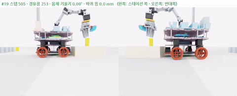
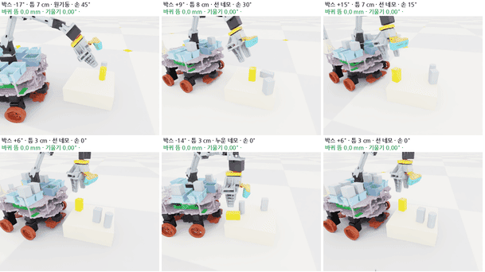
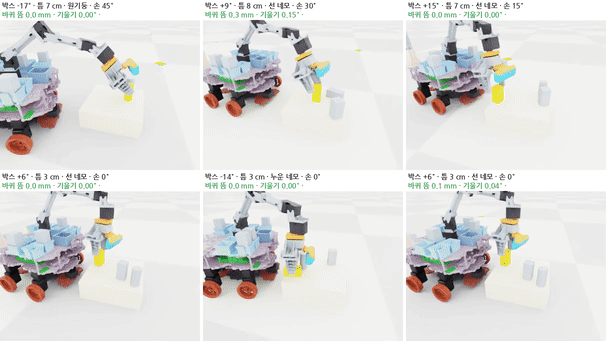
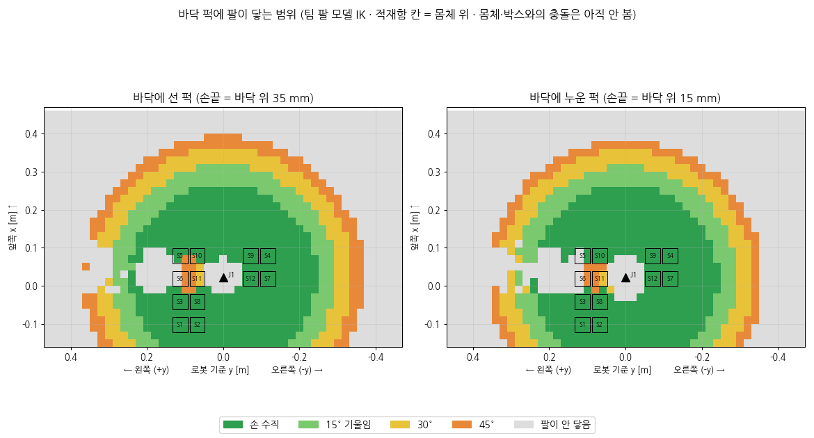

date: 2026.11.12

# Turtle Ninja 매니퓰레이터 학습 일지 (11/12)

> 작성: 김혜민 · 2026-11-12 (목)

오늘은 **보정 학습을 접고, 툭 건드리기 n1b 하나만 남긴 채 새 학습 모델 3개를 다시 정한 날**이에요.

- 밤 학습: 보정 학습 r4 (1500번) 점수 안 오름, 툭 건드리기 빠른 설정 n2fast 는 n1b 보다 나쁨
- 덜컹 원인 찾기: 먼 퍽 다시 쥐기에서 차체가 4–7° 기울고 바퀴가 9–16 mm 뜸 → 바퀴 1 mm 넘게 뜨면 실패
- 스테이션 집기 학습 p1 · p2 · p3: 퍽 10 mm 위에서 시작하면 성공 57%
- 오후 정리: n1b 만 남기고 버림, 새 모델 3개 (적재 · 주사위 놓기 · 떨어진 퍽 복구)
- 혁무님 실물 미션 rosbag 분석 → 1번 적재 모델 설계 확정

코드 위치: `classes/PhysicalAi/projects/project-2/archive/manipulator/training2/`

## 밤 학습 결과

| 학습 | 내용 | 결과 |
|---|---|---|
| r4 | 보정 학습 1500번 (경로 묶음 v4) | 평균 보상 −99 ~ −160 사이만 오르내림, 좋아지지 않음 |
| n2fast | 툭 건드리기 2초 · 관절 1.09 rad/s, 200번 | 성공 71% · 충돌 없이 55% (n1b 91% · 83% 보다 나쁨) |
| n1c | n1b 에서 200번 더 | 성공 70% · 충돌 없이 57% |

n1b 와 n1c 를 같은 조건 (env 4개, 같은 시드) 으로 다시 평가했어요.

| | n1b (200번) | n1c (400번) |
|---|---|---|
| 퍽 세우기 성공 | **89%** | 70% |
| 충돌 없이 성공 | **75%** | 57% |
| 평균 걸린 시간 | 0.8초 | 0.7초 |

더 학습하면 오히려 나빠져서 **n1b 를 그대로 쓰기로** 했어요. n2fast 도 버렸어요.

## 덜컹 구간 찾기

기본 경로 에피소드 12개를 돌리면서 스텝마다 몸체 기울기와 바퀴 높이 차를 기록했어요.

| 에피소드 | 최대 기울기 | 최대 바퀴 뜸 | 언제 |
|---|---|---|---|
| #12 적재 S1→S2 | 6.9° | 15.6 mm | 두 번째 퍽 (기울여 집고 다시 쥐기) |
| #19 적재 S1→S8 | 4.4° | 10.0 mm | 두 번째 퍽 (기울여 집고 다시 쥐기) |
| 나머지 9개 | 0.3–0.6° | 0.6–1.4 mm | 빠르게 움직이는 구간 |

처음엔 "그리퍼가 퍽을 누르며 잡아서" 라고 짐작했는데, 시뮬에서 재 보니 틀렸어요.

- 기울기가 0.2초 만에 0 → 4.1° 로 커질 때 그리퍼는 **열린 채** 이고, 가장 가까운 물체와도 27 mm 넘게 떨어져 있었어요
- 스테이션 쪽 바퀴 두 개만 9.2 mm 떴고, 팔을 들어 올려도 4° 로 기운 채 2초 넘게 남았어요
- 차체 밑에 낀 퍽은 없었고, 스테이션 박스가 바퀴 바로 옆에 붙어 있었어요. 지금 충돌 검사는 팔 ↔ 박스만 보고 차체 ↔ 박스는 안 봐요

이 장면은 학습한 결과가 아니라 **학습 전 기본 경로** 였어요. 보정 학습은 이 경로 위에서 ±0.05 만 비틀 수 있어서 고칠 수 없었어요. 기본 경로와 r4 를 같은 에피소드로 나란히 돌려도 결과가 똑같았어요.

- 사용자 기준: **바퀴는 바닥에서 아예 뜨면 안 됨** → `env_res.py` 에 바퀴 높이 차 1 mm 넘으면 에피소드 끝 + 벌점 −5
- 1 mm 는 빠른 동작에서도 0.6–0.9 mm 나오는 시뮬 흔들림을 봐준 값

## 스테이션 집기 학습 (p1 · p2 · p3)

스테이션 박스가 차체와 평행하지 않고 조금 떨어져 있어도 박스 위 퍽을 집는 작은 정책이에요 (`env_pick.py`, `gen_pick_bank.py`).

- 장면 4000개: 박스 ±20°, 차체 앞면과 틈 1–12 cm, 박스 위 퍽 2–3개 (선 네모 · 원기둥 · 누운 네모), 가장 가까운 퍽을 집음
- 시작 자세: 쥘 자리 위, 손 수직 (안 닿으면 15–45° 기울임), 그리퍼 열림
- 성공: 쥐고 30 mm 들어 10스텝 유지 · 바로 실패: 바퀴 뜸 1 mm, 심한 충돌, 퍽 밀어냄

| 학습 | 바꾼 것 | 결과 |
|---|---|---|
| p1 | 처음 설정 (60 mm 위 시작) | 퍽 위에서 맴돌기만 함, 성공 0% · 쥠 0% |
| p2 | 다가가기 보상 10배, 손가락 사이 보너스, 10 mm 위부터 커리큘럼 | 쥐기 시작 (20–48%) 했지만 바퀴 뜸 실패 93%, 평균 5스텝에 끝남 |
| p3 | 리셋 때 손가락을 열린 채로 놓음 | **성공 57%**, 바퀴 뜸 · 충돌 · 밀어냄 0% |

p2 원인은 무게가 아니었어요.

- 시뮬 총질량 3.81 kg (팀 URDF 와 같음), 팔을 뻗어도 무게중심이 몸체 앞 24–31 mm 로 바퀴 (앞 +60 · 뒤 −70 mm) 사이 안쪽
- 리셋할 때 **닫힌 손가락이 퍽 안에 겹쳐** 생겨서 물리가 밀어내며 몸체 앞이 1–2 mm 들렸음 → 열린 손가락으로 리셋하니 0 mm

p3 은 학습 중 성공률 기록이 0 으로 찍혀서 커리큘럼이 10 mm 에서 올라가지 않았어요. 그래서 60 mm 위에서 내려오는 건 아직 못 배웠어요.

## 바닥 퍽에 팔이 닿는 범위

떨어진 퍽을 줍는 학습을 위해 팀 팔 모델 IK 로 계산했어요 (몸체 · 박스 충돌은 아직 안 봄).

| | 선 퍽 | 누운 퍽 |
|---|---|---|
| 손 수직으로 닿는 거리 (J1 기준) | 약 24 cm | 약 24 cm |
| 45° 기울이면 | 약 37 cm | 약 36 cm |

## 정리: 새 모델 3개

학습한 모델 13개 (t1, r1–r4, n1, n1b, n2fast ×2, n1c, p1–p3) 중 **n1b 만 남기고** 모두 버렸어요. 보상 · 감점은 그대로 두고 새로 학습해요.

1. **적재**: 혁무님 방식 기반으로 스테이션 퍽을 집어 적재함에 넣기, 12개 찰 때까지. 삐뚤게 들어가면 인지로 보고 n1b 로 바로잡기. 빈손이면 다시 보고 될 때까지 다시 집기. 넣기 전에 손 안 퍽을 꼭 인지로 확인. 스테이션 사이는 swerve 로 이동
2. **주사위 놓기**: 12개 찬 적재함에서 L1 · L2 · L3 에 무작위 주사위 모양으로 놓기 (먼 줄 → 가까운 줄, 왼쪽 → 오른쪽, 먼 자리는 다시 쥐기, 놓은 뒤 확인)
3. **복구**: 떨어진 퍽을 인지하면 swerve 로 열린 공간에 가서 바닥에서 줍고 다시 적재. 각도가 안 나오면 그리퍼로 스테이션을 살짝 밀어 공간 만들기 (차체는 안 들리게). 주사위를 놓은 뒤 모양 · 세워짐을 확인하고 틀리면 다시 놓기

## 혁무님 실물 미션 rosbag 분석

젯슨 `~/bags/mission_1112_201555` (11/12 20:15, 683초) 와 `~/planning_logs/run_20261112_202305/verify.yaml` 을 읽기만 해서 봤어요.

| 시간 | 단계 | 내용 |
|---|---|---|
| 0:16–7:23 | 모으기 | B1 2 · B2 1 · B4 1 · B5 0 · B6 1 · B3 1 = 6개 (모두 빨강) |
| 7:26–9:51 | 놓기 | 6개 전부 L3 에 주사위 6 모양 |
| 9:51–11:01 | 재검증 | L3 · L2 · L1 을 보기만 함 |
| 11:23 | 끝 | 출발점 복귀, "COMPLETED" |

- 바코드 신호 `RRYRYRGRYRGY` = L3 빨강 6 · L2 노랑 4 · L1 초록 2 인데 빨강 6개만 찾음
- **재검증**: L3 5개 모두 칸에서 31–44 mm 벗어남, 6개 중 1개 안 보임 → 다시 놓지 않고 완료
- **빈손 집기 3번** (퍽 7 · 11 · 8): 처음에 누운 퍽으로 잘못 봐서. 두 번째에 성공, 한 번에 약 10초 손해
- **끊김**: 팔이 0.4초 안에 멈췄다 다시 가는 게 224번 (집기 58 · 꺼내기 51 · 보기 50 · 놓기 31)
- **몸체**: 팔 작업 중 평소보다 최대 약 1.1° 더 기욺 (IMU 가속도로 잰 대략값)
- 들고 있는 퍽은 넣기 전에 확인함 (`/held_puck/tag`)

## 1번 적재 모델 설계 (확정)

혁무님 `mission_manager` 흐름은 그대로 두고, 팔 동작 하나하나를 **혁무님 동작 따라 하기 (모방) → 강화학습** 으로 배워요.

- 동작: 보기 · 선 퍽 집기 · 먼 퍽 기울여 집고 다시 쥐기 (`farpick_regrasp`) · 누운 퍽 받침 세우기 · 쥠 확인 · 손 안 퍽 확인 · 칸에 넣기 · 넣은 뒤 확인 → n1b
- 인지 잡음 (최대에서 시작해 점점 낮춤): 퍽 위치 ±15 mm, 방향 ±30° 또는 모름, 선 / 누움 잘못 봄 30%, 손 안 퍽 ±5 mm, 칸 안 기울기 ±5°
- 넣기 성공: 중심 3 mm · 기울기 5° · 면 10° 안 · 시간은 빠를수록 보상
- 단계: A 혁무님 동작 재생해 실패 찾기 → B 한 스테이션 학습 → C 잡음 최대 → D 경기장 전체 + swerve + 12개

## 다음 할 일

- [ ] A단계: 혁무님 적재 동작 48개 재생 결과 확인 (밤에 시작했는데 끝 기록이 없음)
- [ ] 팀 swerve 미로 시뮬 (`sim/robot_sim/sim_core/turtleninja_maze_env.py`) 과 학습2 환경 합치기
- [ ] 2번 주사위 놓기 · 3번 복구 모델 설계
- [ ] 실물 로봇 무게 재기 (시뮬 3.81 kg)
