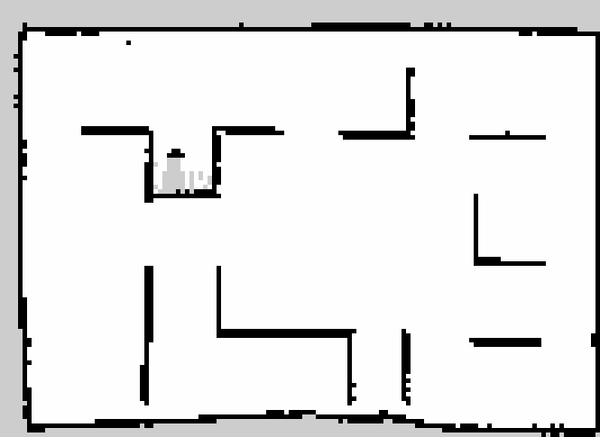
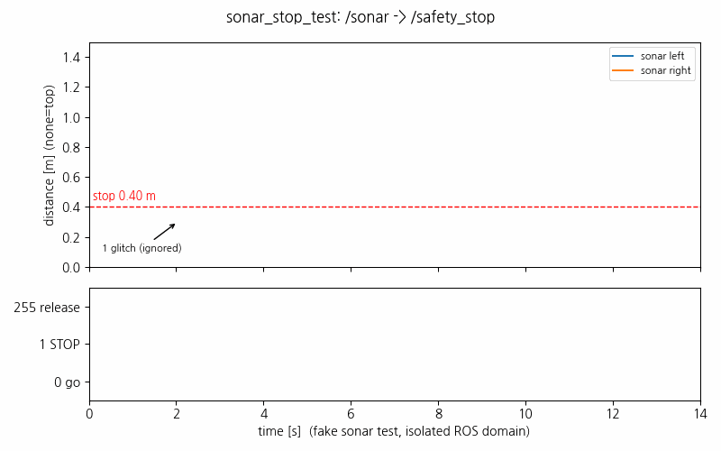
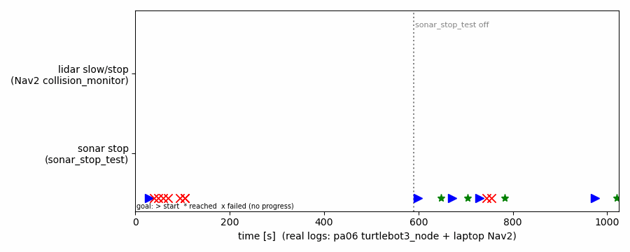

date: 2026.11.12

# Turtle Ninja 터틀봇 (pa06) 일지 (11/12)

> 작성: 김혜민 · 2026-11-12 (목)

오늘은 **개인 터틀봇 pa06 에 초음파 센서 2개를 달고, SLAM 지도로 Nav2 자율주행까지 성공한 날**이에요.

- HC-SR04 초음파 2개를 옆구리에 달고 브레드보드 배선 · 전압 분배기로 OpenCR 에 연결
- OpenCR 펌웨어에 초음파 2개 + 정지 신호를 넣고 (`waffle_guard`), turtlebot3_node 에서 `/sonar/left` · `/sonar/right` · `/safety_stop` 연결
- 리모컨으로 SLAM 지도 (`room1`) 를 만들고, Nav2 로 찍은 곳까지 자율주행 성공 (목표 4개 도착)
- 초음파 정지 시험 노드 (`sonar_stop_test`) 로 정지 동작 확인. 라이다 정지와 초음파 정지를 로그로 구분
- 팀 로봇과는 별개인 개인 프로젝트. 나중에 팀 로봇에 옮길 계획

## 전체 계획 (4단계)

| 단계 | 내용 | 상태 |
|---|---|---|
| 1 | 펌웨어 + turtlebot3_node: 초음파 2개를 ROS 로, 정지 신호 받기 | ✅ |
| 2 | 리모컨으로 SLAM 지도 만들기 → Nav2 자율주행 | ✅ |
| 3 | 정지 감시: 지도에 없는 장애물일 때만 정지 | 다음 |
| 4 | RealSense 로 무엇인지 확인하고 기다릴지 · 돌아갈지 판단 | 그다음 |

지도 만들 때는 리모컨, 장애물 정지는 자율주행 때만 쓰기로 정했어요.

## 초음파 배선

- 센서: HC-SR04 2개 (5V, Echo 출력 5V)
- 전압 분배기: Echo → 1 kΩ → 200 Ω → [약 3.13 V] → 1 kΩ → 1 kΩ → GND (가진 저항 10k · 200 · 1k 로 만듦)
- 연결: OpenCR 아두이노 헤더 DIGITAL 2·3번 (Trig · Echo), 6·7번 (Trig · Echo), 전원은 아두이노 헤더 5V · GND
- 시험 펌웨어 `sonar_test` 로 USB 에 거리를 찍으며 확인

처음에 한쪽만 나오거나 들쭉날쭉했던 원인은 전부 배선이었어요.

| 증상 | 원인 | 해결 |
|---|---|---|
| 둘 다 `--` | 선이 GPIO 헤더가 아니라 DIGITAL 헤더에 꽂혀 있음 | 펌웨어 핀을 DIGITAL 2·3·4·5 로 바꿈 |
| 오른쪽만 안 됨 / 됐다 안 됐다 | 20번 레일 +/− 선이 바뀜, 녹슨 점퍼선, 센서 하나 잘못 꽂음 | 바로 꽂고 선 교체, 오른쪽은 4·5 → 6·7번으로 옮김 |

결과: 손을 대면 10.8 cm, 멀리는 110–170 cm 로 양쪽 모두 정상.

## 1단계: 펌웨어 + turtlebot3_node

**펌웨어** `~/pa-opencr-build/sketches/waffle_guard` (라이브러리 복사본 `libs_pa06_guard`)
- 원래 waffle 펌웨어는 그대로 두고 제어 테이블 빈칸에 추가: 182 = 거리 [m], 186 = 거리 [m] (반사 없음 −1), 193 = 정지 신호
- 초음파는 기다리지 않는 방식: 50 ms 마다 번갈아 쏘고, Echo (3번 · 7번) 인터럽트로 시간만 기록 → 주행이 안 끊김
- 정지 신호가 1 이면 리모컨 · ROS 속도 모두 무시하고 바퀴 0. ROS 가 끊기면 자동으로 풀림. 리모컨은 원래대로

**turtlebot3_node** pa06 `~/pa06_ws` (원래 `~/ninja_ws` 는 안 건드림)
- `/sonar/left` · `/sonar/right` (`sensor_msgs/Range`, 20 Hz) 내보냄
- `/safety_stop` (`UInt8`: 0 통과 · 1 정지 · 255 감시 종료) 받음. 첫 신호 뒤부터 0.5초 끊기면 정지 (감시 노드가 죽어도 멈춤)
- 빌드 후 `libturtlebot3_node_lib.so` 를 못 찾는 문제 → `ninja_ws` 처럼 `--symlink-install` 로 다시 빌드해서 해결
- ssh 로 bringup 할 때 `.bashrc` 가 안 읽혀서 `TURTLEBOT3_MODEL=waffle_pi` · `LDS_MODEL=LDS-03` 를 명령에 직접 넣어야 함

## 2단계: SLAM · Nav2

**SLAM** (노트북에서 slam_toolbox, RViz)
- 문제: LDS-03 라이다가 한 바퀴에 찍는 점 수가 매번 다름 (395–404개) → slam_toolbox 가 `expected 405` 하며 스캔을 버림
- 해결: `scan_fixer` 노드 (`~/pa06_ws/src/pa06_guard`) 로 항상 400개 (0.9° 간격) 로 다시 나눠 `/scan_fixed` 로 보냄. 없는 점은 만들지 않음
- 지도: `~/pa06_ws/maps/room1` (133 × 97 칸, 5 cm → 약 6.7 m × 4.9 m)

**Nav2** (`~/pa06_ws/config/nav2_params.yaml`, TurtleBot3 waffle_pi 설정 복사)
- 바꾼 것: 라이다 `/scan_fixed`, 로봇 반지름 0.22 m, 최고 속도 0.1 m/s · 0.6 rad/s
- 문제 1: 노트북이 pa06 토픽을 못 봄 → 와이파이 멀티캐스트가 막힘 → 노트북 터미널마다 `ROS_STATIC_PEERS=10.2.12.57`
- 문제 2: Nav2 를 켜고 60초 안에 2D Pose 를 안 찍으면 주행 부분이 시작을 포기함 (`Aborting bringup`) → `initial_transform_timeout: 600` 으로 10분까지 기다리게 함
- 문제 3: 노트북에 Nav2 를 두 번 켜서 노드가 충돌함 → 하나만 켬
- 결과: 찍은 목표 4개 모두 도착

## 초음파 정지 시험 (`sonar_stop_test`)

옆구리 초음파 중 하나라도 가까우면 `/safety_stop` 에 정지를 보내는 시험용 노드예요 (지도는 안 봄).
- 2번 연속 가까우면 정지, 0.5초 계속 멀어야 풀림, Ctrl+C 로 끄면 255 를 보내서 풀림
- 가짜 초음파 값으로 먼저 시험 (로봇과 분리된 ROS 도메인): 한 번 튄 값 무시, 정지 · 해제 · 종료 모두 맞게 동작
- 시험 중 버그 2개 고침: `warn` → `warning` (Lyrical), Ctrl+C 때 ROS 가 먼저 닫혀 255 를 못 보내던 것

**실제 로봇에서**
- 라이다로 멈춘 건지 초음파로 멈춘 건지 로그로 구분: 시험 노드가 켜져 있던 동안 초음파 정지 13번, 끈 뒤에는 0번이고 Nav2 의 라이다 충돌 감시 (collision_monitor) 만 감속 · 정지
- 초음파 정지는 시험 노드를 켜야만 동작함. 안 켜면 멈추는 건 전부 라이다

| 문제 | 원인 | 조치 |
|---|---|---|
| 시험 노드를 켜면 Nav2 가 안 움직임 | 한쪽 초음파가 계속 4–7 cm | 안 쓰는 카메라가 센서 앞을 막고 있었음 → 떼냄 → 1.75 m 로 정상 |
| 몸체 안쪽에 묻힌 센서 | 퍼진 소리가 몸체에 먼저 맞음 | 센서를 몸체 밖으로 빼냄 |
| 가깝지 않은 벽에도 멈춤 | 0.40 m 가 통로 벽에 걸림, 지도를 모름 | 0.25 m 로 줄임 |
| 한번 멈추면 못 움직임 | 정지 신호가 모든 움직임을 막아 벽에서 멀어질 수도 없음 | 3단계에서 해결 예정 (지도 벽 무시, 멀어지는 움직임 허용) |
| 좌우가 바뀜 | 로봇에 달 때 바뀜 (손 시험: 왼쪽을 가리니 `/sonar/right` 가 8 cm) | turtlebot3_node 에서 이름을 맞바꿈, pa06 에서 다시 빌드 |
| 왼쪽 값의 약 40% 가 18 m 같은 값 | 펌웨어가 Echo 시작을 놓친 것으로 추정 (최대 4 m) | 펌웨어 수정 예정 |

센서 위치: 몸체 가운데에서 양옆으로 85 mm. 초음파 + 0.085 m 가 라이다로 잰 벽까지 거리와 1–2 cm 안에서 맞았어요.

## 다음 할 일

- [ ] 좌우 바꾼 turtlebot3_node 로 bringup 다시 켜고 손 시험으로 확인
- [ ] 펌웨어: Echo 를 핀 상태 대신 순서로 판단, 4 m 넘는 값은 측정 없음 처리
- [ ] 3단계 감시 노드: AMCL 위치 + 센서 위치 (85 mm) 로 지도 벽까지 예상 거리를 계산해서, 지도 벽이면 무시
- [ ] 옆 센서는 그쪽으로 회전할 때만 막고, 멀어지는 움직임은 허용
- [ ] Nav2 inflation (0.5 m) 이 좁은 통로에서 너무 보수적인지 확인
- [ ] 리모컨이 꺼질 때 마지막 속도로 계속 가는 문제는 그대로 → 끄기 전에 5번
