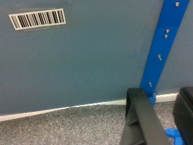
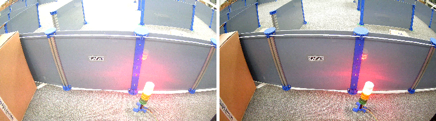

date: 2026.11.13

# Turtle Ninja Jetson 인지 점검 일지 (11/13)

> 작성: 김혜민 · 2026-11-13 (금)

오늘은 **주행 없이 팔 · 카메라 · 인지만 켜서 바코드와 신호등 인식을 실물로 확인한 날**이에요.

- 바코드: 팔을 LOOK_BARCODE 자세로 보내 벽 바코드를 **P2-04** 로 읽음 (벽까지 약 24 cm)
- 신호등: 광각 카메라로 빨강 · 노랑 · 초록 · 꺼짐 모두 판정, 1분 동안 놓친 적 없음
- 광각 밝기가 usb_cam 기본값 +50 이라 화면이 하얗게 날아가 있었음 → −20 으로 낮춰도 판정 정상
- 밝기 고정 코드를 새 브랜치 `feat/wide-cam-brightness` 에 올림 (Jetson 에는 아직 안 넣음)

## 켜는 순서 (Jetson, 창 4개)

1. 로봇 (바퀴 · 팔 보드): `cd ~/p2_integ && … bash tools/jetson/run_robot.sh full opencr` → 질문에 `y`
2. 카메라 2대 + 인지: `ros2 launch bringup bringup.launch.py publish_debug:=true dds_transport:=DEFAULT`
3. robot_cli: `bash ~/real_1111/cli.sh` → `barcode` (팔 자세), `4` (인지 쪽)
4. 바코드 읽기 켜기: `ros2 service call /perception/barcode/enable std_srvs/srv/SetBool "{data: true}"`

끄기: `bash ~/real_1111/stop_robot.sh; sudo poweroff`

## 결과

- 바코드는 한 장씩은 가끔만 읽혔지만 5장 중 3장 조건을 넘어 `/perception/task_text` 로 확정
- 신호등 판정은 초당 약 25번, 매번 `visible=True`. robot_cli 4쪽에서도 바뀌는 걸 확인

- 밝기 +50 은 usb_cam 이 넣은 기본값 (팀 설정에는 밝기 값이 없음). 자동 노출이라 0 으로 해도 밝은 곳은 조금 날아감
- 밝기 고정: `bringup.launch.py` 에서 usb_cam 은 밝기를 안 건드리게 (`-1`) 하고 켜지고 3초 뒤 `v4l2-ctl` 로 −20, 인자 `wide_brightness`

## 막혔던 것

| 증상 | 원인 · 해결 |
|---|---|
| 팔 작업 거절, 모터 "대답 없음" | OpenCR 전원 · 어댑터 전원이 꺼져 있었음 |
| "/arm_task 서버 없음" | `run_robot.sh` 가 `y` 확인을 기다리고 있었음 |
| 바코드 결과 안 나옴 | 팔이 20초 할 일 없으면 스스로 접힘, 읽기 서비스 이름은 `/perception/barcode/enable` |
| robot_cli 에 "신호등 없음" | 인지를 다시 켠 뒤 robot_cli 도 다시 켜야 함 |

- Jetson 의 실행 코드 `~/p2_integ` 는 git 이 아니라 혁무님 bundle 로 갱신됨 (GitHub 보다 최신)
- 노트북에서 실시간으로 보는 `cam_view.py` (SSH 로 영상만 받음) 를 만들어 밝기를 바꾸며 확인

## 다음 할 일

- [ ] 혁무님과 밝기 고정을 Jetson 에 넣을지 정하기 (bundle)
- [ ] −20 에서 신호등 점멸 12번 순서까지 맞는지 확인
