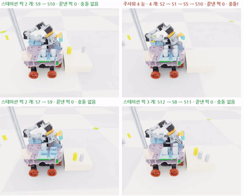
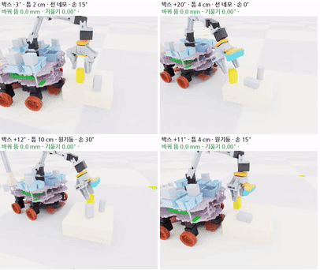
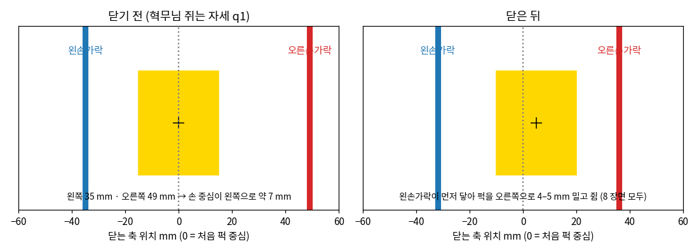

date: 2026.11.13

# Turtle Ninja 매니퓰레이터 학습 일지 (11/13)

> 작성: 김혜민 · 2026-11-13 (금)

오늘은 **혁무님 동작을 통째로 따라 하는 모방 학습을 접고, 단계마다 보상을 주는 "보고 집기" 학습으로 바꾼 날**이에요.

- A단계: 혁무님 적재 동작을 시뮬에서 그대로 돌림 → 성공 23%, 실패는 대부분 먼 퍽 기울여 집기 · 다시 쥐기에서
- 모방 학습 3번 (s1bc · s2bc · s3dag) 모두 실패 → 퍽 끝냄 10% · 19% · 6%
- 단계 보상 설계: 서 있는 퍽 ①–⑦, 누운 퍽 ①–⑨ (해낸 단계마다 한 번씩)
- 집기 정책 k1 · k2 · k3: 다가가기 · 퍽 찾기는 배웠지만 "밀지 않고 쥐기 (②)" 는 아직 0–15%
- 측정: 혁무님 쥐는 자세는 손 중심이 퍽에서 약 5 mm 치우쳐 왼손가락이 먼저 닿아 퍽을 4–5 mm 밂

코드 위치: `classes/PhysicalAi/projects/project-2/archive/manipulator/training2/`

## A단계: 혁무님 적재 동작 그대로

적재 장면 48개를 혁무님 경로 그대로 돌렸어요 (바퀴 1 mm 넘게 뜨면 실패).

| 항목 | 결과 |
|---|---|
| 성공 | 23% |
| 퍽 끝냄 | 50% |
| 충돌 없음 | 31% |

| 집는 방법 | 끝낸 퍽 |
|---|---|
| 수직으로 집기 | 26 / 35 |
| 누운 퍽 | 12 / 23 |
| 기울여 집고 다시 쥐기 | 20 / 59 |

## 모방 학습 (B단계) — 3번 실패

정책 하나가 혁무님 적재 동작 전체 (펴기 → 집기 → 다시 쥐기 → 넣기) 를 따라 하게 했어요 (`env_store.py`, `bc_store.py`).

| | 혁무님 동작 | s1bc | s2bc | s3dag (DAgger 4번) |
|---|---|---|---|---|
| 퍽 끝냄 | 40% | 10% | 19% | 6% |
| 성공 | 23% | 0% | 2% | 0% |

- 학습 오차는 계속 줄었는데 실제로 돌리면 점점 경로에서 벗어남 → 퍽 하나에 수백 스텝인 긴 동작을 통째로 따라 하기는 어려움
- s2bc 는 적재함 위에서 맴돌기만 하고, s3dag 는 충돌이 이어짐

## 단계 보상 설계

경로를 흉내 내는 대신 **해낸 일마다 보상** 을 주기로 했어요 (퍽 하나당 단계마다 한 번, 순서대로만).

- 서 있는 퍽: ① 다가가기 → ② 쥐기 → ③ 들기 → ④ 옮기기 → ⑤ 칸 바로 위 → ⑥ 수직으로 넣기 → ⑦ 빠져나오기
- 누운 퍽: ① 누운 것 확인 → ② 잡는 방법 판단 → ③ 판단대로 집기 → ④ 받침에 놓기 → ⑤ 툭 쳐서 세우기 → ⑥ 스테이션에 내려놓기 → ⑦ 수직으로 집기 → ⑧ 들고 돌기 → ⑨ 내려놓기
- 정책은 작게 나눔: 집기 · 누운 퍽 세우기 · 넣기, 그 사이 빈 공간 이동은 혁무님 경로

## 집기 정책 k1 · k2 · k3 (`env_pick2.py`)

| 학습 | 바꾼 것 | 결과 |
|---|---|---|
| k1 | 단계 보상 ①②③ | ① 다가가기 85%, ② 0% |
| k2 | **보고 집기**: 정답 위치 대신 손목 D435 로 본 위치 (안 보이면 모름), 30% 는 퍽이 안 보이게 시작해 스테이션 쪽을 둘러보며 찾기 | 찾기 90%, 성공 15% (영상 평가) |
| k3 | 닫기 전 퍽을 두 손가락 가운데로 맞추면 보상 (①-2) | 다가가기 90%, 가운데 맞춤 69%, ② 0% |

### 왜 ② 쥐기가 0% 였나 (시뮬에서 잼)

- k1 은 잘 집어서 들어 올렸는데 0점 → "퍽이 2 mm 넘게 움직이면 누른 것" 이라는 기준이 옆으로 움직인 것까지 셈
- 혁무님 쥐는 자세로 그리퍼만 닫아 보니: 손 중심이 퍽에서 약 7 mm (링크 기준) 치우쳐 **왼손가락이 먼저 닿아 퍽을 오른쪽으로 4–5 mm 밀고** 쥠 (8 장면 모두), 아래로는 안 누름
- 손목 카메라는 쥐기 직전 (퍽까지 약 12 cm) 까지 퍽을 화각 안에서 봄 → 기억 없이 보고 집기가 가능

## 다음 할 일

- [ ] k3 도 ② 0% → 쥐기 기준 · 보상을 다시 의논 (2번 넘게 실패, 멈춘 상태)
- [ ] 넣기 정책 · 누운 퍽 세우기 정책 만들기
- [ ] 2번 주사위 놓기, 3번 떨어진 퍽 복구 모델
