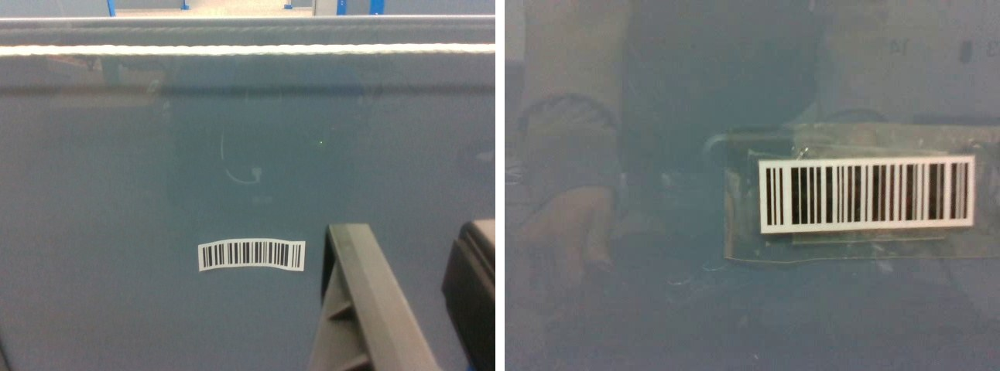
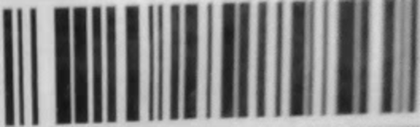
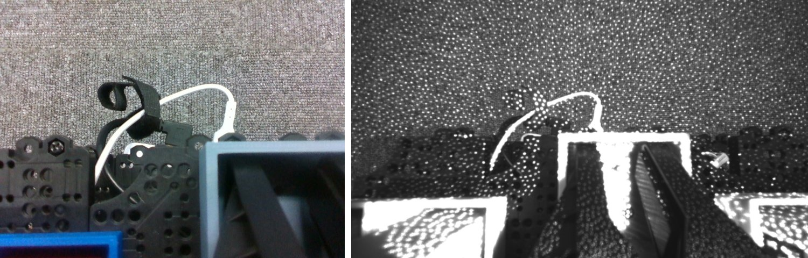

date: 2026.11.13

# Turtle Ninja 비전 작업 일지 (11/13)

> 작성: 김혜민 · 2026-11-13 (금)

오늘은 **바코드가 왜 안 읽히는지 녹화로 직접 확인하고, 신호등 리모컨 펌웨어를 미션용 최종판으로 만든 날**이에요.

- Jetson 에 녹화하지 않고 **노트북이 와이파이로 카메라 토픽을 받아 녹화** (Fast DDS 유니캐스트)
- 11/12 미션 녹화: 신호등 인지는 맞았고, 바코드는 4번째 재시도(약 20초)에 P2-04
- 손목 바코드 녹화 3개 모두 판독 0 → 바코드가 너무 작고 휘어 있음. **스티커에 딱 맞게 자르면 읽힘**
- 설계: ① YOLO 로 "바코드다" (빠른 발견) → ② 그 박스만 잘라 흑백 판독. 손목 바코드 190장을 CVAT 에 올림
- 신호등 펌웨어 최종판: 6 퍽 구성 입력 · D 확인 · U 랜덤 반복 · R 다시 · L 끄기

## 노트북에서 Jetson 토픽 받기

Jetson 에 녹화하면 미션에 방해되고 용량을 많이 써서, 노트북이 구독해서 저장하기로 했어요.

| 문제 | 원인 · 해결 |
|---|---|
| 노트북에서 토픽이 안 보임 | 와이파이가 멀티캐스트를 막고, 노트북 Docker 주소(172.17·172.18)가 섞임 → Fast DDS 설정 `fastdds_laptop.xml` (와이파이 주소만 쓰기 + Jetson 주소로 직접 찾기) |
| 새 터미널마다 `ros2` 없음 | `source ~/Downloads/jetson_env.sh` 하나로 ROS · 도메인 17 · Fast DDS 설정 |
| 광각 1280×720 은 거의 안 옴 | 와이파이 대역폭 부족. 손목 640×480 압축은 29.5 Hz |

- 압축 영상을 구독하면 Jetson 이 장마다 JPEG 로 압축해서 CPU 를 조금 더 씀 → 미션 중에는 노트북 구독을 꺼 두기
- 녹화는 `ros2 bag record` (mcap), 바로 mp4 로 저장하는 `rec_mp4.py` 도 만듦. Foxglove 는 Chrome 에서 녹화 보기만 (영상 내보내기는 유료 · 데스크탑 전용)

## 11/12 미션 녹화 분석

- 신호등: perception 은 `Y G Y G R R Y G Y Y Y R` (R3 Y6 G3) 를 맞게 읽음. 미션이 이상했던 건 planning 의 신호 기록이 앞 시도(2번만 깜빡) 에서 INCOMPLETE 로 남아 안 지워졌기 때문
- 바코드: 5초 재시도 4번째에 P2-04 (약 20초 걸림)

## 손목 바코드가 안 읽히는 이유

손목 카메라 녹화 3개 (`rec_1113_1212 · 1213 · 1219`, 130 · 329 · 425장) 를 장마다 zxing 으로 읽어 보니 **모두 0장**.

| 원인 | 내용 |
|---|---|
| 너무 작음 | 640×480 에서 바코드 폭 약 140 px → 막대 한 칸이 약 1.5 px (2–3 px 는 돼야 읽힘) |
| 휜 스티커 | 웃는 입 모양으로 굽어서 한 줄로 읽으면 양 끝이 어긋남 |
| 흔들림 | 팔이 움직이는 동안은 번짐 (선명도가 한 자리 수까지 떨어짐) |

- 계산대 스캐너가 빠른 이유도 학습이 아니라 **가까이 · 크게 · 선명하게** 찍는 조건 때문
- 학습으로는 없는 픽셀을 만들 수 없음 → 판독기(zxing)가 아니라 찍는 조건과 자르기를 고쳐야 함

### pa06 로 가까이 찍어 보기

pa06 에 RealSense 드라이버(`ros-lyrical-realsense2-camera`)를 깔고 노트북으로 받아 35초 촬영 (1064장).

| 방법 | 읽힌 장 수 |
|---|---|
| 화면 전체 (지금 BarcodeStage) | 1 |
| 밝기로 대충 위치를 찾아 자르기 | 8 |
| 스티커 테두리에 딱 맞게 자르기 | 바로 읽힘 (P2-04) |

- 가까이 찍어도 화면 전체로는 아크릴 반사 · 손 · 어두운 배경 때문에 못 읽음
- **결론**: ① YOLO 가 바코드 박스를 딱 맞게 찾고 → ② 그 부분만 잘라 흑백 · 확대해서 판독. 박스 크기로 "더 가까이" 도 판단할 수 있음

### 흑백(IR) 카메라도 시험

- IR 은 글로벌 셔터라 덜 번지지만 프로젝터 점무늬가 촘촘히 찍히고, 해상도가 depth 설정(848×480)에 묶여 크게 나아지지 않음 → 보류
- IR 을 같이 받으니 와이파이로 컬러가 30 → 10 Hz 로 떨어짐

### 라벨링 준비

- 바코드가 보이는 프레임 190장 (pa06 123 · 로봇 손목 1219 20 · 4cam 47, 바코드 없는 AprilTag 화면 10 포함)
- 노트북 CVAT (`localhost:8080`) 에 영상별 task 3개: #5 `wrist_barcode_pa06_bc_1113` · #6 `wrist_barcode_rec_1113_1219` · #7 `wrist_barcode_rec_1113_4cam`, 라벨 `barcode`
- 박스는 흰 스티커 테두리에 딱 맞게, train · val · test 는 영상 단위로 나눔

## 신호등 펌웨어 최종판 (OpenCR + RC-100)

매번 사진을 주고 코드를 고칠 수 없어서, 퍽 구성을 리모컨으로 넣으면 그 구성에 맞는 미션 신호를 만들게 했어요.

| 버튼 | 동작 |
|---|---|
| 6 → 1 · 2 · 3 · 4 → 6 | 퍽 구성 입력 (빨강 직육면체 · 빨강 원기둥 · 초록 직육면체 · 초록 원기둥, 누른 횟수 = 개수). 빨강 빠르게 2번 = 저장 (전원 꺼도 남음) |
| 5 | 입력 중 실수 → 처음부터 다시 |
| D | 저장된 구성을 1 → 4 순서로 개수만큼 0.5초씩 깜빡여 확인 |
| U | 구성으로 풀 수 있는 R · Y · G 조합 중 랜덤 → 12번 (1초 켜짐 + 1초 꺼짐) + 3초 꺼짐을 무한 반복, 다시 누르면 새 랜덤 |
| R | 방금 세트를 무한 반복 |
| L | 모두 끄기 |

- 가능한 조합은 mission.pdf 규칙 (R = 빨강만, G = 초록만, Y = 한 모양으로 통일, 각 1–6 · 합 12) 으로 보드에서 계산. 퍽 구성 455가지 전부 하나하나 대 본 결과와 같음
- 빌드 · 업로드: `bash ~/pa-opencr-build/build_sign.sh` (빌드 실패면 업로드 안 함)

| 막혔던 것 | 원인 · 해결 |
|---|---|
| 노트북 없이 켜면 첫 색이 몇 초 켜지고 깜빡임이 들쭉날쭉 | USB 시리얼 출력이 받을 곳이 없으면 글자마다 기다림 → 노트북이 열려 있을 때만 출력 |
| 고친 코드가 안 올라감 | Arduino 빌드가 함수 원형을 첫 함수 앞에 자동으로 넣어 구조체보다 앞에 감 + template 충돌 → 빌드 실패인데 예전 bin 이 올라감. 함수를 정의 아래로, template 제거, 빌드 성공 때만 업로드 |
| 리모컨을 끄면 혼자 랜덤이 켜짐, L 을 눌러도 노란불 | 리모컨을 끌 때 수신기가 이상한 값을 보냄, 입력 모드에선 L 을 무시했음 → 버튼 하나짜리 값이 2번 연속 와야 인정, L 은 언제나 모두 끄기 |

## 그 밖에

- Jetson 이 미션 중 꺼졌다 켜짐 (정상 종료 기록 없음 → 전원 의심, 로그 저장 안 되는 설정)
- 녹화 도구: `jetson_env.sh` · `pa06_env.sh` (도메인 50) · `rec_mp4.py` · mcap → mp4 (`~/mp4env`)

## 다음 할 일

- [ ] CVAT #5–7 바코드 라벨링 → 손목 barcode 학습
- [ ] BarcodeStage 를 "YOLO 박스 → 잘라서 판독" 으로
- [ ] LOOK_BARCODE 자세를 더 가까이 (매니퓰레이터 팀), 스티커 평평하게
- [ ] 신호등 최종판 (잘못된 신호 거르기 · L) OpenCR 에서 확인
- [ ] planning: 신호 기록이 앞 시도에서 남지 않게 초기화
