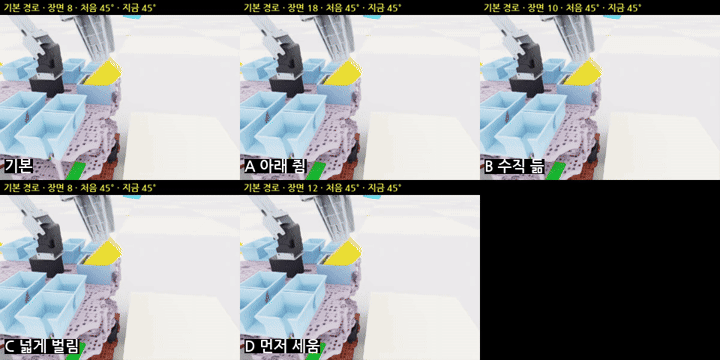
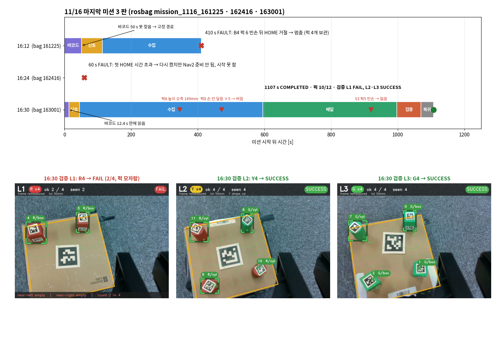

Date: 2026 Nov 16, Monday

## 오늘 배운 것
- 잘 되는 규칙 동작 위에 작은 보정만 더하는 강화학습은 빨리 배우고, 이미 되는 구간을 망가뜨리지 않는다 (38% → 84%)
- 어려운 구간만 더 많이 뽑아 학습해도 안 되면, 보정 크기로는 닿지 않는 문제다 → 동작 자체를 바꿔야 한다
- 실패 장면을 영상으로 보면 "언제" 넘어지는지 보인다 (쥐고 드는 순간)
- 기운 퍽을 쥐고 들 때 축 방향으로 들면 바닥이 벽에 끌려 손 안에서 돈다. 바로 위로 들면 바닥이 곧장 떨어진다
- 미션에서는 이상을 감지하는 것만으로는 부족하다. 감지한 뒤 다시 쥐기 · 빼기 같은 조치가 이어져야 퍽을 안 잃는다

 

## 오늘 한 것 

- [매니퓰레이터 학습 일지 (11/16)](manipulator_log.md)
- [미션 일지 (11/16)](mission_log.md)
- 받침 세우기 강화학습 환경 `env_stand.py`, `train.py --stand`
- `stand_s1` 600 iter, `stand_s2` 43–46° 집중 400 iter, 같은 장면 128개로 비교
- 43° 넘는 퍽 쥐는 동작 4가지 시험 (아래 쥠 · 바로 위로 들기 · 넓게 벌림 · 먼저 세움)
- 경기 마지막 미션 rosbag 3개 분석 → `archive/mission_bags/1116/`
- **경기 1등** 🏆

 

## 문제점
- 받침 세우기 기본 경로 성공 38%, 넘어짐 31%
- 43–46° 퍽은 학습 뒤에도 절반 가까이 넘어짐, 더 학습해도 그대로
- 미션: 16:12 · 16:24 판이 FAULT 로 멈춤
- 16:30 판 퍽 2개 잃음 (먼 퍽 손 안 닿음, 기울게 쥔 퍽이 칸에서 사라짐)

 

## 해결 방법

- 기본 경로에 관절 보정 ±0.05 rad 만 더하는 정책으로 학습
- 43–46° 장면을 절반 뽑아 더 학습 (s2) → 안 돼서 멈추고 영상으로 원인 확인
- 쥐는 동작을 4가지로 바꿔 43° 넘는 같은 퍽 75개로 비교
- 미션 로그에서 퍽마다 집기 · 넣기 · 꺼내기를 따라가 잃은 순간 찾음

 

## 결과

- s1: 성공 38% → 84%, 넘어짐 31% → 13% (43° 이하 94–96%)
- s2: 84% / 15%, 43–46° 는 52% → 57% 에 그침
- 쥐는 동작 B (처음 바로 위로 들기): 43° 넘는 퍽 성공 23% → 53%, 넘어짐 53% → 2% (학습 없이)
- 마지막 미션 16:30 판 완주, 퍽 10 / 12, 바코드 12.4 s → 신호 → 검증 L2 · L3 SUCCESS
- **경기 1등** 🏆

 

## 느낀 점

- 우리 Ninja Turtle 팀이 1등햇다!! 정말 1달동안 힘들었지만 보람찬다. 거의 혁무님의 체력과 클로트 엑스트라 비용과 시간이었지만 나도 한몫했다고 자부한다! 팀 모두 감사하다.

 

## 할 일

- B (바로 위로 들기) 를 기본 경로로 보정 학습 다시
- s1 정책을 실제 흐름에 끼워 보기, 실물에서 가능한지 확인
- 먼 퍽 몸 붙여 집기, 기울게 쥔 퍽은 다시 쥐기
- 팀장님 확인 뒤 `main` 에 밝기 수정 다시 커밋
