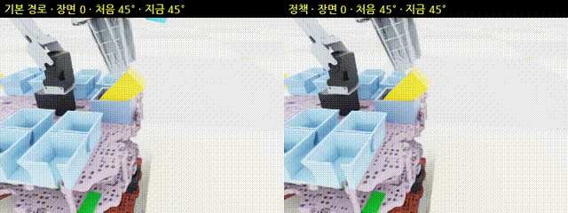
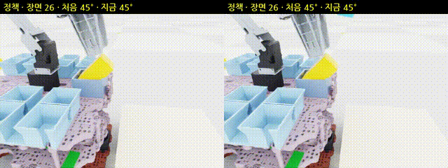
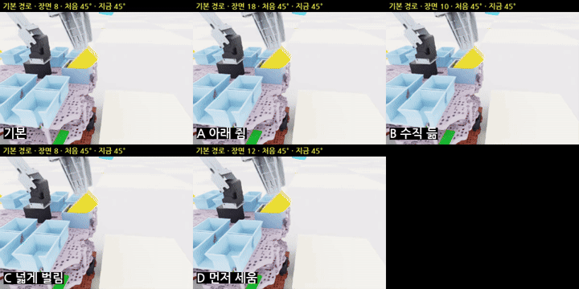

date: 2026.11.16

# Turtle Ninja 매니퓰레이터 학습 일지 (11/16)

> 작성: 김혜민 · 2026-11-16 (월)

오늘은 **받침 세우기를 강화학습으로 보정해서 성공 38% → 84% 로 올린 날**이에요.

- 받침 세우기 환경 `env_stand.py` 새로 만듦 (기운 퍽 자세 504개, 그중 368개는 기본 경로가 나옴)
- 정책은 들어서 세우기 기본 경로에 관절 보정 ±0.05 rad 만 더함
- `stand_s1` 600 iter: 같은 장면 128개에서 **성공 38% → 84%, 넘어짐 31% → 13%**
- `stand_s2` (43–46° 집중 400 iter 더): 나아지지 않음 (84% / 15%)
- 43–46° 는 쥐고 드는 순간 손 안에서 넘어감 → 보정이 아니라 동작 자체를 바꿔야 함
- 밤에 쥐는 동작 4가지 시험 → **처음 들 때 바로 위로 들기 (B)** 가 43° 넘는 퍽의 넘어짐을 53% → 2% 로 줄임

코드: `archive/manipulator/training2/env_stand.py`, `train.py --stand` · 기록: `training2/logs/20261116_*`

 

## 1. 환경 설계

| 항목 | 내용 |
|---|---|
| 시작 | 받침에 퍽을 35–50°, 바깥 방향 ±15° 로 기울여 가라앉힌 자세 504개. 팔은 "봄" 자세 |
| 기본 경로 | 11/15 의 들어서 세우기. 368개 나옴, 136개는 IK 안 됨 (거의 48° 넘는 퍽) |
| 행동 | 관절 5개 보정 ±0.05 rad (손끝 약 10 mm), 저역 필터 0.8, 그리퍼는 기본 경로 |
| 성공 | 손 뺀 뒤 기울기 3° 안 · 받침 가운데 5 mm 안 · 10 스텝 유지 |
| 감점 | 기울기가 처음보다 커짐 (넘어짐), 바퀴 뜸, 충돌, 몸체 밀림, 보정 크기 |

- 기본 경로 끝의 손 빼기를 15 mm 더 올림 (원래는 성공 기준 "손끝이 윗면 15 mm 위" 를 못 맞춤).
- 256 env, iter 하나 약 11 s → 600 iter 약 2시간.

 

## 2. 결과 (같은 장면 128개)

| 처음 기울기 | 기본 경로 | s1 (600 iter) | s2 (43–46° 집중 +400) |
|---|---|---|---|
| 40° 미만 | 49% | **94%** | 94% |
| 40–43° | 45% | **96%** | 96% |
| 43–46° | 35% | 52% | 57% |
| 46° 이상 | 0% | 76% | 67% |
| **전체 성공 / 넘어짐** | 38% / 31% | **84% / 13%** | 84% / 15% |

- 43° 이하는 거의 다 섬. 받침 가운데에서 6–8 mm 비켜 놓이던 것도 가운데로 맞춰 놓음.
- 학습 중에는 150 iter 즈음부터 보상이 평평해짐.

 

## 3. 43–46° 가 안 되는 이유 (장면 26, 처음 45°)

1. 손이 옆에서 들어가 가운데를 감쌀 때 퍽을 밀어 45° → 49°
2. 쥐고 "축 따라 살짝 듦" 을 시작하는 순간 손 안에서 바깥으로 넘어감 (44° → 54° → 61°)

s1 · s2 모두 같은 순간에 넘어져서, ±0.05 rad 보정으로는 안 되고 쥐는 위치 · 드는 방향을 바꿔야 해요. 43° 넘는 퍽은 실제 흐름에서 22번 중 3번 나왔어요.

 

## 4. 밤: 쥐는 동작 4가지 시험 (43° 넘는 퍽)

`env_stand.py paths --variant base|A|B|C|D --min_tilt 43` 로 43° 넘는 자세만 경로를 만들고, 학습 없이 기본 경로만 돌렸어요. 다섯 가지 모두 경로가 나온 같은 퍽 75개로 비교했어요.

| 성공 / 넘어짐 | 43–46° (43개) | 46° 이상 (32개) |
|---|---|---|
| 지금 그대로 | 23% / 53% | 3% / 62% |
| A 더 아래 쥠 (바닥에서 18 mm) | 0% / 84% | 0% / 56% |
| **B 처음 들 때 바로 위로 (+Z)** | **53% / 2%** | **56% / 3%** |
| C 넓게 벌리고 더 멀리서 들어감 | 28% / 56% | 6% / 56% |
| D 쥔 뒤 바닥 쪽 중심으로 먼저 1/3 세움 | 28% / 2% | 22% / 0% |

- 축 따라 들면 퍽 바닥이 받침 벽을 타고 끌리며 손 안에서 돌아요. 바로 위로 들면 바닥이 벽에서 곧장 떨어져서 안 넘어져요.
- B 는 경로가 나오는 자세도 늘었어요 (43° 넘는 239개 중 106 → 139).
- B 실패는 대부분 0° 로 섰지만 받침 가운데에서 5–9 mm 비켜 놓인 것 → s1 보정이 고쳤던 종류예요.
- 들어갈 때 손이 퍽을 미는 것 (C 로 겨냥) 은 주된 원인이 아니었어요.
- 기록: `training2/logs/20261116_stand_grasp.log`, `stand_grasp_*.npz` · `*.json`

 

## 다음 할 일

- [x] 43° 넘는 퍽: 쥐는 위치 · 드는 방향 바꾸기 → B (바로 위로 들기)
- [ ] B 를 기본 경로로 보정 학습 다시 (s1 과 비교)
- [ ] s1 정책을 받침 → 세우기 → 다시 쥐기 → 칸 흐름에 끼워 보기
- [ ] 실물에서 이 보정이 가능한지 확인
