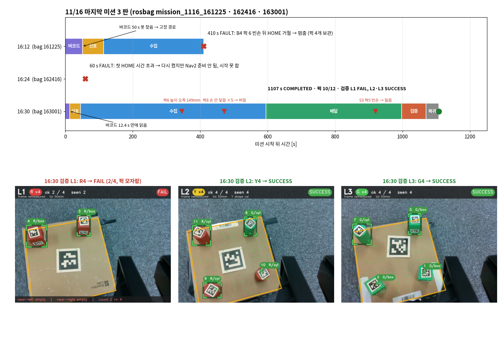

date: 2026.11.16

# Turtle Ninja 미션 일지 (11/16)

> 작성: 김혜민 · 2026-11-16 (월)

오늘은 **경기에서 우리 팀이 1등 한 날**이에요. 🏆

- 마지막 미션 rosbag 3개 (`mission_1116_161225` · `162416` · `163001`) 분석
- 16:30 판 **완주 (COMPLETED 1107 s), 퍽 10 / 12**, 검증 L2 · L3 SUCCESS, L1 FAIL (2/4)
- 세 판 모두 **바코드 먼저 → 광각 켜고 신호** 순서로 돎. 16:30 판은 바코드 12.4 s
- 잃은 퍽 2개: 퍽 8 (0.406 m, 팔이 안 닿음) · 퍽 5 (S3 에 기운 채 넣어 사라짐)
- 분석 정리: `archive/mission_bags/1116/README.md`

 

## 1. 세 판

| 판 (bag) | 바코드 → 신호 | 결과 |
|---|---|---|
| 16:12 (`161225`) | 바코드 50 s 못 찾음 → 옛 고정 경로 → 신호 `RGGYYGGYRRRY` | 410 s FAULT: B4 퍽 6 빈손 뒤 HOME 거절, 퍽 4개 보관 |
| 16:24 (`162416`) | 시작 전 | 60 s FAULT: 첫 HOME 시간 초과. 다시 켰지만 Nav2 준비 안 됨 |
| **16:30 (`163001`)** | **12.4 s** → 신호 `RGGYYGGYRRRY` (45 s) | **COMPLETED · 퍽 10 / 12** |

16:30 판: 바코드 0–13 s → 신호 13–45 s → 수집 45–595 s → 배달 595–997 s → 검증 997–1070 s → 복귀 1107 s. 배치는 L1 R4 · L2 Y4 · L3 G4.

 

## 2. 잃은 퍽

1. **퍽 8 (B5, 초록 원통)**: 몸에서 0.406 m. `PICK_UNREACHABLE` 5번 연속 → 버림. 몸을 더 붙이지 않음 (11/14 과 같은 문제).
2. **퍽 5 (B2, 빨강 네모)**
   - 집을 때 폭 45.2 mm → 놓고 다시 쥠
   - 손목 영상에서 −55° 기울게 쥔 게 보였지만 그대로 감
   - STORE 직전 접근축에서 21 mm 어긋남 (한도 8 mm) → 그대로 넣음
   - 넣은 뒤 윗면 +36.8 mm (허용 6 mm) → "판단 못 함 (로그만)"
   - 배달 때 RETRIEVE S3 빈손 → 잃은 것으로 처리 → L1 에 빨강이 모자라 2/4, 검증 FAIL

이상을 감지했는데 조치 없이 넘어간 게 핵심이에요.

 

## 3. 그 밖에

- 퍽 6 높이 오측: 149 mm (16:30) · 14 mm (16:12), 기대 67 mm. 몸에 가까운 퍽 (x 0.16–0.17 m). 뒤로 빠져 다시 집으니 됨.
- LOOK_RACK (보관 전 손 안 퍽 확인) 은 9번 모두 거절 → 그대로 STORE.
- 누운 · 가까운 퍽은 뒤로 빼고 집기가 잘 됨.
- 16:12 판: 바코드를 늦게 찾아 신호를 중간부터 봄 → partial 버리고 한 바퀴 더 기다림.

 

## 다음 할 일

- [ ] 먼 퍽 몸 더 붙여 집기
- [ ] 기울게 쥔 퍽 · 넣은 뒤 높이 이상은 다시 쥐거나 빼서 다시
- [ ] 가까운 퍽 높이 오측 원인
- [ ] LOOK_RACK 거절 원인
