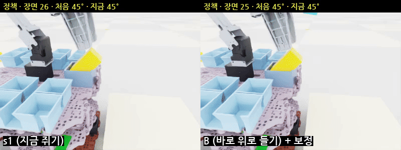
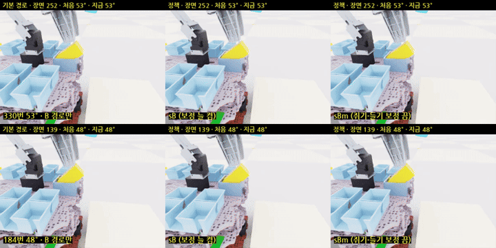

Date: 2026 Nov 17, Tuesday

## 오늘 배운 것
- 동작을 바꾸고 (바로 위로 들기) 그 위에 보정 학습을 다시 하니 어제 안 되던 43–46° 가 풀렸다 (50% → 93%)
- 정책이 "언제" 무엇을 해 주는지는 그 구간 보정을 꺼 보면 보인다. 쥐는 동안 퍽을 가운데로 맞추고, 손이 퍽을 덜 밀게 해 주고 있었다
- 비교는 같은 퍽끼리 해야 한다. 다른 묶음으로 비교해서 "46° 넘는 퍽에서 나빠졌다" 고 잘못 읽었다
- 판정 기준에 빈틈이 있으면 숫자가 실제보다 좋아 보인다 (끝에 기운 채 남은 퍽을 넘어짐으로 안 셈)
- 로봇에서 실제로 도는 코드는 실행한 폴더와 source 한 `setup.bash` 가 정한다 (젯슨은 `~/p2_integ`)
- 젯슨 ↔ OpenCR 패킷은 `AA 55 | 종류 | 길이 | 데이터 | 체크섬`, 같은 헤더를 양쪽이 같이 쓴다. 코드는 의존 관계 아래 (펌웨어) 부터 읽는다

 

## 오늘 한 것 

- [매니퓰레이터 학습 일지 (11/17)](manipulator_log.md)
- [코드 읽기 일지 (11/17)](code_log.md)
- 받침 세우기: B 경로로 다시 학습 (`stand_sB`), 쥐기 · 들기 보정 끄기 시험 → 다시 학습 (`stand_sBm`), 46° 넘는 퍽 넘어짐 영상 분석
- `play --mp4` 영상 안 생기던 버그 고침 (tmux 뒤 ffmpeg 멈춤)
- 11/13–11/16 일지를 개인 노션 · 팀 노션 (개인 일지 DB) 에 올림
- 로봇 코드 첫 단추부터 읽기: `run_robot.sh` → launch → 펌웨어 4개 파일 (`feat/integ-1110`)
- 광각 밝기: 혁무님 PR #19 에 이미 있어서 브랜치 따로 안 만들기로 함

 

## 문제점
- 어제 정책 (s1) 은 43–46° 퍽의 절반이 쥐고 들 때 넘어짐
- B 로 다시 학습한 뒤에도 46° 넘는 퍽은 약 20% 가 넘어짐
- 넘어짐 판정이 끝에 기운 채 남은 퍽을 못 잡음
- 정책 실행 영상 (mp4) 이 안 생기고 영상 하나에 15분씩 걸림
- 코드가 커서 어디서부터 읽어야 할지 모름

 

## 해결 방법

- 어제 시험에서 가장 좋은 B (바로 위로 들기) 로 경로 은행 다시 만들고 600 iter 학습
- 넘어지는 순간 (쥐고 들기) 만 보정을 끄고 다시 학습해 봄 → 효과 없음 확인
- 46° 넘는 퍽 89개를 "누가 넘어뜨리나" 로 나누고, 대표 퍽 2개를 세 방식으로 영상 비교
- ffmpeg 에 `stdin=subprocess.DEVNULL`
- 11/16 rosbag 에 실제로 찍힌 토픽으로 "만들어진 순서" 를 정하고 그 순서로 읽음

 

## 결과

- sB: 43–46° **성공 50% → 93%, 넘어짐 50% → 7%**, 전체 86% / 12% → 89% / 7%
- sBm (쥐기 · 들기 보정 끔): 82% / 13% 로 sB 보다 나쁨 → sB 가 제일 좋음
- 46° 넘는 넘어짐은 두 종류: 50–55° 퍽은 들 때 손 안에서 돌고, 46–49° 퍽은 손이 들어오며 53° 까지 밂
- 코드 생성 순서 13단계 정리, 펌웨어 4개 파일 읽음

 

## 느낀 점

- 간만에 리뷰좀 했다. 우리가 뭘했나.. 난 뭘 했나... 뭘 했나..? 무튼 결과가 좋게 나왔으니 뭐라도 했겠지.. 그래도 뿌듯하다. 다시 코드들을 이제는 알아볼 수 있게 클로들와 함께 리뷰 하는데.. 하나하나씩 코드 장들을 살펴보려니 어느 세월에 이걸 다 보게 될까.. 까마득하긴 하다. 

 

## 할 일

- 쥐는 순간 퍽 기울기를 모든 퍽에서 재기, 손이 퍽을 밀지 않게 들어오는 길 바꾸기
- 넘어짐 판정 고치기, sB 정책을 실제 흐름에 끼워 보기
- 팀장님께 PR #19 merge 부탁 → `main` pull 뒤 `wide_brightness` 확인
- 펌웨어 다음 (hardware) 코드 읽기
