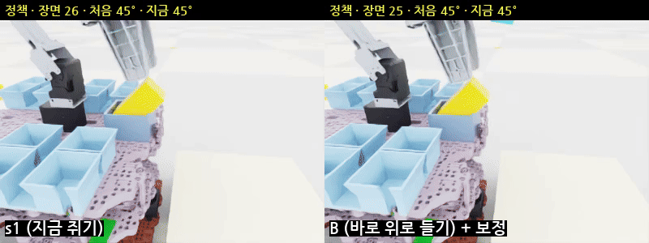
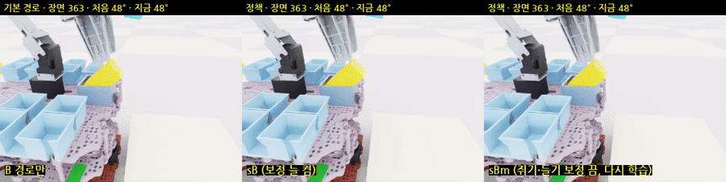
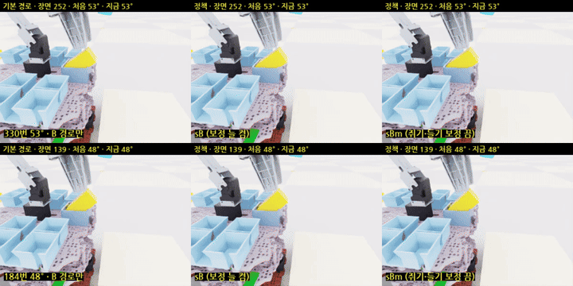

date: 2026.11.17

# Turtle Ninja 매니퓰레이터 학습 일지 (11/17)

> 작성: 김혜민 · 2026-11-17 (화)

오늘은 **"바로 위로 들기 (B)" 로 받침 세우기를 다시 학습하고, 46° 넘는 퍽이 왜 넘어지는지 파고든 날**이에요.

- B 경로로 다시 학습 (`stand_sB`, 600 iter): 43–46° 퍽 **성공 50% → 93%, 넘어짐 50% → 7%**
- 46° 넘는 퍽은 아직 넘어짐 약 20% 남음
- "쥐기 · 들기 구간 보정 끄기" 시험 (학습 없이 → 다시 학습 `stand_sBm`): 46° 넘는 퍽은 그대로, 낮은 퍽이 새로 넘어져 **sB 보다 나쁨**
- 46° 넘는 넘어짐은 두 종류: 50–55° 가파른 퍽은 들 때 손 안에서 돌고, 46–49° 퍽은 손이 들어오며 퍽을 53° 까지 밀어 놓음
- 정책 실행 (`play --mp4`) 영상이 안 생기던 버그 원인 찾아 고침
- 11/13–11/16 일지를 개인 노션 · 팀 노션에 올림

코드: `archive/manipulator/training2/env_stand.py`, `train.py --stand` · 기록: `training2/logs/20261117_*`

 

## 1. B 경로로 다시 학습 (sB)

- 어제 시험에서 가장 좋았던 **B (쥔 뒤 처음 들 때 퍽 축 대신 바로 위로 듦)** 를 기본 경로로 경로 은행을 다시 만듦 → `logs/stand_bank_B.npz` (자세 504개 중 388개 경로 나옴, 어제 v1 은 368개)
- 같은 설정 (관절 보정 ±0.05 rad, 256 env) 으로 600 iter → `logs/20261117_085931_stand_sB/model_600.pt`

같은 퍽 337개, 성공 / 넘어짐:

| 처음 기울기 | s1 (어제, 축 따라 듦) | **sB (바로 위로 듦)** |
|---|---|---|
| 40° 미만 | 95% / 1% | 94% / 2% |
| 40–43° | 91% / 9% | 91% / 0% |
| 43–46° | 50% / 50% | **93% / 7%** |
| 46° 넘음 | 76% / 24% | 62% / 36% |
| 전체 | 86% / 12% | **89% / 7%** |

- 504개 전체 (경로 안 나오는 자세 포함) 로 보면 성공 309 → 342개
- 어제 남은 문제였던 43–46° 는 해결

 

## 2. 46° 넘는 퍽: 정책을 붙이면 넘어지나?

- 영상 (467번 48°, 173번 46°): 정책을 붙이면 **쥐고 바로 위로 들기 시작하는 순간 손 안에서 바깥으로 돎** (48° → 62°, 52° → 66°)
- 173번은 B 경로만으로도 덜 세운 채 내려놓아 58° 로 기울었는데, 넘어짐 기준 ("처음보다 15° 넘게 더 기욺" = 61°) 에 안 걸려서 넘어짐으로 안 셈 → **판정 빈틈**. B 경로만일 때 끝에 10° 넘게 기울었는데 넘어짐으로 안 센 퍽이 39개
- 비교 영상에서 정책 칸이 중간에 멈춘 것처럼 보인 건 정책 문제가 아니라, 넘어짐 판정이 나면 그 판이 바로 끝나서 영상이 짧아진 것 (65장 vs 132장)

 

## 3. 쥐기 · 들기 구간 보정 끄기 (sBm)

생각: 넘어지는 순간이 쥐고 드는 때니까, 그 구간만 정책 보정을 0 으로 두고 든 뒤부터 보정하면?

- 경로 은행에 "살짝 든 뒤 첫 경유점 번호" (`kfree`) 를 넣고, 그 전까지 보정 0 (`cfg.mask_grasp`, `play --mask`)
- 먼저 학습 없이 sB 정책에 걸어 봄 → 다시 학습 (`stand_sBm`, 600 iter)

같은 퍽 384개, 성공 / 넘어짐:

| 처음 기울기 | B 경로만 | sB | 끄기만 (학습 없이) | **sBm (다시 학습)** |
|---|---|---|---|---|
| 40° 미만 | 50 / 12% | **94 / 2%** | 61 / 12% | 81 / 15% |
| 40–43° | 51 / 2% | 91 / 0% | 68 / 2% | 96 / 4% |
| 43–46° | 50 / 4% | 93 / 7% | 65 / 2% | 96 / 2% |
| 46° 넘음 | 25 / 25% | 71 / 22% | 46 / 27% | 71 / 20% |
| 전체 | 45 / 13% | **88 / 7%** | 59 / 13% | 82 / 13% |

- 끄기만 하면 넘어짐이 B 경로만 수준으로 돌아가고, 0° 로 섰는데 가운데에서 5–7 mm 벗어난 실패가 늘어남 → **정책은 쥐는 동안 퍽을 가운데로 맞추고 있었음**
- 다시 학습해도 46° 넘는 퍽은 그대로 (22% → 20%), 대신 33–36° 낮은 퍽이 30개 새로 넘어짐
- 467 · 173번처럼 sB 가 넘어뜨리던 퍽은 sBm 에서 섬
- 같은 퍽으로 다시 보니 46° 넘는 구간에서 sB 는 B 경로만보다 나쁘지 않음 (넘어짐 22% vs 25%). 앞에서 "나빠졌다" 한 건 s1 과 다른 퍽 묶음으로 비교한 탓
- 결론: **지금은 sB 가 제일 좋음**. 쥐기 구간 보정 끄기는 답이 아님

 

## 4. 46° 넘는 퍽의 넘어짐 들여다보기

46° 넘는 89개를 "누가 넘어뜨리나" 로 나눔:

| | 넘어짐 | 넘어진 퍽 평균 처음 기울기 |
|---|---|---|
| B 경로만 | 22 | 51.1° |
| sB | 20 | **48.7°** |
| sBm | 18 | 51.7° |

- **50–55° 가파른 퍽**: B 경로만 · sBm 은 넘어뜨리고 sB 는 살림 (9개). sB 는 쥐는 동안 보정으로 버팀
- **46–49° 퍽**: sB 만 넘어뜨림 (12개)
- 영상 (330번 53°, 184번 48°):
  - 330번: 들 때 손 안에서 53° → 57° → 61° (B 경로만). sB 도 57° 까지 갔다가 다시 세움
  - 184번: **손이 옆으로 들어와 감쌀 때 세 경우 모두 퍽을 48° → 51° → 53° 로 밂**
- 짐작: 쥐는 순간 53° 언저리면 들 때 손 안에서 돌기 쉬움 (영상 2개에서 본 것, 모든 퍽에서 재지는 않음)

 

## 5. 영상 버그 고침

- `env_stand.py play --mp4` 가 mp4 를 안 만들던 이유: tmux 뒤에서 돌 때 ffmpeg 가 키보드 입력 (stdin) 을 읽으려다 멈춤 (멈춤 상태 T). `timeout` 이 끝낼 때까지 영상 하나에 15분씩 걸렸음
- `subprocess.run(..., stdin=subprocess.DEVNULL)` 로 고침 → 바로 mp4 나옴

 

## 다음 할 일

- [ ] 쥐는 순간 퍽 기울기를 모든 퍽에서 재서 넘어짐과 관계 확인
- [ ] 손이 퍽을 밀지 않게 들어오는 길 바꾸기
- [ ] 넘어짐 판정: 끝에 기울어 있는 퍽도 넘어짐으로 세기
- [ ] sB 정책을 실제 흐름 (`stand_loop`) 에 끼워 보기, 실물에서 가능한지 확인
