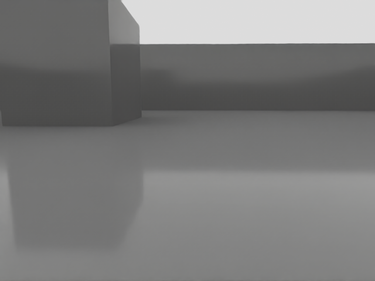
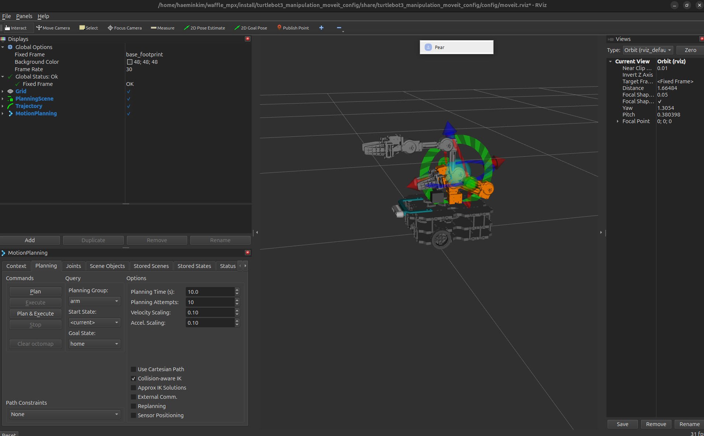

date: 2026.11.26

# ReAct · Waffle MPX 일지 (11/26)

> 작성: 김혜민 · 2026-11-26 (목)
> 강의 자료: [13강. ReAct와 Tool Use (드라이브 PPT)](https://docs.google.com/presentation/d/16Anjh3qNQQir5wTxjD1Pa__6dpp8TdKWQFrltp_H12A/edit) · [실습 코드 (GitHub lessons/13-react)](https://github.com/SpartaPA/waffle-mpx-lyrical/tree/main/lessons/13-react)

오늘은 **13강 ReAct와 Tool Use 를 배우고, pa06 팔을 표준 상태로 되돌린 뒤 Isaac Sim 실습 · MoveIt2 실물 · 자연어 에이전트까지 이어 간 날**이에요.

- 13강: 실행기가 도구를 고르고, 호출 예산 · 시간 초과 같은 이유로 멈추는 구조
- joint1 이 180° 어긋나 있었음 → 혼을 다시 끼우고 OpMode 3 으로, manipulation 펌웨어 복구
- 13강 실습 5개 (촬영 · 촬영 생략 · 전진 · 빨강 / 파랑 집기) 를 Isaac Sim 6.1 에서 성공
- MoveIt2: RViz 버그 → ROS 패키지 업그레이드로 해결, 실물 팔 움직임. 떨림은 모터 프로파일로 줄임
- 실물 자연어 명령 · 퍽 인식 · gemma4 에이전트를 만들고 계획 모드로 확인 (실물 집기는 아직)

 

## 1. 13강 ReAct와 Tool Use

- 실행기는 생각 → 도구 호출 → 관측을 반복. 도구는 `read_scan` (라이다 거리), `take_photo`
- 등록 안 된 도구 (`locate_cup`) 를 부르면 `unknown_tool`
- 종료 이유: `photo_saved` · `outside_threshold` · `budget_exhausted` · `unknown_tool` · `timeout`
- **호출 예산** = 도구를 부를 수 있는 최대 횟수. 예산이 1 이면 `read_scan` 에서 다 써서 사진은 못 찍고 `budget_exhausted`

### `/scan` 을 2초 동안 못 받으면

| | 상황 | 거리 | 결과 |
|---|---|---|---|
| `timeout` | 메시지가 안 옴 | **모름** | 판정 불가 → 종료 |
| `outside_threshold` | 받았는데 멀리 있음 | 예: 0.86m (기준 0.2m) | 조건 불만족 → 종료 |

- timeout 에 0m 를 넣으면 "아주 가깝다" 로 보고 `take_photo` 를 고름 → 관측이 없으면 가짜 값 대신 "값 없음" 으로 남기고 이전 관측 시각을 보존
- 재현: `ROS_DOMAIN_ID=112 python3 waffle_react.py --timeout 2` (112 번에는 `/scan` 을 내보내는 곳이 없음)
- 12강의 `free(B) = unknown` 과 같은 이야기

 

## 2. pa06 팔을 표준 상태로

### 원인 찾기
- 팔 관절 값이 URDF 범위 밖이라 `arm_controller` 가 `unconfigured`
- 모터 상태를 읽으려고 OpenCR 에 USB-to-DXL **브리지 펌웨어** 를 올림 (노트북에서 빌드)
  - `opencr_ld_shell` 은 `[NG] not opencr fw` → `.bin` 은 `opencr_ld` 로 올려야 함
- 읽은 결과: Homing Offset 은 모두 0 (리셋할 것 없음), **joint1 만 OpMode 4** (확장 위치 모드)
- 팀 스워브 설정 (`zero_tick: 8`) 대로 joint1 혼이 180° 돌아간 채 조립돼 있었음 → 정면인데 눈금 8 → -3.13 rad 로 읽힘

### 왜 숫자로 못 고치나
- 다이나믹셀은 한 바퀴 = 4096 눈금, 2048 = 정면 (0 rad). `관절 rad = (눈금 − 2048) × 2π/4096`
- Homing Offset 으로 +2040 을 더하면 되지만, 위치 모드 (3) 는 **±1024 (±90°)** 까지만 됨
- 확장 모드 (4) 는 켤 때 0~4095 안에서 시작해서, 정면이 0 / 4095 경계에 있으면 켤 때마다 값이 달라질 수 있음

### 한 것
| 순서 | 내용 | 결과 |
|---|---|---|
| 1 | 팔은 정면 그대로, joint1 혼만 180° 돌려 다시 끼움 | 눈금 2034, -0.021 rad |
| 2 | 다시 조립하다 빠진 joint1 → joint2 케이블 다시 꽂음 | ID 11~15 모두 응답 |
| 3 | joint1 OpMode 4 → 3 (`write1ByteTxRx(p,11,11,3)`) | `OpMode 3` |
| 4 | manipulation 펌웨어 다시 올림 (`.opencr` → `opencr_ld_shell`) | OpenCR ID 200 응답 |
| 5 | URDF · ros2_control 의 joint2 하한 `-pi*0.57 → -pi*0.7`, joint3 상한 `pi*0.44 → pi*0.5`, SRDF `home = (0, -2.0, 1.5, 0.7)` | 컨트롤러 모두 active |

- 펌웨어 업로드로는 모터 설정이 안 바뀜 (ID · Homing · OpMode 는 각 모터 EEPROM)
- teleop 을 꺼도 토크는 유지됨. 토크를 빼려면 bringup 을 꺼야 함
- 저장소는 `~/waffle_mpx/src` 에 통째로 있음 → `git pull` 은 거기서

 

## 3. 13강 실습 (Isaac Sim 6.1)

- 모델: Qwen2.5 1.5B (Ollama, 986MB), SmolVLM2-500M (4.8GB)
- 0단계 (LLM 만): `"20센티미터 이내에 물체가 있으면 사진을 찍어 줘."` → `{'intent': 'photo', 'meters': 0.2}`
  - "사진 찍어줘" 에 거리가 없는데 0.2 를 지어냄 (프롬프트 예시를 베낌). 실행기는 숫자 범위만 검사해서 통과시킴
  - "빨간 블록 집고 앞으로 가" → drive 0.5 (여러 동작이면 unsupported 여야 함). 0.15m 제한 덕분에 거부됨
  - 한글 입력을 지웠다 다시 쓰면 "찍어 줘" 가 "찍 줘" 로 들어간 적 있음 (조합 중 Backspace)

| 실험 | 결과 |
|---|---|
| 1.5m 안이면 촬영 | 거리 0.887m, yes 8.20 / no 7.79 → `capture` |
| 20cm 안이면 촬영 | 거리 0.904m, yes 8.023 / no 8.031 → `skip` (`range_allowed: false`) |
| 10cm 전진 | 왼쪽 0.1002m, 오른쪽 0.1045m |
| 빨강 블록 집기 | `success: true`, 들어 올림 5.95cm, 놓은 위치 오차 약 6.1mm |
| 파랑 블록 집기 | `success: true`, 오차 약 6.6mm |

- `outcome.json` 의 `action` 은 VLM 이 yes 라고 하고 **그리고** 거리가 기준 이하일 때만 `capture`. 20cm 실험은 VLM 이 거의 50:50 이었지만 코드 조건이 막음
- 빨강 ↔ 파랑 단어 하나만 바꿨는데 다른 블록을 집음 → VLA 가 언어를 실제로 씀
- 두 번 다 목표보다 약 6mm 앞에 놓음 → 같은 방향으로 치우치는 오차
- 결과 파일: `~/waffle_mpx/lesson13-photo` · `-photo-20cm` · `-drive` · `-red` · `-blue`

 

## 4. MoveIt2

- mock (노트북 안 가짜 로봇) 에서 먼저 연습 → 실물
- home 으로 안 감: `Found a contact between 'link5' and 'link2'` → SRDF 에 이 쌍 충돌 검사 끄기 추가
- 그래도 RViz 드롭다운 (Goal State · Planning Group) 이 안 먹음
  - RViz 로그: `No such signal QComboBox::activated(QString)` → Qt6 에서 없어진 신호를 쓰는 MoveIt 버그 ([moveit2#3744](https://github.com/moveit/moveit2/issues/3744), 수정 [#3823](https://github.com/moveit/moveit2/pull/3823))
  - 설치된 2.15.0 이 수정 하루 전 빌드였음
  - MoveIt 패키지만 올렸더니 `undefined symbol: has_buffer_fields_std_msgs__msg__Header` → `ros-lyrical-*` 전체 업그레이드 + 다시 빌드로 해결
- 실물: `ROS_DOMAIN_ID=63` (파이와 같게), `ROS_LOCALHOST_ONLY` 해제

### 팔 떨림
- 파이 bringup 로그: `Overrun detected! ... missed its desired rate of 50 Hz. The loop took 144 ms` (쓰기 125ms) → 실제 약 7Hz
- 속도 · 가속을 낮춘 설정 (100/20) 은 더 나빴고, **프로파일 0/0** 으로 움직일 때 떨림이 사라짐
- 툭 치면 계속 출렁이는 건 모터 PID 에 D (감쇠) 가 0 이라서. manipulation 펌웨어로는 게인을 못 바꿈
- 오후에 로봇 배터리가 다 돼서 어댑터 전원으로 바꿈

 

## 5. 실물 자연어 명령 · 퍽 집기 (`~/waffle_mpx/real_react/`)

- `real_command.py`: 문장 → 도구 하나 (주행 · 팔 · 집게). 정면 장애물이 가까우면 `{"result": "blocked", "clearance_m": 0.218}`
- 노트북이 파이 토픽을 못 받음 → 와이파이가 자동 탐색 (멀티캐스트) 을 막음

| 설정 | /odom | /scan |
|---|---|---|
| 기본 | 0개 | 0개 |
| `ROS_STATIC_PEERS=10.2.150.176` | 137개 (6.9Hz) | 200개 (10Hz) |

- 퍽 찾기 (`find_puck.py`)
  - 팀 YOLO 모델 3개는 파란 퍽을 못 찾음 (실물 파인튜닝 모델 클래스가 red_cyl · green_cyl 뿐)
  - 색 (HSV) + 깊이: 0.433m, 로봇 기준 x 0.55, 지름 0.031m (규격 Ø30mm 와 맞음)
  - 깊이 카메라가 재는 거리와 팔이 닿는 거리가 거의 안 겹침. MoveIt 계획으로 x 0.20~0.26 은 닿고 0.29 부터 안 닿음
- `react_agent.py`: gemma4 가 `look` · `drive` · `pick` · `put_down` · `place_on` 등을 스스로 조합 (ReAct)
  - 계획 모드에서 "파란 퍽 집어서 왼쪽으로 5센티" 5단계 완료, 빨간 퍽이 없으면 `fail`, "춤춰" 는 바로 `fail`
  - 고친 것: 퍽 폭 필터 하한 18mm → 12mm, 지시 받으면 바로 실행 (`--confirm` 은 선택), 깊이로 앞 상자까지 거리를 재서 그 이상 안 감, "보기 → 조금 이동 → 다시 보기" 반복
  - 오도메트리는 53cm 라는데 실제는 약 39cm (카펫 미끄러짐 · 전원선)
  - 초록 퍽을 파란 퍽 위에 쌓는 7단계가 계획 모드에서 통과. **실물에서는 아직 안 해 봄**

 

## 다음 할 일

- [ ] 실물에서 `react_agent.py` 로 퍽 집기 · 쌓기
- [ ] 팔 떨림: `dxl_joints_profile_velocity 30` · `acceleration 0` 시험 후 bringup 재시작
- [ ] 13강 `waffle_react.py` 비교 실험 (호출 예산 · 잘못된 도구 · timeout)
- [ ] 0단계에서 본 LLM 약점: 문장에 숫자가 없으면 `unsupported` 로 바꾸는 검사 추가
- [ ] 파이 IP 가 바뀌면 `~/.ssh/config` 와 `ROS_STATIC_PEERS` 둘 다 고치기
