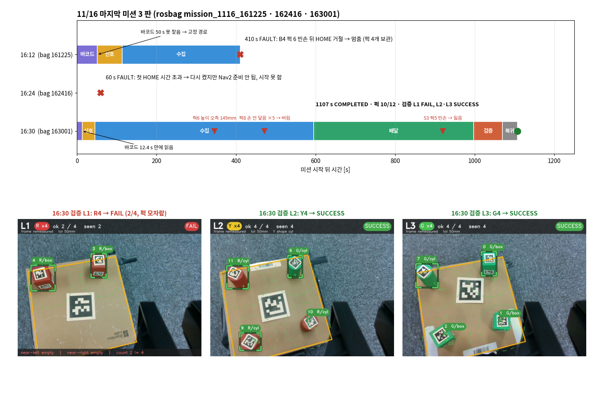

# 11/16 마지막 미션 rosbag 3 개 분석

> 젯슨 `~/bags/mission_1116_161225` · `mission_1116_162416` · `mission_1116_163001`
> 실행 로그 `~/p2_integ/runs/robot_mission_opencr_20261116T*` · 계획 기록 `~/planning_logs/run_20261116_161350`, `run_20261116_163125`

## 한눈에

| 판 (bag) | 바코드 → 신호 | 결과 |
|---|---|---|
| 16:12 (`161225`) | 바코드 50 s 동안 못 찾음 → 옛 고정 경로로 읽음 → 신호 `RGGYYGGYRRRY` | **410 s FAULT** — B4 퍽 6 빈손 뒤 HOME 거절, 퍽 4 개 보관한 채 멈춤 |
| 16:24 (`162416`) | 시작 전 | **60 s FAULT** — 첫 HOME 시간 초과. 16:27 다시 켰지만 Nav2 · 위치 준비가 안 돼서 시작 못 함 |
| **16:30 (`163001`)** | 바코드 **12.4 s** 만에 읽음 → 출발 자리에서 신호 `RGGYYGGYRRRY` (45 s) | **COMPLETED 1107 s · 퍽 10 / 12** · 검증 L1 FAIL (퍽 2/4), L2 · L3 SUCCESS |

- 세 판 모두 **바코드 먼저 → 광각 켜고 신호** 순서로 돌았어요.
- 16:30 판 배치: L1 R4 · L2 Y4 · L3 G4 (descending).

## 16:30 판 흐름 (완주한 판)

| 시간 [s] | 단계 | 내용 |
|---|---|---|
| 0 – 13 | 바코드 | 벽 판 훑기 1 번에 P2-02 읽음 |
| 13 – 45 | 신호 | 출발 자리 0.05 m 뒤로 가서 12 점멸 기록 |
| 45 – 595 | 수집 | B1 (3, 4) → B2 (5, 10) → B4 (9, 6) → B5 (1, 8 실패) → B6 (2, 0) → B3 (11, 7) |
| 595 – 997 | 배달 | L3 4 개 → L2 4 개 → L1 2 개 |
| 997 – 1070 | 검증 | L1 FAIL · L2 SUCCESS · L3 SUCCESS |
| 1070 – 1107 | 복귀 | 출발점 |

## 잃은 퍽 2 개

1. **퍽 8 (B5, 초록 원통) — 팔이 안 닿음**
   - 퍽이 몸에서 0.406 m 앞에 있었어요. `PICK_UNREACHABLE` (높이 30 mm 손 IK 안 됨) 이 5 번 연속 (464 – 472 s).
   - 몸을 더 가까이 붙이지 않고 같은 자리에서 다시 시도만 해서 버렸어요. 11/14 퍽 6 (0.377 m) 과 같은 문제예요.
2. **퍽 5 (B2, 빨강 네모) — 적재함 S3 에 넣은 뒤 사라짐**
   - 집을 때 폭이 45.2 mm 로 재어져 한 번 놓고 다시 쥠 (221.8 s).
   - 손목 영상에서 기울기 −55° 로 쥔 게 보였지만 "다시 쥐지 않고 쥔 그대로" 넣음 (226.9 s).
   - STORE 직전: 접근축에서 21 mm 어긋남 (한도 8 mm) → **어긋남** 으로 찍혔는데 그대로 넣음 (230.1 s).
   - 넣은 뒤: 윗면이 기준보다 +36.8 mm 높음 (허용 6 mm) → **판단 못 함 (로그만)** (236.5 s). 칸에 안 들어가고 걸쳐 있었던 걸로 보여요.
   - 배달 때 RETRIEVE S3 빈손 (920 s) → 적재함 스캔에서 S3 비어 있음 → 잃은 것으로 처리.
   - 그래서 L1 (R4) 에 빨강 퍽이 2 개 모자라 2/4 만 놓았고, 검증 L1 이 FAIL 이에요. 퍽 8 이 초록이라 L1 에는 퍽 5 가 결정적이었어요.

## 그 밖에 본 것

- **퍽 높이 오측**: 퍽 6 (B4) 높이가 149 mm 로 재어져 control 이 거절 (16:30, 345 s). 16:12 판에서도 같은 퍽 6 이 14 mm 로 재어져 거절됐어요. 두 판 다 퍽이 몸에서 x 0.16 – 0.17 m 로 가까웠고, 뒤로 빠져서 다시 집으니 됐어요 (16:30).
- **LOOK_RACK 은 매번 거절**: 보관할 때마다 `arm:LOOK_RACK 거절 () → 그대로 STORE` (16:30 판 9 번). 11/14 와 같아요.
- **누운 · 가까운 퍽은 뒤로 빼고 집기**가 잘 됐어요 (B1 퍽 3, B4 퍽 9 · 6).
- **검증 깊이 오류**: L2 퍽 9 (10 장), L3 퍽 2 (3 장) 깊이가 틀렸지만 그 전 맞는 장으로 판정해서 SUCCESS.
- **16:12 판 FAULT**: 퍽 6 빈손 뒤 "받침에 퍽이 남았을 수 있음" 으로 HOME 이 계속 거절 → 멈춤. resume 하면 COLLECT 이어 하도록 task 는 남겨 둠.
- **16:12 판 신호**: 광각을 켠 순간 (66.7 s) 부터 기록이 시작돼서 첫 시퀀스를 중간부터 봄 → partial 로 버리고 다음 시퀀스로 DONE (113.4 s). 바코드를 늦게 찾으면 신호 대기가 그만큼 길어져요.
- **16:24 판**: 시작하자마자 첫 HOME 이 60 s 시간 초과.

## 파일

- `mission_1116_summary.png` — 위 그림 (세 판 시간표 + 16:30 검증 사진)
- `planning_1630/` — 16:30 판 검증 (`verify.yaml`, `verify_L1~3.jpg`), 신호, 할당 기록
- `planning_1612/` — 16:12 판 신호 (`signal.json`, 중간부터 본 `signal_partial1.json`)
- `timeline/` — 판마다 mission_manager 로그 (미션 시작 = 0 s)
